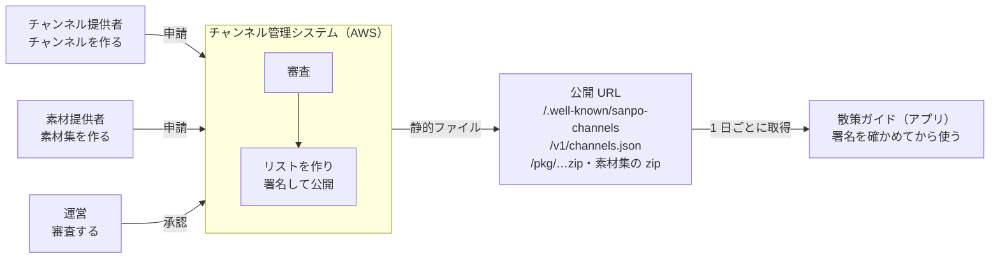

# 0-1 何を作っているのか

[目次](../README.md) ＞ 第 0 部 ＞ 0-1

## この章で学ぶこと

- 散策ガイド（SanpoGuide）とチャンネル管理システム（yorisoi-console）が、それぞれ何をするのか
- 2 つのシステムがどこでつながっているのか
- このチュートリアル全体を通して出てくる言葉（チャンネル、素材、散策者、チャンネル提供者、素材提供者、運営、リスト）

## 散策ガイド: 一緒に歩く Android アプリ

散策ガイドは、散歩についてきて話しかけてくれる Android アプリです。

- 地図に、近くの史跡・寺社・公園などを出す（データは OpenStreetMap から）
- スポットに近づくと、AI が作った解説を声で読み上げる
- 歩いた距離・時間、天気の急変、日の入り、近くのトイレや休憩所などに合わせて話しかける
- 散歩の記録を端末に残す

画面を閉じても動き続ける **常駐サービス**（`WalkService`）が、位置・天気・周りのスポットを見て「いま何を話すか」を決めます。文章は AI（Claude や OpenAI 互換のサービス）に作らせ、端末の読み上げ機能（TTS）で声にします。

## チャンネル: 語り手を切り替える

散策ガイドには **チャンネル** という仕組みがあります。チャンネルは、語り手の口調・話題・話しかける場面と頻度をひとまとめにしたものです。アプリには「標準」「歴史探訪」「自然観察」「しずかに」「グルメの旅」「ショッピング」の 6 つが入っています。

チャンネルの中身は主に **プロンプト**（AI への指示文）と設定値です。つまり、チャンネルを変えると AI への頼み方が変わり、話す内容が変わります。

## チャンネル管理システム: 第三者のチャンネルを審査して届ける

アプリに入っている 6 つだけでなく、観光協会・お店・愛好会などの **第三者** が作ったチャンネルも使えるようにしたい。ただし、だれでも自由にチャンネルを配れると、不適切な内容や危険な案内（「立入禁止の場所に入ろう」など）が混ざるおそれがあります。

そこで、**運営が審査し、合格したものだけをアプリに届ける** ことにしました。これを担うのがチャンネル管理システム（yorisoi-console）です。AWS の上で動きます。

## 素材: チャンネルが見せる文字・画像

第三者のチャンネルは、語り手を変えるだけでなく、**素材**（文字・画像。将来は音声・映像も）を見せることもできます。「この寺に近づいたら、観光協会の解説と写真を出す」のように、**きっかけ**（スポット・地点・散歩の開始などの出来事）と **見せ方**（読み上げ・カード・通知など）を決めて出します。

素材は、チャンネルとは別の **素材集** として作り、チャンネルとは別に審査します（SanpoGuide の [ADR-002](../../yorisoi-platform/docs/adr/ADR-002-material-producers.md)）。観光協会や写真家が、チャンネルを作らなくても素材を届けられるようにするためです。素材集を作る人が、どのチャンネル提供者に使わせるかを決めて署名します。

AI の解説や Wikimedia の写真、背景音のように、アプリが自分で用意する素材もあります。アプリは、どの出どころの素材も同じ形（`Producer`）で扱います。今のアプリが出せるのは文字と画像までです（第 1 段）。くわしくは [5-4](../05-station-format/04-materials-cues.md) で扱います。

## 登場人物

このチュートリアルでは、次の言葉を区別して使います。呼び方は 2 つのリポジトリで共通で、正本は [yorisoi-platform/docs/stakeholders.md](../../yorisoi-platform/docs/stakeholders.md) です。

| 言葉 | だれ・何か | 例 | コード上の名前 |
|---|---|---|---|
| **散策者** | アプリで散歩する人 | — | `user` |
| **チャンネル提供者** | チャンネルを作って申請する第三者 | 鎌倉歴史散歩の会 | `publisher` |
| **素材提供者** | 素材集を作って申請する第三者。アカウントはチャンネル提供者と共通 | 観光協会、写真家 | `producer` |
| **運営** | 申請を審査し、承認・取り下げをして、リストに署名して公開する。人を指すときは「運営の担当者」 | 当面は開発者本人 | `operator` |

もう 1 つ、人ではない大事な言葉があります。

| 言葉 | 何か | 例 | コード上の名前 |
|---|---|---|---|
| **リスト** | 運営が署名して公開する、承認済みのチャンネルと素材集の一覧（承認済みチャンネル・リスト）。散策者は URL と **リストID**（`sc1…`）でアプリに足す。役割として言うときは「リストの発行元」 | 「SanpoGuide 公式チャンネル」 | `provider` |

**チャンネル提供者はチャンネルを作る人、リストは運営が出すチャンネルの一覧** です。コードや JSON の項目名（`publisher`・`producer`・`provider`）は変わっていないので、コードを読むときは右の列と見比べてください。

> 呼び方は 2026-10-12 にそろえました。それより前に書かれたコミットや文書では、散策者を「利用者」、チャンネル提供者を「配信元」、素材提供者を「制作元」、リスト・リストID を「提供元・提供元ID」、運営を「運用者」と呼んでいます。

## 2 つのシステムの関係

大事な点が 2 つあります。

1. **アプリは管理システムの API を呼びません。** 管理システムは、審査に通ったチャンネルと素材集の一覧（**リスト**、正式には承認済みチャンネル・リスト）を静的なファイルとして公開し、アプリはそれを取りに来るだけです
2. **アプリは管理システムを信用しません。信用するのは署名です。** 一覧には電子署名が付いていて、アプリは署名を確かめてから使います。途中で書き換えられたファイルや、古いファイルへの差し戻しは、署名と通し番号で見破ります

この「署名で信用をつなぐ」仕組みが [第 6 部](../06-trust/01-why-signatures.md) の主題です。

## 境界は 1 つの契約書だけ

2 つのリポジトリの境界は、SanpoGuide にある **API-002（承認済みチャンネル・リスト 契約書）** だけです。

- [yorisoi-platform/docs/channel-list-api.md](../../yorisoi-platform/docs/channel-list-api.md)

リストに載るものの中身の形は、別の契約書で決めてあります。チャンネルのパッケージは API-003（[channel-package-format.md](../../yorisoi-platform/docs/channel-package-format.md)）、素材集と素材提供者の共通の形は API-004（[material-producer-api.md](../../yorisoi-platform/docs/material-producer-api.md)）です。どれも SanpoGuide の側にあり、管理システムはそれに従います。

この契約書には、公開するファイルの形、署名の付け方、アプリが確かめる順番、エラーの種類が決めてあります。契約書を守っていれば、管理システムをどう作るか（AWS でも別のクラウドでも）は自由です。実際、契約書には「本書に準拠していれば、管理システムの実装方法と置き場所は問わない」と書かれています。

このように、**2 つのシステムの間の約束を先に文書で決めてから作る** 進め方を「契約から始める開発」と呼びます。第 7 部でも、管理システムの中の API（API-001）を同じ考え方で作っているのを見ます。

## 2 つのリポジトリが共有するもの

もう 1 つ、2 つのリポジトリをつなぐものがあります。**コア**（`core-format`・`core-prompt`）と **プロンプト・パック** というライブラリです（最初は `station-format` という 1 つのライブラリでした）。コアは共通の部品のリポジトリ yorisoi-platform に、プロンプト・パックは SanpoGuide のリポジトリ yorisoi-sanpoguide にあり、どちらも GitHub Packages に公開しています。

- チャンネルのパッケージと素材集（どちらも ZIP）の形式を読み、正しいかを確かめるコード
- アプリが AI に送るプロンプトを組み立てるコード

アプリはこれを使ってチャンネルを読み込みます。管理システムも同じライブラリを使って、申請されたパッケージと素材集を機械で確かめます（`validator`）。**同じコードで確かめる** ので、「管理システムでは合格したのに、アプリでは読み込めない」という食い違いが起きません。詳しくは第 5 部で扱います。

## 規模の目安

| | SanpoGuide | yorisoi-console |
|---|---|---|
| 主な言語 | Kotlin | TypeScript（一部 Kotlin） |
| 動く場所 | Android 端末（Android 8 以上） | AWS（東京リージョン） |
| ソースの量（テストを除く） | 約 12,000 行・90 ファイル | 約 11,000 行・80 ファイル |
| 画面 | 3 つ＋チャンネル画面 | 1 つ（運営とチャンネル提供者で共用） |

どちらも、一人で全体を読み通せる大きさです。

## 確認問題

問 1. 「チャンネル提供者」と「リスト」の違いを一言で説明してください。

チャンネル提供者はチャンネルを作って申請する第三者（人）、リストは運営が署名して公開する、審査済みのチャンネルと素材集の一覧（もの）です。

問 2. アプリはチャンネル管理システムの API を呼び出しますか。

呼び出しません。管理システムが公開した静的ファイル（承認済みチャンネル・リストなど）を HTTPS で取りに来るだけです。

問 3. 管理システムが止まったら、アプリのチャンネルはすぐ使えなくなりますか。

すぐには使えなくなりません。アプリは最後に受け取ったリストを、その有効期限（最長 14 日）まで使い続けます。

---

次: [0-2 技術の地図](02-technology-map.md)
