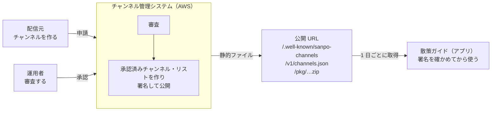

# 0-1 何を作っているのか

[目次](../README.md) ＞ 第 0 部 ＞ 0-1

## この章で学ぶこと

- 散策ガイド（SanpoGuide）とチャンネル管理システム（sanpo-channel-console）が、それぞれ何をするのか
- 2 つのシステムがどこでつながっているのか
- このチュートリアル全体を通して出てくる言葉（チャンネル、提供元、配信元、運用者）

## 散策ガイド: 一緒に歩く Android アプリ

散策ガイドは、散歩についてきて話しかけてくれる Android アプリです。

- 地図に、近くの史跡・寺社・公園などを出す（データは OpenStreetMap から）
- スポットに近づくと、AI が作った解説を声で読み上げる
- 歩いた距離・時間、天気の急変、日の入り、近くのトイレや休憩所などに合わせて話しかける
- 散歩の記録を端末に残す

画面を閉じても動き続ける **常駐サービス**（`WalkService`）が、位置・天気・周りのスポットを見て「いま何を話すか」を決めます。文章は AI（Claude や OpenAI 互換のサービス）に作らせ、端末の読み上げ機能（TTS）で声にします。

## チャンネル: 語り手を切り替える

散策ガイドには **チャンネル** という仕組みがあります。チャンネルは、語り手の口調・話題・話しかける場面と頻度をひとまとめにしたものです。アプリには「標準」「歴史探訪」「自然観察」「しずかに」の 4 つが入っています。

チャンネルの中身は主に **プロンプト**（AI への指示文）と設定値です。つまり、チャンネルを変えると AI への頼み方が変わり、話す内容が変わります。

## チャンネル管理システム: 第三者のチャンネルを審査して届ける

アプリに入っている 4 つだけでなく、観光協会・お店・愛好会などの **第三者** が作ったチャンネルも使えるようにしたい。ただし、だれでも自由にチャンネルを配れると、不適切な内容や危険な案内（「立入禁止の場所に入ろう」など）が混ざるおそれがあります。

そこで、**運用者が審査し、合格したものだけをアプリに届ける** ことにしました。これを担うのがチャンネル管理システム（sanpo-channel-console）です。AWS の上で動きます。

## 登場人物

このチュートリアルでは、次の言葉を区別して使います。

| 言葉 | だれ・何か | 例 |
|---|---|---|
| **利用者** | アプリを使って散歩する人 | — |
| **配信元** | チャンネルを作って申請する第三者 | 鎌倉歴史散歩の会 |
| **運用者** | 申請を審査し、承認・取り下げをする人 | 当面は開発者本人 |
| **提供元** | 承認済みチャンネルの一覧を公開する主体。運用者が運営する | 「SanpoGuide 公式チャンネル」 |

「配信元」と「提供元」は似ていて紛らわしいので注意してください。**配信元はチャンネルを作る人、提供元はチャンネルの一覧を出す人** です。

## 2 つのシステムの関係

大事な点が 2 つあります。

1. **アプリは管理システムの API を呼びません。** 管理システムは、審査に通ったチャンネルの一覧（**承認済みチャンネル・リスト**）を静的なファイルとして公開し、アプリはそれを取りに来るだけです
2. **アプリは管理システムを信用しません。信用するのは署名です。** 一覧には電子署名が付いていて、アプリは署名を確かめてから使います。途中で書き換えられたファイルや、古いファイルへの差し戻しは、署名と通し番号で見破ります

この「署名で信用をつなぐ」仕組みが [第 6 部](../06-trust/01-why-signatures.md) の主題です。

## 境界は 1 つの契約書だけ

2 つのリポジトリの境界は、SanpoGuide にある **API-002（承認済みチャンネル・リスト 契約書）** だけです。

- [SanpoGuide/docs/channel-list-api.md](../../SanpoGuide/docs/channel-list-api.md)

この契約書には、公開するファイルの形、署名の付け方、アプリが確かめる順番、エラーの種類が決めてあります。契約書を守っていれば、管理システムをどう作るか（AWS でも別のクラウドでも）は自由です。実際、契約書には「本書に準拠していれば、管理システムの実装方法と置き場所は問わない」と書かれています。

このように、**2 つのシステムの間の約束を先に文書で決めてから作る** 進め方を「契約から始める開発」と呼びます。第 7 部でも、管理システムの中の API（API-001）を同じ考え方で作っているのを見ます。

## 2 つのリポジトリが共有するもの

もう 1 つ、2 つのリポジトリをつなぐものがあります。SanpoGuide の中にある **`station-format`** というライブラリです。

- チャンネルのパッケージ（ZIP）の形式を読み、正しいかを確かめるコード
- アプリが AI に送るプロンプトを組み立てるコード

アプリはこれを使ってチャンネルを読み込みます。管理システムも同じライブラリを使って、申請されたパッケージを機械で確かめます（`validator`）。**同じコードで確かめる** ので、「管理システムでは合格したのに、アプリでは読み込めない」という食い違いが起きません。詳しくは第 5 部で扱います。

## 規模の目安

| | SanpoGuide | sanpo-channel-console |
|---|---|---|
| 主な言語 | Kotlin | TypeScript（一部 Kotlin） |
| 動く場所 | Android 端末（Android 8 以上） | AWS（東京リージョン） |
| ソースの量 | 約 7,000 行・60 ファイル | 約 7,750 行・65 ファイル |
| 画面 | 3 つ＋チャンネル画面 | 1 つ（運用者と配信元で共用） |

どちらも、一人で全体を読み通せる大きさです。

## 確認問題

問 1. 「配信元」と「提供元」の違いを一言で説明してください。

配信元はチャンネルを作って申請する第三者、提供元は審査済みチャンネルの一覧（承認済みチャンネル・リスト）を公開する主体です。

問 2. アプリはチャンネル管理システムの API を呼び出しますか。

呼び出しません。管理システムが公開した静的ファイル（承認済みチャンネル・リストなど）を HTTPS で取りに来るだけです。

問 3. 管理システムが止まったら、アプリのチャンネルはすぐ使えなくなりますか。

すぐには使えなくなりません。アプリは最後に受け取ったリストを、その有効期限（最長 14 日）まで使い続けます。

---

次: [0-2 技術の地図](02-technology-map.md)
