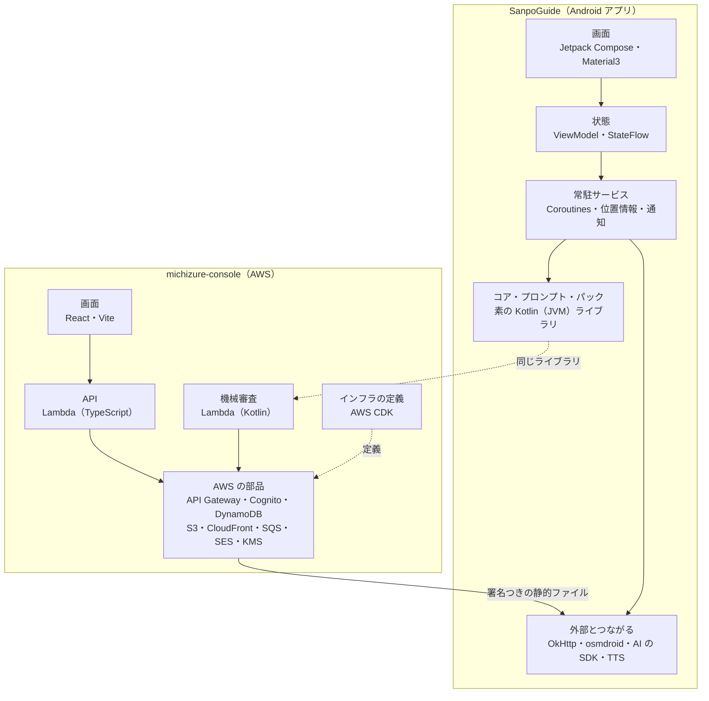

# 0-2 技術の地図

[目次](../README.md) ＞ 第 0 部 ＞ 0-2

## この章で学ぶこと

- 2 つのリポジトリで、どの技術がどこに使われているか
- それぞれの技術を、このチュートリアルのどの部で学ぶか
- 最初に知っておくと楽になる用語

いまは全部を理解する必要はありません。「こんなものがあるのか」と眺めて、あとで迷ったときに戻ってくる地図として使ってください。

## 全体の地図

## SanpoGuide で使われている技術

| 分野 | 技術 | 何に使っているか | 学ぶ部 |
|---|---|---|---|
| 言語 | Kotlin 2.2 | アプリのすべてのコード | 1 |
| ビルド | Gradle（Kotlin DSL）、Android Gradle Plugin、バージョンカタログ | ビルド、依存関係、アプリ・プロンプト・パック・コア・キットの 9 モジュール | 1 |
| 画面 | Jetpack Compose、Material3 | メイン・設定・記録・チャンネルの画面 | 2 |
| 状態 | ViewModel、StateFlow | 画面に出すデータの保持 | 2 |
| 非同期 | Kotlin Coroutines、Flow | 通信や待ち合わせを、画面を止めずに行う | 3 |
| 端末 | Service、通知、Fused Location、方位センサー | 散歩の追跡、話しかけ | 3 |
| 通信 | OkHttp、`org.json` | Overpass（スポット）・OSRM（ルート）・Open-Meteo（天気）・Wikimedia（写真） | 4 |
| 地図 | osmdroid | 地図の表示、タイル | 4 |
| AI | anthropic-java、OpenAI 互換 API | 解説や話しかけの文章を作る | 4 |
| 音 | Android の TTS、AudioTrack | 読み上げ、背景音（音をその場で合成して流す） | 4 |
| 保存 | JSON ファイル、Android Keystore | 散歩の記録、API キーの暗号化 | 4 |
| 暗号 | Tink（Ed25519） | 第三者のチャンネルの署名を確かめる | 6 |
| 読み取り | Google Code Scanner | 試用チケットの QR コード | 6 |
| 公開 | maven-publish、GitHub Packages、GitHub Actions | コアとプロンプト・パックを管理システムに渡す | 5 |
| テスト | JUnit 4 | 判定のロジック、形式の確認 | 各部 |

## michizure-console で使われている技術

| 分野 | 技術 | 何に使っているか | 学ぶ部 |
|---|---|---|---|
| 言語 | TypeScript | API・画面・ツール・インフラの定義 | 7 |
| 実行環境 | Node.js 22 以上 | Lambda の実行、ツール | 7 |
| 構成 | npm workspaces、`tsc -b` | 1 つのリポジトリに複数のパッケージを置く（モノレポ） | 7 |
| 契約 | OpenAPI、openapi-typescript、openapi-fetch | 管理 API の型を契約書から生成する | 7 |
| テスト | Vitest、aws-sdk-client-mock、DynamoDB Local | 単体テスト、AWS の代役 | 7 |
| インフラ | AWS CDK | AWS の部品をコードで定義する | 8 |
| 計算 | AWS Lambda | API、公開の処理、メール、機械審査 | 8 |
| 入口 | API Gateway（HTTP API）、CloudFront | API の受付、画面と公開ファイルの配信 | 8 |
| ログイン | Amazon Cognito | 運営・チャンネル提供者のログインと MFA | 8 |
| データ | Amazon DynamoDB | 申請・チャンネル・チャンネル提供者などすべての記録（1 テーブル） | 8 |
| ファイル | Amazon S3 | パッケージの受付、公開ファイル、記録 | 8 |
| 非同期 | Amazon SQS | メールを送る処理の待ち行列 | 8 |
| メール | Amazon SES | チャンネル提供者・素材提供者への通知 | 8 |
| 鍵 | AWS KMS | 承認済みチャンネル・リストへの署名 | 6・8 |
| 機械審査 | Kotlin の Lambda、コア・プロンプト・パック | 申請されたパッケージと素材集をアプリと同じ規則で確かめる | 8 |
| 画面 | React 19、Vite、react-router | 運営・チャンネル提供者・素材提供者の画面 | 9 |
| ログイン（画面） | oidc-client-ts | ブラウザから Cognito にログインする | 9 |
| 暗号（画面） | WebCrypto | チャンネル提供者の秘密鍵をブラウザの中で作る | 9 |
| CI | GitHub Actions | 型の確認、テスト、ビルド、`cdk synth` | 9 |

## 用語集

最初に知っておくと読みやすくなる言葉です。詳しくは、それぞれの部で説明します。

### 開発全般

| 用語 | 意味 |
|---|---|
| リポジトリ | Git で管理しているフォルダ一式。ここでは SanpoGuide と michizure-console の 2 つ |
| モノレポ | 複数のパッケージ（部品）を 1 つのリポジトリに入れる構成。michizure-console がこれ |
| 依存関係 | 自分のコードが使う、他人が作ったライブラリ |
| ビルド | ソースコードを、実行できる形（APK、JavaScript のファイルなど）に変換すること |
| CI | 継続的インテグレーション。コードを push するたびに、自動でテストやビルドを流す仕組み |

### 文書

| 用語 | 意味 |
|---|---|
| ADR | Architecture Decision Record。設計上の大事な判断と、その理由を残す文書 |
| API 契約書 | 2 つのシステムの間でやりとりするデータの形と約束を決めた文書。API-001〜API-004 |
| DM | データモデル。どんなデータをどう持つかを決めた文書（DM-001） |
| DES | 設計書。実装の細部を決めた文書（DES-001〜010） |

文書の番号（`P-8`、`V-03` など）は、文書の中の決定事項や確認観点を指します。コードのコメントにもよく出てくるので、見かけたら元の文書を引いてください。

### 散策ガイドの言葉

| 用語 | 意味 |
|---|---|
| チャンネル | 語り手・話題・話す場面と頻度をひとまとめにしたもの。コード上の名前は `Station` |
| 素材 | チャンネルが見せる文字・画像（将来は音声・映像も）。AI の解説や Wikimedia の写真も、アプリが用意する素材として同じ形（`Producer`）で扱う |
| 素材集 | 素材提供者が作り、チャンネルとは別に審査される素材のまとまり（`collection`） |
| きっかけ | チャンネルが素材を出す条件。スポット・地点・出来事（`cue`） |
| リスト | 運営が署名して公開する、承認済みのチャンネルと素材集の一覧。`sc1…` のリストIDで見分ける |

人の呼び方（散策者・チャンネル提供者・素材提供者・運営）は [0-1](01-what-we-build.md) にまとめてあります。

### Android

| 用語 | 意味 |
|---|---|
| APK | Android アプリのインストール用ファイル |
| Activity | 1 つの画面の入れ物 |
| Service | 画面がなくても動き続ける処理 |
| Composable | Jetpack Compose で画面の部品を表す関数 |

### AWS

| 用語 | 意味 |
|---|---|
| リージョン | AWS のデータセンターがある地域。このシステムは東京（`ap-northeast-1`） |
| サーバーレス | サーバーを自分で用意・管理せず、AWS が用意した部品を組み合わせる作り方 |
| IAM | AWS の中で「だれが何をしてよいか」を決める仕組み |
| スタック | CDK や CloudFormation で、まとめて作り・まとめて消す AWS の部品の一式 |

### 暗号

| 用語 | 意味 |
|---|---|
| ハッシュ | データから計算する短い「指紋」。データが 1 ビットでも変わると、まったく違う値になる |
| 公開鍵・秘密鍵 | 対になった 2 つの鍵。秘密鍵で署名し、公開鍵で確かめる |
| 署名 | 秘密鍵を持つ人だけが作れる、データへの印 |
| Ed25519 | このシステムで使っている署名の方式 |

暗号の言葉は [第 6 部](../06-trust/01-why-signatures.md) で一から説明します。

## 確認問題

問 1. 管理システムの中で Kotlin が使われている場所はどこですか。なぜそこだけ Kotlin なのでしょうか。

機械審査の Lambda（`validator`）です。アプリと同じコア（`core-format`、Kotlin のライブラリ）を使ってパッケージを確かめるためです。同じコードで確かめれば、管理システムとアプリで判定が食い違いません。

問 2. 承認済みチャンネル・リストへの署名に使う AWS の部品は何ですか。

AWS KMS（Key Management Service）です。署名に使う秘密鍵は KMS の中にあり、外に取り出せません。

---

前: [0-1 何を作っているのか](01-what-we-build.md) ／ 次: [0-3 開発環境の準備](03-setup.md)
