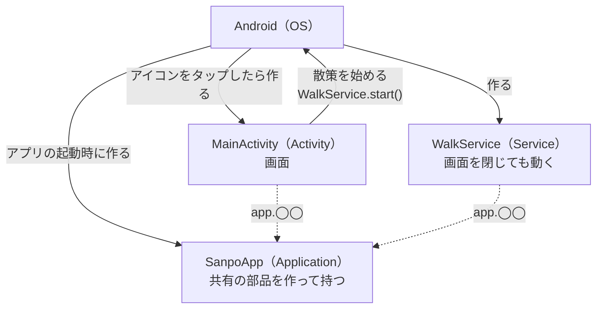
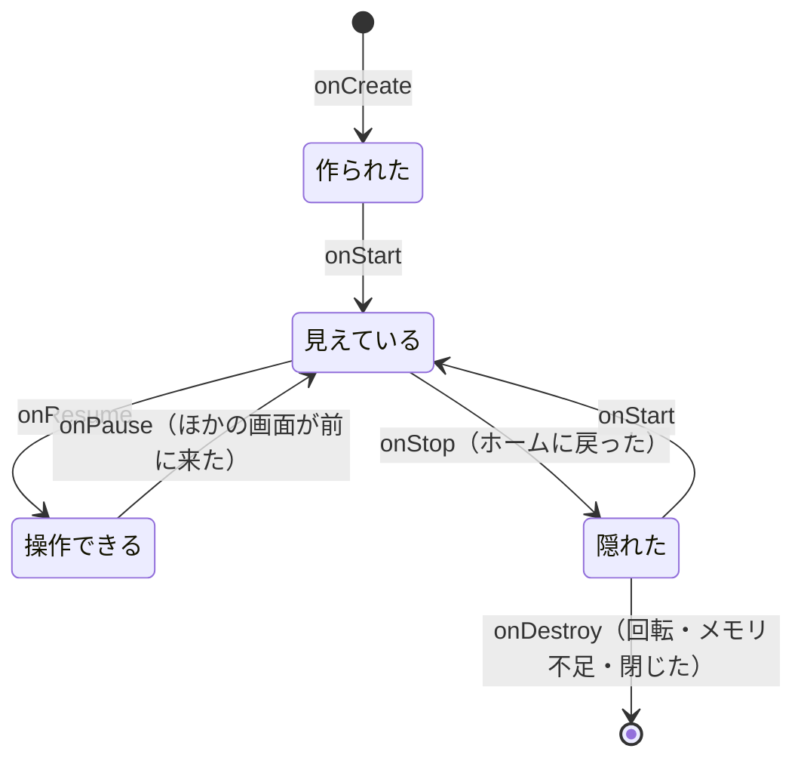

# 1-3 Android アプリの部品

[目次](../README.md) ＞ 第 1 部 ＞ 1-3

## この章で学ぶこと

- Android アプリを形づくる部品（Application・Activity・Service）と、その一生（ライフサイクル）
- マニフェスト（`AndroidManifest.xml`）が何を決めているか
- 権限の宣言と、実行時に利用者へ求める手順
- 散策ガイドが、3 つの部品をどうつないでいるか

## Android アプリは「部品の集まり」

普通のプログラムは `main` 関数から始まり、終わったら止まります。Android アプリは違います。アプリは **部品の集まり** で、それぞれの部品を **Android（OS）が必要なときに作り、不要になったら壊します**。アプリの側から「いつまでも動き続ける」ことはできません。

散策ガイドが使う部品は 3 種類です。

| 部品 | 散策ガイドでは | 役割 |
|---|---|---|
| **Application** | [`SanpoApp`](../../SanpoGuide/apps/sanpoguide/app/src/main/java/io/github/duwenji/sanpoguide/SanpoApp.kt) | アプリ全体で 1 つ。いちばん最初に作られる |
| **Activity** | [`MainActivity`](../../SanpoGuide/apps/sanpoguide/app/src/main/java/io/github/duwenji/sanpoguide/ui/MainActivity.kt) | 画面の入れ物。散策者が操作する |
| **Service** | [`WalkService`](../../SanpoGuide/apps/sanpoguide/app/src/main/java/io/github/duwenji/sanpoguide/walk/WalkService.kt) | 画面がなくても動き続ける処理。散歩の追跡 |

ほかに、ほかのアプリや OS からの知らせを受け取る Broadcast Receiver、データをほかのアプリに渡す Content Provider がありますが、散策ガイドは自分では使っていません。



## マニフェスト: アプリの自己紹介

OS は、アプリにどんな部品があり、何をしたいのかを **マニフェスト** で知ります。[AndroidManifest.xml](../../SanpoGuide/apps/sanpoguide/app/src/main/AndroidManifest.xml):

```xml
<manifest xmlns:android="http://schemas.android.com/apk/res/android">

    <uses-permission android:name="android.permission.INTERNET" />
    <uses-permission android:name="android.permission.ACCESS_NETWORK_STATE" />
    <uses-permission android:name="android.permission.ACCESS_FINE_LOCATION" />
    <uses-permission android:name="android.permission.ACCESS_COARSE_LOCATION" />
    <uses-permission android:name="android.permission.FOREGROUND_SERVICE" />
    <uses-permission android:name="android.permission.FOREGROUND_SERVICE_LOCATION" />
    <uses-permission android:name="android.permission.POST_NOTIFICATIONS" />

    <application
        android:name=".SanpoApp"
        android:allowBackup="false"
        android:icon="@drawable/ic_walk"
        android:label="@string/app_name"
        android:theme="@style/Theme.SanpoGuide">

        <activity
            android:name=".ui.MainActivity"
            android:exported="true"
            android:launchMode="singleTop">
            <intent-filter>
                <action android:name="android.intent.action.MAIN" />
                <category android:name="android.intent.category.LAUNCHER" />
            </intent-filter>
        </activity>

        <service
            android:name=".walk.WalkService"
            android:exported="false"
            android:foregroundServiceType="location" />
    </application>
</manifest>
```

| 部分 | 意味 |
|---|---|
| `<uses-permission>` | このアプリが使いたい権限（下で説明） |
| `android:name=".SanpoApp"` | Application として `SanpoApp` を使う。書かなければ素の Application になる |
| `android:allowBackup="false"` | 端末のバックアップにアプリのデータを含めない。API キーなどを含むため |
| `<activity>` の `MAIN`・`LAUNCHER` | この Activity をホーム画面のアイコンから開く入口にする |
| `android:exported` | ほかのアプリから呼べるか。入口の Activity は `true`、Service は `false`（自分だけが使う） |
| `foregroundServiceType="location"` | この Service は、位置情報のためのフォアグラウンドサービスだと宣言する |

`@drawable/ic_walk`・`@string/app_name` は **リソース**（`app/src/main/res/` の下の画像や文字列）を指す書き方です。

### ライブラリもマニフェストを持ち込む

ライブラリにもマニフェストがあり、ビルドのときにアプリのマニフェストと **合体** されます。ハンズオンで見るように、散策ガイドが自分で書いた部品は 2 つですが、合体後のマニフェストには部品が 10 個以上あります。QR コードの読み取り（ML Kit）などのライブラリが持ち込んだものです。

## Application: SanpoApp

アプリの起動時に、ほかのどの部品より先に `SanpoApp.onCreate()` が呼ばれます。[SanpoApp.kt](../../SanpoGuide/apps/sanpoguide/app/src/main/java/io/github/duwenji/sanpoguide/SanpoApp.kt):

```kotlin
class SanpoApp : Application() {
    val appScope = CoroutineScope(SupervisorJob() + Dispatchers.Main)

    lateinit var settings: SettingsRepository
        private set
    lateinit var spots: SpotRepository
        private set
    // … stations・channels・guides・speaker・history・companion・mood・photos・narration・cueFinder・cues・cueShow …

    override fun onCreate() {
        super.onCreate()
        settings = SettingsRepository(this)
        spots = SpotRepository(OverpassClient(), shops = { stations.current.value.searchedKinds })
        // … 部品を 1 つずつ作る …
        getSystemService(NotificationManager::class.java).apply {
            createNotificationChannel(NotificationChannel(CHANNEL_WALK, "散策モード", NotificationManager.IMPORTANCE_LOW))
            // …
        }
    }
}
```

`SanpoApp` は、画面と散歩のサービスが **共有する部品** を作って持っています。設定、スポットの検索、チャンネル、AI の呼び出し、読み上げ、散歩の記録などです。

- `lateinit var`: 「あとで（`onCreate` で）必ず入れる」という宣言です。Kotlin の `var` は作るときに値が要りますが、Application の部品は `onCreate` まで作れないので、こう書きます。入れる前に読むと例外になります
- `private set`: 外からは読めるが、書き換えられるのはこのクラスの中だけ
- `createNotificationChannel`: Android 8 からは、通知を出す前に **通知のチャンネル**（「チャンネルの案内」「散策モード」「スポット案内」「雷雨の予報」）を作る必要があります。散策者は、設定画面でチャンネルごとに通知のオン・オフや音を変えられます

画面や Service は、`(application as SanpoApp).spots` のように部品を取り出して使います。部品を外から渡す専用のライブラリ（DI ライブラリ）は使っていません。この作りの良し悪しは第 2 部で考えます。

## Activity: MainActivity

散策ガイドの画面は Activity が 1 つだけです。メイン・設定・記録・チャンネルの 4 つの画面は、すべて `MainActivity` の中で Compose によって切り替えています。[MainActivity.kt](../../SanpoGuide/apps/sanpoguide/app/src/main/java/io/github/duwenji/sanpoguide/ui/MainActivity.kt):

```kotlin
class MainActivity : ComponentActivity() {
    private val viewModel: MainViewModel by viewModels()
    // …
    private enum class Screen { MAIN, SETTINGS, HISTORY, CHANNELS }

    override fun onCreate(savedInstanceState: Bundle?) {
        super.onCreate(savedInstanceState)
        // … 権限の確認 …
        setContent {
            var screen by rememberSaveable { mutableStateOf(Screen.MAIN) }
            when (screen) {
                Screen.SETTINGS -> SettingsScreen(/* … */)
                Screen.CHANNELS -> ChannelsScreen(/* … */)
                Screen.HISTORY -> HistoryScreen(/* … */)
                Screen.MAIN -> MainScreen(
                    // …
                    onToggleWalk = { walking ->
                        if (walking) WalkService.stop(this) else WalkService.start(this)
                    },
                )
            }
        }
    }

    override fun onResume() {
        super.onResume()
        if (hasLocationPermission) viewModel.recheckLocationSetting()
    }
}
```

- `setContent { … }`: 画面の中身を Compose で描きます（第 2 部）
- `by viewModels()`: 画面の状態を持つ ViewModel を用意します（第 2 部）
- 1-1 で見た `enum`・`when` で、4 つの画面を切り替えています

### Activity のライフサイクル

Activity は、OS の都合で何度も作り直されます。たとえば **端末を回転させると、Activity は壊されて作り直されます**。



`MainActivity` は `onResume`（画面に戻ってきたとき）で、位置情報の設定がオンになったかを確かめ直しています。散策者が設定画面で位置情報をオンにして戻ってきた場面を想定しています。

`onCreate` の `savedInstanceState` は、作り直されたときに前の状態が入っている引数です。`MainActivity` は「初回だけスポットを取りに行く」（`if (savedInstanceState == null) viewModel.refresh()`）ために使っています。回転するたびにネットワークへ取りに行かないようにするためです。

## Service: WalkService

散歩の追跡は、画面を閉じても、端末をポケットに入れても続ける必要があります。そこで、画面（Activity）ではなく **Service** で行います。[WalkService.kt](../../SanpoGuide/apps/sanpoguide/app/src/main/java/io/github/duwenji/sanpoguide/walk/WalkService.kt):

```kotlin
class WalkService : LifecycleService() {
    private val app get() = application as SanpoApp

    override fun onStartCommand(intent: Intent?, flags: Int, startId: Int): Int {
        super.onStartCommand(intent, flags, startId)
        if (intent?.action == ACTION_STOP) {
            stopSelf()
            return START_NOT_STICKY
        }
        if (session == null) {
            ServiceCompat.startForeground(
                this, NOTIFICATION_ID, walkingNotification("いってらっしゃい。近くに来たらお知らせします"),
                ServiceInfo.FOREGROUND_SERVICE_TYPE_LOCATION,
            )
            // … 散歩の開始: 位置の追跡・タイマー・背景音 …
        }
        return START_STICKY
    }

    companion object {
        fun start(context: Context) {
            context.startForegroundService(Intent(context, WalkService::class.java))
        }
        fun stop(context: Context) {
            context.stopService(Intent(context, WalkService::class.java))
        }
    }
}
```

### フォアグラウンドサービス

最近の Android は、電池を守るため、画面の裏で動く処理を厳しく制限しています。裏で位置を追い続けたいなら、**フォアグラウンドサービス** にする必要があります。

- **通知を出し続ける**: 「散策中です」という通知を出している間だけ、動き続けられます。利用者は、何かが動いていることにいつでも気づけます
- **種類を宣言する**: 何のために動くのか（散策ガイドは `location`）を、マニフェストと `startForeground` の両方で宣言します。対応する権限（`FOREGROUND_SERVICE_LOCATION`）も要ります
- **始めたらすぐ `startForeground`**: `startForegroundService` で起動したら、決められた時間内に `startForeground` を呼ばないと、アプリが止められます

通知には「終了」のボタンがあり、押すと `ACTION_STOP` の付いた Intent で `WalkService` が呼ばれ、`stopSelf()` で止まります。

`onStartCommand` が返す `START_STICKY` は「OS がメモリ不足でこの Service を止めたら、余裕ができたときに作り直してほしい」という意味です。

### Intent

`Intent(context, WalkService::class.java)` は、「`WalkService` を動かしてほしい」という **OS への依頼書** です。Android では、部品どうしが直接呼び合わず、Intent を OS に渡して、OS が相手の部品を作って届けます。`setAction(ACTION_STOP)` のように、依頼書に用件を書き添えることもできます。

## 権限

### 2 種類の権限

マニフェストに書いた権限は、危険度によって 2 種類に分かれます。

| 種類 | 散策ガイドの例 | 利用者への確認 |
|---|---|---|
| **通常の権限** | インターネット、ネットワークの状態、フォアグラウンドサービス | 要らない。マニフェストに書けば使える |
| **危険な権限**（実行時の権限） | 位置情報、通知（Android 13 から） | **アプリの実行中に、利用者に許可を求める**。拒否されることもある |

### 実行時に許可を求める

`MainActivity` の権限の扱いです。

```kotlin
private val permissionLauncher = registerForActivityResult(
    ActivityResultContracts.RequestMultiplePermissions()
) { granted ->
    hasLocationPermission = granted[Manifest.permission.ACCESS_FINE_LOCATION] == true ||
        granted[Manifest.permission.ACCESS_COARSE_LOCATION] == true
    if (hasLocationPermission) viewModel.refresh()
}

private fun requestPermissions() {
    val permissions = buildList {
        add(Manifest.permission.ACCESS_FINE_LOCATION)
        add(Manifest.permission.ACCESS_COARSE_LOCATION)
        if (Build.VERSION.SDK_INT >= Build.VERSION_CODES.TIRAMISU) {
            add(Manifest.permission.POST_NOTIFICATIONS)
        }
    }
    permissionLauncher.launch(permissions.toTypedArray())
}
```

1. `registerForActivityResult` で、「許可を求めて、結果を受け取る」仕組みを用意する。ラムダが結果を受け取る
2. `launch` で、OS の許可のダイアログを出す
3. 利用者が答えると、ラムダが呼ばれ、許可された権限の一覧（`granted`）が届く

いくつか工夫があります。

- **正確な位置（FINE）と大まかな位置（COARSE）の両方を求め、どちらかが許可されれば進む**: Android 12 から、利用者は「大まかな位置だけ」を選べるからです
- **通知の権限は Android 13（`TIRAMISU`）以上でだけ求める**: それより前の版には、この権限がありません。`Build.VERSION.SDK_INT` で端末の版を確かめて分けるのは、Android のコードでよく見る書き方です
- **`== true` で比べる**: `granted[…]` は、その権限が一覧になければ null を返します（`Boolean?`）。`== true` なら null を「許可されていない」として扱えます（1-1 の null 安全）

## ハンズオン: 合体後のマニフェストを見る

1-2 のハンズオンで `./gradlew :app:assembleDebug` を実行していれば、合体後のマニフェストができています。

```sh
cd /c/Dev/apps/SanpoGuide
M=app/build/intermediates/merged_manifest/debug/processDebugMainManifest/AndroidManifest.xml
grep -o 'uses-permission[^>]*android:name="[^"]*"' "$M" | sed 's/.*name="//;s/"//'
```

```
android.permission.INTERNET
android.permission.ACCESS_NETWORK_STATE
android.permission.ACCESS_FINE_LOCATION
android.permission.ACCESS_COARSE_LOCATION
android.permission.FOREGROUND_SERVICE
android.permission.FOREGROUND_SERVICE_LOCATION
android.permission.POST_NOTIFICATIONS
io.github.duwenji.sanpoguide.DYNAMIC_RECEIVER_NOT_EXPORTED_PERMISSION
```

最後の 1 行は、散策ガイドのマニフェストにはありません。AndroidX のライブラリが足したものです。部品の数も数えてみましょう。

```sh
grep -c '<activity\|<service\|<provider\|<receiver' "$M"
```

散策ガイドが書いたのは Activity 1 つと Service 1 つですが、ここでは 12 前後になります（ライブラリの版によって変わります）。ファイルを開いて、どのライブラリの部品かを見てみてください。

> Android Studio なら、`AndroidManifest.xml` を開いて下の「Merged Manifest」タブを押すと、合体後のマニフェストを、どのライブラリから来たかの色分けつきで見られます。

### エミュレータで動かす（任意）

Android Studio でエミュレータ（仮想の端末）を用意していれば、次のことも試せます。

1. `./gradlew installDebug` でアプリを入れて開く。位置情報と通知の許可のダイアログが出る
2. 位置情報を「許可しない」にすると、どうなるか見る
3. 散策を始めて、通知が出ることを確かめる。ホームに戻っても通知が残り、Service が動き続けている
4. 端末を回転させる（エミュレータの横の回転ボタン）。画面が作り直されても、散策は続いている。散策が Activity ではなく Service で動いているからです

エミュレータの位置は、Extended controls → Location で指定できます（例: 鎌倉駅周辺）。

## つまずきやすいところ

- **Activity に長く続く処理を持たせない**: 回転だけで壊されます。散歩の追跡のように続けたい処理は Service に、画面の状態は ViewModel に持たせます（第 2 部）
- **危険な権限は、拒否される前提で作る**: 位置情報を拒否されても、アプリが落ちたり固まったりしないようにします。散策ガイドは、許可がないとメイン画面に地図や一覧の代わりに許可を求め直す表示（`MainScreen` の `PermissionPrompt`）を出し、もう一度許可を求められるようにしています
- **フォアグラウンドサービスの種類と権限をそろえる**: マニフェストの `foregroundServiceType`、`startForeground` の引数、`FOREGROUND_SERVICE_LOCATION` の権限のどれかが欠けると、新しい Android では起動時に例外になります

## 確認問題

<details>
<summary>問 1. 散歩の追跡を MainActivity の中で行わず、WalkService で行うのはなぜですか。</summary>

Activity は、画面を閉じたり端末を回転させたりするだけで OS に壊されるからです。散歩の追跡は画面がなくても続ける必要があるので、フォアグラウンドサービスにして、通知を出しながら動かします。

</details>

<details>
<summary>問 2. 散策者が「大まかな位置だけ」を許可しました。散策ガイドは位置を使えますか。</summary>

使えます。`ACCESS_FINE_LOCATION` と `ACCESS_COARSE_LOCATION` のどちらかが許可されていれば `hasLocationPermission` が `true` になります。ただし位置の精度は下がります。

</details>

<details>
<summary>問 3. Android 12 の端末で <code>POST_NOTIFICATIONS</code> を求めないのはなぜですか。</summary>

この権限は Android 13（API 33、`TIRAMISU`）で加わったもので、それより前の版には存在しないからです。Android 12 以前は、許可を求めなくても通知を出せます。

</details>

---

前: [1-2 Gradle とビルド](02-gradle.md) ／ 次: [1-4 署名と APK](04-signing-apk.md)
