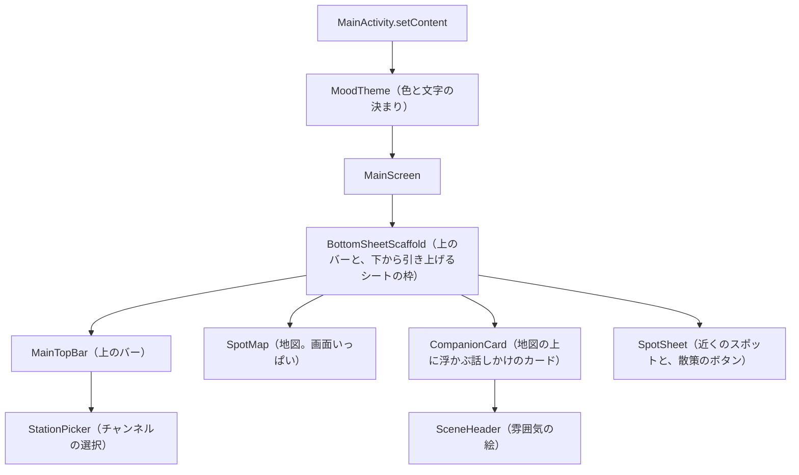

# 2-1 Compose の考え方

[目次](../README.md) ＞ 第 2 部 ＞ 2-1

> Jetpack Compose の仕組みと最小の使い方は [技術カード: Jetpack Compose](../ref/jetpack-compose.md) にあります。

## この章で学ぶこと

- 「宣言的 UI」とは何か。昔ながらの書き方と何が違うのか
- Composable 関数と、再コンポーズ（描き直し）
- 画面の部品が持つ小さな状態（`remember`・`rememberSaveable`）
- 見た目と配置を決める `Modifier`
- 散策ガイドの `CompanionCard` を 1 つ丸ごと読む

## 宣言的 UI

Android の昔ながらの画面作りでは、XML で画面の部品を並べ、Kotlin のコードから部品を探して **書き換えて** いました。

```kotlin
// 昔の書き方（散策ガイドでは使っていない）
val text = findViewById<TextView>(R.id.status)
text.text = "散策中 25分"          // 歩くたびに、部品を探して書き換える
text.visibility = View.VISIBLE
```

この書き方では、「今の画面がどうなっているか」と「データがどうなっているか」を、プログラマーが手で合わせ続けなければなりません。書き換え忘れると、画面とデータがずれます。

**Jetpack Compose** は違う考え方をします。**「データがこうなら、画面はこう」を関数で書くだけ** です。データが変わると、Compose が関数を呼び直して画面を描き直します。これを **宣言的 UI** と呼びます。

```kotlin
@Composable
fun WalkStatus(minutes: Int?) {
    if (minutes != null) {
        Text("散策中 ${minutes}分")
    }
}
```

`minutes` が null なら何も描かず、値があれば文字を描く。書き換えの手順はどこにもありません。React（[9-1](../09-console/01-react-vite.md)）を知っている人には、同じ考え方だと言えば伝わるでしょう。

## Composable 関数

`@Composable` を付けた関数が、画面の部品です。

- 名前は大文字で始める（`CompanionCard`、`MainScreen`）。値を返さず、画面に何かを **描く** 関数だからです
- 中で、ほかの Composable を呼んで組み立てる（`Column` の中に `Text` を並べる、など）
- Composable は Composable の中からしか呼べない

散策ガイドの画面は、すべて Composable の組み合わせです。



### 再コンポーズ

Compose は、Composable が読んでいるデータが変わると、その Composable を **呼び直します**。これを **再コンポーズ** と呼びます。呼び直すのは、変わったデータを読んでいる部分だけです。

そのため、Composable 関数には決まりがあります。

- **何度呼ばれてもよいように書く**: 1 秒に何十回も呼ばれることがあります。中でネットワークに取りに行ったり、ファイルに書いたりしてはいけません
- **呼ばれる順番や回数に頼らない**: 外の変数を書き換えるなどの「副作用」は、専用の仕組み（下の `produceState` など）で行います

## CompanionCard を読む

散策中、地図の上に浮かぶ「話しかけのカード」が [CompanionCard.kt](https://github.com/duwenji/yorisoi-sanpoguide/blob/main/app/src/main/java/io/github/duwenji/yorisoi/sanpoguide/ui/CompanionCard.kt) です。150 行ほどの中に、この章の要素が全部入っています。

```kotlin
@Composable
fun CompanionCard(
    live: LiveWalk?,
    lines: List<Utterance>,
    scene: Mood? = null,
    onOpen: (CueDetail) -> Unit = {},
    onReplay: (Utterance) -> Unit = {},
    onDismiss: (() -> Unit)? = null,
    modifier: Modifier = Modifier,
) {
    var expanded by rememberSaveable { mutableStateOf(false) }
    val now by produceState(System.currentTimeMillis(), live) {
        while (live != null) {
            value = System.currentTimeMillis()
            delay(15_000)
        }
    }
    val timeFormat = SimpleDateFormat("H:mm", Locale.JAPAN)

    val status = if (live != null) {
        "散策中　${WalkCompanion.minutes(now - live.startedAt)}分・" +
            "${WalkCompanion.km(live.distanceM)}km・案内${live.spotCount}か所"
    } else {
        "散策の振り返り"
    }

    Surface(
        shape = RoundedCornerShape(20.dp),
        shadowElevation = 4.dp,
        modifier = modifier.fillMaxWidth().animateContentSize(),
    ) {
        Column {
            if (scene != null) SceneHeader(scene, status)
            // Opened, the earlier lines scroll inside the card so the map stays in view.
            Column(Modifier.heightIn(max = 360.dp).verticalScroll(rememberScrollState()) /* …余白… */) {
                // … 状態の文字と、振り返りを閉じるボタン（scene がないとき）…
                val shown = if (expanded) lines.take(6) else lines.take(1)
                if (shown.isEmpty()) {
                    Text("歩きはじめたら話しかけますね", style = MaterialTheme.typography.bodyMedium)
                }
                shown.forEach { line ->
                    Spacer(Modifier.height(6.dp))
                    Text(/* 時刻とスポット名 */)
                    if (line.text.isNotBlank()) {
                        Text(
                            line.text,
                            style = MaterialTheme.typography.bodyMedium,
                            maxLines = if (expanded) Int.MAX_VALUE else 2,
                            overflow = TextOverflow.Ellipsis,
                        )
                    }
                    line.image?.let { image ->
                        Spacer(Modifier.height(4.dp))
                        MaterialImage(/* チャンネルの素材の画像 */)
                    }
                    // … 画像やテキストの出典（MaterialCredit）…
                    line.detail?.let { detail -> TextButton(onClick = { onOpen(detail) }) { Text("詳しく見る") } }
                }
            }
            // …「もう一度聞く」（onReplay）と「これまでの話」（expanded を切り替える）のボタン …
        }
    }
}
```

### 引数がデータ、本体が見た目

`CompanionCard` は、散歩の数字（`live`）、話した内容（`lines`）、雰囲気（`scene`）を **引数で受け取るだけ** です。どこからデータを取ってくるかは知りません。取ってくるのは呼ぶ側（`MainScreen`、その元は ViewModel）の仕事です（[2-2](02-state-viewmodel.md)）。

`onOpen`・`onReplay`・`onDismiss` は、データではなく **操作** を受け取る引数です。チャンネルが出した素材（画像つきの発言など、[0-1](../00-overview/01-what-we-build.md)）に「詳しく見る」があるとき、押されたら `onOpen(detail)` を呼ぶだけで、解説の画面をどう開くかは知りません。`MainScreen` が `onOpen = viewModel::openCue` を渡しています。「もう一度聞く」（`onReplay`）、散歩のあとの振り返りを閉じる（`onDismiss`）も同じです。`onDismiss` は null を許す型で、散策中は `null` を渡して閉じるボタンを出しません。「データは引数で下へ、操作はラムダで上へ」という形は、2-2 でもう一度見ます。既定値があるので、プレビューやハンズオンでは省けます。

最後の `modifier: Modifier = Modifier` は、Compose の部品の決まった形です。**どこに、どんな余白で置くかは呼ぶ側が決める** ので、部品は受け取った `modifier` を自分のいちばん外側に付けます。`MainScreen` は `modifier = Modifier.padding(horizontal = 12.dp)` を渡して、地図の上に左右の余白を空けて浮かべています。

だから、引数を変えれば、どんな場面のカードでも描けます。ハンズオンでは、これを使って 4 つの場面のカードを並べて表示します。

### 小さな状態: `remember` と `rememberSaveable`

```kotlin
var expanded by rememberSaveable { mutableStateOf(false) }
```

カードは、「これまでの話」を押すと過去の発言を広げて見せます。「広げているかどうか」は、このカードの中だけの小さな状態です。

- `mutableStateOf(false)`: 変わると Compose に知らせる入れ物を作る。`expanded` を書き換えると、それを読んでいる部分が再コンポーズされる
- `remember { … }`: 再コンポーズのたびに作り直さず、前の値を **覚えておく**。これがないと、呼び直されるたびに `false` に戻ってしまう
- `rememberSaveable { … }`: さらに、**端末の回転などで Activity が作り直されても** 値を残す（[1-3](../01-kotlin-android/03-android-components.md) のライフサイクル）
- `by`: `expanded.value` と書く代わりに、`expanded` と普通の変数のように書けるようにする

| 書き方 | 再コンポーズ | 画面の回転 | 使い道 |
|---|---|---|---|
| `mutableStateOf` だけ | **消える** | 消える | （使わない） |
| `remember { mutableStateOf(…) }` | 残る | 消える | 一時的な状態（アニメーションの途中など） |
| `rememberSaveable { mutableStateOf(…) }` | 残る | 残る | 利用者の操作の結果（開閉、入力中の文字） |

`MainActivity` が今どの画面（メイン・設定・記録・チャンネル）を出しているかも、`rememberSaveable` で覚えています。回転しても設定画面のままになるのはこのためです。

### 時間で変わる値: `produceState`

```kotlin
val now by produceState(System.currentTimeMillis(), live) {
    while (live != null) {
        value = System.currentTimeMillis()
        delay(15_000)
    }
}
```

「散策中 25分」の分数は、何もしなくても時間とともに変わります。`produceState` は、**裏で動く処理から値を作る** 仕組みです。

- 中のブロックはコルーチン（第 3 部）で動き、15 秒ごとに `value` を今の時刻に更新する。`now` を読んでいる部分が描き直される
- 2 つ目の引数 `live` が変わると、ブロックをやり直す。散歩が終わって `live` が null になれば、ループが止まる
- カードが画面から消えると、ブロックも自動で止まる。止め忘れの心配がない

Composable の本体で直接 `while` や `delay` を書いてはいけない（何度も呼ばれるため）ので、こうした専用の仕組みを使います。

### Modifier: 見た目と配置

```kotlin
modifier = modifier.fillMaxWidth().animateContentSize()
// …
Column(Modifier.heightIn(max = 360.dp).verticalScroll(rememberScrollState()) /* … */)
```

`Modifier` は、部品の大きさ・余白・タップの反応・アニメーションなどを **つなげて** 指定するものです。

| Modifier | 意味 |
|---|---|
| `fillMaxWidth()` | 横幅いっぱいに広げる |
| `animateContentSize()` | 中身の大きさが変わるとき、なめらかに伸び縮みさせる |
| `heightIn(max = 360.dp)` | 高さの上限を決める。広げても地図を隠しきらない |
| `verticalScroll(…)` | 上限を超えた分は、カードの中でスクロールする |
| `clickable { … }` | タップされたら、ブロックを実行する（スポットの一覧の行など） |
| `padding(16.dp, …)` | 内側の余白（左・上・右・下） |
| `height(6.dp)` | 高さを決める |

**順番に意味があります**。たとえば `Modifier.padding(16.dp).clickable { }` と `Modifier.clickable { }.padding(16.dp)` では、タップに反応する範囲が違います（前者は余白の内側だけ、後者は余白を含む）。

`dp` は端末の画面の細かさに左右されない長さの単位、`sp` は利用者の文字の大きさの設定に合わせて変わる、文字用の単位です。

### 並べる: Column・Row・Box

| 部品 | 並べ方 | CompanionCard では |
|---|---|---|
| `Column` | 縦に並べる | 絵・状態・発言を縦に |
| `Row` | 横に並べる | 「もう一度聞く」と「これまでの話」のボタン |
| `Box` | 重ねる | `SceneHeader` で、雰囲気の絵の上に文字を重ねる |

```kotlin
@Composable
private fun SceneHeader(scene: Mood, status: String) {
    Box(Modifier.fillMaxWidth().height(64.dp)) {
        MoodScene(scene, Modifier.matchParentSize())
        // …
        Text(scene.summary, /* … */ modifier = Modifier.align(Alignment.TopEnd).padding(8.dp, 6.dp))
        Text(status, style = onScene, modifier = Modifier.align(Alignment.BottomStart).padding(16.dp, 8.dp))
    }
}
```

絵を `Box` いっぱいに描き（`matchParentSize`）、その上の右上に雰囲気の言葉（「秋の夕方、寺社の近く」）、左下に散歩の数字を重ねています。

### 普通の if と forEach が使える

```kotlin
if (scene != null) SceneHeader(scene, status)
// …
shown.forEach { line -> /* Text を 2 つ */ }
```

表示するかどうかは `if`、くり返しは `forEach`。画面を組み立てるのに、特別な書き方は要りません。**Kotlin の普通の制御構文がそのまま画面の構造になる** のが、Compose の分かりやすいところです。

## Compose の中に昔の部品を置く

地図（osmdroid）は Compose ではなく、昔ながらの部品（View）です。[SpotMap.kt](https://github.com/duwenji/yorisoi-platform/blob/main/kit-geo/src/main/java/io/github/duwenji/yorisoi/kit/geo/map/SpotMap.kt) は、それを `AndroidView` で Compose の中に置いています。

```kotlin
AndroidView(factory = { mapView }, modifier = modifier) { map ->
    // データが変わるたびに、地図の部品を書き換える
}
```

Compose に対応していないライブラリも、こうして使えます。地図のくわしい話は第 4 部で扱います。

## ハンズオン: カードのプレビューを並べる

Android Studio には、アプリを動かさずに Composable を描いて見せる **プレビュー** があります。`CompanionCard` が引数だけで描ける部品であることを使って、4 つの場面のカードを並べてみます。

### 1. プレビューのファイルを置く

[scripts/TutorialPreviews.kt](scripts/TutorialPreviews.kt) を、SanpoGuide の画面のフォルダにコピーします。

```sh
cd /c/Dev/apps/yorisoi-sanpoguide
cp ../yorisoi-tutorial/02-compose/scripts/TutorialPreviews.kt app/src/main/java/io/github/duwenji/yorisoi/sanpoguide/ui/
```

中身の一部です。

```kotlin
@Preview(name = "秋の夕方・寺社", widthDp = 360)
@Composable
private fun CompanionCardAutumnEvening() {
    val mood = Mood(TimeOfDay.EVENING, Season.AUTUMN, place = Place.SHRINE_TEMPLE)
    MoodTheme(mood = mood, systemDark = false) {
        CompanionCard(live = sampleWalk, lines = sampleLines, scene = mood)
    }
}
```

- `@Preview`: この関数をプレビューに出す。`widthDp = 360` でスマートフォンくらいの幅にする
- 見本のデータ（`sampleWalk`・`sampleLines`）を渡して `CompanionCard` を呼ぶだけ。ネットワークも位置情報も要らない

### 2. Android Studio で見る

1. Android Studio で `TutorialPreviews.kt` を開く
2. 右上の「Split」または「Design」を押す
3. ビルドが終わると、4 枚のカードが並ぶ: 雰囲気なし（緑）、秋の夕方・寺社（橙・明朝体）、夏の昼・雨（青）、冬の夜（暗い色、散歩前の「歩きはじめたら話しかけますね」）

プレビューの中でも、ボタンを押す操作は「Interactive mode」（プレビューの上のボタン）で試せます。「これまでの話」を押すと過去の発言が出るはずです。

> コマンドだけで確かめたいときは、`./gradlew :app:compileDebugKotlin` でコンパイルが通ることを確かめられます（絵は出ません）。

### 3. 自分で場面を足す

`CompanionCardWinterNight` を写して、「春の朝・公園」のカードを足してみてください。`Season.SPRING`、`TimeOfDay.MORNING`、`Place` の値は [Mood.kt](https://github.com/duwenji/yorisoi-platform/blob/main/kit-mood/src/main/java/io/github/duwenji/yorisoi/kit/mood/Mood.kt) にあります。

### 4. 片付け

```sh
rm app/src/main/java/io/github/duwenji/yorisoi/sanpoguide/ui/TutorialPreviews.kt
git status
```

`git status` に何も出なければ元どおりです。

## つまずきやすいところ

- **Composable の中で重い処理をしない**: 再コンポーズのたびに走ります。データの取得は ViewModel で行います（[2-2](02-state-viewmodel.md)）
- **`remember` を忘れる**: `var x by mutableStateOf(…)` を `remember` なしで書くと、描き直すたびに初めの値に戻ります（Android Studio が警告してくれます）
- **Modifier の順番**: 余白とタップの範囲、背景色と余白など、つなげる順番で結果が変わります

## 確認問題

<details>
<summary>問 1. CompanionCard の <code>expanded</code> を <code>remember</code> で覚えるように変えると、何が変わりますか。</summary>

カードを広げた状態で端末を回転させると、閉じた状態に戻るようになります。`remember` は再コンポーズでは値を残しますが、Activity が作り直されると消えるからです。

</details>

<details>
<summary>問 2. 散策中の分数を、<code>produceState</code> を使わずに、本体で <code>System.currentTimeMillis()</code> を読むだけにしたらどうなりますか。</summary>

カードが描き直されたときにしか分数が変わらなくなります。新しい発言が届くなど、ほかの理由で再コンポーズされない限り、「散策中 25分」のまま止まって見えます。`produceState` は 15 秒ごとに値を更新して、描き直しを起こしています。

</details>

<details>
<summary>問 3. CompanionCard が ViewModel を受け取らず、データを引数で受け取るのはなぜですか。</summary>

どこからデータが来るかに依存しないので、どんな場面のカードでも描けるからです。プレビューで見本のデータを渡したり、別の画面で使い回したりできます。

</details>

---

次: [2-2 状態と ViewModel](02-state-viewmodel.md)
