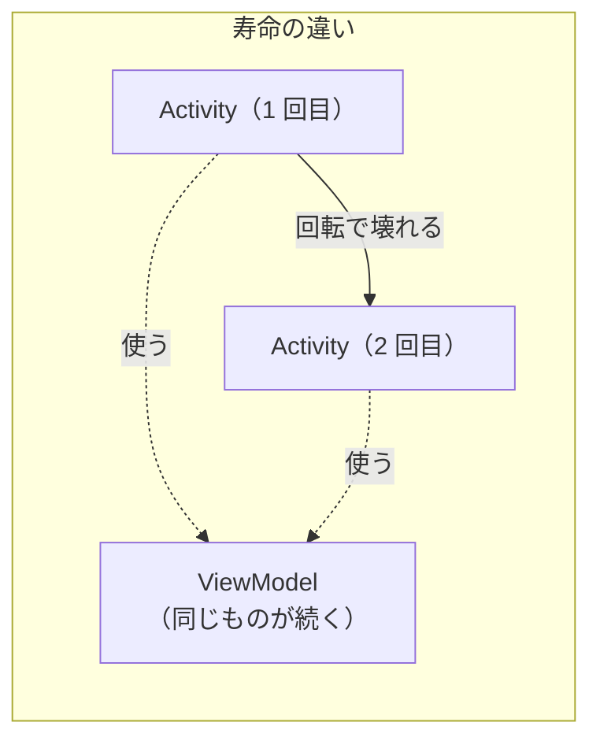
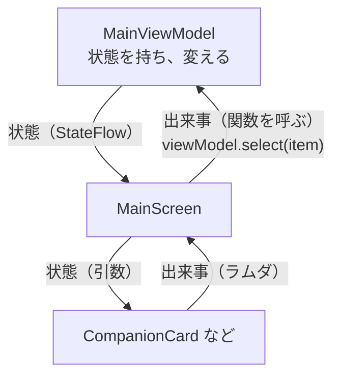
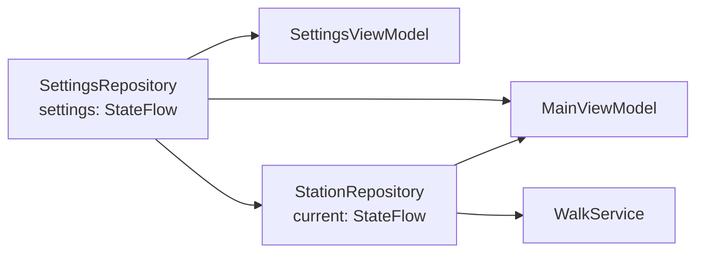

# 2-2 状態と ViewModel

[目次](../README.md) ＞ 第 2 部 ＞ 2-2

> ViewModel と StateFlow の仕組みと最小の使い方は [技術カード: ViewModel と StateFlow](../ref/viewmodel-stateflow.md) にあります。

## この章で学ぶこと

- 画面の状態を、画面の外（ViewModel）に置く理由
- `StateFlow` で状態を流し、Compose で受け取る方法
- 「状態は上から下へ、出来事は下から上へ」という流れ（単方向データフロー）
- いくつもの流れを組み合わせて、画面に出す値を作る方法（`combine`・`stateIn`）
- 編集中の下書きを持つ設定画面の作り

## 状態をどこに置くか

[2-1](01-compose-basics.md) の `expanded`（カードを広げているか）は、カードの中だけの小さな状態でした。でも、画面には次のような状態もあります。

- 近くのスポットの一覧（ネットワークから取ってくる）
- 選んだスポットの AI の解説（生成に数秒かかる）
- 今のチャンネル、設定、散策中かどうか

これらを Composable の中に置くと、困ったことが起きます。

- 端末を回転させると Activity が作り直され（[1-3](../01-kotlin-android/03-android-components.md)）、取ってきたデータも、生成中の解説も消える
- 画面の部品が、ネットワークや AI の呼び出しを知る必要がある。部品だけを取り出して使えない

そこで、こうした状態は **ViewModel** に置きます。

## ViewModel

**ViewModel** は、画面の状態と、状態を変える処理を持つクラスです。いちばん大事な性質は、**画面の回転では壊れず、画面が本当に閉じられたときにだけ片付けられる** ことです。



`MainActivity` は `by viewModels()` で ViewModel を受け取っていました（[1-3](../01-kotlin-android/03-android-components.md)）。

```kotlin
private val viewModel: MainViewModel by viewModels()
```

回転して `MainActivity` が作り直されても、`by viewModels()` は **前と同じ** `MainViewModel` を返します。だから、取ってきたスポットも、生成中の解説も消えません。

## StateFlow: 変わる値を流す

ViewModel は、状態を `StateFlow` で画面に見せます。

**StateFlow** は「今の値を 1 つ持ち、値が変わったら、見ている人に知らせる」入れ物です。

- いつでも `.value` で今の値を読める
- 値が変わると、集めている（`collect` している）側に新しい値が届く
- **同じ値を入れても知らせない**（data class なら中身で比べる）

[MainViewModel.kt](https://github.com/duwenji/yorisoi-sanpoguide/blob/main/app/src/main/java/io/github/duwenji/yorisoi/sanpoguide/ui/MainViewModel.kt) の、選んだスポットの状態です。

```kotlin
private val _selected = MutableStateFlow<SelectedSpot?>(null)
val selected: StateFlow<SelectedSpot?> = _selected.asStateFlow()
```

ここに、よく使う形があります。

- 中では書き換えられる `MutableStateFlow` を `_selected`（先頭に `_`）として持つ
- 外には、読むだけの `StateFlow` として `selected` を見せる（`asStateFlow()`）

こうすると、**状態を変えられるのは ViewModel の中だけ** になります。画面は読むことしかできません。

### 状態を data class と sealed で表す

```kotlin
sealed interface GuideState {
    data object Loading : GuideState
    data class Ready(val text: String) : GuideState
    data class Failed(val message: String) : GuideState
}

data class SelectedSpot(val item: SpotItem, val guide: GuideState, val photo: PhotoState = PhotoState.None)
```

スポットの解説は「生成中」「できた（文章あり）」「失敗した（理由あり）」のどれか 1 つです。1-1 で学んだ sealed で表すと、「生成中なのに文章がある」のようなありえない組み合わせを、型で作れなくできます。画面の側は `when` で 3 つを描き分け、書き忘れはコンパイラが見つけます。

### 状態を変える

スポットを選んだときの `select`:

```kotlin
fun select(item: SpotItem) {
    routeTarget.value = item.poi
    val photo = initialPhotoState(item.poi)
    _selected.value = SelectedSpot(item, GuideState.Loading, photo)
    viewModelScope.launch {
        val state = when (val result = app.narration.sheetGuide(item.poi, item.distanceM)) {
            is MaterialResult.Ready -> GuideState.Ready((result.material.content as Content.Text).text)
            is MaterialResult.Unavailable -> GuideState.Failed("解説の生成に失敗しました: ${result.detail}")
            MaterialResult.None -> GuideState.Failed("解説の生成に失敗しました")
        }
        updateSelected(item) { it.copy(guide = state) }
    }
    // … 写真も同じように …
}

/** Ignores results for a spot the user has already moved on from. */
private fun updateSelected(item: SpotItem, change: (SelectedSpot) -> SelectedSpot) =
    _selected.update { current -> if (current?.item?.poi?.id == item.poi.id) change(current) else current }
```

1. まず「生成中」の状態にする。画面はすぐに「生成中」を表示できる
2. `viewModelScope.launch` で、裏で解説を頼む（コルーチン、第 3 部）。`viewModelScope` は、ViewModel が片付けられると自動で止まる。頼む先の `narration` は、AI（キーがなければ定型文）に解説を作らせ、結果を `MaterialResult` で返す（素材の共通の形。[2-3](03-manual-di.md)）
3. 結果が来たら、「できた」か「失敗した」に書き換える。`MaterialResult` は sealed（[1-1](../01-kotlin-android/01-kotlin-syntax.md)）なので、`when` で 3 つの場合を漏れなく書き分けられる

`updateSelected` の工夫に注目してください。AI の解説には数秒かかります。その間に散策者が **別のスポットを選び直していたら**、遅れて届いた前のスポットの解説で上書きしてはいけません。そこで、今選ばれているスポットと、結果のスポットが同じときだけ書き換えています。非同期の処理では、こうした「結果が届いたときには状況が変わっている」場面への備えが欠かせません。

`update { … }` は、今の値を受け取って新しい値を返すラムダで、StateFlow を書き換えます。`it.copy(guide = state)` で、ほかの項目はそのままに解説だけを変えた新しい値を作っています（1-1 のデータクラスの `copy`）。

## Compose で受け取る

[MainScreen.kt](https://github.com/duwenji/yorisoi-sanpoguide/blob/main/app/src/main/java/io/github/duwenji/yorisoi/sanpoguide/ui/MainScreen.kt) の冒頭です。

```kotlin
@Composable
fun MainScreen(
    viewModel: MainViewModel,
    hasLocationPermission: Boolean,
    onRequestPermission: () -> Unit,
    onToggleWalk: (walking: Boolean) -> Unit,
    onOpenSettings: () -> Unit,
    // …
) {
    val settings by viewModel.settings.collectAsStateWithLifecycle()
    val liveWalk by viewModel.liveWalk.collectAsStateWithLifecycle()
    val lines by viewModel.companionLines.collectAsStateWithLifecycle()
    val spots by viewModel.spots.collectAsStateWithLifecycle()
    val selected by viewModel.selected.collectAsStateWithLifecycle()
    // … ほか十数個 …
```

`collectAsStateWithLifecycle()` は、StateFlow を Compose の状態に変えます。値が変わると、それを読んでいる部分が再コンポーズされます。

名前の `WithLifecycle` は、**画面が見えていない間（アプリが裏にあるとき）は集めるのを止める** という意味です。見えない画面のために無駄な処理をしないためです。

## 単方向データフロー

`MainScreen` の引数を見ると、2 種類あることが分かります。

- **状態**（下へ流れる）: ViewModel の StateFlow から読む値、`hasLocationPermission`
- **出来事**（上へ流れる）: `onToggleWalk`・`onOpenSettings` などのラムダ。散策者が何かしたときに呼ぶ



**状態は上から下へ、出来事は下から上へ** 流れます。これを **単方向データフロー** と呼びます。画面の部品は状態を書き換えず、「こんなことが起きた」と上に伝えるだけです。状態を書き換えるのは、いちばん上（ViewModel）だけ。

こうすると、「この値を変えたのはだれか」が必ず ViewModel の中で見つかります。値があちこちで書き換えられて、追いきれなくなることがありません。

ボタンの例:

```kotlin
ExtendedFloatingActionButton(
    onClick = { onToggleWalk(walking) },
    text = { Text(if (walking) "散策を終える" else "散策をはじめる") },
    // …
)
```

ボタンは「押された」と伝えるだけです。散策を始めるか終えるかは、受け取った `MainActivity` が決め、`WalkService` を起動します。ボタンの文字は `walking`（状態）から決まります。散策が始まると `WalkService.walking` が `true` になり、それを読んでいるボタンが「散策を終える」に描き直されます。ボタンが自分で文字を書き換えることはありません。

## 流れを組み合わせる: combine と stateIn

画面に出すスポットの一覧は、3 つの流れから作っています。

```kotlin
val spots: StateFlow<List<SpotItem>> = combine(
    app.spots.spots, app.spots.location, app.history.walks,
) { spots, loc, walks ->
    spots.map { poi ->
        SpotItem(
            poi,
            loc?.let { l -> poi.distanceFrom(l).toInt() },
            visitCount = walks.count { w -> w.visits.any { it.matches(poi) } },
        )
    }
        .sortedBy { it.distanceM ?: Int.MAX_VALUE }
}.stateIn(viewModelScope, SharingStarted.WhileSubscribed(5_000), emptyList())
```

- `combine(A, B, C) { a, b, c -> … }`: 3 つのどれかが変わるたびに、最新の 3 つの値からブロックで新しい値を作る
  - 近くのスポット（検索し直すと変わる）
  - 現在地（歩くと変わる）→ 距離を計算し直す
  - 散歩の記録（散歩が終わると変わる）→ 訪問回数を数え直す
- `stateIn(…)`: できた流れを StateFlow にする。最初の値は `emptyList()`
- `SharingStarted.WhileSubscribed(5_000)`: 画面が見ている間だけ計算する。見なくなってから 5 秒は続ける。回転で一瞬だけ見る人がいなくなっても、計算をやり直さずに済むようにするためです

**画面に出す値を、元のデータから計算で作る** のがポイントです。「歩いたら距離を書き換える」「散歩が終わったら回数を書き換える」という手順をどこにも書かずに、いつも正しい一覧が出ます。2-1 の宣言的 UI と同じ考え方を、データの側でも使っているわけです。

## ViewModel の外にある状態

`MainViewModel` の StateFlow の多くは、自分で持たずに **SanpoApp の部品から借りています**。

```kotlin
val location: StateFlow<Location?> = app.spots.location
val walking: StateFlow<Boolean> = WalkService.walking
val settings: StateFlow<GuideSettings> = app.settings.settings
val station: StateFlow<Station> = app.stations.current
```

設定や今のチャンネルは、画面だけでなく `WalkService` も使います。だから画面の ViewModel ではなく、アプリ全体で共有する部品（`SanpoApp` が持つ `SettingsRepository` など）が持っています。散策中に画面でチャンネルを変えると、同じ StateFlow を見ている `WalkService` がすぐに気づき、新しいチャンネルで話し始めます。



[StationRepository.kt](https://github.com/duwenji/yorisoi-sanpoguide/blob/main/app/src/main/java/io/github/duwenji/yorisoi/sanpoguide/station/StationRepository.kt) の `current` も、設定とチャンネルの一覧を `combine` して作っています。

```kotlin
val current: StateFlow<Station> = combine(settings, list) { s, l -> select(s, l) }
    .stateIn(scope, SharingStarted.Eagerly, select(settings.value, list.value))
```

ここでは `SharingStarted.Eagerly`（見ている人がいなくても、ずっと計算する）です。`WalkService` が画面と関係なく使うので、画面の都合で止めるわけにいかないからです。

## 下書きを持つ: 設定画面

設定画面は「保存」を押すまで、変更を反映しません。[SettingsViewModel.kt](https://github.com/duwenji/yorisoi-sanpoguide/blob/main/app/src/main/java/io/github/duwenji/yorisoi/sanpoguide/ui/SettingsViewModel.kt):

```kotlin
/** Edits a draft of the AI settings; nothing is persisted until [save]. */
class SettingsViewModel(application: Application) : AndroidViewModel(application) {
    private val repo = (application as SanpoApp).settings

    private val _draft = MutableStateFlow(repo.settings.value)
    val draft: StateFlow<GuideSettings> = _draft.asStateFlow()

    fun reset() {
        _draft.value = repo.settings.value
    }

    fun selectProvider(p: Provider) = edit { it.copy(provider = p) }
    fun setApiKey(key: String) = edit { it.copy(apiKeys = it.apiKeys + (it.provider to key)) }
    fun setModel(model: String) = edit { it.copy(models = it.models + (it.provider to model)) }
    // …
}
```

- 開いたときに、保存されている設定を **写して下書き**（`_draft`）にする
- 画面での変更は、すべて下書きだけを `copy` で書き換える。保存されている設定（`repo.settings`）は変わらない
- 「保存」で初めて `repo` に書き込む。書き込むと `repo.settings` の StateFlow が変わり、それを見ているほかの画面や `WalkService` に伝わる

`GuideSettings` が data class で、`copy` で新しい値を作るだけなので、「下書き」と「保存済み」を 2 つの値として素直に持てます。

## ハンズオン: StateFlow の性質を確かめる

StateFlow の性質を、小さなテストで確かめます。Android の端末は要りません。

### 1. 練習用のテストを置いて流す

[scripts/StateFlowPracticeTest.kt](scripts/StateFlowPracticeTest.kt) をコピーして流します。

```sh
cd /c/Dev/apps/yorisoi-sanpoguide
cp ../yorisoi-tutorial/02-compose/scripts/StateFlowPracticeTest.kt app/src/test/java/io/github/duwenji/yorisoi/sanpoguide/
./gradlew :app:testDebugUnitTest --tests '*StateFlowPracticeTest*'
```

4 件のテストが通ります。

### 2. テストを読む

```kotlin
@Test
fun `setting an equal value does not notify`() = runBlocking {
    val settings = MutableStateFlow(Settings())
    val seen = mutableListOf<Settings>()
    val job = launch { settings.collect { seen += it } }
    yield()
    settings.value = Settings()                       // 中身が同じ（data class の ==）
    yield()
    settings.value = Settings(stationId = "history")  // 中身が違う
    yield()
    job.cancel()
    assertEquals(listOf("standard", "history"), seen.map { it.stationId })
}
```

- `launch { settings.collect { … } }` で、値が届くたびに `seen` に足す
- 中身が同じ `Settings()` を入れても、届かない。中身が違う値だけが届く
- だから `seen` は「最初の値」と「history」の 2 つだけ

`runBlocking`・`launch`・`yield` はコルーチンの道具です（第 3 部）。ここでは「`yield()` で、集める側に順番を回す」とだけ思っておいてください。

### 3. 普通のクラスと比べる

同じファイルに、`data` の付いていない `PlainSettings` で同じことをするテストがあります。

```kotlin
@Test
fun `a plain class is notified even when the contents are the same`() = runBlocking {
    // … 上と同じ手順を PlainSettings で …
    assertEquals(listOf("standard", "standard", "history"), seen.map { it.stationId })
}
```

こちらは、中身が同じ `PlainSettings()` を入れたときにも **届きます**（`standard` が 2 回）。`data` がないと、`==` が「中身」ではなく「同じインスタンスか」で比べるので、中身が同じでも別のインスタンスなら「違う値」とみなされるからです。

状態を data class にしておけば、中身の変わらない更新で画面が無駄に描き直されません。StateFlow で状態を持つとき、状態の型を data class にする理由の 1 つです。

### 4. 壊してみる

`Settings` の前の `data` を消して（`class Settings(…)` にして）、もう一度流してください。

今度はテストを流す前に、コンパイルエラーで止まります。

```
e: …/StateFlowPracticeTest.kt:24:30 Unresolved reference 'copy'.
```

最初のテストの `it.copy(stationId = "history")` の `copy` は、`data` を付けたときに Kotlin が自動で作る関数だからです（[1-1](../01-kotlin-android/01-kotlin-syntax.md) のデータクラス）。`data` を消すと `copy` もなくなります。状態を `copy` で新しく作るこの章の書き方は、data class があってこそ成り立つわけです。

確かめたら `data` を戻してください。

### 5. 片付け

```sh
rm app/src/test/java/io/github/duwenji/yorisoi/sanpoguide/StateFlowPracticeTest.kt
git status
```

## つまずきやすいところ

- **MutableStateFlow を外に見せない**: 外から書き換えられると、単方向データフローが崩れます。`_名前` と `asStateFlow()` の組を使います
- **StateFlow の中身を直接書き換えない**: リストや data class の中を書き換えても、StateFlow は「同じ値」とみなして知らせません。必ず `copy` や新しいリストで **新しい値** を入れます
- **遅れて届く結果に備える**: 非同期の結果が届いたとき、状況が変わっていないかを確かめます（`updateSelected` の工夫）

## 確認問題

<details>
<summary>問 1. <code>MainScreen</code> の散策のボタンを押してから、文字が「散策を終える」に変わるまでの流れを説明してください。</summary>

ボタンが `onToggleWalk(walking)` を呼ぶ → `MainActivity` が `WalkService.start` で散策を始める → `WalkService` が `walking`（StateFlow）を `true` にする → `MainViewModel.walking` を `collectAsStateWithLifecycle` で読んでいる `MainScreen` が再コンポーズされ、ボタンの文字が変わります。ボタン自身は文字を書き換えません。

</details>

<details>
<summary>問 2. スポット A を選び、解説の生成中にスポット B を選び直しました。A の解説が遅れて届いたらどうなりますか。</summary>

捨てられます。`updateSelected` が、今選ばれているスポット（B）と結果のスポット（A）を比べ、違えば書き換えないからです。

</details>

<details>
<summary>問 3. スポットの一覧に <code>SharingStarted.WhileSubscribed(5_000)</code> を、今のチャンネルに <code>SharingStarted.Eagerly</code> を使っているのはなぜですか。</summary>

スポットの一覧は画面に出すためだけのものなので、画面が見ている間だけ計算すれば十分です。今のチャンネルは `WalkService` も画面と関係なく使うので、見ている画面がなくても計算し続ける必要があります。

</details>

---

前: [2-1 Compose の考え方](01-compose-basics.md) ／ 次: [2-3 DI ライブラリを使わない構成](03-manual-di.md)
