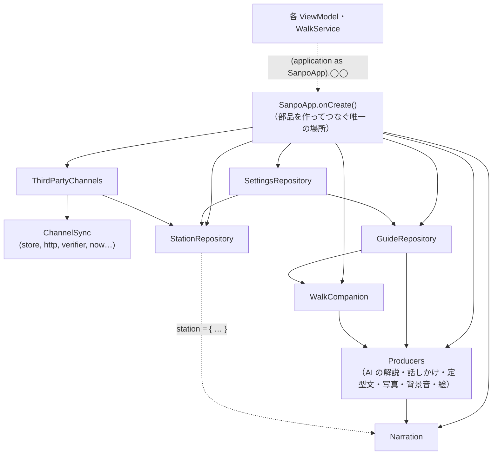

# 2-3 DI ライブラリを使わない構成

[目次](../README.md) ＞ 第 2 部 ＞ 2-3

## この章で学ぶこと

- 「依存を外から渡す」（DI、依存性の注入）とは何か、なぜ大事か
- 散策ガイドが、DI のライブラリを使わずに部品をつないでいる方法
- 外から渡す作りが、テストをどれだけ楽にするか（ChannelSync のテストを読む）
- この構成の良いところと、限界

## 依存とは

ある部品が仕事をするのに **ほかの部品を必要とする** とき、その部品に「依存している」と言います。たとえば第三者のチャンネルを取ってくる `ChannelSync` は、次のものに依存しています。

- ファイルに保存する部品（`ChannelStore`）
- インターネットからファイルを取ってくる部品（`ProviderHttp`）
- 署名を確かめる部品（`Ed25519Verifier`）
- アプリの版、今の時刻

## 依存を自分で作るか、外から受け取るか

依存の手に入れ方は 2 通りあります。

```kotlin
// A: 自分で作る
class ChannelSync {
    private val http = OkHttpProviderHttp()
    private val verifier = TinkEd25519
    private fun now() = Instant.now()
}

// B: 外から受け取る（散策ガイドの書き方）
class ChannelSync(
    private val store: ChannelStore,
    private val http: ProviderHttp,
    private val verifier: Ed25519Verifier,
    private val appVersion: Int,
    private val now: () -> Instant,
    private val allowLocalHttp: Boolean = false,
    // … 素材の段階（mediaStage）と、今いる大まかな地域（region）…
)
```

A は手軽ですが、`ChannelSync` は **いつも本物のインターネットと、本物の時計** を使うことになります。テストで「リストが期限切れになったとき」を試すには、本当に 15 日待つしかありません。

B では、使う側が依存を渡します。アプリでは本物を、テストでは代役を渡せます。これを **依存性の注入**（Dependency Injection、略して **DI**）と呼びます。名前はいかめしいですが、「必要なものはコンストラクタの引数でもらう」というだけのことです。

[ChannelSync.kt](../../SanpoGuide/apps/sanpoguide/app/src/main/java/io/github/duwenji/sanpoguide/station/remote/ChannelSync.kt) は B の書き方です。

## アプリでは本物を渡す

[ThirdPartyChannels.kt](../../SanpoGuide/apps/sanpoguide/app/src/main/java/io/github/duwenji/sanpoguide/station/remote/ThirdPartyChannels.kt) が、本物を渡して `ChannelSync` を作っています。

```kotlin
private val sync = ChannelSync(
    store = ChannelStore(File(context.filesDir, "channels")),
    http = OkHttpProviderHttp(),
    verifier = TinkEd25519,
    appVersion = BuildConfig.VERSION_CODE,
    now = Instant::now,
    allowLocalHttp = BuildConfig.DEBUG,
    region = region,
)
```

- 保存先は端末のアプリ専用のフォルダ
- 通信は OkHttp（第 4 部）
- 署名の確認は Tink（[技術カード: Tink](../ref/tink.md)）
- 時刻は `Instant::now`（「`Instant.now()` を呼ぶ関数」を渡す書き方）

## テストでは代役を渡す

[ChannelSyncTest.kt](../../SanpoGuide/apps/sanpoguide/app/src/test/java/io/github/duwenji/sanpoguide/station/remote/ChannelSyncTest.kt) は、代役を渡しています。

```kotlin
private val start = Instant.parse("2026-10-05T00:00:00Z")
private var clock = start
private val files = HashMap<String, ByteArray>()

private val http = ProviderHttp { url, max ->
    val bytes = files[url] ?: throw IOException("HTTP 404")
    if (bytes.size > max) throw TooLargeException(url)
    bytes
}

private fun newSync() = ChannelSync(ChannelStore(folder.root), http, TinkEd25519, appVersion = 1, now = { clock })
```

| 依存 | 本物 | テストでの代役 |
|---|---|---|
| 通信 `http` | OkHttp でインターネットへ | `files`（メモリの中の表）から返す。なければ「404」 |
| 時刻 `now` | 端末の時計 | 変数 `clock`。テストが好きなように進められる |
| 保存先 `store` | アプリのフォルダ | JUnit が用意する使い捨てのフォルダ |
| アプリの版 | `BuildConfig.VERSION_CODE` | 1（古いアプリを試すときは 0） |

`ProviderHttp` は 1-1 で見た `fun interface`（関数を 1 つだけ持つインターフェース）なので、ラムダ 1 つで代役を作れます。

### 15 日を一瞬で進める

期限切れのテストです。

```kotlin
@Test
fun `an expired list stops its channels and is said once`() {
    publish(1, alice to 1)
    useKamakura()
    files.remove("$base/v1/channels.json")
    clock = clock.plus(Duration.ofDays(15))
    sync.refreshDue(unmetered = true)
    assertTrue(sync.state.providers.single().error!!.startsWith("fetch_failed"))
    assertTrue(sync.stations(standard).isEmpty())
    // …
}
```

1. リスト（期限 14 日）を公開して、チャンネルを使い始める
2. リストのファイルを消す（取得できなくなる）
3. **時計を 15 日進める**（`clock = clock.plus(Duration.ofDays(15))`）
4. 取得し直すと、通信は失敗し（`fetch_failed`）、手元のリストは期限切れなので、そのチャンネルは使えなくなっている

本物の時計とインターネットでは、このテストは書けません。依存を外から受け取っているから、「15 日後」「リストのサーバーが落ちている」という状況を、一瞬で、何度でも作れます。11 件のテストが 1 秒かからずに終わります。

第 6 部の `publish` が保存先・CDN・署名を引数で受け取り、手元では代役で動いた（[6-4](../06-trust/04-two-tier-keys.md)）のも、同じ考え方です。TypeScript でも Kotlin でも、この作りが使われています。

## 関数を渡す: Narration と WalkCompanion

依存は、オブジェクトだけでなく **関数** でも渡せます。[Narration.kt](../../SanpoGuide/apps/sanpoguide/app/src/main/java/io/github/duwenji/sanpoguide/material/Narration.kt) は、散歩と画面が使う素材（解説・話しかけ・写真・背景音）を、素材の出どころ（`Producers`）に頼む部品です。

```kotlin
/** Asks [producers] for the material the walk and the screens use, on the channel [station] returns. */
class Narration(private val producers: Producers, private val station: () -> Station) {
    // …
    private fun request(subject: Subject, type: MaterialType, session: WalkSession? = null, weather: Weather? = null) =
        MaterialRequest(subject, type, MaterialContext(station(), session, weather))
}
```

`station: () -> Station` は「呼ぶと今のチャンネルを返す関数」です。チャンネルそのもの（`Station`）を渡さないのは、**チャンネルは散歩の途中でも変わる** からです。値を渡すと、作ったときのチャンネルに固定されてしまいます。関数を渡せば、頼むたびに **その時点の** チャンネルを聞けます。聞いたチャンネルは要求（`MaterialContext`）に入れて渡すので、その先の部品（AI の解説を作る `GuideRepository.guideFor` など）は、チャンネルを引数で受け取るだけです。「今のチャンネルを聞く」のは `Narration` の 1 か所に決まっています。

[WalkCompanion.kt](../../SanpoGuide/apps/sanpoguide/app/src/main/java/io/github/duwenji/sanpoguide/companion/WalkCompanion.kt) も、同じように関数を受け取ります。

```kotlin
class WalkCompanion(
    private val guides: GuideRepository,
    private val history: HistoryStore,
    private val prompts: PromptTemplates,
    /** The current mood for the companion's tone, or null when the user has turned moods off. */
    private val mood: () -> Mood? = { null },
    /** Whether the user allows coordinates to go to the AI (off by default). */
    private val shareLocation: () -> Boolean = { false },
)
```

`SanpoApp` では、こう渡しています。

```kotlin
companion = WalkCompanion(
    guides, history, prompts,
    mood = { mood.mood.value.takeIf { stations.current.value.moodTone } },
    shareLocation = { settings.settings.value.shareLocationWithAi },
)
// …
narration = Narration(producers, station = { stations.current.value })
```

`WalkCompanion` は StateFlow も `SettingsRepository` も知りません。「今の雰囲気（使わない設定なら null）」「位置を AI に渡してよいか」を、聞けば答えてくれる関数があることだけを知っています。必要なことだけを知っている部品は、テストしやすく、変更にも強くなります。

> 以前は `WalkCompanion` と `GuideRepository` も `station: () -> Station` を受け取っていました。素材の出どころを共通の形（`Producer`、ADR-002 T-7）にまとめたときに、チャンネルは要求と一緒に渡す形に変わりました。

## 全体をつなぐ: SanpoApp

では、部品をだれが作ってつなぐのか。散策ガイドでは、それが `SanpoApp.onCreate()` です（[1-3](../01-kotlin-android/03-android-components.md)）。

```kotlin
override fun onCreate() {
    super.onCreate()
    settings = SettingsRepository(this)
    spots = SpotRepository(OverpassClient(), shops = { stations.current.value.searchedKinds })
    prompts = Prompts.fromResources()
    val developerMode = settings.settings.map { it.developerMode }.stateIn(appScope, SharingStarted.Eagerly, settings.settings.value.developerMode)
    channels = ThirdPartyChannels(this, BuiltInStations.standardPackage(), appScope, developerMode) { /* 今いる大まかな地域 */ }
    stations = StationRepository(BuiltInStations.load(), settings.settings, appScope, channels.stations)
    // …
    guides = GuideRepository(settings, prompts)
    speaker = Speaker(this)
    photos = SpotPhotos(this)
    history = HistoryStore(this)
    mood = MoodSource(spots, feed.weather, appScope)
    companion = WalkCompanion(guides, history, prompts, /* … */)
    val producers = Producers(
        listOf(
            AiGuideProducer(guides, settings),
            AiCompanionProducer(companion, settings),
            FallbackTextProducer(prompts, companion),
            CommonsPhotoProducer(photos, settings),
            AmbientProducer(),
            MoodSceneProducer(),
        )
    )
    narration = Narration(producers, station = { stations.current.value })
    // … きっかけ（cues）の部品、通知のチャンネル …
}
```

上から順に、**先に要る部品から作って、次の部品に渡していく** だけです。`stations` は `settings` と `channels` を、組み込みの素材の出どころ（`AiGuideProducer` など）は `guides`・`companion`・`photos` を使うので、その後に作ります。最後の `narration` が、それらをまとめて使います。

このように、DI のライブラリを使わず、手で部品を作ってつなぐやり方を **手動 DI**（Manual DI）と呼びます。部品をつなぐ場所（ここでは `SanpoApp`）を **コンポジション・ルート** と呼ぶこともあります。



## DI のライブラリとは

Android では、部品をつなぐ仕事を自動でやってくれる DI のライブラリ（Google の **Hilt**、Kotlin 向けの **Koin** など）がよく使われます。部品に「これが必要」と印を付けておくと、ライブラリが順番を考えて作り、渡してくれます。

散策ガイドはこれを使っていません（[architecture.md](../../SanpoGuide/docs/architecture.md) の図 1: 「DI ライブラリは使っていない」）。

## この構成の良いところと限界

| | 手動 DI（散策ガイド） | DI のライブラリ |
|---|---|---|
| 分かりやすさ | **普通の Kotlin のコードだけ**。`onCreate` を上から読めば、何が何に渡るか全部分かる | ライブラリの決まりと、裏で行われる処理を学ぶ必要がある |
| 入れるもの | 何も要らない | ライブラリとその設定、コード生成 |
| 部品が増えたとき | `SanpoApp` が長くなる。作る順番を自分で考える | ライブラリが順番を解決する |
| ViewModel のテスト | **しにくい**（下で説明） | ViewModel にも依存を渡す仕組みがある |

### 限界: ViewModel が SanpoApp を直接見ている

`ChannelSync` や `WalkCompanion` は依存をコンストラクタで受け取っていて、テストしやすい作りでした。ところが ViewModel は違います。

```kotlin
class MainViewModel(application: Application) : AndroidViewModel(application) {
    private val app = application as SanpoApp
    val settings: StateFlow<GuideSettings> = app.settings.settings
    // …
}
```

ViewModel は `by viewModels()` で Android が作るので、コンストラクタに好きな引数を足せません（足すには、作り方を教える「ファクトリー」を書く必要があります）。そこで散策ガイドは、`AndroidViewModel` で受け取った `application` を `SanpoApp` として扱い、部品を直接取り出しています。

その結果、`MainViewModel` をテストするには、本物の `SanpoApp`（とその全部品）が要ります。散策ガイドに ViewModel の単体テストがないのは、このためでもあります。

その代わりに、散策ガイドは **判断のロジックを ViewModel や Service の外に出し**、依存を受け取る小さな部品にしてテストしています。

| 部品 | 何を判断するか | テスト |
|---|---|---|
| `FacilityAdvisor` | 近くの施設を、いま案内するか | `FacilityAdvisorTest`（1-1 のハンズオン） |
| `SpotChooser` | どのスポットを話題にするか | `SpotChooserTest` |
| `WeatherChangeDetector` など | 天気の急変を知らせるか | `WeatherChangeDetectorTest` |
| `ChannelSync` | 第三者のチャンネルの取得と確認 | `ChannelSyncTest`（この章） |

ViewModel と Service は、それらを呼んで結果を画面や声にする「つなぎ」に徹しています。**ロジックを Android の部品の外に出す** のは、DI のライブラリを使う場合でも有効な作り方です。

## ハンズオン: 時計を進めるテストを読んで動かす

### 1. 流す

```sh
cd /c/Dev/apps/SanpoGuide
./gradlew :app:testDebugUnitTest --tests '*ChannelSyncTest*'
```

11 件のテストが通ります。レポート（`app/build/reports/tests/testDebugUnitTest/index.html`）の `ChannelSyncTest` を開くと、全体で 1 秒かからずに終わっているのが分かります。

### 2. テストの名前を眺める

レポートか [ChannelSyncTest.kt](../../SanpoGuide/apps/sanpoguide/app/src/test/java/io/github/duwenji/sanpoguide/station/remote/ChannelSyncTest.kt) で、テストの名前を見てください。

- an older list is refused as a rollback（古いリストは巻き戻しとして拒む）
- an expired list stops its channels and is said once（期限切れのリストのチャンネルは止まり、1 回だけ知らせる）
- a new publisher is taken only with publisherChange from the one on the device（チャンネル提供者の変更は、裏付けがあるときだけ受け入れる）
- …

第 6 部の API-002 で決めた振る舞いが、そのまま並んでいます。どれも、通信と時計を代役にしたから試せるものです。

### 3. 時計の進め方を変えてみる

`an expired list stops its channels and is said once` の

```kotlin
clock = clock.plus(Duration.ofDays(15))
```

を `Duration.ofDays(13)` に変えて流してください。リストの期限（14 日）が切れていないので、チャンネルが使えたままになり、テストが落ちます。

確かめたら元に戻します。

```sh
git checkout -- app/src/test/java/io/github/duwenji/sanpoguide/station/remote/ChannelSyncTest.kt
git status
```

## つまずきやすいところ

- **「今の時刻」も依存** です。`Instant.now()` や `System.currentTimeMillis()` をロジックの中で直接呼ぶと、時間に関わる振る舞いをテストできなくなります。散策ガイドは時刻を引数や関数で受け取っています
- **変わる値は、値ではなく関数で渡す**: 作ったときの値に固定されてしまいます（`WalkCompanion` の `station`）
- **ロジックを Activity・ViewModel・Service に書き込まない**: Android の部品の中のロジックは、テストしにくくなります

## 確認問題

<details>
<summary>問 1. <code>ChannelSync</code> が <code>Instant.now()</code> を直接呼ばず、<code>now: () -&gt; Instant</code> を受け取るのはなぜですか。</summary>

テストで時刻を自由に進められるようにするためです。テストでは変数 `clock` を返す関数を渡し、`clock` を 15 日進めて、期限切れの振る舞いを一瞬で確かめています。

</details>

<details>
<summary>問 2. <code>WalkCompanion</code> に <code>station: Station</code>（値）ではなく <code>station: () -&gt; Station</code>（関数）を渡すのはなぜですか。</summary>

チャンネルは散歩の途中でも変わるからです。値を渡すと作ったときのチャンネルに固定されますが、関数なら話すたびにその時点のチャンネルを聞けます。

</details>

<details>
<summary>問 3. 散策ガイドに ViewModel の単体テストがないのはなぜですか。代わりにどうしていますか。</summary>

ViewModel が `SanpoApp` から部品を直接取り出しているので、テストするには本物の `SanpoApp` が要り、手軽に代役を渡せないからです。代わりに、判断のロジックを `FacilityAdvisor`・`ChannelSync` などの依存を受け取る部品に出し、そちらをテストしています。

</details>

---

前: [2-2 状態と ViewModel](02-state-viewmodel.md) ／ 次: [2-4 テーマと雰囲気](04-theme-mood.md)
