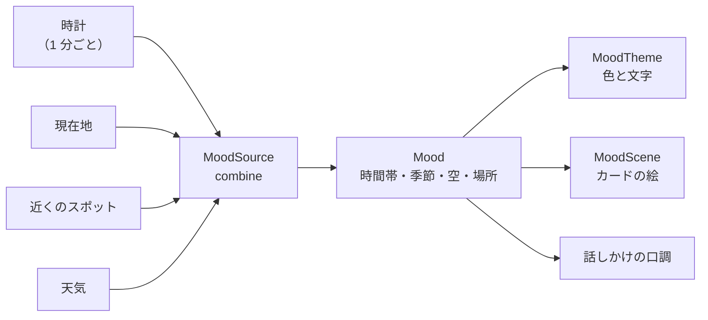

# 2-4 テーマと雰囲気

[目次](../README.md) ＞ 第 2 部 ＞ 2-4

## この章で学ぶこと

- Material3 のテーマ（色の組み合わせと文字の決まり）の仕組み
- 散策ガイドの「雰囲気」で、画面の色と文字を切り替える方法（`MoodTheme`）
- 色をなめらかに変えるアニメーション
- 絵を画像ファイルではなく、コードで描く方法（`Canvas`）
- 雰囲気そのものを、時刻・天気・場所から決める流れ

## 雰囲気とは

散策ガイドは、時間帯・季節・天気・近くの場所の種類から「今の雰囲気」を決め、それに合わせて次のものを変えます（[README](https://github.com/duwenji/yorisoi-sanpoguide/blob/main/README.md) の「雰囲気」）。

- 画面の配色（夜は暗く、雨は青く、夕方は暖かく…）
- 文字の書体（寺社や史跡の近くでは明朝体）
- 散策中のカードの上の絵（[2-1](01-compose-basics.md) の `SceneHeader`）
- 話しかけの口調（AI への指示に雰囲気を入れる。第 4 部）



## Material3 のテーマ

**Material Design** は Google が決めた画面のデザインの決まりで、**Material3** はその最新の版です。Compose の Material3 のライブラリでは、画面全体の見た目を **テーマ** で決めます。

```kotlin
MaterialTheme(colorScheme = …, typography = …) {
    // この中の部品は、ここで決めた色と文字を使う
}
```

### 色の組み合わせ（ColorScheme）

テーマの色は、**役割の名前** で決めます。

| 名前 | 役割 | 散策ガイドでは |
|---|---|---|
| `primary` | いちばん目立たせる色 | ボタンなど |
| `onPrimary` | `primary` の上に載せる文字の色 | ボタンの文字 |
| `primaryContainer` | `primary` を薄くした、カードなどの背景 | 話しかけのカードの背景 |
| `onPrimaryContainer` | その上の文字の色 | カードの文字 |
| `background`・`surface` | 画面の背景 | — |

部品は、具体的な色（「緑」）ではなく **役割の名前** で色を指定します。2-1 の `CompanionCard`:

```kotlin
Surface(color = MaterialTheme.colorScheme.primaryContainer, /* … */) {
    Text(line.text, color = MaterialTheme.colorScheme.onPrimaryContainer, /* … */)
}
```

だから、テーマの `primaryContainer` を変えるだけで、カードの色が変わります。カードのコードには一切手を入れずに、です。「`on◯◯`」の色を必ず組で決めておくので、背景を変えても文字が読めなくなりません。

### 文字の決まり（Typography）

文字の大きさと書体も、役割の名前で決めます（`titleLarge`、`bodyMedium`、`labelSmall` など）。カードは `MaterialTheme.typography.bodyMedium` のように使っています。

## MoodTheme: 雰囲気でテーマを切り替える

[MoodTheme.kt](https://github.com/duwenji/yorisoi-platform/blob/main/kit-mood/src/main/java/io/github/duwenji/yorisoi/kit/mood/MoodTheme.kt) は、雰囲気から色の組み合わせと文字の決まりを作り、`MaterialTheme` に渡します。

```kotlin
@Composable
fun MoodTheme(mood: Mood?, systemDark: Boolean, content: @Composable () -> Unit) {
    val target = paletteFor(mood, systemDark).toScheme()
    MaterialTheme(colorScheme = target.animated(), typography = typographyFor(mood), content = content)
}
```

`MainActivity` は画面全体を `MoodTheme` で包んでいます（[1-3](../01-kotlin-android/03-android-components.md)）。

```kotlin
MoodTheme(mood.takeIf { settings.moodEnabled }, systemDark = isSystemInDarkTheme()) { /* 4 つの画面 */ }
```

- 設定で雰囲気をオフにしていれば `mood` は null（`takeIf` は条件が成り立たなければ null を返す）
- `isSystemInDarkTheme()` は、端末がダークモードかどうか

`content: @Composable () -> Unit` は「Composable を受け取る引数」です。`MoodTheme { … }` の `{ … }` がこれにあたり、1-1 で見た「最後の引数がラムダなら外に出せる」書き方です。

### 雰囲気から色を選ぶ

```kotlin
private fun paletteFor(mood: Mood?, systemDark: Boolean): Palette = when {
    mood == null -> if (systemDark) ForestDark else Forest
    mood.time.isDark -> Night
    mood.sky?.isWet == true || mood.sky == Sky.FOG -> if (systemDark) RainDark else Rain
    mood.time == TimeOfDay.EVENING -> if (systemDark) EveningDark else Evening
    mood.time == TimeOfDay.MORNING -> if (systemDark) MorningDark else Morning
    else -> dayPalette(mood.season, systemDark)
}
```

上から順に当てはまるものを選ぶ `when` です（1-1）。**順番が優先順位** になっています。

1. 雰囲気がオフ → いつもの緑
2. 夜 → 夜の色（端末のダークモードに関係なく暗い色）
3. 雨・雪・雷・霧 → 雨の色
4. 夕方 → 夕方の色、朝 → 朝の色
5. それ以外（晴れた昼） → 季節の色（春は桜色、夏は青、秋は橙、冬は青灰色）

それぞれの色の組（`Palette`）は、明るい版と暗い版（`…Dark`）を持っています。

```kotlin
private val Evening = Palette(Color(0xFFA8521C), Color(0xFFFFDCC7), Color(0xFF361300), Color(0xFFFFF8F3))
private val EveningDark = Palette(Color(0xFFFFB68A), Color(0xFF4A2610), Color(0xFFFFDCC7), Color(0xFF19120D), dark = true)
```

`Color(0xFFA8521C)` の `0xFF` は不透明度（`FF` = 不透明）、続く 6 桁が赤・緑・青です。

### 場所で書体を変える

```kotlin
/** Old-style places read better in a serif (Mincho) face. */
private fun typographyFor(mood: Mood?): Typography {
    val base = Typography()
    if (mood?.place != Place.SHRINE_TEMPLE && mood?.place != Place.HISTORIC) return base
    return base.copy(
        headlineSmall = base.headlineSmall.copy(fontFamily = FontFamily.Serif),
        titleLarge = base.titleLarge.copy(fontFamily = FontFamily.Serif),
        bodyLarge = base.bodyLarge.copy(fontFamily = FontFamily.Serif),
        bodyMedium = base.bodyMedium.copy(fontFamily = FontFamily.Serif),
    )
}
```

寺社や史跡の近くでは、見出しと本文を明朝体（Serif）にします。ここでも data class の `copy` で、標準の決まりの一部だけを変えた新しい決まりを作っています。

### 色をなめらかに変える

散歩の途中で夕方から夜に変わったとき、画面の色がパッと切り替わると落ち着きません。そこで、色を 2 秒かけて変えています。

```kotlin
@Composable
private fun ColorScheme.animated(): ColorScheme {
    @Composable
    fun Color.fade(): Color = animateColorAsState(this, tween(FADE_MS), label = "mood").value

    return copy(
        primary = primary.fade(),
        primaryContainer = primaryContainer.fade(),
        background = background.fade(),
        // … ほかの色も …
    )
}

private const val FADE_MS = 2_000
```

`animateColorAsState(目標の色, …)` は、目標の色が変わると、**今の色から目標の色へ少しずつ変わる値** を返します。アニメーションの途中では、毎フレーム少し違う色が返り、そのたびに再コンポーズが起きて画面が描き直されます。

ここでも [2-1](01-compose-basics.md) の考え方がそのまま使われています。「色をこう変えていく」という手順は書かず、「目標の色はこれ」と書くだけで、途中の色は Compose が作ってくれます。

`ColorScheme.animated()` は `ColorScheme` に足した **拡張関数**（1-1）で、関数の中にさらに `Color.fade()` という拡張関数を定義しています。

## MoodScene: 絵をコードで描く

カードの上の小さな風景（[MoodScene.kt](https://github.com/duwenji/yorisoi-platform/blob/main/kit-mood/src/main/java/io/github/duwenji/yorisoi/kit/mood/MoodScene.kt)）は、画像ファイルではなく、コードで描いています。

```kotlin
/**
 * A small landscape for the current mood — sky for the time and weather, a silhouette for the
 * place, a touch of the season. Drawn rather than bundled as pictures: no image licenses, no
 * download, and any combination of time, weather and place has a picture.
 */
@Composable
fun MoodScene(mood: Mood, modifier: Modifier = Modifier) {
    Canvas(modifier) { drawScene(mood) }
}
```

`Canvas` は、四角形・円・線・グラデーションなどを自分で描ける部品です。コメントに、画像ファイルを使わない理由が 3 つ書かれています。

- 画像のライセンスの問題がない
- ダウンロードが要らない（APK も大きくならない）
- 時間帯（5）× 季節（4）× 空（6＋なし）× 場所（5＋なし）の **どの組み合わせにも絵がある**。画像で用意したら何百枚も要る

描く手順は、雰囲気の要素ごとに重ねていくだけです。

```kotlin
private fun DrawScope.drawScene(mood: Mood) {
    val dark = mood.time.isDark
    val (top, bottom) = skyColors(mood)
    drawRect(Brush.verticalGradient(listOf(top, bottom)))          // 1. 空（時間帯と天気の色のグラデーション）

    val clear = mood.sky == null || mood.sky == Sky.CLEAR
    if (dark && clear) drawStars()                                   // 2. 晴れた夜は星
    if (clear || mood.sky == Sky.CLOUDY) drawSunOrMoon(mood.time)    // 3. 太陽か月
    // … 雲 …
    when (mood.place) {                                              // 4. 場所のシルエット
        Place.SHRINE_TEMPLE -> { drawTrees(ground, horizon, count = 4, scale = 0.8f); drawTorii(ground, horizon, dark) }
        Place.WATERSIDE -> drawWater(ground, horizon, dark)
        Place.HISTORIC -> { drawTrees(ground, horizon, count = 3, scale = 0.7f); drawPagoda(ground, horizon) }
        // …
    }
    when (mood.sky) {                                                // 5. 雨・雪・霧、なければ季節の飾り
        Sky.RAIN -> drawRain()
        Sky.THUNDER -> { drawRain(); drawLightning() }
        Sky.SNOW -> drawSnow()
        Sky.FOG -> drawFog()
        else -> drawSeasonAccent(mood.season, horizon)
    }
}
```

寺社なら鳥居、史跡なら五重塔、水辺なら水面。`val (top, bottom) = …` は、2 つの値の組（`Pair`）を 2 つの変数に分けて受け取る書き方（分解宣言）です。

背景音（第 4 部）も、同じ理由で音源ファイルを持たず、その場で音を合成しています。散策ガイドの一貫した方針です。

## 雰囲気を決める: MoodSource

最後に、雰囲気（`Mood`）そのものがどう決まるかを見ます。[MoodSource.kt](https://github.com/duwenji/yorisoi-platform/blob/main/kit-mood/src/main/java/io/github/duwenji/yorisoi/kit/mood/MoodSource.kt):

```kotlin
class MoodSource(spots: SpotRepository, weather: StateFlow<Weather?>, scope: CoroutineScope) {
    private val smoother = PlaceSmoother()

    /** Time of day moves on even when nothing else changes. */
    private val clock = flow {
        while (true) {
            emit(System.currentTimeMillis())
            delay(CLOCK_MS)
        }
    }

    val mood: StateFlow<Mood> = combine(clock, spots.location, spots.spots, weather) { now, location, list, w ->
        val place = if (location != null && list.isNotEmpty()) {
            smoother.update(PlaceGuess.of(list.map { it.category to it.distanceFrom(location) }), now)
        } else {
            smoother.current
        }
        Mood.at(Calendar.getInstance().apply { timeInMillis = now }, Sky.of(w?.code), place)
    }.stateIn(scope, SharingStarted.Eagerly, Mood.at(Calendar.getInstance()))
}
```

[2-2](02-state-viewmodel.md) で学んだ `combine` と `stateIn` です。

- **時計**: 何も動かなくても時間帯は変わるので、1 分ごとに時刻を流す `flow` を自分で作り、組み合わせに入れています（2-1 の `produceState` と同じ発想）
- **場所**: 近くのスポットの種類と距離から、今いる場所の種類を推測する（`PlaceGuess`）
- **天気**: 天気の予報の番号から空の様子を決める（`Sky.of`）

### ちらつきを防ぐ: PlaceSmoother

公園の境目を歩いていると、GPS の揺れで「公園」と「街なか」が何度も入れ替わります。そのたびに画面の色や書体が変わっては落ち着きません。`PlaceSmoother` は、**新しい場所がしばらく続いたときだけ** 切り替えます。

```kotlin
/**
 * Keeps the place from flickering at the edge of a park or while GPS wanders: a new place is
 * taken only after it has been seen for [holdMs]. The first place is taken at once.
 */
class PlaceSmoother(private val holdMs: Long = HOLD_MS) { /* … */ }
```

このロジックは Android に依存しないので、単体テスト（[MoodTest.kt](https://github.com/duwenji/yorisoi-platform/blob/main/kit-mood/src/test/java/io/github/duwenji/yorisoi/kit/mood/MoodTest.kt)）で確かめられています。テストの名前を見ると、振る舞いがよく分かります。

- the first place is taken at once（最初の場所はすぐに採用する）
- a new place is taken only after it lasts（新しい場所は、続いたときだけ採用する）
- a brief change resets the wait（一瞬の変化は、待ち時間をやり直す）

[2-3](03-manual-di.md) で見た「判断のロジックを Android の部品の外に出してテストする」の、もう 1 つの例です。

## ハンズオン: 色を変えて確かめる

[2-1 のハンズオン](01-compose-basics.md#ハンズオン-カードのプレビューを並べる) のプレビューを使います。まだなら、`TutorialPreviews.kt` を置いて、Android Studio でプレビューを開いてください。

### 1. ダークモードの版を足す

`CompanionCardAutumnEvening` を写して、`systemDark = true` にしたプレビューを足します。

```kotlin
@Preview(name = "秋の夕方・寺社（ダーク）", widthDp = 360)
@Composable
private fun CompanionCardAutumnEveningDark() {
    val mood = Mood(TimeOfDay.EVENING, Season.AUTUMN, place = Place.SHRINE_TEMPLE)
    MoodTheme(mood = mood, systemDark = true) {
        CompanionCard(live = sampleWalk, lines = sampleLines, scene = mood)
    }
}
```

カードの背景が、薄い橙（`Evening` の `container`）から暗い茶（`EveningDark` の `container`）に変わるはずです。`CompanionCard` のコードは同じまま、テーマだけで色が変わることを確かめてください。

### 2. 夕方の色を変える

[MoodTheme.kt](https://github.com/duwenji/yorisoi-platform/blob/main/kit-mood/src/main/java/io/github/duwenji/yorisoi/kit/mood/MoodTheme.kt) の `Evening` の 2 つ目の色（`container`）を、たとえば `Color(0xFFE0F0FF)`（薄い水色）に変えて、プレビューを更新します。夕方のカードの背景が変わります。

`MoodTheme.kt` はアプリではなく yorisoi-platform（`kit-mood`）にあります。アプリはふつう、公開された `kit-mood` を使うので、手元で直しただけではプレビューに出ません。直したソースをアプリに使わせるには、`~/.gradle/gradle.properties` に次の 1 行を足し、Android Studio で「Sync Now」を押します（[1-2](../01-kotlin-android/02-gradle.md) の composite build）。

```properties
yorisoi.platformDir=../yorisoi-platform
```

終わったら、この行は消しておきます（片付けを参照）。

### 3. 優先順位を確かめる

`Mood(TimeOfDay.EVENING, Season.AUTUMN, sky = Sky.RAIN)`（雨の夕方）のプレビューを足してください。夕方の色になるでしょうか、雨の色になるでしょうか。`paletteFor` の `when` の順番から予想してから見てください。

<details>
<summary>答え</summary>

雨の色になります。`paletteFor` の `when` では、雨の判定（3 番目）が夕方の判定（4 番目）より先にあるからです。カードの絵（`MoodScene`）も、`skyColors` で雨の判定が時間帯より先にあるので、夕焼けではなく灰色の雨空になり、雨粒が重なります。

</details>

### 4. 片付け

```sh
cd /c/Dev/apps/yorisoi-sanpoguide
rm app/src/main/java/io/github/duwenji/yorisoi/sanpoguide/ui/TutorialPreviews.kt
git status
cd ../yorisoi-platform
git checkout -- kit-mood/src/main/java/io/github/duwenji/yorisoi/kit/mood/MoodTheme.kt
git status
```

`~/.gradle/gradle.properties` に足した `yorisoi.platformDir` の行も消し、もう一度「Sync Now」を押します。

## つまずきやすいところ

- **部品に色を直接書かない**: `Color(0xFF…)` を部品に書くと、テーマを変えても色が変わらず、ダークモードで文字が読めなくなったりします。`MaterialTheme.colorScheme.◯◯` を使います
- **背景と文字の色は組で決める**: `primaryContainer` を変えたら `onPrimaryContainer` も合わせます
- **入力の揺れをそのまま画面に出さない**: GPS の揺れのような細かい変化は、`PlaceSmoother` のようにならしてから使います

## 確認問題

<details>
<summary>問 1. CompanionCard のコードを変えずに、カードの背景の色が雰囲気で変わるのはなぜですか。</summary>

CompanionCard は具体的な色ではなく、`MaterialTheme.colorScheme.primaryContainer` という役割の名前で色を指定しているからです。`MoodTheme` が雰囲気に合わせてその役割の色を変えると、カードの色も変わります。

</details>

<details>
<summary>問 2. 夜に雨が降っているとき、画面の色は夜の色ですか、雨の色ですか。</summary>

夜の色です。`paletteFor` の `when` では、夜の判定（`mood.time.isDark`）が雨の判定より先にあるからです。

</details>

<details>
<summary>問 3. カードの絵を画像ファイルではなく <code>Canvas</code> で描いている理由を 3 つ挙げてください。</summary>

画像のライセンスの問題がないこと、ダウンロードが要らず APK も大きくならないこと、時間帯・季節・天気・場所のどの組み合わせにも絵を用意できることです。

</details>

---

前: [2-3 DI ライブラリを使わない構成](03-manual-di.md) ／ 次: [3-1 Coroutines と Flow](../03-walk/01-coroutines.md)
