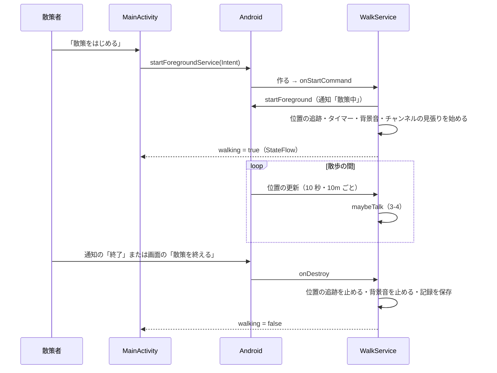
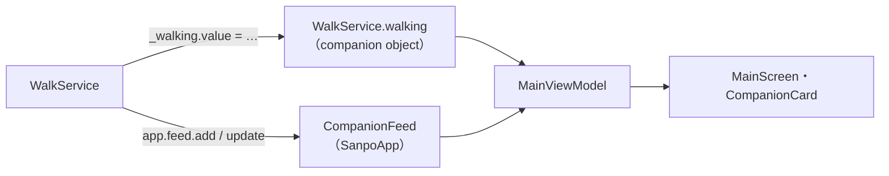

# 3-2 常駐サービス

[目次](../README.md) ＞ 第 3 部 ＞ 3-2

> Android のサービスと通知の仕組みと最小の使い方は [技術カード: Android のサービスと通知](../ref/android-service-notification.md) にあります。

## この章で学ぶこと

- `WalkService` の一生: 散策の開始から終了までに何が起きるか
- 通知の 3 つのチャンネルと、重要度の使い分け
- 通知からアプリを開く・散策を止める仕組み（PendingIntent）
- Service と画面のあいだで状態を共有する方法
- 散策を終えるときの後片付けの順番

[1-3](../01-kotlin-android/03-android-components.md) で Service とフォアグラウンドサービスの基本を見ました。この章では、[WalkService.kt](https://github.com/duwenji/yorisoi-sanpoguide/blob/main/app/src/main/java/io/github/duwenji/yorisoi/sanpoguide/walk/WalkService.kt) をもっと深く読みます。

## WalkService の一生



### 始まり: onStartCommand

```kotlin
override fun onStartCommand(intent: Intent?, flags: Int, startId: Int): Int {
    super.onStartCommand(intent, flags, startId)
    if (intent?.action == ACTION_STOP) {
        stopSelf()
        return START_NOT_STICKY
    }
    if (session == null) {
        ServiceCompat.startForeground(
            this, NOTIFICATION_ID, walkingNotification("いってらっしゃい。近くに来たらお知らせします"),
            ServiceInfo.FOREGROUND_SERVICE_TYPE_LOCATION,
        )
        // Lists are fetched when a walk starts if a day has passed, never during it (API-002 取得の時期).
        app.channels.refreshIfDue()
        val s = WalkSession()
        s.startStation(app.stations.current.value.key)
        // … 試用のチャンネルなら、最初にそう言う …
        session = s
        app.feed.startWalk(s)
        startLocationUpdates()
        startTicker()
        startAmbient()
        watchStations()
        _walking.value = true
    }
    return START_STICKY
}
```

`onStartCommand` は、`startForegroundService` や `startService` のたびに呼ばれます。散策中にもう一度呼ばれることもあるので、`session == null`（まだ散歩が始まっていない）のときだけ始める処理をしています。

始めるときに起きること:

1. **すぐに `startForeground`**: 決められた時間内に通知を出さないと、OS にアプリを止められます（[1-3](../01-kotlin-android/03-android-components.md)）
2. **第三者のチャンネルのリストを取りに行く**（前回から 24 時間たっていれば）: API-002 で「散歩の開始時に取る、散歩中は取らない」と決めたとおりです（[6-5](../06-trust/05-verify-in-app.md)）
3. **散歩の状態（`WalkSession`）を作る**: 距離・訪れたスポット・話した内容など、この散歩のあいだの状態を持ちます（3-3）
4. **4 つの仕事を始める**: どれも `lifecycleScope` のコルーチンなので（[3-1](01-coroutines.md)）、散策を終えると一緒に止まります

| 仕事 | 何をするか |
|---|---|
| `startLocationUpdates` | 位置の更新を受け取り始める（3-3） |
| `startTicker` | 30 秒ごとに天気を確かめ、話すかどうか判断する（3-1・3-4） |
| `startAmbient` | 設定・雰囲気・チャンネルに合わせて背景音を流す（第 4 部） |
| `watchStations` | 散歩の途中でチャンネルが変わったら、新しいチャンネルにあいさつさせる |

### 散歩の途中でのチャンネルの切り替え

```kotlin
/**
 * A channel switch mid-walk: recorded, and the new channel introduces itself. Changing only
 * a setting of the same channel (e.g. its talk level) isn't a switch.
 */
private fun watchStations() = lifecycleScope.launch {
    app.stations.current.collect { station ->
        val s = session ?: return@collect
        if (s.stations.lastOrNull()?.station == station.key) return@collect
        s.switchStation(station.key, trialNotice(station) + station.manifest.greeting)
        maybeTalk()
    }
}
```

[2-2](../02-compose/02-state-viewmodel.md) で見た「画面と Service が同じ StateFlow を見ている」のが、ここで生きています。散策者が画面でチャンネルを変えると、`StationRepository.current` が変わり、ここの `collect` に届きます。Service と画面は直接やりとりしていません。

`return@collect` は「この `collect` のラムダから抜ける（次の値を待つ）」という意味です。ラムダの中の `return` には、どこから抜けるかを `@名前` で書きます。

### 終わり: onDestroy

```kotlin
override fun onDestroy() {
    fused.removeLocationUpdates(callback)
    ambient?.release()
    ambient = null
    session?.let(::finishWalk)
    session = null
    _walking.value = false
    super.onDestroy()
}
```

散策を終えると（`stopService` か `stopSelf`）、`onDestroy` が呼ばれます。

1. **位置の更新を止める**: 止め忘れると、Service がいなくなっても GPS が動き続け、電池を減らします
2. **背景音を止めて、音の部品を手放す**
3. **散歩を締めくくる**（`finishWalk`）: 記録を保存し、まとめの一言を話す。[3-1](01-coroutines.md) で見たとおり、`lifecycleScope` はこのあとキャンセルされるので、`appScope` で行う
4. **`walking` を `false` に**: 画面のボタンが「散策をはじめる」に戻る

`lifecycleScope` のコルーチン（タイマーなど）は、`super.onDestroy()` の中でキャンセルされます。自分で止める必要があるのは、コルーチンではない仕組み（位置の更新のコールバック、音のプレーヤー）だけです。

### START_STICKY と START_NOT_STICKY

`onStartCommand` の戻り値は、「OS がメモリ不足でこの Service を止めたあと、どうしてほしいか」を伝えます。

| 戻り値 | 意味 | 散策ガイドでは |
|---|---|---|
| `START_STICKY` | 余裕ができたら作り直してほしい | 散策を始めたとき |
| `START_NOT_STICKY` | 作り直さなくてよい | 「終了」で止めるとき |

散歩の途中で止められても、作り直されれば新しい散歩として続きます。止められる前の分は、途中で保存した記録（`saveProgress`、3-4 の「区切り」）に残っています。

## 通知

### 4 つのチャンネル

[SanpoApp.kt](https://github.com/duwenji/yorisoi-sanpoguide/blob/main/app/src/main/java/io/github/duwenji/yorisoi/sanpoguide/SanpoApp.kt) が、起動時に 4 つの通知のチャンネルを作っています（[1-3](../01-kotlin-android/03-android-components.md)）。

```kotlin
createNotificationChannel(
    NotificationChannel(CHANNEL_CUE, "チャンネルの案内", NotificationManager.IMPORTANCE_HIGH).apply {
        description = "選んだチャンネルが、場所や散歩の始まり・終わりに合わせて出すお知らせです"
    }
)
createNotificationChannel(NotificationChannel(CHANNEL_WALK, "散策モード", NotificationManager.IMPORTANCE_LOW))
createNotificationChannel(NotificationChannel(CHANNEL_SPOT, "スポット案内", NotificationManager.IMPORTANCE_HIGH))
// High importance keeps the default sound and vibration.
createNotificationChannel(
    NotificationChannel(CHANNEL_ALERT, "雷雨の予報", NotificationManager.IMPORTANCE_HIGH).apply {
        description = "散策中に雷雨が近づいたとき、音で知らせます"
    }
)
```

| チャンネル | 重要度 | 何を知らせるか | なぜその重要度か |
|---|---|---|---|
| 散策モード（`walk`） | 低 | 散策中であることと、最新の一言 | 散歩の間ずっと出ている。そのたびに音が鳴っては困る |
| スポット案内（`spot`） | 高 | 近くに来たスポットの解説 | 画面を見ていなくても気づいてほしい |
| 雷雨の予報（`weather_alert`） | 高 | 雷雨が近づいている | 安全に関わる。イヤホンをしていなくても音で気づかせる |
| チャンネルの案内（`cue`） | 高 | 選んだチャンネルが、きっかけ（スポット・地点・散歩の始まりなど）に合わせて出す素材（文字・画像） | チャンネルを選んだ人が、出てほしいと思って選んでいる。タップすると解説の画面が開く（[2-1](../02-compose/01-compose-basics.md) の「詳しく見る」と同じ） |

チャンネルを分けておくと、散策者は端末の設定で「スポット案内は音なしにする」「雷雨の予報だけは鳴らす」のように、チャンネルごとに選べます。**一度作ったチャンネルの重要度は、アプリからは変えられません**（散策者の選択を尊重するため）。

### 通知を作る

散策中の通知です。

```kotlin
private fun walkingNotification(text: String): Notification {
    val stop = PendingIntent.getService(
        this, 1, Intent(this, WalkService::class.java).setAction(ACTION_STOP),
        PendingIntent.FLAG_IMMUTABLE,
    )
    return NotificationCompat.Builder(this, SanpoApp.CHANNEL_WALK)
        .setSmallIcon(R.drawable.ic_walk)
        .setContentTitle("散策中")
        .setContentText(text)
        .setStyle(NotificationCompat.BigTextStyle().bigText(text))
        .setContentIntent(openAppIntent())
        .addAction(0, "終了", stop)
        .setOngoing(true)
        .setOnlyAlertOnce(true)
        .build()
}
```

| 指定 | 意味 |
|---|---|
| `Builder(this, CHANNEL_WALK)` | どのチャンネルの通知か |
| `setSmallIcon` | ステータスバーに出る小さなアイコン（必須） |
| `BigTextStyle` | 長い文を、広げたときに全部見せる |
| `setContentIntent` | 通知をタップしたら何をするか（アプリを開く） |
| `addAction(…, "終了", stop)` | 通知に「終了」のボタンを付ける |
| `setOngoing(true)` | スワイプで消せない（散策中であることを隠さない） |
| `setOnlyAlertOnce(true)` | 同じ通知を更新しても、2 回目以降は音や振動を出さない |

### 同じ ID で上書きする

```kotlin
private const val NOTIFICATION_ID = 1
// One slot for spot talks: each new spot replaces the last instead of piling up.
private const val SPOT_NOTIFICATION_ID = 2
private const val ALERT_NOTIFICATION_ID = 3
```

通知は **ID が同じなら上書き** されます。

- 散策中の通知（ID 1）は、話すたびに最新の一言に書き換わる（`speakLine` の中で `notify(NOTIFICATION_ID, walkingNotification(text))`）。`setOnlyAlertOnce` のおかげで、書き換えのたびに鳴ることはない
- スポットの通知（ID 2）は、新しいスポットが前のスポットを置き換える。コメントのとおり、通知がたまっていかないようにするため

### PendingIntent: あとで OS に代わりにやってもらう

通知の「終了」ボタンは、散策者がいつ押すか分かりません。押されたときには、アプリが動いていないかもしれません。そこで **PendingIntent** を使います。

PendingIntent は、「この Intent を、あとで、このアプリの代わりに実行してください」と **OS に預けておく依頼書** です。

- `PendingIntent.getService(…, Intent(this, WalkService::class.java).setAction(ACTION_STOP), …)`: 押されたら、`ACTION_STOP` の付いた Intent で `WalkService` を呼ぶ → `onStartCommand` で `stopSelf()`
- `PendingIntent.getActivity(…, Intent(this, MainActivity::class.java), …)`: タップされたら `MainActivity` を開く

`FLAG_IMMUTABLE` は、預けた Intent をほかのアプリが書き換えられないようにする指定で、Android 12 からは指定が必須です。

### 雷雨のときだけ音つきの通知

```kotlin
// Without earphones the spoken warning goes unheard; lightning is worth a sound.
if (change.kind == WeatherChangeKind.THUNDER) {
    getSystemService(NotificationManager::class.java).notify(ALERT_NOTIFICATION_ID, alertNotification(CueShow.textOf(line).orEmpty()))
}
speakLine(line)
```

散策ガイドはふつう声で話しかけますが、イヤホンをしていなければ声は届きません。雷は命に関わるので、音の鳴るチャンネルの通知も出します。`alertNotification` は `setCategory(NotificationCompat.CATEGORY_ALARM)` で、警報の通知だと OS に伝えています。

## Service と画面で状態を共有する

画面は「散策中かどうか」を知る必要があります（ボタンの文字）。`WalkService` は `companion object` に StateFlow を持っています。

```kotlin
companion object {
    private val _walking = MutableStateFlow(false)
    val walking: StateFlow<Boolean> = _walking.asStateFlow()

    fun start(context: Context) {
        context.startForegroundService(Intent(context, WalkService::class.java))
    }

    fun stop(context: Context) {
        context.stopService(Intent(context, WalkService::class.java))
    }
}
```

`companion object` の中のものは、Service のインスタンスがなくても使えます（[1-1](../01-kotlin-android/01-kotlin-syntax.md)）。`MainViewModel` は `WalkService.walking` を読むだけです（[2-2](../02-compose/02-state-viewmodel.md)）。Service が動いていてもいなくても、`walking` はいつも読めます。

話した内容や散歩の数字（距離・時間）は、`SanpoApp` が持つ `CompanionFeed` に書き込み、画面はそれを StateFlow で読みます（`app.feed.add(…)`・`app.feed.update(s)`）。2-1 の `CompanionCard` に届く `live` と `lines` は、ここから来ています。



## ハンズオン: エミュレータで通知とサービスをのぞく

ここは任意です。Android Studio のエミュレータ（または USB でつないだ実機）と、`adb`（Android SDK の道具）を使います。

### 1. 準備

```sh
ADB="$(sed -n 's/^sdk.dir=//p' /c/Dev/apps/yorisoi-sanpoguide/local.properties | sed 's/\\:/:/; s/\\\\/\//g')/platform-tools/adb.exe"
"$ADB" devices
```

`emulator-5554  device` のように端末が表示されれば準備完了です。散策ガイドが入っていなければ、`./gradlew installDebug` で入れ、一度起動して許可のダイアログに答えてください。

### 2. 通知のチャンネルを見る

```sh
"$ADB" shell dumpsys notification | grep -o "mId='\(cue\|walk\|spot\|weather_alert\)', mName=[^,]*, mDescription=[^,]*, mImportance=[0-9]"
```

```
mId='cue', mName=チャンネ..., mDescription=hasDescription , mImportance=4
mId='spot', mName=スポッ..., mDescription=, mImportance=4
mId='walk', mName=散策モ..., mDescription=, mImportance=2
mId='weather_alert', mName=雷雨の..., mDescription=hasDescription , mImportance=4
```

`SanpoApp` が作った 4 つのチャンネルです。`mImportance` の 2 が `IMPORTANCE_LOW`、4 が `IMPORTANCE_HIGH` です。チャンネルの案内と雷雨の予報には説明文（`description`）があることも分かります。`cue` の行がなければ、端末のアプリが素材の第 1 段より前の版（`versionCode` 1）です。

端末の「設定」→「アプリ」→「散策ガイド」→「通知」でも、4 つのチャンネルが並んでいるのを見られます。

### 3. サービスの状態を見る

散策していないとき:

```sh
"$ADB" shell dumpsys activity services io.github.duwenji.yorisoi.sanpoguide
```

```
ACTIVITY MANAGER SERVICES (dumpsys activity services)
  (nothing)
```

アプリで「散策をはじめる」を押してから、もう一度実行すると、`WalkService` の情報が表示されます。`isForeground=true` の行を探してください。フォアグラウンドサービスとして動いている印です。

> 散策を始めると、AI のキーを設定していれば、あいさつのために AI が呼ばれます（AI のサービスの料金がかかります）。キーを設定していなければ、定型文で話します。

### 4. 通知の「終了」で止める

通知を引き下ろして「終了」を押し、手順 3 のコマンドで `(nothing)` に戻ることを確かめます。画面のボタンも「散策をはじめる」に戻っているはずです。PendingIntent → `onStartCommand` の `ACTION_STOP` → `stopSelf` → `onDestroy` → `walking = false`、という流れです。

## つまずきやすいところ

- **`onStartCommand` は何度も呼ばれる**: 「始める」処理は、まだ始まっていないときだけ行う
- **コルーチン以外の後片付けを忘れない**: 位置の更新のコールバックや音のプレーヤーは、`onDestroy` で自分で止める
- **通知のチャンネルの重要度は後から変えられない**: 変えたいときは、別の ID のチャンネルを作り直す必要があります。最初によく考えて決めます
- **PendingIntent には `FLAG_IMMUTABLE`**: Android 12 以降は、指定しないと例外になります

## 確認問題

<details>
<summary>問 1. 散策中の通知が、話すたびに書き換わっても鳴らないのはなぜですか。</summary>

同じ ID（`NOTIFICATION_ID`）で上書きしていることと、`setOnlyAlertOnce(true)` で 2 回目以降の音や振動を止めていることの 2 つによります。さらに、散策モードのチャンネルの重要度は「低」です。

</details>

<details>
<summary>問 2. 通知の「終了」ボタンが押されたとき、WalkService の中で何が起きますか。</summary>

PendingIntent に預けた、`ACTION_STOP` の付いた Intent で `onStartCommand` が呼ばれ、`stopSelf()` で止まります。続いて `onDestroy` で、位置の更新と背景音を止め、散歩の記録を保存し、`walking` を `false` にします。

</details>

<details>
<summary>問 3. 画面がチャンネルを変えたことを、WalkService はどうやって知りますか。</summary>

`watchStations` で `StationRepository.current`（StateFlow）を `collect` しているからです。画面は設定を保存するだけで、Service に直接何かを伝えてはいません。同じ StateFlow を見ているので、変化が届きます。

</details>

---

前: [3-1 Coroutines と Flow](01-coroutines.md) ／ 次: [3-3 位置情報とセンサー](03-location-sensors.md)
