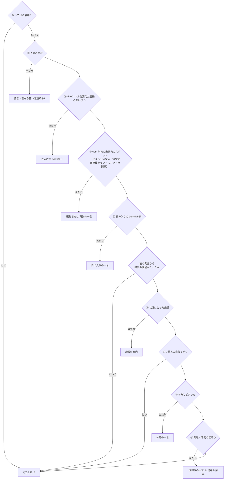

# 3-4 「いま何を話すか」の判定

[目次](../README.md) ＞ 第 3 部 ＞ 3-4

## この章で学ぶこと

- 散策ガイドの心臓部 `maybeTalk()` が、何をどの順番で判断しているか
- 優先順位を「上から順に、最初に当たった 1 つだけ」で表す書き方
- 話しすぎを防ぐしくみ（話している最中・間隔・1 回だけ）
- 判断のロジックを小さな部品に分けてテストする作り
- enum の **並び順** に意味を持たせる書き方と、その危うさ

## maybeTalk はいつ呼ばれるか

[WalkService.kt](../../SanpoGuide/app/src/main/java/io/github/duwenji/sanpoguide/walk/WalkService.kt) の `maybeTalk()` は、次の 3 つのときに呼ばれます。

| きっかけ | 場所 | 章 |
|---|---|---|
| 位置が届いたとき（10 秒・10m ごと） | `onLocation` | [3-3](03-location-sensors.md) |
| 30 秒ごとのタイマー（立ち止まっていても） | `startTicker` | [3-1](01-coroutines.md) |
| 散歩の途中でチャンネルを変えたとき | `watchStations` | [3-2](02-service.md) |

呼ばれるたびに、「今、話すべきことがあるか」を上から順に調べ、**最初に当たった 1 つだけ** を話します。何も当たらなければ、何も話しません。

## 全体の流れ

[SanpoGuide/docs/architecture.md](../../SanpoGuide/docs/architecture.md) の図 2 にも同じ流れが描かれています。



## 上から順に、最初の 1 つだけ

コードは、条件が当たったら話して `return` する、という形のくり返しです。

```kotlin
/** Decides whether anything is worth saying right now, most important first. */
private suspend fun maybeTalk() {
    val s = session ?: return
    val location = lastLocation ?: return
    // Let the current line finish before starting another.
    if (app.speaker.isSpeaking) return
    val station = app.stations.current.value
    val level = station.talkLevel
    val limits = app.settings.settings.value.thresholds
    val now = System.currentTimeMillis()

    // A turn in the weather comes first, regardless of the talk level: it's about safety.
    val change = weather?.let { WeatherChangeDetector.detect(it, now, limits) }
    // …
    if (change != null && /* 同じ種類を最近知らせていない */) {
        talk { /* … 警告を話す … */ }
        return
    }
    // … ②〜⑦ も同じ形 …
}
```

この書き方の良いところは、**コードの上下の並びが、そのまま優先順位になる** ことです。「天気の急変は、スポットの案内より先」という決まりは、天気の判定がスポットの判定より上に書いてある、という事実だけで表されています。優先順位を変えたければ、ブロックの順番を入れ替えます。

[2-4](../02-compose/04-theme-mood.md) の `paletteFor` の `when`（上から順に当てはまる色を選ぶ）と同じ考え方を、もっと大きな規模で使っているわけです。

## 7 つの判断

### ① 天気の急変（いつでも最優先）

```kotlin
// A turn in the weather comes first, regardless of the talk level: it's about safety.
val change = weather?.let { WeatherChangeDetector.detect(it, now, limits) }
val warnedAt = change?.let { s.weatherWarnedAt[it.kind] }
if (change != null && (warnedAt == null || now - warnedAt >= limits.ms(Threshold.WEATHER_REPEAT_MIN))) {
    talk {
        // A thunderstorm warning also covers the rain that comes with it.
        WeatherChangeKind.entries.filter { it >= change.kind }.forEach { s.weatherWarnedAt[it] = now }
        val line = app.companion.say(TalkEvent.WeatherTurn(change), s, weather)
        // Without earphones the spoken warning goes unheard; lightning is worth a sound.
        if (change.kind == WeatherChangeKind.THUNDER) {
            getSystemService(NotificationManager::class.java).notify(ALERT_NOTIFICATION_ID, alertNotification(line))
        }
        speakLine(line)
    }
    return
}
```

- 安全に関わるので、**話しかけの頻度の設定（控えめ・ふつう・おしゃべり）に関係なく** 話します
- 同じ種類の予告は、設定の間隔（既定 60 分）をあけます（`weatherWarnedAt`）
- 「近いうちに崩れるか」の判断は、`WeatherChangeDetector` という別の部品に任せています（下で見ます）

### ② チャンネルを変えた直後のあいさつ

```kotlin
// The user just switched channels: the new one says hello before anything else. No AI, so it's instant.
s.pendingGreeting?.let { line ->
    talk {
        s.pendingGreeting = null
        speakLine(line)
    }
    return
}
```

チャンネルのあいさつは、チャンネルのパッケージに書かれた決まった文（AI を使わない）なので、すぐに話せます。

### ③ 近くのスポット

```kotlin
// While the user stands still, don't run through every spot within reach one by one;
// the spot they arrived at has been introduced, and a rest remark may be due instead.
val stationary = s.restMinutes(now) >= STATIONARY_MINUTES
if (!stationary && !justSwitched && now - s.lastSpotTalkAt >= level.spotGapMs) {
    // One spot per tick, by distance from the user (spots' distances to each other don't matter).
    val candidates = app.spots.spots.value
        .filter { poi -> poi.id !in s.talkedAbout && s.visits.none { it.matches(poi) } }
        .map { it to it.distanceFrom(location) }
        .filter { (_, d) -> d <= ANNOUNCE_RADIUS_M }
        .map { (poi, d) -> SpotCandidate(poi, d, app.history.visitsTo(poi, excludingWalk = s.id).isNotEmpty()) }
    val spot = SpotChooser.pick(
        candidates, station.preferredCategories, station.skippedCategories,
        newSpots = station.talksOn(TalkEventKind.SPOT), revisits = station.talksOn(TalkEventKind.REVISIT),
    )
    if (spot != null) {
        talk {
            s.lastSpotTalkAt = now
            talkAboutSpot(s, spot.poi, spot.distanceM.toInt())
        }
        return
    }
}
```

コレクションの操作（[1-1](../01-kotlin-android/01-kotlin-syntax.md)）で、候補を絞り込んでいます。

1. この散歩でまだ話していないスポット
2. 距離を計算して、60m 以内のもの
3. 過去の散歩で訪れたか（再訪か）を調べる

そのうえで、どれを話すかは `SpotChooser` に任せます。条件のコメントも大事です。

- **立ち止まっている間は、次々に案内しない**（`stationary`）: 寺の境内で 2 分立ち止まったら、周りのスポットを片っ端から案内するのではなく、休憩の一言の出番かもしれない
- **スポットの案内どうしの間隔**（`level.spotGapMs`）: スポットが密集した通りで、講義のようにならないように

`SpotChooser.pick` は、チャンネルの好み（歴史探訪なら寺社を先に、など）と、そのスポットの「話題になりそうか」（Wikipedia の記事があるか、など）で点数をつけ、点数が同じなら近い順に 1 つ選びます。選ばれなかった候補は、間隔がたったあとの判断で、まだ近くにいれば選ばれます。

### ④ 日の入り（頻度に関係なく）

```kotlin
// Heads-up before dark, regardless of the talk level: it's about getting home, not chat.
val sunsetAt = weather?.sunsetAt
if (sunsetAt != null && !s.sunsetWarned) {
    val minutesLeft = ((sunsetAt - now) / 60_000).toInt()
    // Too close to be useful below the latest minute; an empty range if the settings cross.
    if (minutesLeft in limits[Threshold.SUNSET_LATEST_MIN]..limits[Threshold.SUNSET_NOTICE_MIN]) {
        // … 1 回だけ話す …
    }
}
```

`in 5..30` は「5 以上 30 以下」という範囲の判定です。コメントの "an empty range if the settings cross" に注目してください。設定で「何分前から」（30）より「何分前を過ぎたら知らせない」（5）を大きくしてしまうと、`35..30` のような **空の範囲** になり、何も当たりません。設定画面がこの組み合わせを保存させないのは、このためです（[Threshold.kt](../../SanpoGuide/app/src/main/java/io/github/duwenji/sanpoguide/settings/Threshold.kt) の `conflicts`）。

### ここから雑談の間隔を守る

```kotlin
if (now - s.lastSpokeAt < level.minGapMs) return
```

①〜④は「伝えるべきこと」でした。ここから下は「言ってもいいこと」なので、前に何か話してから一定の時間（ふつうなら 3 分）がたつまでは何も話しません。

### ⑤ 施設、⑥ 休憩、⑦ 区切り

- **⑤ 施設**: `FacilityAdvisor.pick` に任せる（[1-1](../01-kotlin-android/01-kotlin-syntax.md) のハンズオンで読んだ部品）。方向は [3-3](03-location-sensors.md) の `relativeDirection`
- **切り替えの直後 1 分は、ここで止める**（`if (justSwitched) return`）: 新しいチャンネルのあいさつの直後に雑談が続くと、あいさつがかすむため
- **⑥ 休憩**: 4 分とどまったら（[3-3](03-location-sensors.md) の錨の仕組み）、1 回だけ
- **⑦ 区切り**: 前の区切りから一定の距離を歩いたか、一定の時間がたったら。区切りでは、記録も途中まで保存します（`saveProgress`）。話さないチャンネルでも保存だけはします。コメント: "so a quiet walk isn't lost if the service dies"（Service が止められても、静かな散歩の記録が失われないように）

## 話しすぎを防ぐしくみ

`maybeTalk` は数秒〜30 秒ごとに呼ばれます。話しすぎないように、何重もの仕組みがあります。

| 仕組み | 場所 | 防ぐもの |
|---|---|---|
| 話している最中は判断しない | `if (app.speaker.isSpeaking) return` | 話の途中に次の話が割り込む |
| 1 度に 1 つだけ | `talk { … }` の `tryLock`（[3-1](01-coroutines.md)） | AI が文を作っている間に、別の話が始まる |
| 最初に当たった 1 つだけ | 当たったら `return` | 1 回の判断で何個も話す |
| 同じものは 1 回だけ | `talkedAbout`・`mentionedFacilities`・`sunsetWarned`・`restRemarked` | 同じスポットや施設を何度も |
| 種類ごとの間隔 | `weatherWarnedAt`・`lastSpotTalkAt`・`facilityMentionAt` | 同じ種類の話が続く |
| 全体の間隔 | `lastSpokeAt` と `level.minGapMs` | 雑談が続く |

### 話しかけの頻度: TalkLevel

間隔の長さは、チャンネルの「話しかけの頻度」で決まります（[TalkLevel.kt](../../SanpoGuide/app/src/main/java/io/github/duwenji/sanpoguide/settings/TalkLevel.kt)）。

```kotlin
enum class TalkLevel(
    val label: String,
    val spotGapMs: Long,          // スポットの案内どうしの間隔
    val minGapMs: Long,           // 雑談の間隔
    val milestoneDistanceM: Double,
    val milestoneIntervalMs: Long,
    val remarkOnRest: Boolean,    // 休憩の一言をするか
) {
    QUIET("控えめ", 5 * MINUTE, 6 * MINUTE, 2000.0, 30 * MINUTE, remarkOnRest = false),
    NORMAL("ふつう", 2 * MINUTE, 3 * MINUTE, 1000.0, 15 * MINUTE, remarkOnRest = true),
    CHATTY("おしゃべり", 1 * MINUTE, 2 * MINUTE, 500.0, 8 * MINUTE, remarkOnRest = true),
}
```

1-1 で見た「値ごとに項目を持てる enum」の例です。`maybeTalk` は `level.spotGapMs` のように読むだけで、「控えめ」かどうかを `if` で分けていません。頻度の段階を足したいときは、ここに 1 行足すだけです。

### 何について話すか: チャンネル

`station.talksOn(TalkEventKind.REST)` のように、チャンネルごとに「どの場面で話すか」も決まっています。「しずかに」チャンネルなら、スポットや休憩の一言を話さない、といった具合です。第三者のチャンネル（第 6 部）も、パッケージの中でこれを決められます。

## 判断を小さな部品に分ける

`maybeTalk` 自身は、いわば **交通整理** です。難しい判断は、Android に依存しない小さな部品に任せています（[2-3](../02-compose/03-manual-di.md)）。

| 部品 | 判断すること | テスト |
|---|---|---|
| `WeatherChangeDetector.detect` | 近いうちに天気が崩れるか、何分後か | `WeatherChangeDetectorTest`（8 件） |
| `SpotChooser.pick` | 候補のうち、どのスポットを話すか | `SpotChooserTest`（4 件） |
| `FacilityAdvisor.pick` | どの施設を、どの理由で案内するか | `FacilityAdvisorTest`（9 件） |
| `WalkSession` | 距離、休憩の時間、チャンネルの切り替え | `WalkSessionStationTest` |

`maybeTalk` は Service の中にあり、位置・天気・AI・音声・通知に囲まれているので、テストが難しい場所です。だから判断のほうを外に出し、`maybeTalk` には「順番に聞いて、当たったら話す」ことだけを残しています。

### WeatherChangeDetector を読む

[WeatherChange.kt](../../SanpoGuide/app/src/main/java/io/github/duwenji/sanpoguide/companion/WeatherChange.kt):

```kotlin
/** A turn for the worse, most serious first. Each kind also covers the ones after it. */
enum class WeatherChangeKind {
    THUNDER,
    HEAVY_RAIN,
    /** Rain, drizzle or snow starting. */
    RAIN;
    // …
}

object WeatherChangeDetector {
    fun detect(weather: Weather, now: Long, limits: Thresholds = Thresholds()): WeatherChange? {
        val lookaheadMs = limits.ms(Threshold.WEATHER_LOOKAHEAD_MIN)
        // …
        // Slots not over yet whose weather starts within the lookahead.
        val coming = weather.forecast.filter { it.at > now && it.at - SLOT_MS <= now + lookaheadMs }
        for (kind in WeatherChangeKind.entries) {
            if (isHappening(kind, weather, heavyMm)) continue
            val slot = coming.firstOrNull { kind.matches(it.code, it.precipitationMm, heavyMm) } ?: continue
            // …
            return WeatherChange(kind, minutes, WeatherCodes.describe(slot.code))
        }
        return null
    }
}
```

- 予報（15 分ごと）のうち、まだ終わっていなくて、設定の時間（既定 60 分）以内に始まるものを集める
- **深刻な順に**（雷雨 → 強い雨 → 雨）調べる。もうその天気になっているなら飛ばす（すでに降っているのに「降りそうです」とは言わない）
- 最初に見つかった種類を返す

ここでも「上から順に、最初の 1 つ」です。そして、その「上から」は **enum の並び順** で決まっています。`WeatherChangeKind.entries` は、enum を書いた順（雷雨・強い雨・雨）に並んだ一覧だからです。

### enum の並び順に意味を持たせる

並び順は、`maybeTalk` の中でも使われています。

```kotlin
// A thunderstorm warning also covers the rain that comes with it.
WeatherChangeKind.entries.filter { it >= change.kind }.forEach { s.weatherWarnedAt[it] = now }
```

enum の値は、書いた順に大小を比べられます（`THUNDER < HEAVY_RAIN < RAIN`）。雷雨を予告したら、`>= THUNDER`（雷雨・強い雨・雨の全部）に「予告済み」の印を付けます。雷雨の予告は雨の予告も兼ねる、という決まりを、この 1 行で表しています。

便利ですが、**並びを入れ替えると意味が変わってしまう** という危うさもあります。enum の上のコメント "most serious first. Each kind also covers the ones after it." は、その約束を書き残したものです。ハンズオンで、並びを入れ替えるとどうなるか見てみましょう。

## ハンズオン: 優先順位を壊す

### 1. 天気の判定のテストを流す

```sh
cd /c/Dev/apps/SanpoGuide
./gradlew :app:testDebugUnitTest --tests '*WeatherChangeDetectorTest*'
```

8 件のテストが通ります。テストの名前を [WeatherChangeDetectorTest.kt](../../SanpoGuide/app/src/test/java/io/github/duwenji/sanpoguide/companion/WeatherChangeDetectorTest.kt) で見てみてください。

- steady weather is no news（天気が変わらなければ、知らせない）
- rain starting within the hour（1 時間以内に雨が降り出す）
- thunder beats rain, and is news even when it is already raining（雷雨は雨より優先。すでに雨が降っていても知らせる）
- …

### 2. enum の並びを入れ替える

[WeatherChange.kt](../../SanpoGuide/app/src/main/java/io/github/duwenji/sanpoguide/companion/WeatherChange.kt) の `WeatherChangeKind` を、深刻でない順に並べ替えます。

```kotlin
enum class WeatherChangeKind {
    /** Rain, drizzle or snow starting. */
    RAIN,
    HEAVY_RAIN,
    THUNDER;
    // …（下の matches はそのまま）
}
```

もう一度テストを流します。

```
8 tests completed, 1 failed
```

落ちるのは `thunder beats rain, and is news even when it is already raining` で、`expected:<THUNDER> but was:<RAIN>` と出ます。雨と雷雨の両方が予報されているとき、雨を先に見つけて返してしまうからです。「雷が来ます、建物に入ってください」と言うべきところで「雨が降りそうです」と言ってしまう、安全に関わる不具合です。

実は `maybeTalk` の `it >= change.kind` の意味も逆になります（雨の予告が、雷雨の予告を兼ねてしまう）。こちらはテストでは見つかりません。enum の並びに意味を持たせるなら、その約束をコメントに書き、テストで守る必要があります。

### 3. 元に戻す

```sh
git checkout -- app/src/main/java/io/github/duwenji/sanpoguide/companion/WeatherChange.kt
git status
```

### 4. 考えてみる

`maybeTalk` で、④日の入りの判定を①天気の急変より上に移したら、どんな場面で困るでしょうか。

<details>
<summary>考え方の例</summary>

日の入りの 30 分前と、雷雨が 20 分後に来る予報が重なったとき、先に日の入りの一言を話し、雷雨の警告がそのあとになります。日の入りの一言を話している間（と、次の判断まで）、雷雨の警告が遅れます。安全に関わる知らせほど上に置く、というのが今の並びの考え方です。

</details>

## つまずきやすいところ

- **優先順位はコードの並びで表す**: 条件をばらばらの場所に書くと、どれが先に判断されるのか分からなくなります
- **「伝えるべきこと」と「言ってもいいこと」を分ける**: 安全に関わる知らせは、頻度の設定や間隔に関係なく話します
- **enum の並び順に頼るなら、約束をコメントとテストに残す**: 並べ替えただけで意味が変わります
- **判断のロジックを Service に書き込まない**: テストしやすい小さな部品に出します

## 確認問題

<details>
<summary>問 1. 「控えめ」のチャンネルで、雷雨が近づきました。前の発言から 1 分しかたっていません。警告は話されますか。</summary>

話されます。天気の急変は `maybeTalk` のいちばん上で判断され、頻度の設定（`level.minGapMs`）による間隔の判定より前にあるからです。ただし、ほかの話をしている最中なら、話し終わってからの判断になります。

</details>

<details>
<summary>問 2. 雷雨を予告した 20 分後、雨が降り出しそうな予報になりました。雨の予告は話されますか。</summary>

話されません（既定の設定なら）。雷雨を予告したときに、`WeatherChangeKind.entries.filter { it >= change.kind }` で雷雨・強い雨・雨の全部に「予告済み」の印を付けているので、雨も同じ種類の間隔（既定 60 分）の中にあるとみなされます。

</details>

<details>
<summary>問 3. 寺の境内で立ち止まっています。周りに 60m 以内のスポットがまだ 3 つあります。次々に案内されますか。</summary>

されません。2 分以上とどまっていると `stationary` になり、スポットの案内の判定を飛ばすからです。代わりに、4 分たてば休憩の一言の出番になります（休憩の一言を話すチャンネルなら）。歩き出せば、間隔をあけて残りのスポットも案内されます。

</details>

---

前: [3-3 位置情報とセンサー](03-location-sensors.md) ／ 次: [4-1 HTTP と JSON](../04-outside/01-http-json.md)
