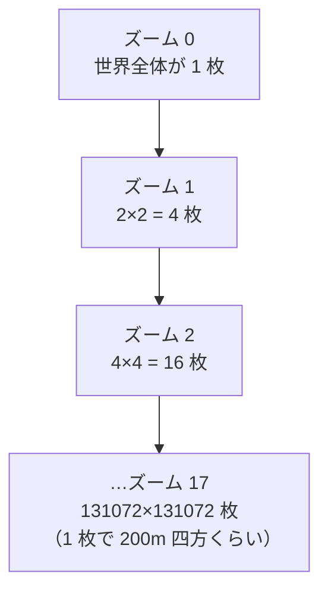

# 4-2 地図

[目次](../README.md) ＞ 第 4 部 ＞ 4-2

> osmdroid の仕組みと最小の使い方は [技術カード: osmdroid](../ref/osmdroid.md) にあります。

## この章で学ぶこと

- Web の地図が「タイル」という小さな画像の集まりでできていること
- 散策ガイドが使う 2 種類の地図（国土地理院、Google Map Tiles）と、その違い
- osmdroid の地図を Compose の中に置く方法（`AndroidView`）
- 地図の上にスポット・施設・ルート・現在地と向きを描く方法
- 歩くたびに地図を作り直さない工夫
- 地図の出典（著作権の表示）を守ること

## 地図はタイルの集まり

スマートフォンの地図は、1 枚の大きな画像ではありません。**256×256 ピクセルの小さな画像（タイル）** を、碁盤の目のように並べたものです。



- ズームを 1 段上げると、1 枚のタイルが 4 枚（縦 2×横 2）に分かれる
- タイルは「ズーム（z）・横の番号（x）・縦の番号（y）」で決まる
- 地図のサービスは、`https://…/{z}/{x}/{y}.png` のような URL でタイルを配っている

地図の部品は、画面に見えている範囲のタイルだけを取ってきて並べ、動かすと次のタイルを取ってきます。一度取ったタイルは端末に保存（キャッシュ）して、次から使い回します。

## 散策ガイドの地図

設定画面で 6 種類から選べます（[MapStyle.kt](https://github.com/duwenji/yorisoi-platform/blob/main/kit-geo/src/main/java/io/github/duwenji/yorisoi/kit/geo/map/MapStyle.kt)）。

```kotlin
enum class MapStyle(val label: String, val description: String, val google: GoogleMapType? = null) {
    GSI_STANDARD("地理院 標準", "国土地理院の標準地図"),
    GSI_PALE("地理院 淡色", "色を抑えた地図。スポットやルートの線が目立ちます"),
    GSI_PHOTO("地理院 写真", "国土地理院の航空写真"),
    GSI_RELIEF("地理院 標高", "高さを色で表した地図。坂や高低差がわかります（拡大は少し粗め）"),
    GOOGLE_ROADMAP("Google 地図", "Google マップの地図。Map Tiles API のキーが必要です", GoogleMapType.ROADMAP),
    GOOGLE_SATELLITE("Google 航空写真", "Google マップの航空写真。Map Tiles API のキーが必要です", GoogleMapType.SATELLITE),
}
```

| | 国土地理院（地理院タイル） | Google Map Tiles API |
|---|---|---|
| キー | 要らない | 要る（散策者が Google Cloud で用意する） |
| 料金 | 無料 | 散策者の Google Cloud に請求される |
| タイルの URL | 固定 | セッションを作ってから（下で説明） |
| 出典の表示 | 固定の文 | 見ている範囲によって変わる |

既定は国土地理院の地図です。キーも料金も要らないので、だれでもすぐ使えます。

### 国土地理院のタイル

[MapTiles.kt](https://github.com/duwenji/yorisoi-platform/blob/main/kit-geo/src/main/java/io/github/duwenji/yorisoi/kit/geo/map/MapTiles.kt):

```kotlin
private fun gsi(name: String, layer: String, minZoom: Int, maxZoom: Int, ext: String, credit: String) =
    XYTileSource(name, minZoom, maxZoom, 256, ext, arrayOf("https://cyberjapandata.gsi.go.jp/xyz/$layer/"), credit)

private val GsiStandard = gsi("GSI_std", "std", 5, 18, ".png", "出典：国土地理院")
private val GsiPale = gsi("GSI_pale", "pale", 5, 18, ".png", "出典：国土地理院")
private val GsiPhoto = gsi("GSI_photo", "seamlessphoto", 2, 18, ".jpg", /* 出典 */)
private val GsiRelief = gsi("GSI_relief", "relief", 5, 15, ".png", /* 出典 */)
```

`XYTileSource` は osmdroid の「`{URL}{z}/{x}/{y}{拡張子}` でタイルを取ってくる」部品です。地図の種類（`std`・`pale` など）ごとに、使えるズームの範囲と出典の文が違います。標高の地図はズーム 15 まで（それより拡大すると粗くなる、と設定画面の説明にもあります）。

### Google のタイル: セッションと出典

Google Map Tiles API は、タイルを取る前に **セッション** を作る必要があります（[GoogleMapTiles.kt](https://github.com/duwenji/yorisoi-platform/blob/main/kit-geo/src/main/java/io/github/duwenji/yorisoi/kit/geo/map/GoogleMapTiles.kt)）。

```kotlin
suspend fun session(apiKey: String, type: GoogleMapType): GoogleTileSession {
    val cacheKey = "${type.apiName}/$apiKey"
    sessions[cacheKey]?.takeIf { it.expiresAt - System.currentTimeMillis() > RENEW_BEFORE_MS }?.let { return it }
    return withContext(Dispatchers.IO) {
        val body = JSONObject()
            .put("mapType", type.apiName)
            .put("language", "ja-JP")
            .put("region", "JP")
            .toString()
            .toRequestBody("application/json".toMediaType())
        val url = "$BASE/v1/createSession".toHttpUrl().newBuilder().addQueryParameter("key", apiKey).build()
        // … POST して、session と expiry を受け取る …
    }.also { sessions[cacheKey] = it }
}
```

- 地図の種類・言語・地域を送ると、セッションの文字列（`session`）と有効期限（約 2 週間）が返る
- タイルの URL には、毎回セッションとキーを付ける: `https://tile.googleapis.com/v1/2dtiles/{z}/{x}/{y}?session=…&key=…`
- セッションは期限の 1 日前まで使い回す。作り直しを減らし、地図を開いている間に期限が切れないように

さらに Google の地図は、**見ている範囲によって出典の文が変わります**（「Map data ©2026 Google, ZENRIN」など）。地図を動かすたびに、見ている範囲を `copyright` で聞き直し、Google のロゴと一緒に画面に表示します。規約で表示が求められているからです。

### 失敗したら国土地理院の地図に戻る

キーが間違っている、Map Tiles API が有効になっていない、利用の上限に達した、といったときは、`GoogleMapsException` に散策者向けの説明を入れて投げ、`MainViewModel` は国土地理院の地図に切り替えて、理由を表示します（`MapState` の `notice`）。地図が真っ白になることはありません。

## 地図の部品: osmdroid

散策ガイドは、地図の表示に **osmdroid** を使っています。OpenStreetMap のために作られた、オープンソースの Android の地図の部品です。

- いろいろなタイルのサービスを、URL の形を教えるだけで使える
- マーカー（印）、線（Polyline）、図形などを地図の上に重ねられる
- タイルを端末にキャッシュする

Google 純正の地図の部品（Maps SDK for Android）ではなく osmdroid を使うのは、国土地理院のタイルをそのまま使えて、キーも要らないからです。

osmdroid は利用者のアプリを見分けるため、User-Agent の設定を求めています。[SanpoApp.kt](https://github.com/duwenji/yorisoi-sanpoguide/blob/main/app/src/main/java/io/github/duwenji/yorisoi/sanpoguide/SanpoApp.kt) の最初で設定しています。

```kotlin
Configuration.getInstance().userAgentValue = "SanpoGuide/${BuildConfig.VERSION_NAME} (Android)"
```

## Compose の中に地図を置く

osmdroid の `MapView` は、Compose ではない昔ながらの部品（View）です。[SpotMap.kt](https://github.com/duwenji/yorisoi-platform/blob/main/kit-geo/src/main/java/io/github/duwenji/yorisoi/kit/geo/map/SpotMap.kt) は、これを `AndroidView` で Compose の中に置いています（[2-1](../02-compose/01-compose-basics.md) で少し触れました）。

```kotlin
@Composable
fun SpotMap(
    tiles: MapTiles,
    location: Location?,
    heading: Float?,
    spots: List<SpotItem>,
    facilities: List<FacilityItem>,
    route: RouteToSpot?,
    focus: Facility?,
    onSpotClick: (SpotItem) -> Unit,
    onViewportChanged: (zoom: Int, north: Double, south: Double, east: Double, west: Double) -> Unit,
    modifier: Modifier = Modifier,
) {
    val mapView = remember {
        MapView(context).apply {
            setMultiTouchControls(true)
            controller.setZoom(17.0)
            // … 動かし終わったら、見ている範囲を知らせる …
        }
    }

    DisposableEffect(mapView) {
        mapView.onResume()
        onDispose { mapView.onPause(); mapView.onDetach() }
    }

    AndroidView(factory = { mapView }, modifier = modifier) { map ->
        // 引数が変わるたびに呼ばれる。地図の部品を書き換える
    }
}
```

| 部分 | 役割 |
|---|---|
| `remember { MapView(…) }` | 地図の部品を 1 回だけ作り、再コンポーズで作り直さない |
| `DisposableEffect` | 部品が画面に出たら `onResume`、消えたら `onPause`・`onDetach`。地図の部品の後片付け |
| `AndroidView(factory = …)` | 昔の部品を Compose の中に置く |
| `AndroidView` の最後のブロック | 引数（位置・スポットなど）が変わるたびに呼ばれる。ここで地図を書き換える |

最後のブロックは、宣言的な Compose と、書き換えて使う昔の部品の **つなぎ目** です。Compose の側からは「位置はここ、スポットはこれ」と宣言するだけで、ブロックの中で昔の部品のやり方（マーカーを足す、消す）に翻訳しています。

## 地図の上に描く

`AndroidView` のブロックの中で、地図に重ねるもの（オーバーレイ）を毎回並べ直しています。

```kotlin
map.overlays.clear()
// Under the spots, so a bench in a park doesn't cover the park.
map.overlays += markers.facilities
if (walked.size >= 2) { /* … 歩いた道の線 … */ map.overlays += track }
if (route != null) { /* … ルートの線 … */ map.overlays += line }
map.overlays += markers.spots
if (location != null) { /* … 現在地 … */ map.overlays += me }
if (tiles !is MapTiles.Google) map.overlays += copyright
map.invalidate()
```

**足した順に下から重なります**。施設 → 歩いた道 → ルート → スポット → 現在地の順なので、公園の中のベンチが公園の印を隠すことはなく、現在地はいつもいちばん上に見えます（コメント: "Under the spots, so a bench in a park doesn't cover the park."）。

### ルートの線

```kotlin
val line = markers.route ?: Polyline(map).apply {
    outlinePaint.color = ROUTE_COLOR
    outlinePaint.strokeWidth = 5 * density
    outlinePaint.strokeCap = Paint.Cap.ROUND
    outlinePaint.strokeJoin = Paint.Join.ROUND
    infoWindow = null
}.also { markers.route = it }
// Dashed when it's only the direction, not a way along paths.
line.outlinePaint.pathEffect = if (route.route.onPaths) null else DashPathEffect(floatArrayOf(12 * density, 8 * density), 0f)
line.setPoints(route.route.points.map { GeoPoint(it.lat, it.lon) })
```

OSRM でルートが引けたら道にそった実線、引けなかったら（[4-1](01-http-json.md) のハンズオン 4）スポットへの方向だけを示す **破線** にしています。線の太さは `density`（画面の細かさ）を掛けて、どの端末でも同じくらいの太さに見えるようにしています（Compose の `dp` と同じ考え方を、自分で計算しています）。

### 歩いた道の線

散策中に歩いた道も線で描きます。ルートの線と同じ `Polyline` ですが、色を変え（ルートの青と区別する赤紫）、ルートより下に置きます。歩いている最中は、これから行く道の方が大事だからです。

```kotlin
// The list is replaced only when the walk has grown, so this skips most updates.
if (walked !== markers.walkedPoints) {
    track.setPoints(walked.map { GeoPoint(it.lat, it.lon) })
    markers.walkedPoints = walked
}
```

このブロックは、位置や向きが少し変わるたびに呼ばれます。そのたびに何百もの点を入れ直すのは無駄なので、前回渡したリストと **同じもの（`!==` で、中身ではなく同じオブジェクトか）** なら飛ばします。歩いた道のリストは、記録した点が増えたときだけ新しいリストに置き換わる（`CompanionFeed` の `walked`）ので、それ以外の呼び出しでは入れ直しが起きません。点が 1 つだけのとき（歩き始めた場所）は、現在地の印と重なるので描きません。

### 現在地と向き

```kotlin
me.icon = heading?.let { markers.headingIcon(context, it) } ?: meIcon
```

向き（[3-3](../03-walk/03-location-sensors.md) の `rememberHeading`）が分かれば、向いている方向に扇形のついた印、分からなければただの丸です。扇形の印は `Canvas` で描いた画像です（[2-4](../02-compose/04-theme-mood.md) の `MoodScene` と同じく、画像ファイルを持たずにコードで描く）。

```kotlin
/** The position dot with a beam toward [degrees]; one per [HEADING_STEP] degrees, made on first use. */
fun headingIcon(context: Context, degrees: Float): Drawable {
    val step = ((degrees / HEADING_STEP).roundToInt() * HEADING_STEP) % 360
    return headingIcons.getOrPut(step) { drawHeadingIcon(context, step.toFloat()) }
}
```

向きを 5° 刻みに丸め、刻みごとに 1 回だけ画像を描いて使い回しています（最大 72 枚）。向きが変わるたびに画像を描き直すと重いからです。

## 歩くたびに作り直さない

位置は 10 秒ごとに変わり、そのたびに `AndroidView` のブロックが呼ばれます。何も考えずにマーカーを毎回作り直すと、困ったことが起きます。

```kotlin
// Distances change with every location update; the markers only when the places do,
// so a bubble the user opened stays open while they walk.
// Sets: the lists are sorted by distance, so walking reorders them without changing them.
val facilityIds = facilities.map { it.facility.id }.toSet()
if (facilityIds != markers.facilityIds) {
    // … マーカーを作り直す …
    markers.facilityIds = facilityIds
}
```

- 施設をタップして開いた吹き出しが、歩くたびに閉じてしまう
- 無駄な仕事で電池を使う

そこで、**場所の顔ぶれ（ID の集まり）が変わったときだけ** マーカーを作り直します。一覧は距離の順に並んでいるので、歩くと並び順は変わりますが、顔ぶれは変わりません。だから `List` ではなく `Set`（順番のない集まり）で比べています。

作ったマーカーは、`remember` した `MapMarkers` に入れて持ち越します。

```kotlin
/** Markers kept across map updates; rebuilt only when the set of places changes. */
private class MapMarkers {
    var facilityIds: Set<String>? = null
    var facilities: List<Marker> = emptyList()
    var spotIds: Set<String>? = null
    var spots: List<Marker> = emptyList()
    // …
}
```

### 地図の真ん中を勝手に戻さない

```kotlin
val last = centeredAt[0]
if (last == null || last.distanceTo(location) > 150f) {
    map.controller.animateTo(GeoPoint(location.latitude, location.longitude))
    centeredAt[0] = location
}
```

位置が届くたびに地図の真ん中を現在地に戻すと、散策者が指で地図を動かして先の方を見ていても、10 秒ごとに引き戻されてしまいます。そこで、前に真ん中に合わせた位置から **150m 以上動いたときだけ** 合わせ直します。

`arrayOfNulls<Location>(1)` を `remember` しているのは、「値を覚えておきたいが、変えても再コンポーズは起こしたくない」ためです。`mutableStateOf` にすると、書き換えるたびに描き直しが起きてしまいます。

## 出典を表示する

地図のデータには、必ず出典（著作権）の表示が要ります。

- 国土地理院: osmdroid の `CopyrightOverlay` が、タイルの設定に書いた出典の文（「出典：国土地理院」）を地図の隅に描く
- Google: 見ている範囲の出典を `copyright` で聞いて、ロゴと一緒に画面が描く。だから Google のときは `CopyrightOverlay` を重ねない（`if (tiles !is MapTiles.Google) map.overlays += copyright`）

スポットの写真（Wikimedia Commons）にも、作者とライセンスを表示しています（[README](https://github.com/duwenji/yorisoi-sanpoguide/blob/main/README.md) の「スポットの写真」）。外のデータを使うときは、その条件を守ることが欠かせません。

## ハンズオン: タイルを 1 枚取ってみる

### 1. 場所からタイルの番号を計算する

鶴岡八幡宮（北緯 35.3260°、東経 139.5563°）を含む、ズーム 17 のタイルの番号を計算します。地図のタイルで広く使われている計算式（Web メルカトル）です。

```sh
python -c "
import math
lat, lon, z = 35.3260, 139.5563, 17
n = 2 ** z
x = int((lon + 180) / 360 * n)
y = int((1 - math.asinh(math.tan(math.radians(lat))) / math.pi) / 2 * n)
print(z, x, y)"
```

```
17 116346 51772
```

- 横の番号（x）は、経度を 0〜1 に直して、横の枚数（2 の 17 乗）を掛けたもの
- 縦の番号（y）は、緯度をメルカトル図法で引き伸ばしてから同じようにしたもの

### 2. タイルを取る

```sh
cd /tmp
curl -s -o tile.png -w "%{http_code} %{content_type}\n" https://cyberjapandata.gsi.go.jp/xyz/std/17/116346/51772.png
```

```
200 image/png
```

`tile.png` を VS Code で開くと、256×256 の地図の画像が見えます。鶴岡八幡宮の源平池と、「鶴」の字の一部が写っているはずです。osmdroid は、画面に見えている範囲のこうしたタイルを並べて地図にしています。

### 3. 地図の種類を変える

URL の `std` を `pale`（淡色）や `seamlessphoto`（写真、拡張子は `.jpg`）に変えて、同じ場所のタイルを取ってみてください。散策ガイドの設定の「地図」の選択肢は、この URL の違いです。

```sh
curl -s -o photo.jpg https://cyberjapandata.gsi.go.jp/xyz/seamlessphoto/17/116346/51772.jpg
```

### 4. 片付け

```sh
rm -f tile.png photo.jpg
```

> 地理院タイルを使うときは、[国土地理院の利用規約](https://maps.gsi.go.jp/development/ichiran.html) に従い、出典を表示します。大量にまとめて取るのは控えてください。

## つまずきやすいところ

- **地図の部品は `remember` で 1 回だけ作る**: 再コンポーズのたびに作ると、地図が初めからになる
- **昔の部品の後片付けを忘れない**: `DisposableEffect` で `onPause`・`onDetach`
- **毎回作り直さない**: 変わったときだけ作り直す。比べるときは、並び順に左右されない形（`Set`）で
- **重ねる順番に意味がある**: 先に足したものが下になる
- **出典を必ず表示する**: 地図のデータの利用の条件

## 確認問題

<details>
<summary>問 1. 施設の吹き出しを開いたまま歩いても、吹き出しが閉じないのはなぜですか。</summary>

施設のマーカーは、施設の顔ぶれ（ID の集まり）が変わったときだけ作り直すからです。歩くと距離と並び順は変わりますが、顔ぶれは変わらないので、マーカー（と開いた吹き出し）はそのまま残ります。

</details>

<details>
<summary>問 2. Google の地図を選んだとき、osmdroid の <code>CopyrightOverlay</code> を重ねないのはなぜですか。</summary>

Google の地図の出典は、見ている範囲によって変わり、ロゴと一緒に表示する必要があるからです。範囲ごとの出典を `copyright` で聞いて、画面の側でロゴと一緒に描いています。固定の文を描く `CopyrightOverlay` では足りません。

</details>

<details>
<summary>問 3. ズーム 17 のタイルを、ズーム 18 にすると、同じ範囲を覆うタイルは何枚になりますか。</summary>

4 枚です。ズームを 1 段上げると、1 枚のタイルが縦 2×横 2 に分かれます。

</details>

---

前: [4-1 HTTP と JSON](01-http-json.md) ／ 次: [4-3 AI を組み込む](03-ai.md)
