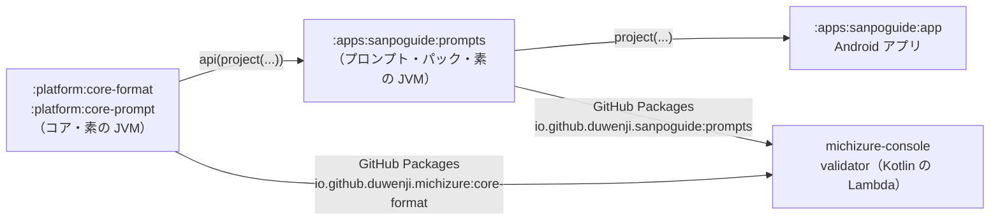

# 5-1 Android に依存しない JVM ライブラリ

[目次](../README.md) ＞ 第 5 部 ＞ 5-1

## この章で学ぶこと

- コア（`core-format`・`core-prompt`）とプロンプト・パック（`apps/sanpoguide/prompts`）が何を持っていて、なぜアプリ本体から切り出したのか
- Android に依存しない作りにするための 3 つの工夫（差し替え口、`compileOnly`、クラスパスのリソース）
- ファイルの集まりを抽象化する `StationFiles` と、その 3 つの実装
- 「アプリの動きを変えずに」切り出すための進め方（RFC-001・RFC-002）

> **名前の移り変わり**: この部の題にある `station-format` は、最初に切り出したときのモジュールの名前です（RFC-001、2026-10-03）。2026-10-12 に、付き添いアプリのエコシステム **michizure**（[ADR-003](../../SanpoGuide/docs/adr/ADR-003-companion-app-platform.md)）のために、アプリをまたいで使う **コア** と、SanpoGuide だけのものを入れた **プロンプト・パック** に分けました（[RFC-002](../../SanpoGuide/docs/refactoring/RFC-002-platform-stage1.md)）。`station-format` は 2.1.0 を最後に公開をやめています。この章では今の名前で説明し、フォルダ名（`05-station-format`）だけ元のままにしています。

## 3 つの JVM モジュールが持っているもの

SanpoGuide のリポジトリには、Android に依存しない素の Kotlin（JVM）のモジュールが 3 つあります（[1-2](../01-kotlin-android/02-gradle.md)）。

| モジュール | パッケージ | 中身 | 章 |
|---|---|---|---|
| `:platform:core-format` | `io.github.duwenji.michizure.core.format` | チャンネルのパッケージの形式と確認（`StationValidator`・`StationManifest`・`Slot`・`PackageArchive`・`PublisherSignature`）、素材・きっかけ・見せ方の確認（`Cues`・`CollectionReferences`）、エコシステムの語彙と互換性の判定（`Ecosystem`）、リストの文書の確認（`ProviderDocuments`） | [5-2](02-package-format.md)・[6-5](../06-trust/05-verify-in-app.md) |
| 〃 | `…core.format.material` | 素材集の形式と確認、素材提供者の共通の形（`Collections`・`Resources`・`Producers`・`Regions`） | [5-4](04-materials-cues.md) |
| `:platform:core-prompt` | `io.github.duwenji.michizure.core.prompt` | プロンプトのテンプレートの仕組み（`PromptTemplates`） | [4-3](../04-outside/03-ai.md) |
| `:apps:sanpoguide:prompts`（プロンプト・パック） | `io.github.duwenji.sanpoguide.prompt` | SanpoGuide のプロンプトの一覧（`Prompts`）、スロットの差し込み方（`StationPrompts`）、組み込みのチャンネル（`BuiltInChannels`）、審査の見本の場面（`ReviewSamples`） | [4-3](../04-outside/03-ai.md) |
| 〃 | リソース | `sanpoguide/prompts/`（プロンプトの文面）、`sanpoguide/channels/`（組み込みの 6 つのチャンネル） | [4-3](../04-outside/03-ai.md) |

コアは「チャンネルとは何か、どう確かめるか」という **エコシステム共通の決まりごと**、プロンプト・パックは「散歩の付き添いとして AI にどう話させるか」という **SanpoGuide の決まりごと** です。どちらにも、画面・位置情報・音・通信といった Android の機能は 1 つも入っていません。アプリ（`:apps:sanpoguide:app`）はプロンプト・パックに依存し、プロンプト・パックがコアを `api` で引き連れてきます。

## なぜ切り出したのか

理由は 2 つあります。

1. **管理システムでも同じコードを使うため**（RFC-001）
2. **サイクリングの伴走など、2 本目の付き添いアプリでもチャンネルを使うため**（RFC-002、ADR-003）



チャンネル管理システムは、チャンネル提供者が申請したパッケージを機械で確かめ（機械審査）、運営のために「このチャンネルなら AI はこう話す」という見本のプロンプトを作ります。そのとき、アプリと **違うコード** で確かめると、次のような食い違いが起きます。

- 管理システムでは合格したのに、アプリでは読み込めない
- 審査で見た見本と、アプリが実際に AI に送るプロンプトが違う

[6-6](../06-trust/06-same-rules.md) で見たとおり、食い違いを防ぐいちばん確かな方法は **同じコードを使う** ことです。そのためには、そのコードが Android の上でも、AWS の Lambda（普通の JVM）の上でも動く必要があります。だからコアとプロンプト・パックは、Android に依存しない素の Kotlin（JVM）のライブラリになっています。

最初の切り出しの経緯は [RFC-001](../../SanpoGuide/docs/refactoring/RFC-001-prompts-to-station-format.md) に記録されています。

> 管理システム（sanpo-channel-console）は、審査でアプリと同じプロンプトを組み立てて AI に話させる。そのため、アプリ本体にあったプロンプトの組み立て（…）と、空いたスロットを埋める組み込みのチャンネルを、Android に依存しない `:station-format` に移す。（RFC-001「目的・背景」より要約。文書の名前は当時のまま）

2 つ目の理由で、`station-format` をさらに分けました。チャンネルの形式はどのアプリでも同じなのでコアに、散歩の場面の見本や SanpoGuide のプロンプトの文面はそのアプリのものなのでプロンプト・パックに置きます（RFC-002 の R-1・R-4）。

> コアとキットは `io.github.duwenji.michizure.core.*`・`io.github.duwenji.michizure.kit.*`（ADR-003 E-22）。（…）プロンプト・パックとアプリは `io.github.duwenji.sanpoguide.*` のまま（RFC-002 の R-3）

Android の部品（音声・地図・AI の呼び出しなど）は、同じく `platform/` の下の **キット**（`kit-voice`・`kit-llm`・`kit-geo`・`kit-mood`・`kit-companion`）に分けました。キットは Android のライブラリで、同じリポジトリのアプリだけが使い、公開しません（RFC-002 の R-11）。

## Android に依存しないための 3 つの工夫

### 工夫 1: Android が要るところは差し替え口にする

署名の確認には Ed25519 が要ります。でも Android 8〜12 には Ed25519 がなく、Tink が要りました。Tink の Android 版をコアに入れると、管理システムでは使えません。

そこで `core-format` は、確認の約束（`Ed25519Verifier`）だけを決め、実装は使う側が渡します（[PublisherSignature.kt](../../SanpoGuide/platform/core-format/src/main/kotlin/io/github/duwenji/michizure/core/format/PublisherSignature.kt)、[6-5](../06-trust/05-verify-in-app.md)）。

```kotlin
fun interface Ed25519Verifier {
    fun verify(publicKey: ByteArray, message: ByteArray, signature: ByteArray): Boolean
}
```

| 使う側 | 渡す実装 |
|---|---|
| アプリ（Android 8 以上） | `TinkEd25519`（アプリにある） |
| 管理システムの機械審査（Java 17） | `JcaEd25519`（`core-format` の `PublisherSignature.kt` にある、Java 標準の暗号） |

[2-3](../02-compose/03-manual-di.md) の「依存を外から渡す」は、テストのためだけでなく、**同じコードを違う環境で使うため** にも役立つわけです。

### 工夫 2: 環境が持っているものは compileOnly にする

JSON を読むのに `org.json` を使っています。ところが `org.json` は Android に最初から入っています。ライブラリに同梱すると、アプリの中で 2 つがぶつかります（lint の `DuplicatePlatformClasses`）。

```kotlin
// platform/core-format/build.gradle.kts
dependencies {
    // Android ships org.json; bundling the jar into the app would clash with it
    // (lint: DuplicatePlatformClasses). Other users add it themselves.
    compileOnly(libs.json)
    // …
}
```

`compileOnly` は「コンパイルのときだけ使い、配るもの（jar や、使う側の依存）には含めない」という指定です（[1-2](../01-kotlin-android/02-gradle.md)）。`libs.json` は、版をそろえるためのバージョンカタログ（`gradle/libs.versions.toml`）の名前です（RFC-002 の R-10）。

| 使う側 | `org.json` はどこから |
|---|---|
| アプリ | Android に最初から入っている |
| 管理システムの `validator` | 自分で `implementation("org.json:json:20240303")` を足す |
| コアの単体テスト | `testImplementation` で足している |

管理システムの [validator/build.gradle.kts](../../michizure-console/validator/build.gradle.kts) には、そのとおりのコメントがあります。

```kotlin
implementation("io.github.duwenji.michizure:core-format:1.2.0")
implementation("io.github.duwenji.sanpoguide:prompts:1.1.0")
// core-format leaves org.json to its users (Android ships one).
implementation("org.json:json:20240303")
```

ハンズオンで、できあがった jar に `org.json` が入っていないことを確かめます。

### 工夫 3: ファイルは Android の仕組みではなく、クラスパスから読む

プロンプトの文面や組み込みのチャンネルは、以前はアプリの `assets/` に置き、Android の `AssetManager` で読んでいました。`AssetManager` は Android にしかないので、管理システムでは使えません。

そこで、ファイルを JVM のモジュールの **リソース**（`src/main/resources/`）に移し、Java の標準の仕組み（クラスパス）で読むようにしました（RFC-001 の R-1）。今はプロンプト・パックのリソースです。

```kotlin
// apps/sanpoguide/prompts/…/Prompts.kt
/** The prompt files bundled with this library (in the app, inside the APK). */
fun fromResources() = PromptTemplates { name ->
    val path = "$RESOURCE_DIR/$name.md"
    val stream = Prompts::class.java.classLoader.getResourceAsStream(path)
        ?: throw IllegalArgumentException("No prompt file $path")
    stream.bufferedReader(Charsets.UTF_8).use { it.readText() }
}
```

`classLoader.getResourceAsStream(パス)` は、jar（アプリなら APK）の中に同梱されたファイルを読む、Java の標準の書き方です。Android でも普通の JVM でも同じように動きます。`PromptTemplates`（テンプレートの仕組み）は `core-prompt` にあり、どこからファイルを読むかは使う側（ここではプロンプト・パック）が渡します。工夫 1 と同じ形です。

[1-4](../01-kotlin-android/04-signing-apk.md) で APK の中を見たとき、`sanpoguide/` というフォルダがありました。これがプロンプト・パックのリソースです。

#### フォルダの中身を一覧できない問題

ただし、クラスパスのリソースには弱点があります。**フォルダの中にどんなファイルがあるかを一覧できない** のです（jar や APK の中は、普通のフォルダではないため）。組み込みのチャンネルを読むには、`history/` の中にどんなファイルがあるかを知る必要があります。

そこで、ビルドのときにファイルの一覧（`index.txt`）を作って一緒に入れています。[1-2](../01-kotlin-android/02-gradle.md) で見た自作のタスク `channelIndex` です（RFC-001 の R-5。今は `apps/sanpoguide/prompts/build.gradle.kts` にある）。

```kotlin
// BuiltInChannels.kt
/**
 * Every file under [RESOURCE_DIR], one relative path per line. Written by the build
 * (`channelIndex` in apps/sanpoguide/prompts/build.gradle.kts), since a jar can't list a folder.
 */
const val INDEX = "$RESOURCE_DIR/index.txt"
```

## ファイルの集まりを抽象化する: StationFiles

チャンネルのファイルは、いろいろな場所から来ます。

| どこから | 例 |
|---|---|
| 普通のフォルダ | 単体テストで、ソースのフォルダを直接読む |
| クラスパスのリソース | アプリや機械審査で、組み込みのチャンネルを読む |
| ZIP の中身（メモリ） | 第三者のチャンネルのパッケージを展開したもの |

確かめる側（`StationValidator`）が、それぞれの読み方を知っていたら大変です。そこで「ファイルの一覧と、ファイルの中身を返す」という約束だけを決めています（[StationFiles.kt](../../SanpoGuide/platform/core-format/src/main/kotlin/io/github/duwenji/michizure/core/format/StationFiles.kt)）。

```kotlin
/** The files of one channel, by path relative to its root (`channel.json`, `prompts/...`). */
interface StationFiles {
    /** Every file's relative path, with `/` separators. */
    fun list(): List<String>

    /** The file's bytes, or null if there is no such file. */
    fun read(path: String): ByteArray?
}
```

| 実装 | 場所 | 中身 |
|---|---|---|
| `DirectoryStationFiles` | `core-format` の `StationFiles.kt` | 普通のフォルダを `File` で読む |
| `ResourceStationFiles` | プロンプト・パックの `BuiltInChannels.kt` | クラスパスのリソースを、`index.txt` の一覧で読む |
| `MemoryStationFiles` | `core-format` の `PackageArchive.kt` | ZIP を展開した中身（`Map<String, ByteArray>`）を返す |

`StationValidator.check(files, …)` は、`StationFiles` さえ受け取れば、どこから来たファイルでも同じように確かめられます。リソースを読む実装がプロンプト・パックの側にあるのは、どのリソースを持つかがアプリごとに違うからです。

### 組み込みのチャンネルも同じ確認を通す

```kotlin
/**
 * The channels that ship with the app, as resources under `sanpoguide/channels/{id}/` in the
 * same layout as a third-party package. They go through the same checks, so a mistake in the
 * format shows up here first. …
 */
object BuiltInChannels {
    /** Reads and checks the built-in channel in [files]; a rejection means the app's own files are wrong. */
    fun read(id: String, files: StationFiles): StationPackage =
        when (val result = StationValidator.check(files, StationOrigin.BUILT_IN)) {
            is StationCheck.Ok -> result.station.also { /* … */ }
            // Fail loudly rather than run with a broken channel.
            is StationCheck.Rejected -> error("Built-in channel \"$id\" is invalid: ${result.code.json} ${result.detail}")
        }
}
```

アプリに入っている 6 つのチャンネルも、**第三者のパッケージとまったく同じ形** で置き、**同じ確認** を通しています（署名だけは要らない）。コメントのとおり、形式の間違いは、まず自分の組み込みのチャンネルで見つかります。そして組み込みのチャンネルが確認に落ちたら、静かに続けず、はっきり止めます（"Fail loudly"）。自分のファイルが壊れているということだからです。

## 動きを変えずに切り出す

アプリの中にあったコードとファイルを別のモジュールに移すのは、アプリの動きを変えてはいけない **リファクタリング** です。RFC-001 は、それを小さな手順に分け、手順ごとに「何で確かめるか」を決めて進めました。

| 手順 | 内容 | 確かめ方 |
|---|---|---|
| 0 | 改行を LF に固定 | 失敗していた 12 件のテストが通る |
| 1 | `PromptTemplates`・`Prompts` を移す | テストを移して通す |
| 2 | プロンプトのファイルと組み込みのチャンネルを移す | 全チャンネルのプロンプトと、見本（48 件）が、移す前と **1 文字も変わらない** |
| 3 | スロットの差し込み方を `StationPrompts` に移す | 同じ比較 |
| 4 | 審査の見本の場面（`ReviewSamples`）を足す | 単体テスト |
| 5 | GitHub Packages への公開 | ローカルに公開して、jar と `org.json` だけで見本を作れるか確かめる |

手順 2 の「1 文字も変わらない」が要です。移す前に、全部のプロンプトを描き出して保存しておき、移したあとに描き出した結果と比べます。1 文字でも違えば、動きが変わったということです。[4-3](../04-outside/03-ai.md) で見た `PromptFilesTest` の見本の書き出し（`build/prompt-samples/`）や、テストの資源の `prompt-baseline/` は、こうした比較のためのものです。

コアとプロンプト・パックに分けた RFC-002 も、同じ進め方です。手順 0 で「端末に保存したものの名前（設定のキー・通知のチャンネル ID など）が変わらない」ことを確かめるテストを先に足し、手順ごとに単体テストとエミュレータで動きが変わらないことを確かめてから次へ進みました。保存したデータの名前を変えると、更新した散策者の設定が消えてしまうからです（RFC-002 の R-8）。

手順 0 も興味深い話です。Windows（`core.autocrlf=true`）で取り出すと、組み込みのチャンネルのファイルの改行が CRLF になり、**自分の確認**（スロットに CR があれば拒む、[5-2](02-package-format.md)）に落ちていました。そこで `.gitattributes` で LF に固定しました（[0-3](../00-overview/03-setup.md)）。

## ハンズオン: jar の中を確かめる

### 1. Android の SDK なしでテストを流す

```sh
cd /c/Dev/apps/SanpoGuide
./gradlew :platform:core-format:test :apps:sanpoguide:prompts:test
```

どちらも素の JVM のモジュールなので、Android の SDK やエミュレータがなくてもテストを流せます（[0-3](../00-overview/03-setup.md)）。

### 2. jar を作って中を見る

```sh
./gradlew :platform:core-format:jar :apps:sanpoguide:prompts:jar
ls platform/core-format/build/libs/ apps/sanpoguide/prompts/build/libs/
```

`core-format-1.3.0.jar` と `prompts-1.1.0.jar` のように、`gradle.properties` の `michizureCoreVersion`・`sanpoguidePromptsVersion` の版が付いた jar ができます（前の版の jar が残っていることもあります）。

まずプロンプト・パックの中です。

```sh
P=apps/sanpoguide/prompts/build/libs/prompts-1.1.0.jar
unzip -l "$P" | awk '{print $4}' | sed 's#^\([^/]*/[^/]*/[^/]*\)/.*#\1/…#' | sort | uniq -c | sort -rn | head -10
```

```
     15 io/github/duwenji/…
     13 sanpoguide/prompts/companion/…
     12 sanpoguide/prompts/fallback/…
      9 sanpoguide/channels/standard/…
      9 sanpoguide/channels/shopping/…
      9 sanpoguide/channels/nature/…
      9 sanpoguide/channels/history/…
      9 sanpoguide/channels/gourmet/…
      4 sanpoguide/prompts/shared/…
      3 sanpoguide/prompts/guide/…
```

- `io/github/duwenji/…`: コンパイルした Kotlin のクラス。プロンプトの組み立て方だけなので、少ない
- `sanpoguide/prompts/…`・`sanpoguide/channels/…`: リソース。プロンプトの文面と、組み込みのチャンネル

`index.txt` も入っていることを確かめましょう。

```sh
unzip -p "$P" sanpoguide/channels/index.txt | head -3
```

```
gourmet/channel.json
gourmet/prompts/companion/persona.md
gourmet/prompts/companion/topics.md
```

### 3. org.json が入っていないことを確かめる

コアの jar を見ます。

```sh
J=platform/core-format/build/libs/core-format-1.3.0.jar
unzip -l "$J" | grep -c "io/github/duwenji/michizure/core"
unzip -l "$J" | grep -c "org/json"
```

```
128
0
```

クラスはすべて `io/github/duwenji/michizure/core/…` の下にあり、リソースはありません。`compileOnly` にしたので、jar に `org.json` は入っていません。使う側（アプリは Android の、機械審査は自分で足した `org.json`）を使います。

## つまずきやすいところ

- **Android の API を使ったら、管理システムで使えなくなる**: コアとプロンプト・パックに `android.*` の import を足してはいけない。Android が要るところは差し替え口にする（Android の部品はキットへ）
- **どのアプリにも共通か、SanpoGuide だけのものかで置き場所を決める**: チャンネルの形式はコア、散歩のプロンプトや見本はプロンプト・パック
- **環境が持っているライブラリを同梱しない**: `compileOnly` にして、使う側に任せる
- **リソースのフォルダは一覧できない**: 一覧が要るなら、ビルドのときに作って同梱する
- **切り出しは小さな手順で、手順ごとに確かめる**: 動きが変わっていないことを、比べられる形（描き出した結果など）で確かめる。端末に保存したものの名前は変えない

## 確認問題

<details>
<summary>問 1. コアとプロンプト・パックを Android のライブラリ（<code>com.android.library</code>）にしなかったのはなぜですか。</summary>

管理システムの機械審査（AWS Lambda、普通の JVM）でも同じコードを使うためです。Android のライブラリは Android の上でしか使えません。素の JVM のライブラリなら、Android のアプリからも、普通の JVM からも使えます。

</details>

<details>
<summary>問 2. 組み込みのチャンネルのファイルを、アプリの <code>assets/</code> ではなくプロンプト・パックのリソースに置いているのはなぜですか。</summary>

`assets/` は Android の `AssetManager` でしか読めませんが、リソースはクラスパスから読めるので、管理システムでも同じファイルを使えるからです。管理システムは、組み込みの「標準」チャンネルで、第三者のチャンネルの空いたスロットを埋めて見本を作ります。

</details>

<details>
<summary>問 3. <code>station-format</code> を、コア（<code>core-format</code>・<code>core-prompt</code>）とプロンプト・パックに分けたのはなぜですか。</summary>

チャンネルの形式は、SanpoGuide のほかの付き添いアプリ（サイクリングの伴走など）でも同じものを使うので、アプリをまたぐコアに置きます。一方、散歩のプロンプトの文面や場面の見本は SanpoGuide だけのものなので、プロンプト・パックに置きます。こうすると、2 本目のアプリは自分のプロンプト・パックを作るだけで、同じコアとチャンネルを使えます（ADR-003、RFC-002）。

</details>

<details>
<summary>問 4. 組み込みのチャンネルが確認に落ちたとき、静かに続けずにエラーで止めるのはなぜですか。</summary>

組み込みのチャンネルはアプリ自身のファイルなので、確認に落ちるのはアプリのファイルが壊れているということだからです。壊れたまま動かすより、はっきり止めて、開発のうちに気づけるようにしています。

</details>

---

前: 第 4 部 [4-5 端末にデータを置く](../04-outside/05-storage.md) ／ 次: [5-2 チャンネル・パッケージの形式](02-package-format.md)
