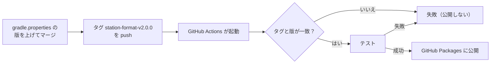

# 5-3 ライブラリを公開する

[目次](../README.md) ＞ 第 5 部 ＞ 5-3

> GitHub Actions の仕組みと最小の使い方は [技術カード: GitHub Actions](../ref/github-actions.md) にあります。

## この章で学ぶこと

- 別のリポジトリから使えるように、ライブラリを「公開」するとはどういうことか
- Maven の座標（グループ・名前・版）と、ライブラリの版の付け方
- `maven-publish` で GitHub Packages に公開する設定
- タグを押すと、GitHub Actions が確かめてから公開する流れ
- 使う側（管理システムの `validator`）が、公開されたライブラリを取ってくる設定
- 実際に起きた失敗（`./gradlew: Permission denied`）から学ぶこと

## なぜ公開するのか

同じリポジトリの中なら、`:app` は `implementation(project(":station-format"))` で `:station-format` を使えます（[1-2](../01-kotlin-android/02-gradle.md)）。でも管理システム（sanpo-channel-console）は **別のリポジトリ** です。`project(…)` では参照できません。

方法はいくつか考えられます。

| 方法 | 問題 |
|---|---|
| コードを写して持っていく | 写した瞬間から食い違い始める。同じコードを使う意味がない |
| Git のサブモジュールで取り込む | 両方のビルドの仕組みが絡み合い、版の管理も難しい |
| **ライブラリとして公開し、版を指定して使う** | 散策ガイドが選んだ方法 |

ライブラリを **パッケージのリポジトリ**（Maven リポジトリ）に置き、使う側は OkHttp や Tink と同じように `implementation("グループ:名前:版")` と書いて取ってきます。散策ガイドは、置き場所に **GitHub Packages**（GitHub が用意している Maven リポジトリ）を使っています。この決定は管理システムの ADR-001 の T-4 と、[RFC-001](../../SanpoGuide/docs/refactoring/RFC-001-prompts-to-station-format.md) の R-3 に記録されています。

## Maven の座標

ライブラリは 3 つの値で決まります。これを **座標** と呼びます。

```
io.github.duwenji.sanpoguide : station-format : 2.0.0
└───────── グループ ───────┘   └─── 名前 ───┘   └ 版 ┘
```

[station-format/build.gradle.kts](../../SanpoGuide/station-format/build.gradle.kts):

```kotlin
group = "io.github.duwenji.sanpoguide"
version = providers.gradleProperty("stationFormatVersion").get()
```

名前は `publishing` の設定で `artifactId = "station-format"` と決めています（下で見ます）。

### 版はアプリと別に管理する

版は `gradle.properties` に書いています。

```properties
# Version of :station-format as published to GitHub Packages (io.github.duwenji.sanpoguide:station-format).
# Independent of the app's version: bump it when the format, the prompts or the built-in channels
# change, then push the tag station-format-v<version> (.github/workflows/publish-station-format.yml).
stationFormatVersion=2.0.0
```

アプリの版（`versionName = "0.1.0"`）とは **別** です。アプリの画面を直しても、`:station-format` は変わらないので、版を上げる必要はありません。逆に、プロンプトの文面を直したら、アプリの版はそのままでも `:station-format` の版は上げます。管理システムの見本が、新しい文面で作られるようにするためです。

これまでの版:

| 版 | 主な変更 |
|---|---|
| 1.0.0 | プロンプトと組み込みのチャンネルを移した最初の版（RFC-001） |
| 1.1.0 | ZIP の展開と配信元の署名の確認（[5-2](02-package-format.md)） |
| 1.2.0 | 提供元の文書の確認（`ProviderDocuments`、[6-5](../06-trust/05-verify-in-app.md)） |
| 1.3.0 | 店の種類 7 つ（飲食・買い物）と、組み込みのチャンネル「グルメの旅」「ショッピング」（API-003 1.1）。公開はせず、2.0.0 に含めた |
| 2.0.0 | グループと Kotlin のパッケージを `com.example.sanpoguide` から `io.github.duwenji.sanpoguide` に変えた（RFC-001 1.1） |

機能を足したら真ん中の数字を、互換性のない変更をしたら最初の数字を上げる、という決まり（セマンティック バージョニング）に近い付け方です。2.0.0 は、最初の数字を上げた例です。中身の動きは 1.3.0 と同じですが、パッケージ名が変わったので、使う側は `import` と依存の座標を書き換えないとビルドできません。だから「互換性のない変更」です。

### 一度公開した版は変えない

一度公開した `1.2.0` の中身を、あとから差し替えてはいけません。使う側は「`1.2.0` はこの中身」と信じてビルドしているからです。直したいときは `1.2.1` や `1.3.0` を出します。RFC-001 の「戻し方」にも「公開したパッケージは版で固定されるので、戻すときは前の版を使えばよい」とあります。

## maven-publish の設定

```kotlin
plugins {
    id("org.jetbrains.kotlin.jvm")
    `maven-publish`
}

java {
    // …
    withSourcesJar()
}

// Published to GitHub Packages for the channel management system (sanpo-channel-console,
// ADR-001 T-4). Users add org.json themselves (see the dependency note above).
publishing {
    publications {
        create<MavenPublication>("stationFormat") {
            artifactId = "station-format"
            from(components["java"])
            pom {
                name.set("SanpoGuide station-format")
                description.set(
                    "SanpoGuide channel package format (API-003): checks, PromptTemplates, the app's prompts " +
                        "and the built-in channels. Requires org.json on the classpath.",
                )
                url.set("https://github.com/duwenji/SanpoGuide")
            }
        }
    }
    repositories {
        maven {
            name = "GitHubPackages"
            url = uri("https://maven.pkg.github.com/duwenji/SanpoGuide")
            credentials {
                username = System.getenv("GITHUB_ACTOR")
                password = System.getenv("GITHUB_TOKEN")
            }
        }
    }
}
```

| 部分 | 意味 |
|---|---|
| `` `maven-publish` `` | Maven リポジトリに公開するタスクを足す Gradle の標準のプラグイン |
| `withSourcesJar()` | ソースコードの jar も一緒に公開する。使う側の IDE で、ライブラリの中身を読める |
| `publications { … }` | 何を公開するか。`from(components["java"])` で、jar と依存の情報 |
| `pom { … }` | ライブラリの説明（POM という XML に書かれる） |
| `repositories { … }` | どこに公開するか。GitHub Packages の URL と、認証の情報 |

認証の情報は、**環境変数から読む** ようにしています。トークンをファイルに書かないためです。GitHub Actions の中では、`GITHUB_ACTOR` と `GITHUB_TOKEN` が自動で用意されます。

POM の説明文に "Requires org.json on the classpath."（クラスパスに org.json が要る）とあるのは、[5-1](01-jvm-library.md) の `compileOnly` のためです。使う側に、自分で足してもらう必要があることを伝えています。

## タグを押すと公開される

公開は、手元のパソコンではなく **GitHub Actions**（GitHub の上でコマンドを自動で実行する仕組み）で行います。[.github/workflows/publish-station-format.yml](../../SanpoGuide/.github/workflows/publish-station-format.yml):

```yaml
# Publishes :station-format to GitHub Packages when a tag station-format-v<version> is pushed.
# The tag must match stationFormatVersion in gradle.properties.
name: Publish station-format

on:
  push:
    tags:
      - 'station-format-v*'

permissions:
  contents: read
  packages: write

jobs:
  publish:
    runs-on: ubuntu-latest
    steps:
      - uses: actions/checkout@v4

      - uses: actions/setup-java@v4
        with:
          distribution: temurin
          java-version: '17'

      - uses: gradle/actions/setup-gradle@v4

      - name: Check the tag matches the version
        run: |
          version=$(grep '^stationFormatVersion=' gradle.properties | cut -d= -f2)
          if [ "${GITHUB_REF_NAME}" != "station-format-v${version}" ]; then
            echo "Tag ${GITHUB_REF_NAME} does not match stationFormatVersion=${version}" >&2
            exit 1
          fi

      - name: Test and publish
        run: ./gradlew :station-format:test :station-format:publish --console=plain
        env:
          GITHUB_ACTOR: ${{ github.actor }}
          GITHUB_TOKEN: ${{ secrets.GITHUB_TOKEN }}
```



工夫を見ておきましょう。

- **タグで公開する**: `main` にマージするたびではなく、`station-format-v…` のタグを押したときだけ公開します。公開は「この版を出す」という意思を持って行うものだからです
- **タグと版の一致を確かめる**: タグ `station-format-v2.1.0` を押したのに、`gradle.properties` が `2.0.0` のままだったら、`2.0.0` を公開し直そうとしてしまいます。公開の前に、2 つが一致しているかを確かめて止めます
- **テストに通ってから公開する**: `:station-format:test` と `:station-format:publish` を同じコマンドで実行するので、テストが落ちれば公開されません
- **権限を最小にする**: `permissions` で、リポジトリの読み取り（`contents: read`）とパッケージの書き込み（`packages: write`）だけを許します。それ以上の権限をワークフローに与えません

## 使う側: validator の設定

管理システムの [validator/settings.gradle.kts](../../sanpo-channel-console/validator/settings.gradle.kts) は、GitHub Packages から `station-format` を取ってくる設定をしています。

```kotlin
dependencyResolutionManagement {
    repositories {
        mavenCentral()
        // station-format, published by SanpoGuide (ADR-001 T-4). Reading GitHub Packages needs a token
        // with read:packages: $GITHUB_TOKEN in CI, or gpr.user / gpr.key in ~/.gradle/gradle.properties.
        // Without one, only a locally published station-format is used (asking without a token fails).
        val gprUser = providers.gradleProperty("gpr.user").orElse(providers.environmentVariable("GITHUB_ACTOR")).orNull
        val gprKey = providers.gradleProperty("gpr.key").orElse(providers.environmentVariable("GITHUB_TOKEN")).orNull
        if (gprUser != null && gprKey != null) {
            maven {
                name = "SanpoGuide"
                url = uri("https://maven.pkg.github.com/duwenji/SanpoGuide")
                credentials {
                    username = gprUser
                    password = gprKey
                }
                content { includeGroup("io.github.duwenji.sanpoguide") }
            }
        }
        // A station-format built locally (`./gradlew :station-format:publishToMavenLocal` in SanpoGuide).
        mavenLocal { content { includeGroup("io.github.duwenji.sanpoguide") } }
    }
}
```

- **GitHub Packages は、公開のリポジトリでも読むのにトークンが要る**: CI では `GITHUB_TOKEN`、手元では `~/.gradle/gradle.properties` に書いた `gpr.user`・`gpr.key`（`read:packages` の権限のトークン）
- **トークンがなければ、手元に公開したものを使う**（`mavenLocal`）: SanpoGuide で `./gradlew :station-format:publishToMavenLocal` を実行すると、パソコンの `~/.m2/repository` に公開され、それを使える
- **`includeGroup("io.github.duwenji.sanpoguide")`**: このリポジトリからは、このグループのライブラリだけを取る。ほかのライブラリを、思わぬ場所から取ってこないように

`validator/build.gradle.kts` の依存は、版を固定しています。

```kotlin
implementation("io.github.duwenji.sanpoguide:station-format:2.0.0")
```

SanpoGuide が新しい版（たとえば `2.1.0`）を出しても、管理システムは `2.0.0` を使い続けます。実際、SanpoGuide が `1.2.0` を出したあとも、管理システムは `2.0.0` に上げるまで `1.1.0` を使っていました。新しい版を使うのは、管理システムの側で版を書き換えて確かめたときです。**使う側が、上げる時期を自分で決められる** のが、版を固定する利点です。

管理システムの CI（[ci.yml](../../sanpo-channel-console/.github/workflows/ci.yml)）も、`packages: read` の権限と `GITHUB_TOKEN` で `station-format` を取ってきて、`validator` をビルドしています。

## 実際に起きた失敗: Permission denied

最初の公開（`station-format-v1.0.0`）は、11 秒で失敗しました。GitHub Actions のログ:

```
./gradlew: Permission denied
##[error]Process completed with exit code 126.
```

`gradlew` は、Linux（GitHub Actions の `ubuntu-latest`）で実行するには **実行の権限** が要るシェルスクリプトです。ところが Windows のパソコンで作ったファイルを Git に入れると、実行の権限が記録されないことがあります。Windows のファイルには、Linux と同じ形の実行の権限がないからです。

修正は、Git にファイルの実行の権限を記録し直すことでした（コミット「fix: gradlew に実行権限を付ける」）。Windows では、次のコマンドで Git に直接記録できます。

```sh
git update-index --chmod=+x gradlew
```

ファイルの中身は 1 文字も変わらず、権限だけが変わります（そのコミットの差分は `gradlew | 0`、`git show --summary` で見ると `mode change 100644 => 100755 gradlew`）。修正のあと、同じタグ `station-format-v1.0.0` から公開をやり直して、成功しています。

この失敗から分かることは 2 つです。

- **手元（Windows）で動いても、CI（Linux）で動くとは限らない**。改行（[0-3](../00-overview/03-setup.md) の CRLF）と並んで、Windows で開発するときによく出会う落とし穴
- **自動化した手順は、一度は本番の環境で流して確かめる**。最初の公開で失敗に気づけたのは、公開を手作業ではなく CI にしていたから

SanpoGuide の `.gitattributes` に `gradlew text eol=lf` とあるのも、`gradlew` の改行が CRLF になると Linux で動かないためです。

## ハンズオン: 公開の情報を手元で確かめる

実際の公開（GitHub Packages への書き込み）はせず、手元のビルドのフォルダの中だけで確かめます。

### 1. POM を作って読む

```sh
cd /c/Dev/apps/SanpoGuide
./gradlew :station-format:generatePomFileForStationFormatPublication
cat station-format/build/publications/stationFormat/pom-default.xml
```

```xml
  <groupId>io.github.duwenji.sanpoguide</groupId>
  <artifactId>station-format</artifactId>
  <version>2.0.0</version>
  <name>SanpoGuide station-format</name>
  <description>… Requires org.json on the classpath.</description>
  …
  <dependencies>
    <dependency>
      <groupId>org.jetbrains.kotlin</groupId>
      <artifactId>kotlin-stdlib</artifactId>
      <version>2.2.0</version>
      <scope>compile</scope>
    </dependency>
  </dependencies>
```

- 座標（`groupId`・`artifactId`・`version`）と説明が入っている
- 依存は `kotlin-stdlib` だけ。`compileOnly` の `org.json` は **入っていない**。使う側に `org.json` が連れてこられないことが分かる

タスクの名前 `generatePomFileForStationFormatPublication` の `StationFormat` は、`create<MavenPublication>("stationFormat")` の名前から来ています。

### 2. タグと版の照合を手元で再現する

ワークフローの「Check the tag matches the version」と同じ処理を、手元で動かしてみます。

```sh
for tag in station-format-v2.0.0 station-format-v2.1.0; do
  GITHUB_REF_NAME=$tag bash -c '
    version=$(grep "^stationFormatVersion=" gradle.properties | cut -d= -f2)
    if [ "${GITHUB_REF_NAME}" != "station-format-v${version}" ]; then
      echo "Tag ${GITHUB_REF_NAME} does not match stationFormatVersion=${version}" >&2; exit 1
    fi
    echo "OK $GITHUB_REF_NAME"'
done
```

```
OK station-format-v2.0.0
Tag station-format-v2.1.0 does not match stationFormatVersion=2.0.0
```

版を上げずにタグだけ `2.1.0` を押すと、ここで止まることが分かります。

### 3. gradlew の権限を確かめる

```sh
git ls-files -s gradlew
```

```
100755 b9bb139f… 0	gradlew
```

先頭の `100755` が「実行できるファイル」の印です（ふつうのファイルは `100644`）。Git がファイルの権限を記録していることが分かります。

### 4. 公開の記録を見る（任意）

GitHub の CLI（`gh`）が使えるなら、公開のワークフローの実行の記録を見られます。

```sh
gh run list --workflow publish-station-format.yml --limit 5
```

`station-format-v1.0.0` の失敗（11 秒）と成功、`v1.1.0`・`v1.2.0`・`v2.0.0` の成功が並んでいるはずです（1.3.0 は公開していません）。失敗した実行のログは `gh run view <実行のID> --log-failed` で読めます。

> 手元への公開（`./gradlew :station-format:publishToMavenLocal`）も試せますが、パソコンの `~/.m2/repository` にファイルが書き込まれ、管理システムの `validator` のビルドがそれを使うことがあります（`mavenLocal`）。試したあとは `~/.m2/repository/io/github/duwenji/sanpoguide/` を消すと元に戻ります。

## つまずきやすいところ

- **公開した版の中身を差し替えない**: 直すときは新しい版を出す
- **タグと版をそろえる**: CI で照合して止める
- **トークンをファイルに書かない**: 環境変数や、リポジトリの外の `~/.gradle/gradle.properties` に
- **使う側は版を固定する**: 上げる時期を自分で決められる
- **Windows で作ったスクリプトの実行権限**: `git update-index --chmod=+x`。改行も LF に

## 確認問題

<details>
<summary>問 1. 管理システムが <code>station-format</code> のコードを写して持っていかず、公開されたライブラリを使うのはなぜですか。</summary>

写した瞬間から、アプリのコードと食い違い始めるからです。同じコードで確かめる、という目的が果たせなくなります。公開されたライブラリなら、版で中身が決まり、アプリと同じコードを使えます。

</details>

<details>
<summary>問 2. SanpoGuide が <code>station-format</code> の 2.1.0 を公開しました。管理システムの <code>validator</code> は、すぐに 2.1.0 を使い始めますか。</summary>

使い始めません。`validator/build.gradle.kts` が `2.0.0` に固定しているからです。管理システムの側で版を書き換え、テストで確かめてから上げます。

</details>

<details>
<summary>問 3. 最初の公開が <code>./gradlew: Permission denied</code> で失敗したのはなぜですか。どう直しましたか。</summary>

Windows で作った `gradlew` が、実行の権限なしで Git に記録されていて、GitHub Actions の Linux の環境で実行できなかったからです。`git update-index --chmod=+x gradlew` で、Git に実行の権限を記録して直しました。

</details>

---

前: [5-2 チャンネル・パッケージの形式](02-package-format.md) ／ 次: [第 6 部 信頼の仕組み](../06-trust/01-why-signatures.md)（管理システム側から読むなら [7-1 TypeScript の文法](../07-typescript/01-typescript-syntax.md)）
