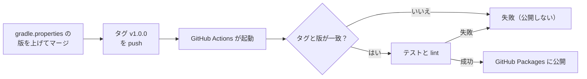

# 5-3 ライブラリを公開する

[目次](../README.md) ＞ 第 5 部 ＞ 5-3

> GitHub Actions の仕組みと最小の使い方は [技術カード: GitHub Actions](../ref/github-actions.md) にあります。

## この章で学ぶこと

- 別のリポジトリから使えるように、ライブラリを「公開」するとはどういうことか
- Maven の座標（グループ・名前・版）と、ライブラリの版の付け方
- `maven-publish` で GitHub Packages に公開する設定
- タグを押すと、GitHub Actions が確かめてから公開する流れ
- 使う側（管理システムの `validator`）が、公開されたライブラリを取ってくる設定
- 公開でつまずきやすいところ（`./gradlew: Permission denied`、パッケージとリポジトリの結びつき）

## なぜ公開するのか

同じリポジトリの中なら、アプリは `implementation(project(":prompts"))` でプロンプト・パックを使えます（[1-2](../01-kotlin-android/02-gradle.md)、[5-1](01-jvm-library.md)）。でもコア（yorisoi-platform）はアプリから見て **別のリポジトリ** で、管理システム（yorisoi-console）から見れば、コアもプロンプト・パックも別のリポジトリです。`project(…)` では参照できません。

方法はいくつか考えられます。

| 方法 | 問題 |
|---|---|
| コードを写して持っていく | 写した瞬間から食い違い始める。同じコードを使う意味がない |
| Git のサブモジュールで取り込む | 両方のビルドの仕組みが絡み合い、版の管理も難しい |
| **ライブラリとして公開し、版を指定して使う** | 散策ガイドが選んだ方法 |

ライブラリを **パッケージのリポジトリ**（Maven リポジトリ）に置き、使う側は OkHttp や Tink と同じように `implementation("グループ:名前:版")` と書いて取ってきます。散策ガイドは、置き場所に **GitHub Packages**（GitHub が用意している Maven リポジトリ）を使っています。この置き場所は、yorisoi-platform の ADR-003 E-19（リポジトリの構成）で決めています。

## Maven の座標

ライブラリは 3 つの値で決まります。これを **座標** と呼びます。

```
io.github.duwenji.yorisoi : core-format : 1.0.0
└────── グループ ──────┘   └─ 名前 ──┘   └ 版 ┘
```

公開しているのは、2 つのリポジトリで合わせて 8 つです。

| 座標 | 公開するリポジトリ | 版を決める値（`gradle.properties`） |
|---|---|---|
| `io.github.duwenji.yorisoi:core-format`・`core-prompt` | yorisoi-platform | `yorisoiVersion` |
| `io.github.duwenji.yorisoi:kit-voice`・`kit-llm`・`kit-geo`・`kit-mood`・`kit-companion` | yorisoi-platform | `yorisoiVersion`（7 つすべて同じ版） |
| `io.github.duwenji.yorisoi.sanpoguide:prompts` | yorisoi-sanpoguide | `sanpoguidePromptsVersion` |

グループが 2 つあるのは、コアとキットがエコシステム（yorisoi）のもので、プロンプト・パックが SanpoGuide のものだからです。キット（Android のライブラリ）は AAR という形で公開します。キットを使うのは今は SanpoGuide だけですが、リポジトリを分けたので、アプリもキットを公開された版で使います（[1-2](../01-kotlin-android/02-gradle.md)）。

yorisoi-platform では、グループと版を **全体の** [build.gradle.kts](../../yorisoi-platform/build.gradle.kts) でまとめて決めています。

```kotlin
subprojects {
    group = "io.github.duwenji.yorisoi"
    version = providers.gradleProperty("yorisoiVersion").get()
    // …
}
```

名前（`artifactId`）は、モジュールの名前（`core-format` など）がそのまま使われます。

### 版はアプリと別に管理する

版は、それぞれのリポジトリの `gradle.properties` に書いています。

```properties
# yorisoi-platform/gradle.properties
# The version of every module published to GitHub Packages (io.github.duwenji.yorisoi:<module>).
# Bump it, then push the tag v<version> (.github/workflows/publish.yml).
yorisoiVersion=1.0.0
```

```properties
# yorisoi-sanpoguide/gradle.properties
sanpoguidePromptsVersion=1.0.0
```

アプリの版（`versionName = "1.0.0"`）とは **別** です。アプリの画面を直しても、コアもプロンプト・パックも変わらないので、版を上げる必要はありません。逆に、プロンプトの文面を直したら、アプリの版はそのままでもプロンプト・パックの版は上げます。管理システムの見本が、新しい文面で作られるようにするためです。コアとプロンプト・パックの版を分けたのも同じ理由で、プロンプトの文面を直すたびに、形式の確認（コア）の版まで上げずに済みます。

yorisoi-platform の中では、コアとキットの版を 1 つにしています。版を分けると「どのコアとどのキットの組み合わせなら動くか」を確かめる手間が増えるからです。

### 版の付け方

版は「最初.真ん中.最後」の 3 つの数字です（例 `1.0.0`）。機能を足したら真ん中の数字を、互換性のない変更をしたら最初の数字を上げます（セマンティック バージョニングに近い付け方）。

| 変更 | 例 | 版 |
|---|---|---|
| 直しただけ | 確認のエラーの説明を直す | `1.0.0` → `1.0.1` |
| 機能を足した | 語彙に新しい過ごし方を足す、リストの新しい項目を読めるようにする | `1.0.0` → `1.1.0` |
| 互換性のない変更 | Kotlin のパッケージ名やグループを変える、関数の引数を変える | `1.0.0` → `2.0.0` |

パッケージ名を変えると、中身の動きが同じでも、使う側は `import` と依存の座標を書き換えないとビルドできません。だから「互換性のない変更」です。グループを変えた場合は、Maven から見ると **別のライブラリ** になるので、新しいグループの版は `1.0.0` から始めてかまいません。

### 一度公開した版は変えない

一度公開した `1.2.0` の中身を、あとから差し替えてはいけません。使う側は「`1.2.0` はこの中身」と信じてビルドしているからです。直したいときは `1.2.1` や `1.3.0` を出します。公開したパッケージは版で固定されるので、問題が出たら、使う側は前の版に戻せばよいのです。

## maven-publish の設定

yorisoi-platform は、7 つのモジュールの公開の設定を、全体の [build.gradle.kts](../../yorisoi-platform/build.gradle.kts) の `subprojects { … }` に 1 回だけ書いています（少し省略しています）。

```kotlin
subprojects {
    group = "io.github.duwenji.yorisoi"
    version = providers.gradleProperty("yorisoiVersion").get()

    apply(plugin = "maven-publish")

    plugins.withId("org.jetbrains.kotlin.jvm") {
        extensions.configure<JavaPluginExtension> { withSourcesJar() }
        extensions.configure<PublishingExtension> {
            publications.create<MavenPublication>("maven") { from(components["java"]) }
        }
    }
    plugins.withId("com.android.library") {
        extensions.configure<LibraryExtension> {
            publishing {
                singleVariant("release") { withSourcesJar() }
            }
        }
        afterEvaluate {
            extensions.configure<PublishingExtension> {
                publications.create<MavenPublication>("maven") { from(components["release"]) }
            }
        }
    }

    extensions.configure<PublishingExtension> {
        publications.withType<MavenPublication>().configureEach {
            pom {
                name.set("yorisoi ${project.name}")
                description.set(provider { project.description })
                url.set("https://github.com/duwenji/yorisoi-platform")
            }
        }
        repositories {
            maven {
                name = "GitHubPackages"
                url = uri("https://maven.pkg.github.com/duwenji/yorisoi-platform")
                credentials {
                    username = System.getenv("GITHUB_ACTOR")
                    password = System.getenv("GITHUB_TOKEN")
                }
            }
        }
    }
}
```

| 部分 | 意味 |
|---|---|
| `subprojects { … }` | すべてのモジュールに同じ設定をする。モジュールごとに書くと、7 か所で少しずつずれていく |
| `maven-publish` | Maven リポジトリに公開するタスクを足す Gradle の標準のプラグイン |
| `plugins.withId(…) { … }` | 「そのプラグインを使っているモジュールなら」という条件。素の JVM（コア・`kit-companion`）と Android のライブラリ（キット）で、公開するものの作り方が違うので分けている |
| `withSourcesJar()` | ソースコードの jar も一緒に公開する。使う側の IDE で、ライブラリの中身を読める |
| `from(components["java"])` | 素の JVM のモジュールは jar と依存の情報を公開する |
| `singleVariant("release")`・`from(components["release"])` | Android のライブラリは、リリース版の AAR を公開する。`release` の部品は Android のプラグインが評価を終えてから作られるので、`afterEvaluate` の中で使う |
| `pom { … }` | ライブラリの説明（POM という XML に書かれる）。説明文は、各モジュールの `description = "…"` から取る |
| `repositories { … }` | どこに公開するか。GitHub Packages の URL と、認証の情報 |

認証の情報は、**環境変数から読む** ようにしています。トークンをファイルに書かないためです。GitHub Actions の中では、`GITHUB_ACTOR` と `GITHUB_TOKEN` が自動で用意されます。

`core-format` の説明文に "Requires org.json on the classpath."（クラスパスに org.json が要る）とあるのは、[5-1](01-jvm-library.md) の `compileOnly` のためです。使う側に、自分で足してもらう必要があることを伝えています。

プロンプト・パック（yorisoi-sanpoguide の [prompts/build.gradle.kts](../../yorisoi-sanpoguide/prompts/build.gradle.kts)）は 1 つだけなので、`publishing { … }` をモジュールの中に直接書いています。中身は同じ形です。

## タグを押すと公開される

公開は、手元のパソコンではなく **GitHub Actions**（GitHub の上でコマンドを自動で実行する仕組み）で行います。yorisoi-platform の [.github/workflows/publish.yml](../../yorisoi-platform/.github/workflows/publish.yml):

```yaml
# Publishes every module to GitHub Packages when the tag v<version> is pushed.
# The tag must match yorisoiVersion in gradle.properties.
name: Publish

on:
  push:
    tags:
      - 'v*'

permissions:
  contents: read
  packages: write

jobs:
  publish:
    runs-on: ubuntu-latest
    steps:
      - uses: actions/checkout@v4
      # … Java 17 と Gradle の準備

      - name: Check the tag
        run: |
          version=$(grep '^yorisoiVersion=' gradle.properties | cut -d= -f2)
          if [ "${GITHUB_REF_NAME#v}" != "${version}" ]; then
            echo "Tag ${GITHUB_REF_NAME} does not match yorisoiVersion=${version}" >&2
            exit 1
          fi

      - name: Test and publish
        run: ./gradlew test lint publish --console=plain
        env:
          GITHUB_ACTOR: ${{ github.actor }}
          GITHUB_TOKEN: ${{ secrets.GITHUB_TOKEN }}
```

yorisoi-sanpoguide の [publish.yml](../../yorisoi-sanpoguide/.github/workflows/publish.yml) も同じ形で、タグ `prompts-v<版>` を押すとプロンプト・パックだけを公開します。



工夫を見ておきましょう。

- **タグで公開する**: `main` にマージするたびではなく、タグを押したときだけ公開します。公開は「この版を出す」という意思を持って行うものだからです
- **タグと版の一致を確かめる**: タグ `v1.1.0` を押したのに、`gradle.properties` が `1.0.0` のままだったら、`1.0.0` を公開し直そうとしてしまいます。公開の前に、2 つが一致しているかを確かめて止めます。`${GITHUB_REF_NAME#v}` は、タグの名前から先頭の `v` を取り除くシェルの書き方です
- **テストに通ってから公開する**: テストと公開を同じコマンドで実行するので、テストが落ちれば公開されません
- **依存されるもの（yorisoi-platform）を先に公開する**: プロンプト・パックはコアに依存するので、新しいコアを使うプロンプト・パックは、そのコアを公開してからタグを押します
- **権限を最小にする**: `permissions` で、リポジトリの読み取り（`contents: read`）とパッケージの書き込み（`packages: write`）だけを許します。それ以上の権限をワークフローに与えません

## 使う側: validator の設定

管理システムの [validator/settings.gradle.kts](../../yorisoi-console/validator/settings.gradle.kts) は、GitHub Packages からコアとプロンプト・パックを取ってくる設定をしています。2 つは別のリポジトリから公開されているので、取ってくる場所も 2 つです。

```kotlin
dependencyResolutionManagement {
    repositories {
        mavenCentral()
        // core-format from yorisoi-platform, SanpoGuide's prompt pack from yorisoi-sanpoguide (…).
        // Both are public repositories. Reading GitHub Packages needs a token with read:packages: …
        val gprUser = providers.gradleProperty("gpr.user").orElse(providers.environmentVariable("GITHUB_ACTOR")).orNull
        val gprKey = providers.gradleProperty("gpr.key").orElse(providers.environmentVariable("GITHUB_TOKEN")).orNull
        if (gprUser != null && gprKey != null) {
            maven {
                name = "yorisoiPlatform"
                url = uri("https://maven.pkg.github.com/duwenji/yorisoi-platform")
                credentials { username = gprUser; password = gprKey }
                content { includeGroup("io.github.duwenji.yorisoi") }
            }
            maven {
                name = "yorisoiSanpoguide"
                url = uri("https://maven.pkg.github.com/duwenji/yorisoi-sanpoguide")
                credentials { username = gprUser; password = gprKey }
                content { includeGroup("io.github.duwenji.yorisoi.sanpoguide") }
            }
        }
        // Built locally (`./gradlew publishToMavenLocal` in yorisoi-platform and yorisoi-sanpoguide).
        mavenLocal {
            content {
                includeGroup("io.github.duwenji.yorisoi")
                includeGroup("io.github.duwenji.yorisoi.sanpoguide")
            }
        }
    }
}
```

- **GitHub Packages は、公開のリポジトリでも読むのにトークンが要る**: CI では `GITHUB_TOKEN`、手元では `~/.gradle/gradle.properties` に書いた `gpr.user`・`gpr.key`（`read:packages` の権限のトークン）。`gh auth token` で出るトークンは、ふつう `read:packages` の権限を持たないので、そのままでは使えません
- **非公開のリポジトリのパッケージは、許可したリポジトリしか読めない**: yorisoi-platform と yorisoi-sanpoguide は公開のリポジトリなので、ほかのリポジトリの CI の `GITHUB_TOKEN` でも読めます。非公開にすると、パッケージの設定の「Manage Actions access」で、読むリポジトリを 1 つずつ許可する必要があります（実際に、非公開のうちはアプリの CI が `Could not find io.github.duwenji.yorisoi:core-format:1.0.0` で失敗しました）
- **トークンがなければ、手元に公開したものを使う**（`mavenLocal`）: yorisoi-platform と yorisoi-sanpoguide で `./gradlew publishToMavenLocal`（プロンプト・パックは `:prompts:publishToMavenLocal`）を実行すると、パソコンの `~/.m2/repository` に公開され、それを使える。版を合わせるため、validator が使う版のコミット（タグなど）で実行する
- **`includeGroup(…)`**: その場所からは、決めたグループのライブラリだけを取る。ほかのライブラリを、思わぬ場所から取ってこないように

`validator/build.gradle.kts` の依存は、版を固定しています。

```kotlin
implementation("io.github.duwenji.yorisoi:core-format:1.0.0")
implementation("io.github.duwenji.yorisoi.sanpoguide:prompts:1.0.0")
```

コアが新しい版を出しても、管理システムは書いた版を使い続けます。たとえばコアがリストの新しい項目の読み方（アプリのためのもの）を足した版を出しても、機械審査に要らなければ、管理システムは前の版のままでかまいません。新しい版を使うのは、管理システムの側で版を書き換えて確かめたときです。**使う側が、上げる時期を自分で決められる** のが、版を固定する利点です。アプリ（yorisoi-sanpoguide）も、yorisoi-platform に対して同じ立場です。

管理システムの CI（[ci.yml](../../yorisoi-console/.github/workflows/ci.yml)）も、`packages: read` の権限と `GITHUB_TOKEN` でコアとプロンプト・パックを取ってきて、`validator` をビルドしています。

## 落とし穴: Permission denied

Windows で開発したリポジトリを GitHub Actions で公開すると、最初の実行が数秒で失敗することがあります。ログ:

```
./gradlew: Permission denied
##[error]Process completed with exit code 126.
```

`gradlew` は、Linux（GitHub Actions の `ubuntu-latest`）で実行するには **実行の権限** が要るシェルスクリプトです。ところが Windows のパソコンで作ったファイルを Git に入れると、実行の権限が記録されないことがあります。Windows のファイルには、Linux と同じ形の実行の権限がないからです。

直すには、Git にファイルの実行の権限を記録し直します。Windows では、次のコマンドで Git に直接記録できます。

```sh
git update-index --chmod=+x gradlew
```

ファイルの中身は 1 文字も変わらず、権限だけが変わります（そのコミットの差分は `gradlew | 0`、`git show --summary` で見ると `mode change 100644 => 100755 gradlew`）。

ここから分かることは 2 つです。

- **手元（Windows）で動いても、CI（Linux）で動くとは限らない**。改行（[0-3](../00-overview/03-setup.md) の CRLF）と並んで、Windows で開発するときによく出会う落とし穴
- **自動化した手順は、一度は本番の環境で流して確かめる**。公開を手作業ではなく CI にしておけば、最初の公開で気づける

両リポジトリの `.gitattributes` に `gradlew text eol=lf` とあるのも、`gradlew` の改行が CRLF になると Linux で動かないためです。

## 落とし穴: パッケージはリポジトリに結びつく

GitHub Packages の Maven のパッケージは、**最初に公開したリポジトリに結びつきます**。同じ座標（グループと名前）のパッケージを、別のリポジトリから公開しようとすると、次のように失敗します。

```
Could not PUT 'https://maven.pkg.github.com/<owner>/<別のリポジトリ>/…/prompts-1.0.0.jar'.
Received status code 422 from server: Unprocessable Entity
```

ライブラリをほかのリポジトリへ移すときは、「パッケージの座標を変える」「古いパッケージを消す」のどちらかが要る、と覚えておいてください。

## ハンズオン: 公開の情報を手元で確かめる

実際の公開（GitHub Packages への書き込み）はせず、手元のビルドのフォルダの中だけで確かめます。

### 1. POM を作って読む

```sh
cd /c/Dev/apps/yorisoi-platform
./gradlew :core-format:generatePomFileForMavenPublication
cat core-format/build/publications/maven/pom-default.xml
```

```xml
  <groupId>io.github.duwenji.yorisoi</groupId>
  <artifactId>core-format</artifactId>
  <version>1.0.0</version>
  <name>yorisoi core-format</name>
  <description>… Requires org.json on the classpath.</description>
  …
  <dependencies>
    <dependency>
      <groupId>org.jetbrains.kotlin</groupId>
      <artifactId>kotlin-stdlib</artifactId>
      <version>2.2.0</version>
      <scope>compile</scope>
    </dependency>
  </dependencies>
```

- 座標（`groupId`・`artifactId`・`version`）と説明が入っている
- 依存は `kotlin-stdlib` だけ。`compileOnly` の `org.json` は **入っていない**。使う側に `org.json` が連れてこられないことが分かる

タスクの名前 `generatePomFileForMavenPublication` の `Maven` は、`create<MavenPublication>("maven")` の名前から来ています。キットの POM（`./gradlew :kit-mood:generatePomFileForMavenPublication`）を見ると、依存に `kit-geo`・`kit-voice`・`core-format` が `io.github.duwenji.yorisoi:…:1.0.0` として入っていることを確かめられます。同じリポジトリの中の `project(…)` への依存が、公開すると座標への依存に置き換わるのです。

### 2. タグと版の照合を手元で再現する

ワークフローの「Check the tag」と同じ処理を、手元で動かしてみます。

```sh
for tag in v1.0.0 v1.1.0; do
  GITHUB_REF_NAME=$tag bash -c '
    version=$(grep "^yorisoiVersion=" gradle.properties | cut -d= -f2)
    if [ "${GITHUB_REF_NAME#v}" != "${version}" ]; then
      echo "Tag ${GITHUB_REF_NAME} does not match yorisoiVersion=${version}" >&2; exit 1
    fi
    echo "OK $GITHUB_REF_NAME"'
done
```

```
OK v1.0.0
Tag v1.1.0 does not match yorisoiVersion=1.0.0
```

版を上げずにタグだけ `1.1.0` を押すと、ここで止まることが分かります。

### 3. gradlew の権限を確かめる

```sh
git ls-files -s gradlew
```

```
100755 b9bb139f… 0	gradlew
```

先頭の `100755` が「実行できるファイル」の印です（ふつうのファイルは `100644`）。Git がファイルの権限を記録していることが分かります。

### 4. 公開の記録を見る（任意）

GitHub の CLI（`gh`）が使えるなら、公開のワークフローの実行の記録を見られます。

```sh
gh run list -R duwenji/yorisoi-platform --workflow publish.yml --limit 8
gh run list -R duwenji/yorisoi-sanpoguide --workflow publish.yml --limit 8
```

公開のタグ（`v<版>`・`prompts-v<版>`）ごとに、実行の記録が並びます。失敗した実行のログは `gh run view <実行のID> -R <リポジトリ> --log-failed` で読めます。

> 手元への公開（`./gradlew publishToMavenLocal`）も試せますが、パソコンの `~/.m2/repository` にファイルが書き込まれ、管理システムの `validator` のビルドがそれを使うことがあります（`mavenLocal`）。試したあとは `~/.m2/repository/io/github/duwenji/yorisoi/` と `…/sanpoguide/` を消すと元に戻ります。

## つまずきやすいところ

- **公開した版の中身を差し替えない**: 直すときは新しい版を出す
- **タグと版をそろえる**: CI で照合して止める
- **トークンをファイルに書かない**: 環境変数や、リポジトリの外の `~/.gradle/gradle.properties` に
- **使う側は版を固定する**: 上げる時期を自分で決められる
- **依存されるもの（コア）から先に公開する**: プロンプト・パックは、使うコアが公開されてから
- **パッケージはリポジトリに結びつく**: ライブラリを別のリポジトリへ移すときは、名前を変えるか、古いパッケージを消す
- **Windows で作ったスクリプトの実行権限**: `git update-index --chmod=+x`。改行も LF に

## 確認問題

<details>
<summary>問 1. 管理システムがコアのコードを写して持っていかず、公開されたライブラリを使うのはなぜですか。</summary>

写した瞬間から、アプリのコードと食い違い始めるからです。同じコードで確かめる、という目的が果たせなくなります。公開されたライブラリなら、版で中身が決まり、アプリと同じコードを使えます。

</details>

<details>
<summary>問 2. yorisoi-platform が <code>core-format</code> の 1.1.0 を公開しました。管理システムの <code>validator</code> は、すぐに 1.1.0 を使い始めますか。</summary>

使い始めません。`validator/build.gradle.kts` が `1.0.0` に固定しているからです。管理システムの側で版を書き換え、テストで確かめてから上げます。

</details>

<details>
<summary>問 3. コアとプロンプト・パックの版を、1 つにまとめずに分けているのはなぜですか。</summary>

変わる理由が違うからです。プロンプトの文面や組み込みのチャンネルを直すたびに、形式の確認（コア）の版まで上げると、コアを使うほかのアプリや管理システムが、中身の変わらない新しい版を追いかけることになります。分けておけば、それぞれ変わったときだけ版を上げられます。

</details>

<details>
<summary>問 4. Windows で作ったリポジトリの公開が、GitHub Actions で <code>./gradlew: Permission denied</code> になりました。なぜですか。どう直しますか。</summary>

Windows で作った `gradlew` が、実行の権限なしで Git に記録されていて、GitHub Actions の Linux の環境で実行できないからです。`git update-index --chmod=+x gradlew` で、Git に実行の権限を記録して直します。

</details>

<details>
<summary>問 5. あるライブラリを、別のリポジトリから同じ座標で公開しようとして、422 で失敗しました。なぜですか。</summary>

GitHub Packages の Maven のパッケージは、最初に公開したリポジトリに結びつくからです。同じ座標のパッケージを別のリポジトリから公開することはできません。座標を変えるか、古いパッケージを消してから公開し直します。

</details>

---

前: [5-2 チャンネル・パッケージの形式](02-package-format.md) ／ 次: [5-4 素材ときっかけ](04-materials-cues.md)
