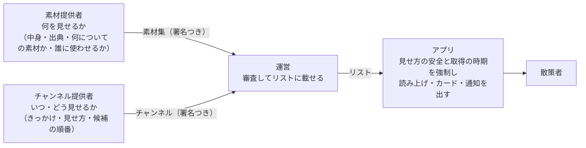

# 5-4 素材ときっかけ

[目次](../README.md) ＞ 第 5 部 ＞ 5-4

## この章で学ぶこと

- チャンネルから **素材**（文字・画像・音声・映像）を切り出した理由と、関係者の役割の分け方
- AI も Wikimedia の写真も第三者の素材集も、**同じ形**（`Producer`）で扱う設計。違いはクラスではなく **属性** で表す
- 候補を前から順に試し、だめなら次へ進む仕組み
- **きっかけ**（いつ出すか）と **見せ方**（どう出すか）、アプリが必ず守らせる安全の決まり
- 素材集を **名前で借りる** 仕組み（利用許諾と取り下げ）、基準で選ぶときの **地域**（ジオハッシュ）
- アプリの段階（第 1 段は文字と画像）に合わせて確かめる方法

この章は、[0-1](../00-overview/01-what-we-build.md) の「素材」の節、[5-2](02-package-format.md) の「素材・きっかけ・見せ方」の節の続きです。

## なぜ素材を切り出したのか

最初の形（API-003 1.1）では、素材はチャンネルのパッケージの一部（`channel.json` の `resources`）でした。それでは困ることが 4 つありました（[ADR-002](../../SanpoGuide/docs/adr/ADR-002-material-producers.md)「目的・背景」）。

| 困ること | 例 |
|---|---|
| 審査の重複 | 観光協会の音声ガイドを 3 つのチャンネルが使うと、3 回審査する |
| 素材だけでは参加できない | 写真家が写真を届けたいだけなのに、語り手や話題まで含むチャンネルを作らないといけない |
| 更新の波及 | 写真を 1 枚直すと、使っているチャンネルがすべて申請し直し |
| 利用許諾を確かめられない | 「この写真を使ってよい」は、チャンネル提供者の自己申告でしか示せない |

そこで、素材を **素材集** として別に作り、別に審査することにしました。役割はこう分かれます（ADR-002 D-1）。



素材提供者は「何を」、チャンネルは「いつ・どう」、アプリは「安全に」を受け持ちます。1 つの決まりを 1 か所が持つように分けたわけです。

## すべての出どころを 1 つの形で: Producer

素材の出どころは 3 種類あります（ADR-002 D-2）。

| 種類 | 例 | 中身はいつ決まるか |
|---|---|---|
| 組み込みの素材提供者 | AI の解説・話しかけ、定型文、Wikimedia の写真、合成の背景音、雰囲気の絵 | その場で取得・生成する |
| 第三者の素材集 | 観光協会の解説と写真 | 審査で固定。前もって取得する |
| チャンネルに同梱の素材 | `channel.json` の `resources` | 審査で固定。パッケージに入っている |

ばらばらに見えますが、アプリはすべてを **同じ形** で扱います（API-004 I-1）。アプリの側の形は [Producer.kt](../../SanpoGuide/apps/sanpoguide/app/src/main/java/io/github/duwenji/sanpoguide/material/Producer.kt) の `Producer` です。

```kotlin
interface Producer {
    val descriptor: ProducerDescriptor

    /** Called when a channel is chosen, to fetch everything ahead (API-004 I-6). Built-in producers need nothing. */
    suspend fun prepare() {}

    /**
     * The result when it's already known without producing (no network, no waiting), or null.
     * Lets a screen show "waiting for Wi-Fi" at once instead of a loading state.
     */
    fun peek(request: MaterialRequest): MaterialResult? = null

    suspend fun produce(request: MaterialRequest): MaterialResult
}
```

- `prepare`: チャンネルを選んだときに呼ぶ。前もって取得する出どころは、ここで全部取ってきて確かめる
- `produce`: 見せる直前に呼ぶ。**例外を投げず、結果を値で返す**（`MaterialResult`）
- `peek`: 待たずに分かる結果（「この回線では出さない」など）を先に返す。画面がすぐに「Wi-Fi を待っています」と出せる

結果は 3 つに分かれます（API-004 I-5）。

```kotlin
sealed interface MaterialResult {
    data class Ready(val material: Material) : MaterialResult
    /** The producer has nothing for this request. */
    data object None : MaterialResult
    /** The producer can't produce now; [detail] is for the log or an error message. */
    data class Unavailable(val reason: Reason, val detail: String? = null) : MaterialResult

    enum class Reason { OFFLINE, METERED, NO_KEY, REVOKED, NOT_PREPARED, FAILED }
}
```

`None`（その出どころには該当がない）と `Unavailable`（今は出せない、理由つき）を分けているのが要点です。たとえば AI は、キーがなければ `Unavailable(NO_KEY)` を返します。次の候補（定型文）は、その理由を見て文を選べます（[4-3](../04-outside/03-ai.md)）。

### 違いはクラスではなく属性で

組み込みの AI と第三者の素材集では、許してよいことがまるで違います。AI は散策者の位置（スポット名）を外の AI サービスに送りますが、第三者の素材集にそれを許すと、散策者の居場所が第三者に伝わります。

この違いを、散策ガイドは **クラスの種類ではなく、記述の属性** で表します（API-004 I-2）。[Producers.kt](../../SanpoGuide/platform/core-format/src/main/kotlin/io/github/duwenji/michizure/core/format/material/Producers.kt) の `ProducerDescriptor`:

| 属性 | 値 | 意味 |
|---|---|---|
| `trust` | `builtin` / `reviewed` / `trial` | だれが中身に責任を持つか（アプリのコード / 運営の審査 / 審査前の試用） |
| `fetch` | `local` / `prefetch` / `onDemand` | いつ取るか（端末の中で作る / 選んだときに全部取る / 見せるときに取る） |
| `exposure` | `none` / `subject` | 出すときに、何についての素材か（＝散策者の近くの場所）が外に伝わるか |
| `generated` | true / false | 毎回中身が変わるか（AI など） |

何を許すかは、属性を見て **アプリの方針** が決めます。

```kotlin
/** The app's rules for producers by their description (API-004 方針 P-1・P-2). Channels and producers can't change them. */
object ProducerPolicy {
    /** The rule [descriptor] breaks, or null when it may be used. */
    fun violation(descriptor: ProducerDescriptor): String? = with(descriptor) {
        when {
            // P-1: only the app's own code may fetch when shown, reveal the subject, or generate.
            trust != Trust.BUILTIN && fetch != Fetch.PREFETCH -> "P-1: a ${trust.json} producer must prefetch ($id)"
            trust != Trust.BUILTIN && exposure != Exposure.NONE -> "P-1: a ${trust.json} producer must not expose the subject ($id)"
            trust != Trust.BUILTIN && generated -> "P-1: a ${trust.json} producer must not generate ($id)"
            // P-2 follows: fetching on demand while revealing the subject is left to built-in producers.
            else -> null
        }
    }
}
```

第三者には「前もって全部取る」「何も外に漏らさない」「中身は審査したときのまま」しか許しません（ADR-002 D-5）。その場で取りに行くと、散策者の居場所が相手に伝わり、しかも中身が毎回変わって審査できないからです。アプリは起動時に、使う出どころをすべてこの方針にかけます（`Producers` の `init`）。

組み込みの 6 つの記述は `BuiltInProducers` にあります。たとえば AI の解説はこうです。

```kotlin
/** Spot narration by the AI (`GuideRepository`). */
val AI_GUIDE = ProducerDescriptor(
    "${PREFIX}ai-guide", VERSION, setOf(MaterialType.TEXT), setOf(SubjectKind.SPOT),
    Trust.BUILTIN, Fetch.ON_DEMAND, Exposure.SUBJECT, generated = true, params = setOf("persona", "focus", "length"),
)
```

この一覧は `:station-format` にあるので、管理システムの機械審査も同じものを読み、チャンネルが書いた `builtin:…` の参照が実在するかを確かめられます。

## 候補を前から順に試す

チャンネルは、1 つの見せ方に候補を 1〜3 個並べます（API-004 I-7）。

```json
{ "as": "speak", "source": ["kamakura#daibutsu-intro", "builtin:ai-guide", "builtin:fallback-text"] }
```

「観光協会の解説があればそれを、なければ AI の解説、それもだめなら定型文」という意味です。アプリは前から `produce` を呼び、最初の `Ready` を使います。全部だめなら、その見せ方は飛ばします。

この「前から順に」は、2 か所に同じ形で書かれています。

| 場所 | 何の候補か |
|---|---|
| `Producers.first`（[Producer.kt](../../SanpoGuide/apps/sanpoguide/app/src/main/java/io/github/duwenji/sanpoguide/material/Producer.kt)） | きっかけのないふだんの解説と話しかけ（`Narration` の `Shorthand`、[4-3](../04-outside/03-ai.md)） |
| `CuePresenter`（[Cues.kt](../../SanpoGuide/apps/sanpoguide/app/src/main/java/io/github/duwenji/sanpoguide/material/Cues.kt)） | きっかけの見せ方ごとの候補 |

ふだんの解説も「`builtin:ai-guide` → `builtin:fallback-text`」という候補の並びとして書かれています（API-004「省略形の展開」）。きっかけを持たない組み込みのチャンネルも、同じ仕組みの上で動いているわけです。

`CuePresenter` には、見せ方ならではの確かめが 2 つ加わります。

- **段階で絞る**: 見せ方が受け付ける種類のうち、このアプリの段（下で見ます）で出せるものだけを求める（`accepts`）
- **長さで絞る**: AI は好きなだけ長く書くので、カード（200 字）・通知（100 字）に収まらない文は使わず、次の候補へ（`fits`）

## きっかけ: いつ出すか

きっかけの条件（`trigger`）は 4 種類です（[Cues.kt](../../SanpoGuide/platform/core-format/src/main/kotlin/io/github/duwenji/michizure/core/format/Cues.kt) の `Trigger`）。

```kotlin
sealed interface Trigger {
    data class Spot(val osm: String, val name: String?) : Trigger
    /** Any spot of these kinds (API-003 1.2, `"any": true`). */
    data class AnySpot(val categories: List<SpotKind>) : Trigger
    data class Point(val lat: Double, val lon: Double, val radiusM: Int) : Trigger
    data class Event(val event: CueEvent) : Trigger
}
```

| 条件 | 当たるとき | 散歩の中で調べる場所 |
|---|---|---|
| `Spot` | その OSM のスポット（または同じ名前のスポット）に近づいた | `maybeTalk` の ③（[3-4](../03-walk/04-maybe-talk.md)） |
| `AnySpot` | 指定した種類（寺・神社など）のどのスポットでも | ③。名指しのきっかけがないスポットだけ |
| `Point` | 緯度・経度と半径（20〜300m）の中に入った | ③b |
| `Event` | チャンネルを選んだ・散歩を始めた・終えた | あいさつ・振り返りのあと |

当たったきっかけを探すのは、アプリの `CueFinder` です。スポットでは、**名指しのきっかけを先に**、なければ種類のきっかけを探します。

```kotlin
fun spot(stationId: String, media: StationMedia, poi: Poi, distanceM: Int?, shownThisWalk: Set<String>, now: Long): CueFire? {
    val subject = Subject.Spot(poi, distanceM)
    val named = media.cues.filter { cue ->
        val t = cue.trigger as? Trigger.Spot ?: return@filter false
        t.osm == poi.id || (t.name != null && t.name == poi.name)
    }
    if (named.isNotEmpty()) return named.firstNotNullOfOrNull { fire(stationId, it, subject, shownThisWalk, now) }
    return media.cues.firstNotNullOfOrNull { cue ->
        val t = cue.trigger as? Trigger.AnySpot ?: return@firstNotNullOfOrNull null
        if (t.categories.none { it.category == poi.category }) return@firstNotNullOfOrNull null
        fire(stationId, cue, subject, shownThisWalk, now, perSubject = poi.id)
    }
}
```

名前でも照らすのは、同じ場所が OSM では「敷地（way）」と「点（node）」の 2 つの ID を持つことがあるからです。

### 何度出すか

`repeat` は `oncePerWalk`（既定）・`oncePerDay`・`once` の 3 つです。`fire` の中で、きっかけごとの鍵（`チャンネルID#きっかけID`、種類のきっかけなら `@スポットID` も付ける）で数えます。1 回の散歩の中のことは散歩の記録（`shownThisWalk`）で、日をまたぐことは端末の小さなファイル（`FileCueMemory`）で覚えます。

## 見せ方: どう出すか、何を出させないか

見せ方は 7 つで、それぞれ出せる素材の種類が決まっています（`PresentAs`）。

```kotlin
enum class PresentAs(override val json: String, val types: Set<MaterialType>) : JsonValue {
    SPEAK("speak", setOf(MaterialType.TEXT)),
    CARD("card", setOf(MaterialType.TEXT, MaterialType.IMAGE)),
    NOTIFY("notify", setOf(MaterialType.TEXT, MaterialType.IMAGE)),
    SHEET("sheet", MaterialType.entries.toSet()),
    PLAY("play", setOf(MaterialType.AUDIO)),
    AMBIENT("ambient", setOf(MaterialType.AUDIO)),
    FULLSCREEN("fullscreen", setOf(MaterialType.IMAGE, MaterialType.VIDEO));
    // …
}
```

「カードで音声を出す」のような組み合わせは、取り込むときに `bad_cue` で拒みます。enum に「出せる種類」を持たせておくと、確認のコードは `resource.type !in p.presentAs.types` と書くだけで済みます。

チャンネルが選べるのは見せ方の **種類** までです。どう見せるかの安全の決まりは、アプリが必ず守らせます（API-003 F-8）。

| 決まり | どこで守るか |
|---|---|
| 解説の画面（`sheet`）と全画面（`fullscreen`）は、カードか通知を散策者がタップしたときだけ開く。自動では開かない | `CueLayout` が、この 2 つを `CueDetail` にまとめて「タップで開くもの」として持つ（[2-1](../02-compose/01-compose-basics.md) の「詳しく見る」） |
| 歩いている間（0.5m/s 以上）は全画面を開かない | `Pace.walking`（`CueLayout.kt`） |
| 読み上げは、話しかけと同じ順番待ちに並ぶ。割り込まない | `CueShow`（API-003 F-13） |
| 画像には作者・ライセンス・素材提供者を添える | `MaterialCredit`（`CueViews.kt`） |
| AI が書いたものは、作者を「AI（モデル名）」とする | `aiCredit`（`BuiltIns.kt`、API-004 P-3） |

[5-2](02-package-format.md) で見た「選択肢しか書かせない」考え方が、見せ方でも生きています。

## 素材集: 別に審査し、名前で借りる

素材集は、素材提供者が自分の鍵で署名した ZIP です（API-004「素材集の形式」）。中の `collection.json` はこんな形です。

```json
{
  "format": 1,
  "id": "kamakura-audio-guide",
  "version": 2,
  "producer": "sg1abcd...",
  "name": "鎌倉音声ガイド",
  "summary": "鎌倉市観光協会による寺社の音声ガイド",
  "lang": "ja",
  "grants": { "publishers": "*" },
  "resources": [
    { "id": "hachimangu-intro", "type": "text", "file": "resources/text/hachimangu.md", "tags": ["history", "faith"],
      "about": { "type": "spot", "osm": "way/123456", "name": "鶴岡八幡宮", "lat": 35.3260, "lon": 139.5565 } }
  ]
}
```

- `grants`: どのチャンネル提供者に使わせるか。`"*"`（誰でも）か、アカウントIDの一覧（ADR-002 D-9）。素材提供者が署名するので、自己申告ではなくなる
- `about`: 何についての素材か。チャンネルは素材の ID で選ぶほかに、「きっかけのスポットについての素材があれば」と題材で選べる
- `tags`: 何の話か（`history`・`faith`・`nature` など決まった一覧）。基準で選ぶとき（下で見ます）に使う

チャンネルは、使う素材集を **ID だけで** 宣言し、別名を付けて参照します。

```json
"collections": [ { "as": "kamakura", "id": "kamakura-audio-guide", "minVersion": 2 } ],
```

素材提供者のアカウントIDは書きません（ADR-002 D-17）。鍵を移し替えるとアカウントIDが変わるので、ID で結ぶと参照が壊れるからです。だれの素材集かは、リストの `collections[].producer` を見れば分かります。

### 使えるかどうかは、リストで決まる

宣言した素材集が使えるかは、`CollectionReferences.resolve`（[CollectionReferences.kt](../../SanpoGuide/platform/core-format/src/main/kotlin/io/github/duwenji/michizure/core/format/CollectionReferences.kt)）がリストと照らして決めます（API-004 確かめる手順 3・4）。

```kotlin
sealed interface CollectionStatus {
    /** On the list and granted; [pkg] is the collection read at the listed version. */
    data class Usable(val listed: ListedCollection, val pkg: CollectionPackage) : CollectionStatus
    /** On the list and granted, but its package hasn't been read yet (the app fetches it next). */
    data class NotFetched(val listed: ListedCollection) : CollectionStatus
    data class Unusable(val code: RejectCode, val detail: String) : CollectionStatus
}
```

この同じ関数を、管理システムとアプリが別の目的で使います。

| 使う側 | `Unusable` のとき |
|---|---|
| 管理システム（申請の機械審査、[8-8](../08-aws/08-kotlin-lambda.md)） | 申請を拒む。参照がすべて正しくなければ承認しない |
| アプリ（取り込んだあと） | その素材集を指す **候補だけ** を出せないものとし、次の候補へ。チャンネルは止めない（ADR-002 D-12） |

素材集が取り下げられても、候補の並びの次（たとえば AI の解説）に進むだけで、チャンネルの語りは続きます。候補を並べる仕組みが、ここで壊れにくさにもつながっています。

## 基準で選ぶ: 地域だけを伝える

チャンネルは、素材集を名指しする代わりに **基準**（`selectors`）を書くこともできます（API-004「基準で選ぶ素材提供者」）。

```json
"selectors": [
  { "as": "history-audio",
    "match": { "type": "audio", "tags": ["history", "faith"], "lang": "ja", "maxDurationSec": 180 } }
]
```

「歴史か信仰の話の、3 分以内の音声」に合う素材を、リストに載っていて使ってよいすべての素材集から集めます。組み合わせる相手は、題材を問わないきっかけ（「寺社に近づいたら」）です。

ここで問題になるのが取得の時期です。日本中の素材集を前もって全部取るわけにはいきません。かといって、スポットに近づいてから取りに行けば、散策者の居場所が伝わります。そこで、**今いる大まかな地域とその周り** の素材集だけを、Wi-Fi のときに取ります（API-004 P-6）。

地域は **ジオハッシュ** の 3 文字で表します（[技術カード: ジオハッシュ](../ref/geohash.md)）。3 文字で約 150km 四方です。[Regions.kt](../../SanpoGuide/platform/core-format/src/main/kotlin/io/github/duwenji/michizure/core/format/material/Regions.kt) の `around` は、今いるマスと周りの 8 マスを返します。

- 管理システムは、素材集の素材の `about` の位置から、その素材集の地域（`regions`）を計算してリストに載せる
- アプリは、自分のまわり 9 マスに地域が重なる素材集だけを取る
- だから素材集の置き場所に伝わるのは「どの 150km 四方の素材集を取ったか」まで。どのスポットにいるかは伝わらない

管理システム（TypeScript の [geo.ts](../../michizure-console/packages/protocol/src/geo.ts)）とアプリ（Kotlin の `Regions.geohash`）は、同じ計算を別の言語で書いています。食い違いを防ぐため、Kotlin のテスト（`RegionsTest`）には鎌倉が `xn7` になることを書き、管理システムの準拠テストの V-25 は、リストに載った地域（Kotlin の機械審査が計算したもの）を TypeScript で計算し直して照らします。[6-6](../06-trust/06-same-rules.md) と同じ考え方です。

## 段階: アプリが出せるものだけ

アプリは素材の種類を段階的に増やしています（API-003 M-1）。

| 段 | 出せるもの | アプリ |
|---|---|---|
| 0 | 素材なし | `versionCode` 1 |
| 1 | 文字・画像 | `versionCode` 2（今） |
| 2 | 音声（`play`・`ambient`） | まだない |
| 3 | 映像 | まだない |

チャンネルが必要とする段は `MediaStage.required` が数えます。見せ方と素材の種類の両方を見るので、「解説の画面（`sheet`）に映像を並べた」チャンネルは第 3 段になります。

- アプリは `ChannelSync.MEDIA_STAGE`（1）を渡して確かめ、出せないチャンネルは `unsupported_resource` で取り込まない
- 管理システムはすべての段で確かめ、段に応じた `minAppVersion` をリストに書く（[8-2](../08-aws/02-cdk.md) の `appStageVersions`）。古いアプリは、そのチャンネルを一覧に「アプリの更新が必要です」と出すだけで、取り込まない（`ChannelSync.install`）

## ハンズオン: 自分のチャンネルに素材ときっかけを足す

[5-2](02-package-format.md) の「喫茶店さんぽ」に、素材ときっかけを足して確かめます。

### 1. 練習用のテストを置いて流す

[scripts/MyCuesPracticeTest.kt](scripts/MyCuesPracticeTest.kt) をコピーして流します。

```sh
cd /c/Dev/apps/SanpoGuide
cp ../sanpo-tutorial/05-station-format/scripts/MyCuesPracticeTest.kt station-format/src/test/kotlin/io/github/duwenji/sanpoguide/station/format/
./gradlew :station-format:test --tests '*MyCuesPracticeTest*'
```

6 件のテストが通ります。

| テスト | 確かめること |
|---|---|
| a text cue passes at stage 1 with the AI as a fallback | 「古い喫茶店に近づいたら、同梱の紹介文を読む。なければ AI、それもだめなら定型文」が第 1 段で通る |
| an audio cue needs stage 2 - the app turns it away, the review tools don't | 音声を `play` するきっかけは、第 1 段のアプリでは `unsupported_resource`。すべての段で確かめると通り、必要な段は 2 |
| a card can't show audio | カードで音声を出そうとすると `bad_cue` |
| a collection that isn't declared can't be named | 宣言していない素材集 `kamakura#intro` を指すと `unresolved_reference` |
| only the app's own producers may fetch when shown | 組み込みの 6 つは方針に合う。同じ記述で `trust` だけ `reviewed` にすると、方針に反する |
| the region of a spot and the eight around it | 鶴岡八幡宮のあたりのジオハッシュと、周りの 9 マス |

### 2. 出力を見る

テストのレポート（`station-format/build/reports/tests/test/index.html`）を開き、`MyCuesPracticeTest` の「Standard output」を見てください。

```
rejected: Rejected(code=BAD_CUE, detail=old-cafe: card can't show audio "voice")
Cue(id=old-cafe, trigger=Spot(osm=node/123456, name=珈琲 古時計), narration=null, repeat=ONCE_PER_WALK, present=[Presentation(presentAs=SPEAK, items=[[Self(id=intro), BuiltIn(id=builtin:ai-guide), BuiltIn(id=builtin:fallback-text)]])])
P-1: a reviewed producer must prefetch (collection:my-photos)
rejected: Rejected(code=UNRESOLVED_REFERENCE, detail=old-cafe: "kamakura" is not declared)
rejected: Rejected(code=UNSUPPORTED_RESOURCE, detail=needs app stage 2 (this one shows up to 1))
xn7 [xn4, xn5, xn6, xn7, xnd, xne, xnh, xnk, xns]
```

（テストの順番は実行のたびに変わることがあります）

- 2 行目が、読み込んだきっかけです。`"source": ["self#intro", "builtin:ai-guide", "builtin:fallback-text"]` が、`Reference` の 3 つの種類（同梱・組み込み・別名）に読み分けられています。`repeat` を書かなかったので、既定の `ONCE_PER_WALK` です
- 3 行目は、Wikimedia の写真と同じ記述の `trust` だけを `reviewed` に変えたものです。「見せるときに取りに行く」のは、アプリのコードにしか許されません
- 最後の行が、鶴岡八幡宮のあたり（`xn7`）と、その周りの 8 マスです

### 3. 管理システムでも同じ地域になるか

```sh
cd /c/Dev/apps/michizure-console
npx tsx -e "import { geohash } from './packages/protocol/src/geo.ts'; console.log(geohash(35.3260, 139.5565), geohash(35.6812, 139.7671))"
```

```
xn7 xn7
```

TypeScript でも `xn7` です。2 つ目は東京駅です。鎌倉と同じマスに入るほど、3 文字のマスは大きい（約 150km 四方）ことが分かります。

### 4. 自分で壊してみる

テストの中の値を変えて、どのコードで拒まれるか予想してから流してみてください。

- 1 つ目のテストの `show("speak", …)` を `show("fullscreen", "self#intro")` に変える
- `intro` の `"file"` を `"resources/text/missing.md"` に変える
- きっかけの `"osm"` を消す

<details>
<summary>予想の答え</summary>

- 全画面で文字を出す: `bad_cue`（`fullscreen` が出せるのは画像と映像だけ）
- ないファイルを指す: `bad_resource`（素材の `file` の先がない）
- `osm` を消す: `bad_cue`（スポットのきっかけには `osm` が要る）

</details>

### 5. 片付け

```sh
cd /c/Dev/apps/SanpoGuide
rm station-format/src/test/kotlin/io/github/duwenji/sanpoguide/station/format/MyCuesPracticeTest.kt
git status
```

`git status` に何も出なければ元どおりです。

## つまずきやすいところ

- **素材の出どころを種類で分岐しない**: 「AI なら…、素材集なら…」と書き始めると、出どころが増えるたびに分岐が増えます。違いは記述の属性で表し、何を許すかは方針（`ProducerPolicy`）の 1 か所で決めます
- **出せないことを例外にしない**: 「該当なし」と「今は出せない」は、よくあることです。値（`None`・`Unavailable`）で返せば、呼ぶ側は次の候補へ進むだけで済みます。本当に思わぬ失敗だけが例外で、それも `Producers.first` が受け止めて `Unavailable(FAILED)` に直します（`CancellationException` は投げ直す。[3-1](../03-walk/01-coroutines.md)）
- **近づいてから取りに行かない**: 散策者の居場所が相手に伝わります。第三者の素材は選んだときに前もって取り、基準で選ぶ素材集も地域（150km 四方）単位で取ります
- **参照をアカウントIDで結ばない**: 鍵の移し替えで ID が変わります。素材集は素材集の ID で指します
- **自動で画面を開かない**: 歩いている人の目を画面に奪わない。解説の画面と全画面は、タップしたときだけです

## 確認問題

<details>
<summary>問 1. 素材提供者が、自分の素材集を「見せるときにサーバーから取る」形（<code>fetch=onDemand</code>）にしたいと言ってきました。認められますか。理由も答えてください。</summary>

認められません（API-004 方針 P-1、ADR-002 D-5）。見せるときに取りに行くと、そのとき散策者がどこにいるか（どのスポットの近くか）が素材提供者のサーバーに伝わります。また、中身が審査したときと変わってしまうかもしれません。第三者の素材は、チャンネルを選んだときに前もって全部取り、SHA-256 で審査どおりかを確かめてから使います。

</details>

<details>
<summary>問 2. あるきっかけの候補が <code>["kamakura#intro", "builtin:ai-guide"]</code> です。素材集 <code>kamakura</code> が取り下げられたら、アプリはどうしますか。</summary>

素材集を指す 1 つ目の候補を出せないものとして、2 つ目の AI の解説に進みます。チャンネルそのものは止めません（ADR-002 D-12）。一方、管理システムは、取り下げられた素材集を使うチャンネルの新しい申請を受け付けません（`collection_not_listed`）。

</details>

<details>
<summary>問 3. 音声を流すきっかけを持つチャンネルが承認されました。今のアプリ（<code>versionCode</code> 2）を使っている散策者には、どう見えますか。</summary>

チャンネルの一覧には出ますが、「アプリの更新が必要です」と表示され、取り込めません。管理システムは、音声を使うチャンネルの `minAppVersion` を、第 2 段の版（今は `9999`、[8-2](../08-aws/02-cdk.md) の `appStageVersions`）にしてリストに載せます。今のアプリはそれより古いので、`ChannelSync.install` がパッケージを取りに行く前に止めます。仮にパッケージを取ってきても、`StationValidator` が `MEDIA_STAGE` 1 で確かめて `unsupported_resource` で拒みます。

</details>

---

前: [5-3 ライブラリを公開する](03-publish.md) ／ 次: [第 6 部 信頼の仕組み](../06-trust/01-why-signatures.md)（管理システム側から読むなら [7-1 TypeScript の文法](../07-typescript/01-typescript-syntax.md)）
