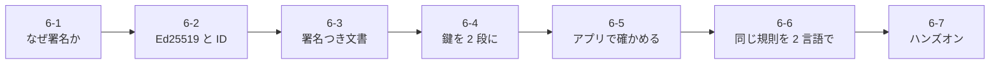
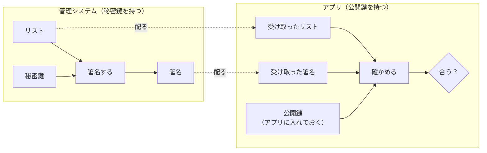
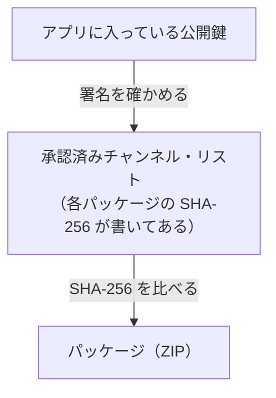

# 6-1 なぜ署名が要るのか

[目次](../README.md) ＞ 第 6 部 ＞ 6-1

## この章で学ぶこと

- アプリが第三者のチャンネルを受け取るときに、何が心配なのか
- ハッシュ・公開鍵・署名とは何か（数学なしで）
- 「置き場所を信用せず、署名を信用する」という設計の考え方

## 第 6 部の全体像

第 6 部では、**チャンネル管理システムが作ったチャンネルの一覧を、アプリが「本物だ」と確かめる仕組み** を追います。2 つのリポジトリにまたがる話で、次の順に進みます。



## 何が心配なのか

アプリは、インターネット上の URL から次のファイルを取ってきます（[0-1](../00-overview/01-what-we-build.md) の図を思い出してください）。

- 承認済みチャンネル・リスト（どのチャンネルが審査に通ったか）
- チャンネルのパッケージ（ZIP。プロンプトと設定値が入っている）

このとき、次のようなことが起こりえます。

| 心配 | 具体例 |
|---|---|
| **書き換え** | ファイルを置いているサーバーや CDN が乗っ取られ、リストに審査を通っていないチャンネルが足される |
| **差し替え** | パッケージの ZIP が、危険なプロンプトの入った別の ZIP に差し替えられる |
| **巻き戻し** | 取り下げたはずのチャンネルが載っている「古いリスト」を、攻撃者がもう一度配る |
| **なりすまし** | 公式のリストのふりをした、別の人のリストを読まされる |

チャンネルの中身は AI への指示文です。もし書き換えられたら、AI が散策者に「立入禁止の場所に入ってみましょう」と話しかけたり、居場所を聞き出したりするかもしれません。しかも AI は **散策者の API キー** で呼ぶので、話しかけを異常に増やされると散策者の費用がかさみます。

### HTTPS だけでは足りない

「HTTPS で通信すれば安全では？」と思うかもしれません。HTTPS が守るのは **通信の途中** です。通信相手のサーバーそのものが乗っ取られていたら、HTTPS は乗っ取られたサーバーの言うことを安全に届けてしまいます。

散策ガイドの設計では、リストやパッケージを **CloudFront（CDN）の上の静的ファイル** として配ります。CDN や S3 の設定ミス、AWS アカウントの乗っ取りなど、置き場所が破られる道はいくつもあります。そこで、置き場所が破られてもアプリが騙されないようにしたい。これを実現するのが署名です。

## 道具 1: ハッシュ（データの指紋）

> ハッシュの仕組みと各言語での使い方は [技術カード: ハッシュ（SHA-256）](../ref/sha-256.md) にまとめてあります。

**ハッシュ関数** は、どんな大きさのデータからも、決まった長さの値を計算する関数です。このシステムでは **SHA-256** を使います。結果は 256 ビット（32 バイト）で、16 進数で書くと 64 文字になります。

試してみましょう。Node.js が入っていれば、次のコマンドで計算できます。

```sh
node -e "console.log(require('crypto').createHash('sha256').update('鎌倉歴史散歩').digest('hex'))"
node -e "console.log(require('crypto').createHash('sha256').update('鎌倉歴史散步').digest('hex'))"
```

1 文字違うだけで、結果はまったく違う値になります。ハッシュには次の性質があります。

- **同じデータからは、いつも同じ値** が出る
- **少しでも違うデータからは、まったく違う値** が出る
- 値から元のデータを復元できない。**同じ値になる別のデータを作ることも、事実上できない**

だから、「このファイルの SHA-256 は `14f0975c…` です」と信頼できる経路で教えてもらえれば、取ってきたファイルのハッシュを計算して比べるだけで、差し替えられていないかが分かります。

散策ガイドでは、リストの中に各パッケージの SHA-256 を書いておき、アプリはパッケージを取ってきたらハッシュを計算して比べます（API-002 P-4）。

でも、そのリスト自体が書き換えられたら？ リストに偽のハッシュを書かれたら終わりです。リストが本物だと確かめる別の道具が要ります。

## 道具 2: 公開鍵と署名

> Ed25519 の仕組みと各言語での使い方は [技術カード: 公開鍵暗号と Ed25519](../ref/ed25519.md) にまとめてあります。

**公開鍵暗号** では、**対になった 2 つの鍵** を使います。

| 鍵 | 持つ人 | できること |
|---|---|---|
| **秘密鍵** | 本人だけ。だれにも見せない | データに **署名** する |
| **公開鍵** | だれに配ってもよい | 署名が、対の秘密鍵で作られたかを **確かめる** |

たとえるなら、秘密鍵は **本人だけが持つハンコ**、公開鍵は **だれでも照合できる印影の見本** です。ただし紙のハンコと違い、署名は **押した文書の中身と結びついて** います。文書を 1 文字でも書き換えると、同じ署名では確かめられなくなります。



アプリに **公開鍵を最初から入れておけば**、どこから取ってきたリストでも、本物の秘密鍵で署名されたものかを確かめられます。攻撃者はリストを書き換えられても、秘密鍵を持っていないので、書き換えたリストに合う署名を作れません。

## 組み合わせると

署名とハッシュを組み合わせると、信用が鎖のようにつながります。



1. アプリは、自分が持っている公開鍵でリストの署名を確かめる → リストは本物
2. リストに書かれた SHA-256 で、パッケージを確かめる → パッケージも本物

これで、**置き場所（CDN・サーバー）を信用しなくても**、届いたものが本物かを判断できます。API-002 はこれを次のように書いています。

> アプリが信用するのは署名であって、管理システムではない。リストとパッケージは静的ファイルとして CDN などに置いてよい。管理システムが止まっても、アプリは期限までは前回のリストで動く。（API-002 P-7）

## 署名では防げないもの

残る 2 つの心配、**巻き戻し** と **なりすまし** はどうでしょうか。

- **巻き戻し**: 古いリストも、当時は本物の秘密鍵で署名されています。署名だけでは「古い」ことが分かりません。そこで、リストに **通し番号（`seq`）と有効期限（`expiresAt`）** を入れて署名し、アプリは前に受け取ったものより小さい番号を拒みます（API-002 P-6）。[6-5](05-verify-in-app.md) で見ます
- **なりすまし**: アプリが **どの公開鍵を信用するか** を決める必要があります。散策ガイドでは、公開鍵から計算した「指紋」をそのままリストの ID にして、散策者が別の経路で得た ID と照合します（API-002 P-2）。[6-2](02-ed25519-and-ids.md) で見ます

また、署名が保証するのは「このリストの発行元が承認した」ことまでです。**審査そのものの質** は、リストの発行元を信用するしかありません（API-002「制約」）。

## つまずきやすいところ

- **「暗号化」と「署名」は別物** です。暗号化は中身を隠すこと、署名は中身が本物だと示すことです。承認済みチャンネル・リストは暗号化されておらず、だれでも読めます。隠す必要はなく、書き換えられないことだけが大事だからです
- **ハッシュだけでは本物と言えません**。ハッシュは「さっき聞いた値と同じか」を確かめる道具で、その値をどこから聞いたかが信頼の出発点になります。散策ガイドでは、その値を署名つきのリストから聞きます

## 確認問題

<details>
<summary>問 1. CDN が乗っ取られて、リストのあるチャンネルの <code>package.sha256</code> が偽の ZIP のハッシュに書き換えられました。アプリはどこで気づきますか。</summary>

リストの署名を確かめるところで気づきます。リストの中身が 1 文字でも変わると署名が合わなくなるので、アプリはそのリストを捨てます（`bad_signature`）。偽の ZIP を取りに行く段階まで進みません。

</details>

<details>
<summary>問 2. 攻撃者が、2 週間前の本物のリスト（取り下げ前のチャンネルが載っている）をそのまま配りました。署名は合います。アプリはどうやって拒みますか。</summary>

通し番号 `seq` と有効期限 `expiresAt` で拒みます。アプリは前回受け取ったリストの `seq` を覚えていて、それより小さい `seq` を拒みます（`rollback`）。また、リストの期限は発行から最長 14 日なので、古いリストは期限切れ（`expired`）でも拒まれます。

</details>

<details>
<summary>問 3. 承認済みチャンネル・リストを暗号化しないのはなぜですか。</summary>

隠す必要がないからです。リストに載っているのは公開してよい情報（チャンネル名・説明・パッケージの場所など）で、守りたいのは「書き換えられないこと」です。それは署名で守れます。

</details>

---

次: [6-2 Ed25519 と「鍵の指紋」の ID](02-ed25519-and-ids.md)
