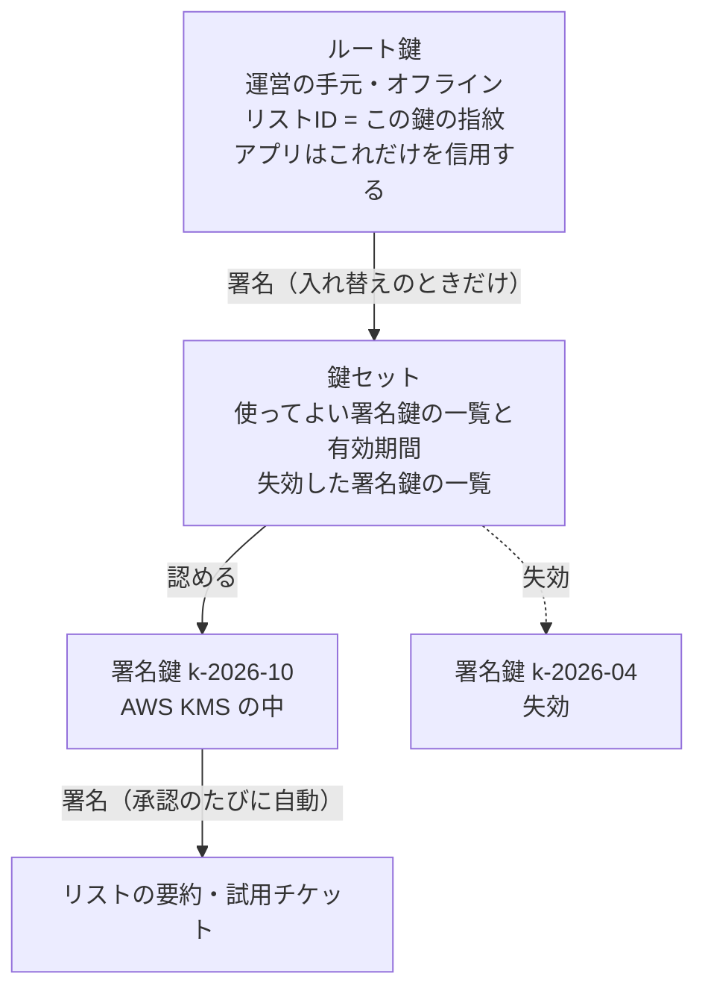
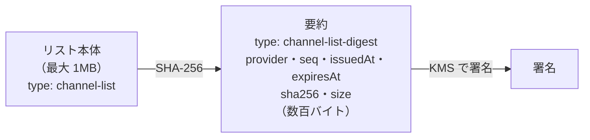
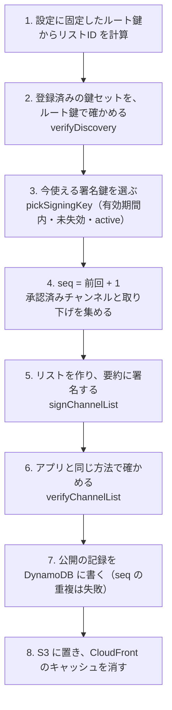

# 6-4 鍵を 2 段にする

[目次](../README.md) ＞ 第 6 部 ＞ 6-4

## この章で学ぶこと

- 鍵を「ルート鍵」と「署名鍵」の 2 段に分ける理由
- 鍵セット（使ってよい署名鍵の一覧）の仕組み
- AWS KMS で署名鍵を守る方法と、その制約（4,096 バイト）
- 制約を避けるための「要約への署名」
- 管理システムの公開の処理（`publish`）が、署名したものを外に出すまで

## 鍵が 1 つだけだと何が困るか

いちばん素直な作りは、署名の鍵を 1 つだけ持つことです。管理システムがその秘密鍵でリストに署名し、アプリにはその公開鍵を入れておく。

でも、管理システムは承認のたびに自動で署名します（API-002 L-3）。つまり **秘密鍵はいつもインターネットにつながったシステムの中** にあります。もし管理システムが乗っ取られたら？

- 攻撃者は偽のリストに署名できる
- 鍵を取り替えたくても、アプリにはその公開鍵が入っている。**アプリを更新して、散策者全員に入れ直してもらう** しかない

これでは立て直しに時間がかかりすぎます。

## 2 段にする

そこで、鍵を 2 段に分けます（API-002 P-1）。



| 鍵 | 置き場所 | 何に署名するか | 使う頻度 |
|---|---|---|---|
| **ルート鍵** | 運営の手元の、ネットにつながっていない端末 | 鍵セットだけ | 署名鍵を入れ替えるときだけ（年に数回） |
| **署名鍵** | AWS KMS（取り出せない） | リストの要約、試用チケット | 承認・取り下げのたび、毎日の作り直し |

アプリが信用するのは **ルート鍵だけ** です。署名鍵は、ルート鍵が署名した鍵セットに載っているから信用されます。

### 乗っ取られたら

管理システムが乗っ取られても、ルート鍵は無事です（オフラインにあるので）。運営は次のように立て直します。

1. KMS に新しい署名鍵を作る
2. オフラインの端末で、ルート鍵を使って **新しい鍵セット** に署名する。新しい署名鍵を載せ、乗っ取られた署名鍵を `revokedKeys` に入れる
3. 新しい鍵セットを公開する

アプリは次の取得（最大 24 時間後）で新しい鍵セットを受け取り、失効した署名鍵で署名されたリストを使わなくなります。**アプリの更新は要りません**。

一方、**ルート鍵をなくすと取り返しがつきません**。リストID はルート鍵の指紋なので、新しいルート鍵を作れば別のリストになります。内蔵のリストならアプリの更新が要ります。だから利用ガイドは、ルート鍵を「複数の場所にオフラインで保管」するよう求めています。

## 鍵セット

鍵セットの中身（API-002「GET /.well-known/sanpo-channels」）:

```json
{
  "type": "keyset",
  "provider": "sc1abcd...",
  "seq": 3,
  "issuedAt": "2026-10-03T00:00:00Z",
  "keys": [
    { "keyId": "k-2026-10", "publicKey": "<base64url>", "notBefore": "2026-10-01T00:00:00Z", "notAfter": "2027-04-01T00:00:00Z" }
  ],
  "revokedKeys": ["k-2026-04"]
}
```

- `keys` の各署名鍵には **有効期間**（`notBefore`〜`notAfter`、1 年以内）がある。期間を過ぎた鍵は自然に使えなくなる
- `revokedKeys` に載った鍵で署名された文書は、署名した日時にかかわらず使わない
- `seq` は鍵セットを作り直すたびに増やす。アプリは前より小さい `seq` を拒む。こうしないと、攻撃者が「失効させる前の古い鍵セット」を配って、失効を取り消せてしまう

鍵セットは `/.well-known/sanpo-channels`（**検出の文書**）の中に入れて公開します。アプリはまずこれを取り、ルート鍵 → 鍵セット → 署名鍵の順に確かめます。

## ルート鍵の CLI

ルート鍵は、管理システムとは別の CLI（コマンドで使う道具）で扱います。[tools/root-key/src/root-key.ts](../../michizure-console/tools/root-key/src/root-key.ts) を見ます。

### 作る

```ts
export function generateRootKey(passphrase: string): RootKeyFiles {
  if (passphrase.length < MIN_PASSPHRASE) throw new Error(`the passphrase must be at least ${MIN_PASSPHRASE} characters`);
  const { privateKey, publicKey } = generateEd25519();
  const privatePem = privateKey.export({ type: 'pkcs8', format: 'pem', cipher: 'aes-256-cbc', passphrase }).toString();
  return { privatePem, publicKey: b64url.encode(publicKey), provider: providerId(publicKey) };
}
```

秘密鍵は **パスフレーズ（16 文字以上）で暗号化して** ファイルに書き出します。オフラインの端末でも、ファイルはコピーされうるからです（コメント: "the machine is offline, but files get copied"）。

### 鍵セットに署名する

```ts
export async function signKeyset(input: KeysetInput, privatePem: string, passphrase: string, now = new Date()) {
  const root = openRootKey(privatePem, passphrase);
  const keyset = buildKeyset(input, root.provider, now);
  const signed = await signDocument(keyset, root.signer);
  // Check the result the way the app will.
  verifyKeyset(signed, b64url.encode(root.publicKey));
  return signed;
}
```

ここに、このシステム全体に通じる 2 つの習慣が見えます。

1. **署名する前に、中身を確かめる**（`buildKeyset`）: 鍵の ID の形、公開鍵が 32 バイトか、有効期間が 1 年以内か、同じ鍵が「有効」と「失効」の両方に入っていないか。間違った鍵セットにルート鍵の署名が付いてしまうと、取り消すのが大変だからです
2. **署名したあと、アプリと同じ方法で確かめる**（`verifyKeyset`）: アプリが拒むものを外に出さないためです

## 署名鍵を KMS に置く

### KMS とは

> KMS の仕組みと、AWS CLI での最小の使い方は [技術カード: AWS KMS](../ref/aws-kms.md) にまとめてあります。

**AWS KMS**（Key Management Service）は、暗号の鍵を AWS の専用の機器の中で作り、保管し、使うサービスです。いちばん大事な性質は、**秘密鍵を KMS の外に取り出せない** ことです。署名したいときは、データを KMS に送り、KMS の中で署名してもらい、署名だけを受け取ります。

だから、管理システムが乗っ取られても、**秘密鍵そのものは盗まれません**。攻撃者にできるのは、乗っ取っている間に KMS に署名を頼むことだけです。乗っ取りに気づいて権限を止め、鍵を失効させれば、それ以上の被害は出ません。

### CDK での定義

KMS の鍵は、インフラを定義する CDK のコード（[infra/lib/console-stack.ts](../../michizure-console/infra/lib/console-stack.ts)）で作ります。

```ts
// A-8: Ed25519 keys that never leave KMS; one per period, replaced through the root-signed keyset.
new kms.Key(this, `SigningKey-${keyId}`, {
  keySpec: kms.KeySpec.ECC_NIST_EDWARDS25519,
  keyUsage: kms.KeyUsage.SIGN_VERIFY,
  // …
  removalPolicy: RemovalPolicy.RETAIN,
});
```

- `ECC_NIST_EDWARDS25519` が Ed25519 の鍵です
- `RemovalPolicy.RETAIN` は、CDK のスタックを消しても鍵は消さない、という指定です。鍵を消すと、その鍵で署名した過去の文書を確かめられなくなります

そして、**この鍵で署名してよいのは公開の Lambda だけ** に絞ります（試用チケットに署名する管理 API の Lambda にも、同じ条件の許可を別に与えています）。

```ts
key.addToResourcePolicy(
  new iam.PolicyStatement({
    actions: ['kms:Sign'],
    principals: [new iam.ArnPrincipal(publisher.role!.roleArn)],
    resources: ['*'],
    conditions: { StringEquals: { 'kms:SigningAlgorithm': 'ED25519_SHA_512', 'kms:MessageType': 'RAW' } },
  }),
);
// No key.grant(): it would add an unconditional IAM allowance next to the conditioned key policy.
```

署名の方式まで条件で固定しています。CDK の便利な `key.grant()` を使わない理由もコメントに書かれています（条件のない許可が別に足されてしまうため）。AWS の権限（IAM）は第 8 部でくわしく扱います。

### 署名を頼むコード

[api/src/publish/aws.ts](../../michizure-console/api/src/publish/aws.ts) の末尾にある KMS の `Signer`:

```ts
sign: async (message) => {
  if (message.length > 4096) throw new Error(`KMS signs at most 4096 bytes, not ${message.length}`);
  const out = await kms.send(
    new SignCommand({ KeyId: key.kmsKeyArn, Message: message, MessageType: 'RAW', SigningAlgorithm: 'ED25519_SHA_512' }),
  );
  if (!out.Signature) throw new Error('KMS returned no signature');
  return out.Signature;
},
```

[6-3](03-signed-documents.md) の `Signer` インターフェースを、KMS で実装したものです。`MessageType: 'RAW'` は「渡したバイト列そのものに署名する」という指定で、これで普通の Ed25519 の署名になります。だからアプリは、KMS のことを何も知らずに、Tink で確かめられます。

1 行目に注目してください。**KMS が一度に署名できるのは 4,096 バイトまで** です。

## 要約に署名する

承認済みチャンネル・リストは最大 1MB あります。4,096 バイトを超えるので、KMS で直接署名できません。

そこで、リスト本体には直接署名せず、**本体の SHA-256 を含む小さな「要約」に署名** します（API-002 P-8）。



公開されるリストは次の形になります。`payload` は本体で、署名は `digest` の中にあります。

```json
{
  "payload": "<base64url(リスト本体の JSON のバイト列)>",
  "digest": {
    "payload": "<base64url(要約の JSON のバイト列)>",
    "keyId": "k-2026-10",
    "sig": "<base64url(要約への署名)>"
  }
}
```

要約には本体の SHA-256 と大きさが入っているので、本体を 1 バイトでも書き換えれば要約と合わなくなります。要約は署名されているので書き換えられません。結果として、**要約への署名が本体も守る** ことになります。[6-1](01-why-signatures.md) の「リストの中のハッシュがパッケージを守る」と同じ考え方を、もう 1 段重ねたものです。

### リストを作って署名するコード

[packages/protocol/src/list.ts](../../michizure-console/packages/protocol/src/list.ts) の `signChannelList`:

```ts
export async function signChannelList(content: ListContent, signer: Signer) {
  if (content.expiresAt.getTime() - content.issuedAt.getTime() > LIMITS.listLifetimeMs) {
    throw new Error('a list may live 14 days at most');
  }
  const body: ChannelList = { type: 'channel-list', format: 1, provider: content.provider, seq: content.seq, /* … */ };
  const bytes = payloadBytes(body);
  if (bytes.length > LIMITS.listBytes) throw new Error(`list is ${bytes.length} bytes (max ${LIMITS.listBytes})`);
  const digest: ChannelListDigest = {
    type: 'channel-list-digest',
    provider: body.provider,
    seq: body.seq,
    issuedAt: body.issuedAt,
    expiresAt: body.expiresAt,
    sha256: sha256Hex(bytes),
    size: bytes.length,
  };
  if (payloadBytes(digest).length >= LIMITS.digestPayloadBytes) throw new Error('digest too large for KMS');
  return { document: { payload: b64url.encode(bytes), digest: await signDocument(digest, signer) }, body, digest };
}
```

1. 期限が 14 日以内かを確かめる
2. 本体を作り、バイト列にする。1MB 以内かを確かめる
3. 本体のバイト列から SHA-256 と大きさを計算し、要約を作る。`provider`・`seq`・`issuedAt`・`expiresAt` は本体と同じ値を写す
4. 要約が KMS で署名できる大きさかを確かめる
5. 要約に署名する（[6-3](03-signed-documents.md) の `signDocument`）

ここでも「署名する前に確かめる」習慣が見えます。

## 公開の処理

最後に、これらを組み合わせて公開する [api/src/publish/publisher.ts](../../michizure-console/api/src/publish/publisher.ts) の `publish` を見ます。承認・取り下げ・鍵セットの登録・毎日 03:00 の作り直しのたびに、この関数が動きます。



いくつかの工夫を見ておきます。

- **ルート鍵の公開鍵を設定に固定する**（手順 1・2）: 登録された鍵セットが、本当にこの運営のルート鍵で署名されているかを毎回確かめます。間違った鍵セットを登録してしまっても、外に出る前に止まります
- **外に出す前にアプリと同じ方法で確かめる**（手順 6）: コメントは "Never put out what an app would reject (e.g. a KMS key that isn't the one in the keyset)" と言っています。たとえば KMS の鍵と鍵セットの公開鍵が食い違っていたら、ここで止まります
- **`seq` を二重に使わない**（手順 7）: 同時に 2 回公開が走ると、同じ `seq` で中身の違うリストができてしまいます。アプリはこれを `rollback` として拒むので、困ったことになります。そこで、DynamoDB への書き込みを「前回の `seq` が変わっていなければ」という条件つきにし、さらに Lambda の同時実行数を 1 に絞っています（CDK の `reservedConcurrentExecutions: 1`）
- **キャッシュは 5 分**（手順 8）: `Cache-Control: public, max-age=300` で置き、CloudFront のキャッシュも消します

`publish` は、保存先（`store`・`storage`）・CDN・署名（`signerFor`）をすべて引数（`deps`）で受け取ります。だから [0-3](../00-overview/03-setup.md) の `publish:local` は、同じ `publish` に、メモリの保存・フォルダへの書き出し・手元の鍵を渡すだけで動きます（[api/src/publish/local-cli.ts](../../michizure-console/api/src/publish/local-cli.ts)）。このように **依存するものを外から渡す** 作りは、第 7 部でもう一度扱います。

## つまずきやすいところ

- **「署名鍵が KMS にあるから安全」ではない**: KMS は鍵を盗まれなくしますが、乗っ取られている間は攻撃者も KMS に署名を頼めます。だから失効の仕組み（ルート鍵と鍵セット）が要ります。API-002 の「制約」にも、失効がアプリに届くまで最大 24 時間かかると書かれています
- **要約の値と本体の値を両方確かめる**: 要約の `seq` だけを見て本体を見ない、という作りにすると、本体の `seq` を書き換えた文書を見逃します。アプリは両方が一致することを確かめます（[6-5](05-verify-in-app.md)）

## 確認問題

<details>
<summary>問 1. 署名鍵 k-2026-10 を持つ管理システムが乗っ取られました。アプリを更新せずに立て直す手順を説明してください。</summary>

KMS に新しい署名鍵を作り、オフラインの端末でルート鍵を使って新しい鍵セット（`seq` を増やし、新しい鍵を `keys` に、k-2026-10 を `revokedKeys` に入れる）に署名し、公開します。アプリは次の取得で新しい鍵セットを受け取り、k-2026-10 で署名されたリストを `key_not_valid` で拒むようになります。

</details>

<details>
<summary>問 2. リスト本体ではなく要約に署名するのはなぜですか。それでも本体の書き換えを見破れるのはなぜですか。</summary>

AWS KMS の Ed25519 は一度に 4,096 バイトまでしか署名できず、最大 1MB のリストに直接署名できないからです。要約には本体の SHA-256 と大きさが入っていて、要約は署名で守られているので、本体を書き換えると SHA-256 が合わなくなり見破れます。

</details>

<details>
<summary>問 3. 公開の処理が、署名したリストを外に出す前に <code>verifyChannelList</code> で確かめるのはなぜですか。</summary>

アプリが拒むものを外に出さないためです。たとえば KMS の鍵と鍵セットに載った公開鍵が食い違っている、といった設定の誤りがあると、署名はできてもアプリでは確かめられません。外に出す前に、アプリと同じ方法で確かめて止めます。

</details>

---

前: [6-3 署名つき文書の形](03-signed-documents.md) ／ 次: [6-5 アプリで確かめる](05-verify-in-app.md)
