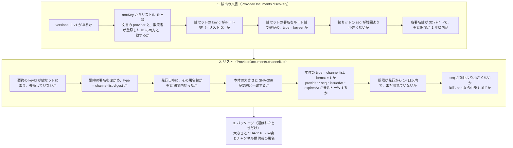

# 6-5 アプリで確かめる

[目次](../README.md) ＞ 第 6 部 ＞ 6-5

## この章で学ぶこと

- アプリ（Kotlin）が、リストの文書をどの順番で確かめるか
- Android 8 から Ed25519 を使うための Tink と、差し替え口 `Ed25519Verifier`
- 巻き戻し・期限切れ・端末の時計のずれへの備え
- 確かめに失敗したときの振る舞い（前回のリストで動き続ける）
- パッケージの確認と、チャンネル提供者の署名

## 関わるファイル

| ファイル | 役割 | モジュール |
|---|---|---|
| [ProviderDocuments.kt](../../yorisoi-platform/core-format/src/main/kotlin/io/github/duwenji/yorisoi/core/format/ProviderDocuments.kt) | 検出の文書・鍵セット・リスト・試用チケットを確かめる | コア（`core-format`） |
| [PublisherSignature.kt](../../yorisoi-platform/core-format/src/main/kotlin/io/github/duwenji/yorisoi/core/format/PublisherSignature.kt) | Ed25519 の差し替え口、ID の計算 | コア（`core-format`） |
| [TinkEd25519.kt](../../yorisoi-sanpoguide/app/src/main/java/io/github/duwenji/yorisoi/sanpoguide/station/remote/TinkEd25519.kt) | Tink による Ed25519 の実装 | `:app` |
| [ChannelSync.kt](../../yorisoi-sanpoguide/app/src/main/java/io/github/duwenji/yorisoi/sanpoguide/station/remote/ChannelSync.kt) | 取得・確認・保存の流れ | `:app` |
| [ThirdPartyChannels.kt](../../yorisoi-sanpoguide/app/src/main/java/io/github/duwenji/yorisoi/sanpoguide/station/remote/ThirdPartyChannels.kt) | `ChannelSync` を Android の上で動かす（スレッド、画面への通知） | `:app` |

**確かめる規則そのもの** はコア（`core-format`）にあり、**Android に依存する部分**（Tink、通信、ファイル、スレッド）はアプリにあります。この分け方には理由があり、[6-6](06-same-rules.md) で見ます。

## 差し替え口: Ed25519Verifier

> Tink そのものの仕組みと使い方は [技術カード: Tink](../ref/tink.md) にあります。

[6-2](02-ed25519-and-ids.md) で触れたように、Android が Ed25519 を標準で持つのは 13 からです。散策ガイドは Android 8 から動かしたい。一方、コア（`core-format`） は管理システムの機械審査（普通の JVM、Java 17）でも使います。

そこで、コア（`core-format`） は「Ed25519 の署名を確かめる」という約束だけを決めています。

```kotlin
fun interface Ed25519Verifier {
    fun verify(publicKey: ByteArray, message: ByteArray, signature: ByteArray): Boolean
}
```

実装は使う側が渡します。

| 実装 | どこにあるか | 使う場所 |
|---|---|---|
| `JcaEd25519` | `core-format`（Java 標準の暗号） | 管理システムの機械審査、コアのテスト |
| `TinkEd25519` | アプリ（Google の Tink） | アプリ（Android 8 以上） |

```kotlin
/** Pure Ed25519 (RFC 8032) from Tink, which works from Android 8; the platform has it only from 13. */
object TinkEd25519 : Ed25519Verifier {
    override fun verify(publicKey: ByteArray, message: ByteArray, signature: ByteArray): Boolean = try {
        Ed25519Verify(publicKey).verify(signature, message)
        true
    } catch (e: GeneralSecurityException) {
        false
    } catch (e: IllegalArgumentException) {
        false
    }
}
```

Tink の `verify` は、合わないときに例外を投げます。それを `true`/`false` に直しているだけの、小さなクラスです。

> **Kotlin の読み方メモ**
> - `fun interface` は、関数を 1 つだけ持つインターフェース。ラムダ（`{ … }`）で手軽に実装できます
> - `object` は、インスタンスが 1 つだけのクラス（シングルトン）を定義します
> - `try { … } catch …` も Kotlin では値を返す式です

[6-3](03-signed-documents.md) の TypeScript の `Signer` と見比べてください。**「署名する」「確かめる」という操作を約束（インターフェース）にして、実装を差し替えられるようにする**、という同じ設計が、2 つの言語で使われています。

## 確かめる順番

アプリは、[API-002](../../yorisoi-platform/docs/channel-list-api.md) の「呼び出しシーケンス」のとおりに確かめます。



どこかで合わなければ、その段階のエラーコードで止まります。エラーコードは API-002 の「エラー表」のとおりで、Kotlin では `ProviderError` という `enum` になっています。

### 検出の文書

`discovery` の中心部分:

```kotlin
fun discovery(json: String, expectedProvider: String, minKeysetSeq: Int? = null): ProviderInfo = parsing("discovery") {
    val doc = JSONObject(json)
    // … versions の確認 …
    val rootKey = bytes(doc.getString("rootKey"), "rootKey")
    if (rootKey.size != 32) fail(ProviderError.BAD_DOCUMENT, "rootKey is not 32 bytes")
    val provider = ProviderIds.of(rootKey)
    if (provider != doc.getString("provider")) fail(ProviderError.PROVIDER_MISMATCH, /* … */)
    if (provider != expectedProvider) fail(ProviderError.PROVIDER_MISMATCH, /* … */)

    val signed = doc.getJSONObject("keyset")
    if (signed.getString("keyId") != provider) fail(ProviderError.UNKNOWN_KEY, "the keyset is not signed by the root key")
    val keyset = open(signed, rootKey, "keyset", "keyset").json
    // … provider・seq・各署名鍵の確認 …
}
```

`expectedProvider` は **散策者が登録したリストID** です。[6-2](02-ed25519-and-ids.md) で見たとおり、サーバーが返す ID ではなく、散策者が別の経路で得た ID と照合するのが要点です。

`minKeysetSeq` は前回受け取った鍵セットの `seq` です。[6-4](04-two-tier-keys.md) で見たように、古い鍵セットを配られて失効を取り消されるのを防ぎます。

### リスト

`channelList` は [6-4](04-two-tier-keys.md) の「要約への署名」を確かめます。とくに次の部分を見てください。

```kotlin
val body = bytes(doc.getString("payload"), "payload")
if (body.size > MAX_LIST_BYTES) fail(ProviderError.TOO_LARGE, "the list is ${body.size} bytes")
val sha256 = sha256(body).hex()
if (body.size != digest.getInt("size") || sha256 != digest.getString("sha256")) fail(ProviderError.BAD_SIGNATURE, "the body does not match the digest")
val list = JSONObject(String(body, Charsets.UTF_8))
if (list.optString("type") != "channel-list") fail(ProviderError.BAD_SIGNATURE, "the body is not a channel list")
if (list.optInt("format") != 1) fail(ProviderError.UNSUPPORTED_VERSION, "list format ${list.opt("format")}")
for (field in listOf("provider", "seq", "issuedAt", "expiresAt")) {
    if (list.opt(field) != digest.opt(field)) fail(ProviderError.BAD_SIGNATURE, "the body's $field differs from the digest")
}
```

本体のハッシュが要約と合うことを確かめたあと、さらに `provider`・`seq`・`issuedAt`・`expiresAt` が **要約と本体で一致する** ことを確かめています。ハッシュが合っていれば本体は要約を作ったときのままなので、理屈の上では二重の確認です。それでも確かめるのは、要約を作る側の誤り（本体と違う値を要約に書いた）も見逃さないためです（API-002 V-17）。

## 巻き戻しと期限

[6-1](01-why-signatures.md) の宿題だった **巻き戻し** への備えです。

```kotlin
if (Duration.between(issuedAt, expiresAt) > LIST_LIFETIME) fail(ProviderError.EXPIRED, "expiresAt is more than 14 days after issuedAt")
if (!now.isBefore(expiresAt)) fail(ProviderError.EXPIRED, "expired at $expiresAt")
if (previousSeq != null && (seq < previousSeq || (seq == previousSeq && previousSha256 != null && sha256 != previousSha256))) {
    fail(ProviderError.ROLLBACK, "seq $seq after $previousSeq")
}
```

- **期限**: リストの期限は発行から最長 14 日。期限の長すぎるリストも拒みます。そうしないと、管理システムを乗っ取った攻撃者が「期限 10 年」のリストを作れてしまいます
- **`seq` の巻き戻し**: 前回より小さい `seq` を拒みます
- **同じ `seq` で中身が違う**: これも `rollback` です。本物のリストの発行元は、同じ `seq` で違うリストを出しません（[6-4](04-two-tier-keys.md) で見た、`seq` を二重に使わない工夫）。出てきたら、何かがおかしいということです

前回の `seq` とハッシュ（`previousSeq`・`previousSha256`）は、`ChannelSync` がリストごとに端末に保存しています。

### 端末の時計がずれていたら

期限の判定は端末の時計に頼っています。端末の時計が大きく進んでいると、まだ有効なリストを「期限切れ」と判定してしまいます。そこで `ChannelSync.refresh` は、期限切れで拒まれたとき、リストの発行日時が端末の時刻より 1 日以上先なら「時計がずれているようです」と知らせます（`issuedInFuture`）。

```kotlin
val list = try {
    docs.channelList(listJson, info.keyset, at, record.listSeq, record.listSha256)
} catch (e: ProviderException) {
    if (e.error.code == "expired" && docs.issuedInFuture(listJson, at)) {
        throw ChannelSyncException("端末の時計がずれているようです。時刻を確かめてください")
    }
    throw e
}
```

## 失敗したときは前回のリストで

`ChannelSync.refresh` 全体の形を見ると、失敗の扱いが分かります。

```kotlin
fun refresh(providerId: String, unmetered: Boolean) {
    // …
    try {
        val info = docs.discovery(discoveryJson, record.id, minKeysetSeq = record.keysetSeq)
        val list = /* docs.channelList(…) */
        updateProvider(record.id) { it.copy(/* 新しい文書・seq・ハッシュを保存 */ error = null) }
        apply(record.id, info, list, unmetered)
    } catch (e: ProviderException) {
        updateProvider(record.id) { it.copy(triedAt = at, error = e.message) }
    } catch (e: ChannelSyncException) {
        updateProvider(record.id) { it.copy(triedAt = at, error = e.message) }
    } catch (e: IOException) {
        updateProvider(record.id) { it.copy(triedAt = at, error = "fetch_failed: ${e.message ?: e.javaClass.simpleName}") }
    }
}
```

- 確かめに **成功したときだけ**、新しい文書を保存し、`seq` とハッシュを更新する
- 失敗したら、エラーの理由だけを記録する（設定画面のリストの欄に出る）。**保存してある前回の文書には手を付けない**

だから、通信に失敗しても、偽のリストを配られても、アプリは前回の正しいリストで動き続けます（API-002「確認に失敗したとき」）。前回のリストも期限が切れたら、そのリストのチャンネルは次の散歩から使いません。

取得するのは、アプリの起動時と散歩の開始時に、前回から 24 時間以上たっているときだけです（`refreshDue`）。散歩の途中では取得しません。

## 取り下げ

新しいリストを受け取ったら、`apply` が端末にあるチャンネルと突き合わせます。

```kotlin
val revoked = list.revoked.firstOrNull { it.id == c.id && it.covers(c.version) }
val listed = list.channels.firstOrNull { it.id == c.id }
when {
    revoked != null -> {
        store.deletePackage(c.sha256)
        // … 端末の一覧から外し、理由を知らせる …
    }
    listed != null && listed.version > c.version && unmetered -> runCatching { download(providerId, listed, c, list, unmetered) }
}
```

`revoked` に載ったチャンネルはパッケージを消し、理由を知らせます。新しい版が出ていれば、Wi-Fi のとき（`unmetered`）に取得します。

## パッケージの確認

散策者がチャンネルを選ぶと、`download` がパッケージを取ってきます。

```kotlin
val bytes = http.get(url, minOf(entry.pkg.size, ProviderDocuments.MAX_PACKAGE_BYTES))
if (bytes.size != entry.pkg.size || sha256(bytes) != entry.pkg.sha256) throw ChannelSyncException("パッケージがリストと一致しません（hash_mismatch）")
val listedAs = ListedAs(entry.id, entry.version, entry.publisher, entry.activities, entry.genres, entry.requires)
val check = StationValidator.checkArchive(bytes, listedAs, verifier, mediaStage, Strictness.APP)
if (check is StationCheck.Rejected) throw ChannelSyncException("パッケージの確認に失敗しました（package_rejected: ${check.code.json}）")
check as StationCheck.Ok
// What the package holds may rule out this app where the list's copy couldn't (an unknown restriction).
if (Compatibility.reasons(check.station.manifest, profile).isNotEmpty()) throw ChannelSyncException("このアプリでは使えないチャンネルです")

store.writePackage(entry.pkg.sha256, bytes)
// …
fetchMaterials(providerId, list, check.station, entry.publisher, unmetered)
```

1. **大きさの上限つきで取得する**: リストに書かれた大きさ（と 2MB）を超えたら途中で打ち切る。巨大なファイルで端末を埋められないように
2. **大きさと SHA-256 をリストと比べる**: [6-1](01-why-signatures.md) の「署名つきのリストのハッシュがパッケージを守る」がここです
3. **中身を確かめる**（`StationValidator.checkArchive`）: パッケージの形式（API-003）と、**チャンネル提供者の署名**。`mediaStage` はこのアプリが出せる素材の段、`Strictness.APP` はアプリとしての読み方（[5-2](../05-station-format/02-package-format.md)）。`ListedAs` にはリストに載った `activities`・`genres`・`requires` も入っていて、パッケージの値と一致するかも確かめる（API-002 P-19）
4. **このアプリで使えるかを、パッケージの値でもう一度判定する**（`Compatibility.reasons`、[5-2](../05-station-format/02-package-format.md)）: リストの値では分からない、知らない制限の項目があるかもしれないため
5. **確かめてから保存する**（`store.writePackage`）
6. **素材を前もって取る**（`fetchMaterials`）: チャンネルが使う素材集や外の素材を、選んだときにまとめて取る。散歩の途中でスポットに近づいてから取りに行くと、どこにいるかが相手に伝わってしまうからです（API-003 F-10）。基準（`selectors`）で今いる地域の素材集を集める分だけは、Wi-Fi のとき（`unmetered`）に限って取ります

### チャンネル提供者の署名

パッケージには、それを作った **チャンネル提供者の署名**（`signature.json`）も付いています（API-003 F-6）。チャンネル提供者は自分の秘密鍵で、パッケージの `signature.json` 以外のすべてのファイルの SHA-256 の一覧に署名します（これも [6-3](03-signed-documents.md) と同じ `payload`・`sig` の形で、`type` は `channel-package`）。`StationValidator` は、

- 署名を、パッケージに入っているチャンネル提供者の公開鍵で確かめる
- 一覧に載ったファイルと実際のファイルが過不足なく一致し、それぞれの SHA-256 が合う
- その公開鍵から計算したアカウントID（`sg1…`）が、パッケージの `channel.json` のチャンネル提供者とも、**リストに書かれたチャンネル提供者** とも一致する

ことを確かめます。運営の署名が「審査に通った」ことを、チャンネル提供者の署名が「だれが作ったか」を示す、という役割分担です。チャンネル提供者の鍵の作り方（ブラウザの中で作る）は [9-3](../09-console/03-keys-in-browser.md) で扱います。

`download` の冒頭には、チャンネル提供者が変わったときの確認もあります。端末にある版と新しい版でチャンネル提供者が違うとき、リストに運営が付けた `publisherChange`（鍵の移し替えの記録）がなければ、新しい版を使いません（`publisher_changed`、API-002 P-9）。

### 素材集も同じ形で確かめる

リストには、チャンネルのほかに **素材集**（`collections`、API-002 1.2）も載っています。`ProviderDocuments` は、それを `ListedCollection` として読みます（素材集の ID・版・素材提供者・使ってよいチャンネル提供者 `grants`・パッケージの URL と SHA-256 など）。素材集のパッケージを取るときも、チャンネルとまったく同じ順で確かめます（`ChannelSync.fetchCollection`）。

```kotlin
val bytes = http.get(checkedUrl(listed.pkg.url), minOf(listed.pkg.size, ProviderDocuments.MAX_PACKAGE_BYTES))
if (bytes.size != listed.pkg.size || sha256(bytes) != listed.pkg.sha256) throw IOException("hash_mismatch")
val listedAs = CollectionListedAs(listed.id, listed.version, listed.producer, list.formerProducerIds(listed.producer))
if (CollectionValidator.checkArchive(bytes, listedAs, verifier, Strictness.APP) !is CollectionCheck.Ok) throw IOException("collection_invalid")
store.writeCollection(listed.pkg.sha256, bytes)
```

運営の署名（リスト）が「審査に通った」ことを、素材提供者の署名（素材集の `signature.json`）が「だれが作ったか」を示す、という役割分担もチャンネルと同じです。素材集の取り下げはチャンネルとは別の欄（`revokedCollections`）に載り、取り下げられた素材集は「出せない」として次の候補に進みます。チャンネルそのものは止まりません（ADR-002 D-12）。

## つまずきやすいところ

- **確かめに成功する前に保存しない**: 保存してから確かめると、失敗したときに前回の正しいリストを失います
- **「期限切れ」と「時計のずれ」を区別する**: 端末の時計がずれていると、正しいリストも期限切れに見えます

## 確認問題

<details>
<summary>問 1. コア（<code>core-format</code>）が Tink を直接使わず、<code>Ed25519Verifier</code> を受け取るのはなぜですか。</summary>

コア（`core-format`） はアプリ（Android 8 以上、Ed25519 は Tink が要る）と管理システムの機械審査（普通の JVM、Java 標準の暗号で足りる）の両方で使うからです。確かめ方の約束だけを決め、実装は使う側が渡します。

</details>

<details>
<summary>問 2. リストの発行元が、同じ <code>seq</code> で中身の違うリストを 2 つ出してしまいました。前のリストを受け取っていたアプリはどうしますか。</summary>

`rollback` で新しい方を拒み、前のリストを使い続けます。アプリは前回の `seq` とハッシュを覚えていて、同じ `seq` でハッシュが違うものを拒みます。

</details>

<details>
<summary>問 3. 散歩の途中で取り下げが公開されました。アプリはいつ気づきますか。</summary>

散歩の途中では取得しないので、その散歩の間は気づきません。次の散歩の開始時（前回の取得から 24 時間以上たっていれば）か、アプリの次の起動時に取得して気づきます。

</details>

---

前: [6-4 鍵を 2 段にする](04-two-tier-keys.md) ／ 次: [6-6 2 つの言語で同じ規則を守る](06-same-rules.md)
