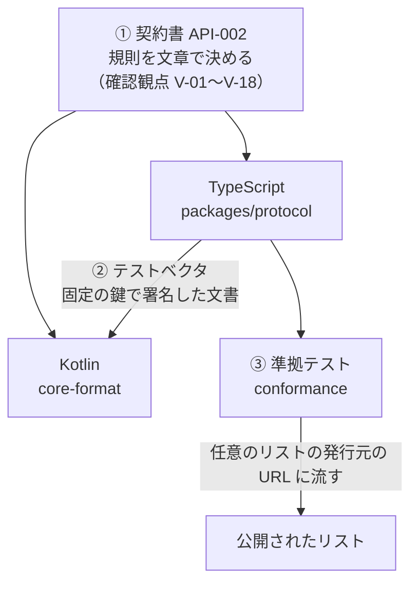

# 6-6 2 つの言語で同じ規則を守る

[目次](../README.md) ＞ 第 6 部 ＞ 6-6

## この章で学ぶこと

- 署名する側（TypeScript）と確かめる側（Kotlin）で、規則が食い違うと何が起きるか
- 食い違いを防ぐ 3 つの道具: 契約書、テストベクタ、準拠テスト
- 同じ Kotlin のコードを、アプリと管理システムの両方で使う工夫

## 食い違いの怖さ

ここまでで、同じ規則が 2 つの言語で書かれているのを何度も見てきました。

| 規則 | TypeScript（管理システム） | Kotlin（アプリ） |
|---|---|---|
| ID の計算 | `providerId`・`accountId`（encoding.ts） | `ProviderIds`・`AccountIds` |
| 署名つき文書を開く | `openSigned`（verify.ts） | `ProviderDocuments.open` |
| 検出の文書 | `verifyDiscovery` | `ProviderDocuments.discovery` |
| リスト | `verifyChannelList` | `ProviderDocuments.channelList` |

もし 2 つが少しでも食い違ったら、どうなるでしょう。

- **管理システムが甘く、アプリが厳しい**: 管理システムは「正しい」と思って公開したのに、アプリが全部拒む。第三者のチャンネルがだれにも届かなくなる
- **管理システムが厳しく、アプリが甘い**: ふだんは問題が出ない。でも攻撃者が作った文書を、アプリだけが受け入れてしまうかもしれない。こちらの方が怖い

たとえば base32 の変換を片方だけ間違えれば ID が合わなくなり、JSON の数値の扱い（`7` と `7.0`）が違えば要約と本体の比較が食い違います。こうした違いは、片方のコードだけを見ていても気づけません。

このシステムは、3 つの道具で食い違いを防いでいます。



## ① 契約書: 規則を文章で決める

まず、規則を **コードではなく文章で** 決めます。それが API-002 です。確かめる順番、エラーコード、上限の値、そして「何を確かめれば準拠しているといえるか」（確認観点 V-01〜V-18）まで書いてあります。

両方のコードは、この文書を手本にして書かれています。コメントに `(V-03, V-04, P-8)` のような番号があるのはそのためです。食い違いに気づいたら、「どちらのコードが正しいか」ではなく「契約書は何と言っているか」で決めます。

## ② テストベクタ: 片方が作り、もう片方が確かめる

**テストベクタ** は、「この入力なら、この結果になるはず」という具体的なデータの組です。暗号の分野では、別々に作った実装が同じ結果を出すかを確かめるのによく使います。

このシステムでは、**管理システムのコードで署名した文書** をファイルに書き出し、**アプリのテストがそれを確かめます**。

### 作る側

[conformance/src/app-vectors.ts](../../yorisoi-console/conformance/src/app-vectors.ts) が、検出の文書・リスト・試用チケットを作ります。

```ts
const PKCS8_ED25519 = Buffer.from('302e020100300506032b657004220420', 'hex');
const fromSeed = (byte: number): KeyObject => createPrivateKey({ key: Buffer.concat([PKCS8_ED25519, Buffer.alloc(32, byte)]), format: 'der', type: 'pkcs8' });

const root = fromSeed(1);
const signing = fromSeed(2);
```

鍵は乱数ではなく、**固定の種**（32 バイトすべてが `1`、すべてが `2`）から作ります。[6-2](02-ed25519-and-ids.md) で見たように Ed25519 は決定的なので、同じ鍵・同じ文書からはいつも同じ署名ができます。だから **出力のファイルは、形式を変えない限り毎回まったく同じ** になります。コメントにも "Ed25519 is deterministic, so the output never changes unless the format does" とあります。

もちろん、この鍵は公開されているので、本物のリストの発行元に使ってはいけません（"never use them for a real provider"）。

出力先は SanpoGuide のテスト用のファイルです。

```sh
npm run vectors -w conformance -- ../yorisoi-platform/core-format/src/test/resources/provider-vectors.json
```

### 確かめる側

SanpoGuide の [ProviderDocumentsTest.kt](../../yorisoi-platform/core-format/src/test/kotlin/io/github/duwenji/yorisoi/core/format/ProviderDocumentsTest.kt) が、そのファイルを読みます。

```kotlin
/**
 * API-002 as the app checks it, against documents the channel management system's own code signed
 * (`provider-vectors.json`, from yorisoi-console `conformance/src/app-vectors.ts`). The
 * rejections re-sign altered documents with the same fixed, public seeds (1 = root, 2 = signing).
 */
class ProviderDocumentsTest {
    private val vectors = JSONObject(javaClass.getResource("/provider-vectors.json")!!.readText())
    private val provider = vectors.getString("provider")
    private val now = Instant.parse(vectors.getString("now"))
    private val docs = ProviderDocuments(JcaEd25519)
    // …
```

テストは 2 種類のことを確かめます。

1. **受け入れるべきものを受け入れる**: 管理システムが作った正しい文書を、アプリの規則が受け入れること
2. **拒むべきものを拒む**: 文書の一部を変えて、**同じ固定の種で署名し直し**、正しいエラーコードで拒むこと。署名し直すので、署名は合っている。「変えたところ以外はすべて正しい」文書で、その 1 か所の誤りを見つけられるかを確かめる

2 つ目の工夫が大事です。ただ文書を書き換えるだけだと、どんな書き換えも `bad_signature` で止まってしまい、その先の確認（期限、`seq`、`type` など）を試せません。

### 時刻を固定する

テストベクタには `now`（`2026-10-05T00:00:00.000Z`）も入っています。リストには期限があるので、テストを流す日によって結果が変わってしまっては困ります。そこで「この時刻に確かめたことにする」値を一緒に渡し、確かめる関数は時刻を引数（`now`）で受け取ります。

[6-5](05-verify-in-app.md) の `channelList(json, keyset, now, …)` や、TypeScript の `verifyChannelList(value, keyset, { now })` が時刻を引数に取るのは、このためです。**時刻のように外から来るものを引数にすると、テストしやすくなります。**

## ③ 準拠テスト: 公開されたものを外から確かめる

テストベクタは「コードどうし」の食い違いを防ぎます。もう 1 つ、**実際に公開されているもの** が契約書どおりかを確かめる道具があります。それが **準拠テスト**（[conformance/src/check.ts](../../yorisoi-console/conformance/src/check.ts)）です。

```sh
npm run check -w conformance -- https://channels.example.com --provider sc1…
```

URL を渡すと、アプリと同じように検出の文書・リスト・パッケージ・アイコンを取ってきて、API-002 の確認観点のうちリストの発行元が守るべきもの（V-01〜V-09、V-15、V-16、素材集の V-19〜V-21・V-25）を 1 つずつ確かめ、結果を表示します。

準拠テストの特徴:

- **任意のリストの発行元に流せる**: この管理システムだけでなく、だれかが別の方法で作ったリストの発行元にも流せます。API-002 が「実装方法と置き場所は問わない」としている以上、準拠しているかを外から確かめる手段が要ります
- **リストID は URL から取らない**: `--provider` で、別の経路で得た ID を渡します。アプリと同じ考え方です
- **確かめる規則は `packages/protocol` と同じ**: 中で `verifyDiscovery`・`verifyChannelList` を使っています。公開の処理が外に出す前に使うのと同じ関数です

## 同じコードを使うという選択

食い違いを防ぐいちばん確かな方法は、**同じコードを使う** ことです。

チャンネルのパッケージの確認（API-003）では、実際にそうしています。アプリのコア（`core-format`）とプロンプト・パックを GitHub Packages にライブラリとして公開し、管理システムの機械審査（`validator`、Kotlin の Lambda）がそれを使います。

```kotlin
// yorisoi-console/validator/build.gradle.kts
dependencies {
    implementation("io.github.duwenji.yorisoi:core-format:1.0.0")
    implementation("io.github.duwenji.yorisoi.sanpoguide:prompts:3.0.0")
    // core-format leaves org.json to its users (Android ships one).
    implementation("org.json:json:20240303")
    // …
}
```

だから、機械審査で合格したパッケージは、アプリでも必ず読み込めます。

では、なぜ承認済みチャンネル・リストは TypeScript と Kotlin で 2 回書いたのでしょう。管理システムの公開の処理や画面は TypeScript で書かれていて、そこから Kotlin のコードを呼ぶのは大がかりだからです。その代わりに、テストベクタと準拠テストで食い違いを防いでいます。**同じコードを使えるなら使い、使えないならテストでつなぐ**、という使い分けです。

コアが Android に依存しない素の Kotlin（JVM）のモジュールになっているのも、この共有のためです。`org.json` を `compileOnly`（コンパイルのときだけ使い、配らない）にしているのは、Android が `org.json` を標準で持っていて、二重に入れるとぶつかるからです。こうしたライブラリの作り方は第 5 部で扱います。

## つまずきやすいところ

- **テストベクタは手で直さない**: ファイルの先頭に "Do not edit by hand" と書かれています。形式を変えたら、管理システム側で作り直して SanpoGuide にコピーします。手で直すと、「管理システムのコードが作ったもの」という意味がなくなります
- **片方だけ直さない**: 規則を変えるときは、契約書 → TypeScript → テストベクタの作り直し → Kotlin の順に、全部をそろえます

## 確認問題

<details>
<summary>問 1. テストベクタの鍵を、乱数ではなく固定の種から作るのはなぜですか。</summary>

Ed25519 は決定的なので、固定の鍵なら出力のファイルが毎回まったく同じになります。形式を変えない限りファイルに差分が出ないので、変わったときは「形式が変わった」と分かります。また、Kotlin のテストが同じ種から鍵を作って、書き換えた文書に署名し直すこともできます。

</details>

<details>
<summary>問 2. 拒むべき文書のテストで、書き換えた文書を「署名し直す」のはなぜですか。</summary>

署名し直さないと、どんな書き換えも署名の確認で `bad_signature` になり、その先の確認（期限、`seq`、`type`、要約と本体の一致など）を試せないからです。署名し直せば、書き換えた 1 か所だけが誤りの文書を作れます。

</details>

<details>
<summary>問 3. パッケージの確認では同じコードを使い、リストの確認では 2 つの言語で書いているのはなぜですか。</summary>

パッケージを確かめる機械審査は Kotlin で書けるので、アプリのコアをそのまま使えます。リストを作る公開の処理や画面は TypeScript なので、Kotlin のコードを使うのは大がかりです。その代わりに、テストベクタと準拠テストで食い違いを防いでいます。

</details>

---

前: [6-5 アプリで確かめる](05-verify-in-app.md) ／ 次: [6-7 ハンズオン](07-hands-on.md)
