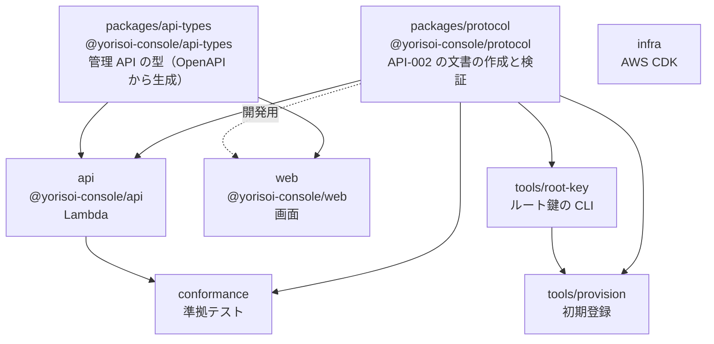

# 7-2 npm workspaces とプロジェクト参照

[目次](../README.md) ＞ 第 7 部 ＞ 7-2

> npm workspaces の仕組みと最小の使い方は [技術カード: npm workspaces](../ref/npm-workspaces.md) にあります。

## この章で学ぶこと

- 1 つのリポジトリに、いくつものパッケージを置く構成（モノレポ）
- npm workspaces で、パッケージどうしを名前で参照する仕組み
- パッケージが TypeScript のソースを **そのまま** 公開する作り（ビルドの手順がない）
- `tsc -b` とプロジェクト参照で、全体の型を順番に確かめる仕組み
- `tsx`・Vite・esbuild が、それぞれどこで TypeScript を JavaScript にしているか

## 管理システムのパッケージ

[0-4](../00-overview/04-reading-the-repos.md) で見たとおり、管理システムは 8 つのパッケージでできています。



矢印は「使われる → 使う」の向きです。`packages/protocol`（[第 6 部](../06-trust/01-why-signatures.md)）と `packages/api-types`（[7-3](03-openapi.md)）が、ほかの多くのパッケージから使われる共通部品になっています。

なぜ 1 つのリポジトリに入れるのでしょうか（**モノレポ**）。

- **共通部品を変えたら、使う側もすぐに確かめられる**: `protocol` の関数の引数を変えたら、`api`・`conformance`・`tools` のどこが壊れたかが、同じ `tsc -b` ですぐに分かる
- **公開の手間がない**: 第 5 部のコア（`core-format`）のように、版を付けて公開して、使う側で版を上げる、という手順が要らない
- **全体を 1 回のプルリクエストで変えられる**: 契約（OpenAPI）、サーバー、画面を一緒に直せる

SanpoGuide と管理システムの間は、**別のリポジトリ** にして、コアとプロンプト・パックを版を付けて公開しています（[5-3](../05-station-format/03-publish.md)）。持ち主も、言語も、リリースの時期も違うからです。管理システムの中は、同じ持ち主・同じ言語・同じリリースなので、1 つのリポジトリにまとめています。

## npm workspaces

[package.json](../../yorisoi-console/package.json)（いちばん上）:

```json
{
  "name": "yorisoi-console",
  "private": true,
  "type": "module",
  "workspaces": [
    "packages/protocol",
    "packages/api-types",
    "api",
    "tools/root-key",
    "tools/provision",
    "conformance",
    "infra",
    "web"
  ],
  "scripts": {
    "typecheck": "tsc -b",
    "test": "vitest run",
    "synth": "npm run synth -w infra"
  },
  "devDependencies": {
    "@types/node": "^24.0.0",
    "tsx": "^4.23.15",
    "typescript": "^7.0.2",
    "vitest": "^5.0.3"
  },
  "engines": { "node": ">=22" }
}
```

`workspaces` に並べたフォルダが、それぞれ 1 つのパッケージ（自分の `package.json` を持つ）になります。`npm ci` を 1 回実行すると、

1. すべてのパッケージの依存ライブラリを、いちばん上の `node_modules` にまとめて入れる
2. 各パッケージを、`node_modules/@yorisoi-console/名前` に **リンク**（シンボリックリンク）として置く

だから、`api` のコードは、同じリポジトリの `protocol` を、ふつうのライブラリと同じように名前で読み込めます。

```ts
// api/src/publish/publisher.ts
import { b64url, payloadBytes, providerId, signChannelList, verifyChannelList, verifyDiscovery } from '@yorisoi-console/protocol';
```

使う側の `package.json` には、依存として名前と版を書きます。

```json
// api/package.json
"dependencies": {
  "@aws-sdk/client-kms": "^3.1146.0",
  "@yorisoi-console/api-types": "0.1.0",
  "@yorisoi-console/protocol": "0.1.0",
  …
}
```

- `"private": true`: npm の公開のリポジトリに **間違って公開しない** ための印。管理システムのパッケージは、どれも外に公開しない
- 共通の道具（`typescript`・`vitest`・`tsx`）は、いちばん上の `devDependencies` に 1 回だけ書く。全パッケージで同じ版を使える

### -w でパッケージを選んで実行する

各パッケージの `package.json` には、そのパッケージ用のコマンド（`scripts`）があります。

```json
// conformance/package.json
"scripts": {
  "check": "tsx src/cli.ts",
  "serve": "tsx src/serve-cli.ts",
  "vectors": "tsx src/app-vectors.ts"
}
```

いちばん上のフォルダから、`-w`（`--workspace`）でパッケージを選んで実行します。第 6 部のハンズオンで使った書き方です。

```sh
npm run publish:local -w api
npm run check -w conformance -- http://127.0.0.1:8787 --allow-local-http --provider <リストID>
```

`--` のあとは、コマンドにそのまま渡す引数です。

## ソースをそのまま公開する

各パッケージが「外にどのファイルを見せるか」は、`package.json` の `exports` で決まります。[packages/protocol/package.json](../../yorisoi-console/packages/protocol/package.json):

```json
{
  "name": "@yorisoi-console/protocol",
  "version": "0.1.0",
  "private": true,
  "type": "module",
  "exports": {
    ".": {
      "types": "./src/index.ts",
      "default": "./src/index.ts"
    },
    "./testing": {
      "types": "./src/testing.ts",
      "default": "./src/testing.ts"
    }
  }
}
```

ふつうのライブラリは、TypeScript を JavaScript にビルドした `dist/index.js` を `exports` に書きます。管理システムは、**`.ts` のソースそのもの** を書いています。パッケージをビルドする手順がありません。

では、だれが `.ts` を JavaScript にしているのでしょうか。**使う側の道具** です。

| 使う場面 | 道具 | 何をするか |
|---|---|---|
| 手元のコマンド（`npm run check -w conformance` など） | **tsx** | `.ts` を実行の直前に JavaScript にして動かす |
| テスト | **Vitest** | テストを実行するときに JavaScript にする（[7-4](04-testing.md)） |
| 画面（`web`） | **Vite** | 開発中はその場で、`npm run build` で 1 つにまとめて（[9-1](../09-console/01-react-vite.md)） |
| Lambda（`api`） | **esbuild**（CDK の `NodejsFunction`） | 配備のときに、依存ごと 1 つの `.js` にまとめる（第 8 部） |

どれも、TypeScript の **型を取り除いて** JavaScript にするだけで、型は確かめません（[7-1](01-typescript-syntax.md) のハンズオンで見たとおり、`tsx` は型が間違っていても動きます）。型の確認は、別に `tsc -b` で行います。

`"./testing"` の入口は、テスト用の道具（`makeTestProvider`・`sampleChannel`、[6-6](../06-trust/06-same-rules.md)）を、ふつうの入口と分けて公開するためのものです。`import { makeTestProvider } from '@yorisoi-console/protocol/testing'` と書きます。本番のコードが、うっかりテスト用の使い捨ての鍵を使わないようにする工夫です。

## tsc -b とプロジェクト参照

型の確認は、いちばん上のフォルダで `npx tsc -b` を 1 回実行するだけです（CI もこれを流します）。

### 共通の設定

[tsconfig.base.json](../../yorisoi-console/tsconfig.base.json):

```json
{
  "compilerOptions": {
    "target": "ES2023",
    "module": "NodeNext",
    "moduleResolution": "NodeNext",
    "strict": true,
    "noUncheckedIndexedAccess": true,
    "declaration": true,
    "composite": true,
    "verbatimModuleSyntax": true,
    // …
  }
}
```

全パッケージが、この設定を `extends` で受け継ぎます。`strict` と `noUncheckedIndexedAccess` は [7-1](01-typescript-syntax.md) で見た、null と配列の取り出しを厳しく確かめる設定です。

### パッケージごとの設定と参照

[api/tsconfig.json](../../yorisoi-console/api/tsconfig.json):

```json
{
  "extends": "../tsconfig.base.json",
  "compilerOptions": {
    "rootDir": ".",
    "outDir": "dist",
    "emitDeclarationOnly": true
  },
  "include": ["src", "test"],
  "references": [
    { "path": "../packages/protocol" },
    { "path": "../packages/api-types" }
  ]
}
```

- `references`: このパッケージが使うパッケージ。**プロジェクト参照** と呼ぶ
- `composite: true`（共通の設定）: 参照される側になれる、という印。確かめた結果を `dist/tsconfig.tsbuildinfo` に記録する
- `emitDeclarationOnly: true`: JavaScript は書き出さず、型の情報（`.d.ts`）だけを書き出す。JavaScript を作るのは、上の表の道具の仕事だから

いちばん上の [tsconfig.json](../../yorisoi-console/tsconfig.json) は、全パッケージを参照しているだけです。

```json
{
  "files": [],
  "references": [
    { "path": "packages/protocol" },
    { "path": "packages/api-types" },
    { "path": "api" },
    // … 全パッケージ …
  ]
}
```

### -b（build）がすること

`tsc -b` は、参照をたどって、

1. **使われる側から順に** 確かめる（`protocol` → `api` → `conformance` …）
2. 前回から **何も変わっていないパッケージは飛ばす**（`tsbuildinfo` と、ファイルの日時を比べる）
3. 使われる側が変わっても、その **型の情報（`.d.ts`）が変わらなければ、使う側は確かめ直さない**

ので、ふだんは 1 秒もかかりません。ハンズオンで `--verbose` を付けて、その様子を見ます。

> この構成では、各パッケージが `.ts` のソースをそのまま公開しているので、参照を書き忘れても型の確認そのものは通ってしまうことがあります（試してみると、`tools/root-key` の参照を外してもエラーになりませんでした）。それでも参照を書いておくのは、確かめる順番と、変わっていないパッケージを飛ばす判断に使われるからです。

## ハンズオン: ワークスペースをのぞく

### 1. パッケージどうしのつながりを見る

```sh
cd /c/Dev/apps/yorisoi-console
ls -la node_modules/@yorisoi-console/
```

```
api -> /c/Dev/apps/yorisoi-console/api
api-types -> /c/Dev/apps/yorisoi-console/packages/api-types
conformance -> /c/Dev/apps/yorisoi-console/conformance
…
protocol -> /c/Dev/apps/yorisoi-console/packages/protocol
…
```

`->` は、リンク（シンボリックリンク）の行き先です。`node_modules` の中に、リポジトリのフォルダへのリンクが並んでいます。`import … from '@yorisoi-console/protocol'` は、これをたどって `packages/protocol` を読んでいます。

あるパッケージが何に依存しているかは、`npm ls` で見られます。

```sh
npm ls -w tools/root-key --depth 0
```

```
yorisoi-console@ C:\Dev\apps\yorisoi-console
`-- @yorisoi-console/root-key@0.1.0 -> .\tools\root-key
  `-- @yorisoi-console/protocol@0.1.0 -> .\packages\protocol
```

### 2. tsc -b の順番と、飛ばす様子を見る

```sh
npx tsc -b --verbose
```

```
Projects in this build:
    * packages/protocol/tsconfig.json
    * packages/api-types/tsconfig.json
    * api/tsconfig.json
    * tools/root-key/tsconfig.json
    …
Project 'packages/protocol/tsconfig.json' is up to date because newest input 'packages/protocol/src/verify.ts' is older than output …
Project 'api/tsconfig.json' is up to date because …
…
```

- 最初に、確かめる順番が並ぶ。使われる側（`protocol`・`api-types`）が先
- 「is up to date」は、前回から変わっていないので飛ばした、という意味

`packages/protocol/src/encoding.ts` の最後に空行を 1 つ足して保存し、もう一度 `npx tsc -b --verbose` を実行してください。

```
Project 'packages/protocol/tsconfig.json' is out of date because output … is older than input …
Building project 'packages/protocol/tsconfig.json'...
Updating output timestamps of project 'api/tsconfig.json'...
Updating output timestamps of project 'tools/root-key/tsconfig.json'...
…
```

`protocol` は「out of date」になって確かめ直されます。でも、それを使う `api` などは「Updating output timestamps」（日時を更新するだけ）です。空行を足しても `protocol` の型の情報（`.d.ts`）は変わらないので、使う側を確かめ直す必要がない、と `tsc` が判断したのです。関数の引数を変えるなど、型の情報が変わる変更をすると、使う側も確かめ直されます。

確かめたら空行を消します（`git checkout -- packages/protocol/src/encoding.ts`）。

### 3. ソースがそのまま使われていることを確かめる

```sh
cat packages/protocol/package.json
ls packages/protocol/dist/src 2>/dev/null | head
```

`exports` が `./src/index.ts` を指していること、`dist/` には型の情報（`.d.ts`）しかないことを確かめてください。第 6 部の `npm run publish:local -w api` が動いたのは、`tsx` が `api` と `protocol` の `.ts` を、その場で JavaScript にして動かしたからです。

## つまずきやすいところ

- **ワークスペースのパッケージを足したら `npm install`**: リンクが作られ、`package-lock.json` が更新される
- **コマンドはいちばん上のフォルダから `-w` で**: 各フォルダの中で `npm install` すると、別の `node_modules` ができて混乱する
- **`tsx` や Vite で動いても、型が正しいとは限らない**: `npx tsc -b` で確かめる
- **共通部品を変えたら、全体を確かめる**: モノレポの利点は、使う側の壊れ方がすぐ分かること

## 確認問題

<details>
<summary>問 1. 管理システムの中のパッケージは 1 つのリポジトリにまとめ、SanpoGuide とは別のリポジトリにしているのはなぜですか。</summary>

管理システムの中は、持ち主・言語・リリースの時期が同じなので、1 つのリポジトリにまとめると、共通部品の変更を使う側ですぐに確かめられ、公開の手間もありません。SanpoGuide とは、言語もリリースの時期も違うので、別のリポジトリにして、共通のコード（コアとプロンプト・パック）は版を付けて公開しています。

</details>

<details>
<summary>問 2. <code>@yorisoi-console/protocol</code> の <code>exports</code> が <code>.ts</code> のファイルを指していても動くのはなぜですか。</summary>

使う側の道具（手元のコマンドは tsx、テストは Vitest、画面は Vite、Lambda は esbuild）が、`.ts` を読み込むときに JavaScript に変えているからです。パッケージを前もってビルドする必要がありません。

</details>

<details>
<summary>問 3. <code>npx tsc -b</code> が、ふだんは 1 秒もかからないのはなぜですか。</summary>

前回の確かめた結果（`tsbuildinfo`）を覚えていて、何も変わっていないパッケージを飛ばすからです。変わったパッケージと、それを使うパッケージだけを確かめ直します。

</details>

---

前: [7-1 TypeScript の文法](01-typescript-syntax.md) ／ 次: [7-3 契約から始める（OpenAPI）](03-openapi.md)
