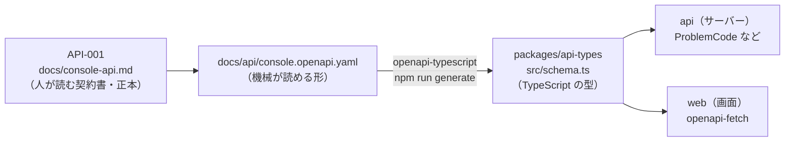
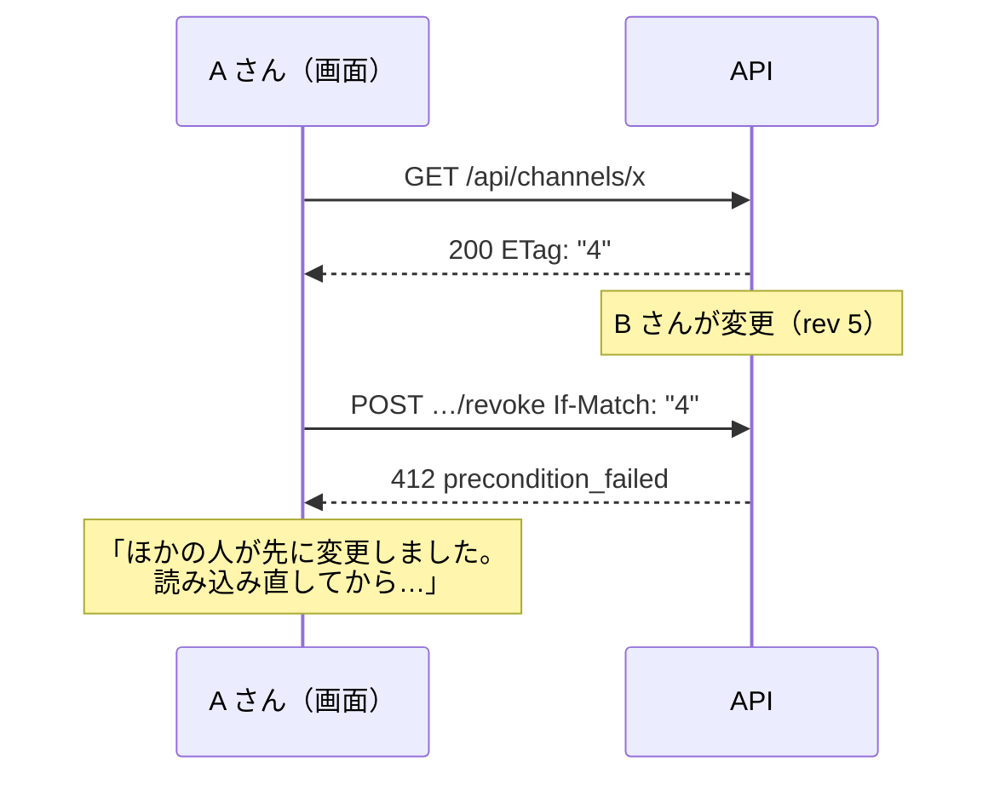

# 7-3 契約から始める（OpenAPI）

[目次](../README.md) ＞ 第 7 部 ＞ 7-3

> OpenAPI の仕組みと最小の使い方は [技術カード: OpenAPI](../ref/openapi.md) にあります。

## この章で学ぶこと

- 「契約から始める開発」の流れ（契約書 → OpenAPI → 型 → サーバーと画面）
- OpenAPI の文書の読み方
- OpenAPI から TypeScript の型を作る（openapi-typescript）
- 作った型を、サーバー（Lambda）と画面（openapi-fetch）の両方で使う
- エラーの形（Problem Details）と、同時の書き込みを防ぐ `ETag`・`If-Match`
- 契約と食い違うコードを、コンパイルで止める

## 契約から始める

管理システムの画面（[9-1](../09-console/01-react-vite.md)）と API（第 8 部）の間でやりとりするデータの形は、コードを書く前に **契約** として決めています。[0-1](../00-overview/01-what-we-build.md) で、SanpoGuide と管理システムの境界を API-002 で決めたのと同じ考え方を、管理システムの中の境界にも使っているわけです。



| 文書 | 役割 |
|---|---|
| [API-001（console-api.md）](../../michizure-console/docs/console-api.md) | 人が読む契約書。決定事項（C-1・C-2…）、状態の移り変わり、権限、エラーの意味。**正本** |
| [console.openapi.yaml](../../michizure-console/docs/api/console.openapi.yaml) | 同じ内容を、機械が読める形にしたもの。操作 66 個、データの形、エラーコード |
| [packages/api-types/src/schema.ts](../../michizure-console/packages/api-types/src/schema.ts) | OpenAPI から **生成した** TypeScript の型。手で書かない |

OpenAPI の冒頭には、正本がどちらかが書いてあります。

```yaml
description: |
  [console-api.md](../console-api.md)（API-001 1.1）を機械で読める形にしたもの。
  方針・状態・権限の根拠は契約書が正本で、食い違いがあれば契約書に合わせてこのファイルを直す。
```

## OpenAPI を読む

**OpenAPI** は、HTTP の API の「どの道（パス）に、どんな要求を送ると、どんな応答が返るか」を書くための、広く使われている形式です。YAML（または JSON）で書きます。

取り下げの操作（[console.openapi.yaml](../../michizure-console/docs/api/console.openapi.yaml)）:

```yaml
paths:
  /api/admin/channels/{channelId}/revoke:
    parameters: [{ $ref: '#/components/parameters/ChannelId' }]
    post:
      tags: [review]
      operationId: revokeChannel
      summary: 取り下げ（リストから消し、revoked に 7 日載せる）
      parameters: [{ $ref: '#/components/parameters/IfMatch' }]
      requestBody:
        required: true
        content:
          application/json:
            schema: { $ref: '#/components/schemas/RevokeInput' }
      responses:
        '200': { $ref: '#/components/responses/Channel' }
        default: { $ref: '#/components/responses/Error' }
```

| 部分 | 意味 |
|---|---|
| `paths` の下の `/api/admin/channels/{channelId}/revoke` | 道。`{channelId}` は道の中の値（パスパラメータ） |
| `post` | HTTP のメソッド |
| `operationId` | 操作の名前 |
| `parameters` | パスやヘッダーやクエリの値（ここでは `If-Match` のヘッダー） |
| `requestBody` | 要求の本文の形 |
| `responses` | 応答の形。`'200'` は成功、`default` はそれ以外（エラー） |
| `$ref` | ほかの場所の定義を参照する。同じ形を何度も書かずに済む（素材集の取り下げ `revokeCollection` も、同じ `RevokeInput` を参照している） |

参照先の `RevokeInput`（`components/schemas` の下）:

```yaml
RevokeInput:
  type: object
  required: [reason, severity]
  properties:
    versions:
      type: array
      items: { type: integer, minimum: 1 }
      description: 省くとすべての版
    reason: { type: string, minLength: 1, maxLength: 200, description: 散策者に見せる理由 }
    severity: { type: string, enum: [high, low] }
```

`reason` と `severity` は必須、`versions` は任意、`severity` は `high` か `low` のどちらか、と読めます。

## OpenAPI から型を作る

[packages/api-types/package.json](../../michizure-console/packages/api-types/package.json):

```json
{
  "name": "@michizure-console/api-types",
  "description": "Types generated from docs/api/console.openapi.yaml (API-001); regenerate with npm run generate",
  "scripts": {
    "generate": "openapi-typescript ../../docs/api/console.openapi.yaml -o src/schema.ts"
  }
}
```

`npm run generate -w packages/api-types` を実行すると、**openapi-typescript** が OpenAPI を読んで、TypeScript の型（`schema.ts`、約 3,200 行）を書き出します。上の `RevokeInput` は、次のような型になります。

```ts
RevokeInput: {
  /** @description 省くとすべての版 */
  versions?: number[];
  /** @description 散策者に見せる理由 */
  reason: string;
  /** @enum {string} */
  severity: "high" | "low";
};
```

[7-1](01-typescript-syntax.md) で学んだ、任意の項目（`?`）とユニオン型（`"high" | "low"`）です。

[packages/api-types/src/index.ts](../../michizure-console/packages/api-types/src/index.ts) は、よく使う型に短い名前を付けて公開しているだけです。

```ts
import type { components, paths } from './schema.js';

export type { components, paths };
export type Schemas = components['schemas'];
export type Problem = Schemas['Problem'];
export type ProblemCode = Problem['code'];
```

`components['schemas']['Problem']['code']` のように、型の中の型を取り出せるのも TypeScript の便利なところです（インデックスアクセス型）。

**`schema.ts` は手で直しません**。OpenAPI を直して、作り直します。

## サーバーで使う: エラーコードを漏らさない

エラーの形は、API-001 の決定事項 C-2 で決まっています。

> エラーの形: RFC 9457（`application/problem+json`）に `code` を足す。

**Problem Details**（RFC 9457）は、HTTP の API のエラーを JSON で返すための標準の形です。

```json
{
  "type": "about:blank",
  "title": "Precondition failed",
  "status": 412,
  "code": "precondition_failed",
  "detail": "the channel is at rev 4",
  "instance": "<要求の ID>"
}
```

`code` の取りうる値は、OpenAPI の `Problem` の `enum` に 23 個並んでいます（`invalid_request`・`forbidden`・`not_found`・`precondition_failed`…）。

サーバーの [api/src/console/http.ts](../../michizure-console/api/src/console/http.ts) は、それぞれの `code` を HTTP のステータスに対応させています。

```ts
import type { ProblemCode } from '@michizure-console/api-types';

const STATUS: Record<ProblemCode, number> = {
  invalid_request: 400,
  invalid_signature: 400,
  // …
  unauthorized: 401,
  forbidden: 403,
  not_found: 404,
  // …
  precondition_failed: 412,
  precondition_required: 428,
  throttled: 429,
  internal: 500,
};
```

ここが要です。`Record<ProblemCode, number>` は「`ProblemCode` の **すべての** 値をキーに持つ表」という型です。

- OpenAPI に新しいエラーコードを足して型を作り直すと、`ProblemCode` に値が増える
- `STATUS` にその値がないので、**コンパイルエラー** になる
- 「新しいエラーコードの HTTP ステータスを決め忘れる」ことが、起こりえない

[1-1](../01-kotlin-android/01-kotlin-syntax.md) の、sealed を `when` で分けると書き忘れをコンパイラが見つける、と同じ考え方です。ハンズオンで実際に試します。

エラーを返すのは、[7-1](01-typescript-syntax.md) で見た `fail` です。

```ts
if (channel.rev !== rev) fail('precondition_failed', `the channel is at rev ${String(channel.rev)}`);
if (channel.status !== 'active') fail('invalid_state', `the channel is ${String(channel.status)}`);
```

`fail` の最初の引数は `ProblemCode` 型なので、契約にないコード（`'precondition_faild'` のような書き間違いも）は書けません。

### 本文の確かめ

型は実行するときには消えるので（[7-1](01-typescript-syntax.md)）、要求の本文が契約どおりかは、サーバーが実行するときに確かめます。

```ts
export async function revokeChannel(deps: Deps, req: Request): Promise<Response> {
  requireOperator(req);
  const rev = ifMatch(req);
  const body = object(req.body);
  const reason = requiredText(body, 'reason', { max: 200 });
  const severity = body.severity;
  if (severity !== 'high' && severity !== 'low') fail('invalid_request', 'severity must be high or low', [{ path: '/severity', message: 'high or low' }]);
  // …
}
```

`reason` は 1〜200 文字、`severity` は `high` か `low`。OpenAPI の `RevokeInput` と同じ決まりを、コードで確かめています。`http.ts` のコメントのとおり、「OpenAPI の文書が契約で、これらの確かめは、おかしな入力をテーブルに入れないため」です。

## 画面で使う: openapi-fetch

画面の [web/src/api.ts](../../michizure-console/web/src/api.ts) は、生成した型を **openapi-fetch** に渡して、型のついた API の呼び出し口を作っています。

```ts
import type { Problem, paths } from '@michizure-console/api-types';
import createClient, { type Middleware } from 'openapi-fetch';

export function createApi(auth: Auth) {
  // … ログインのトークンを付ける、エラーを ApiProblem にする …
  const client = createClient<paths>({ baseUrl: window.location.origin });
  client.use(bearer);
  return client;
}
```

画面での取り下げの呼び出し（[web/src/pages/channel.tsx](../../michizure-console/web/src/pages/channel.tsx)）:

```ts
await api.POST('/api/admin/channels/{channelId}/revoke', {
  params: { path: { channelId }, header: ifMatch(c.rev) },
  body: { reason, severity, ...(list.length ? { versions: list } : {}) },
});
```

この 1 行に、契約がすべて効いています。

| 書いたもの | 型が確かめること |
|---|---|
| `'/api/admin/channels/{channelId}/revoke'` | 契約にある道か |
| `POST` | その道に `post` があるか |
| `params.path.channelId` | 道の中の値を渡しているか |
| `params.header` | 必須の `If-Match` を渡しているか |
| `body` | `RevokeInput` の形か（`reason` と `severity` は必須、`severity` は `high` か `low`） |
| 戻り値の `data` | 成功したときの応答（`Channel`）の型になる |

道を書き間違えても、必須の項目を忘れても、**コンパイルエラー** になります。画面とサーバーが別々に作られていても、どちらも同じ型（同じ契約）から作られているので、食い違いません。

`api.GET('/api/me')` の戻り値も、`Me` の形の型になります。

```ts
const { data } = await api.GET('/api/me');
// data の型: { sub: string; roles: ("operator" | "publisher")[]; publisher?: {…} | null }
```

### エラーを画面の言葉に

```ts
const MESSAGES: Partial<Record<Problem['code'], string>> = {
  precondition_failed: 'ほかの人が先に変更しました。読み込み直してから、もう一度操作してください。',
  forbidden: 'この操作をする権限がありません。',
  not_found: '見つかりませんでした。',
  // …
};
```

サーバーの `STATUS` と違い、こちらは `Partial<…>`（全部はなくてよい）です。画面の言葉を用意していないコードは、「操作できませんでした。」と表示すれば足りるからです。**全部の値を必ず扱うべき場所は `Record`、一部だけでよい場所は `Partial<Record>`** と使い分けています。

## 同時の書き込みを防ぐ: ETag と If-Match

運営の担当者が 2 人いて、同じチャンネルを同時に操作したらどうなるでしょう。

1. A さんがチャンネルの画面を開く（このとき `rev` は 4）
2. B さんも同じ画面を開く（`rev` は 4）
3. B さんが何かを変更する（`rev` は 5 になる）
4. A さんが、古い画面（`rev` 4 のときの内容）を見たまま「取り下げ」を押す

A さんは、B さんの変更を知らずに操作しています。API-001 の C-8 は、これを防ぐ決まりです。

> 状態が変わるもの（チャンネル提供者・チャンネル・申請・鍵の移し替え）は、応答に `ETag`（DM-001 の `rev`）を付ける。それを変える操作は `If-Match` が必須で、ないと 428、違うと 412。



- サーバーは、取得の応答に今の版（`rev`）を `ETag` として付ける（`withEtag`）
- 画面は、変更の要求に、取得したときの版を `If-Match` で付ける（`ifMatch(c.rev)`）
- サーバーは、今の版と `If-Match` が違えば `412`（`precondition_failed`）で断る

この仕組みを **楽観的ロック** と呼びます。「たぶんだれも同時に変えないだろう」と楽観して、変えるときにだけ確かめる方式です。データベースの側での確かめ方（条件つき書き込み）は第 8 部で見ます。

## ハンズオン: 契約と食い違うコードを止める

管理システムのフォルダで行います。どの手順も、最後に元に戻します。

```sh
cd /c/Dev/apps/michizure-console
npx tsc -b
```

まず、何も表示されない（型が正しい）ことを確かめておきます。

### 1. 画面で、応答の項目を書き間違える

[web/src/main.tsx](../../michizure-console/web/src/main.tsx) の

```ts
const operator = session.me.roles.includes('operator');
```

を、`session.me.role.includes('operator')`（`s` を消す）に変えて、`npx tsc -b` を実行します。

```
web/src/main.tsx(85,31): error TS2551: Property 'role' does not exist on type '{ sub: string; roles: ("operator" | "publisher")[]; … }'. Did you mean 'roles'?
```

「`roles` のことでは？」と教えてくれます。次に、`includes('operator')` を `includes('admin')` に変えてみてください。

```
web/src/main.tsx(85,46): error TS2345: Argument of type '"admin"' is not assignable to parameter of type '"operator" | "publisher"'.
```

契約にない役割は書けません。確かめたら元に戻します（`git checkout -- web/src/main.tsx`）。

### 2. 画面で、必須の項目を忘れる

[web/src/pages/channel.tsx](../../michizure-console/web/src/pages/channel.tsx) の取り下げの呼び出しで、`body: { reason, severity, …` から `severity, ` を消して、`npx tsc -b` を実行します。

```
error TS2322: Type '{ reason: string; versions?: number[] | undefined; }' is not assignable to type '{ versions?: number[] | undefined; reason: string; severity: "high" | "low"; } & {}'.
  Property 'severity' is missing in type …
```

OpenAPI の `RevokeInput` で `severity` が必須（`required`）だからです。元に戻します（`git checkout -- web/src/pages/channel.tsx`）。

### 3. 契約にエラーコードを足す

[docs/api/console.openapi.yaml](../../michizure-console/docs/api/console.openapi.yaml) の `Problem` の `code` の `enum` に、`- throttled` の次の行として `- maintenance` を足します（字下げを周りとそろえる）。そして型を作り直し、型を確かめます。

```sh
npm run generate -w packages/api-types
npx tsc -b
```

```
✨ openapi-typescript 7.13.0
🚀 ../../docs/api/console.openapi.yaml → src/schema.ts [76ms]
api/src/console/http.ts(26,7): error TS2741: Property 'maintenance' is missing in type '{ invalid_request: number; … }' but required in type 'Record<…, number>'.
```

契約にエラーコードを足しただけで、サーバーの `STATUS` が「`maintenance` の HTTP ステータスが決まっていない」とコンパイルで止まりました。画面の `MESSAGES` は `Partial` なので止まりません（画面の言葉は、なければ汎用の文で足りる）。

確かめたら、OpenAPI と生成した型の両方を元に戻します。

```sh
git checkout -- docs/api/console.openapi.yaml packages/api-types/src/schema.ts
npx tsc -b
git status
```

## つまずきやすいところ

- **生成した型を手で直さない**: OpenAPI を直して作り直す。手で直すと、次に作り直したときに消える
- **OpenAPI を直したら、型を作り直す**: 作り直さないと、型は古い契約のまま
- **型は実行するときには消える**: サーバーは、要求の本文を実行するときに確かめる
- **全部扱うべき場所は `Record`、一部でよい場所は `Partial<Record>`**: 書き忘れをコンパイラに見つけてもらえる
- **変更の要求には `If-Match`**: 古い画面のまま操作して、ほかの人の変更を上書きしないように

## 確認問題

<details>
<summary>問 1. 契約書（console-api.md）と OpenAPI の内容が食い違っていたら、どちらに合わせますか。</summary>

契約書（console-api.md）に合わせて、OpenAPI を直します。OpenAPI の冒頭に「契約書が正本で、食い違いがあれば契約書に合わせてこのファイルを直す」と書かれています。

</details>

<details>
<summary>問 2. サーバーの <code>STATUS</code> を <code>Record&lt;ProblemCode, number&gt;</code> にしていると、どんな良いことがありますか。</summary>

契約に新しいエラーコードを足して型を作り直したとき、`STATUS` にそのコードがなければコンパイルエラーになるので、HTTP のステータスを決め忘れることがありません。

</details>

<details>
<summary>問 3. A さんが古い画面のまま取り下げを押したとき、サーバーはどう応えますか。画面には何が出ますか。</summary>

`If-Match` の版と今の版が違うので、`412`（`precondition_failed`）で断ります。画面は「ほかの人が先に変更しました。読み込み直してから、もう一度操作してください。」と表示します。

</details>

---

前: [7-2 npm workspaces とプロジェクト参照](02-workspaces.md) ／ 次: [7-4 テスト](04-testing.md)
