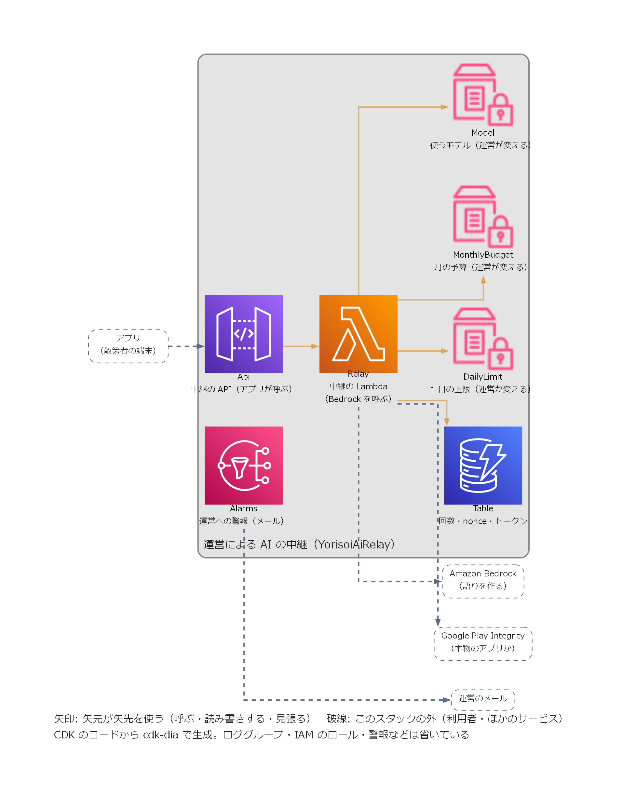
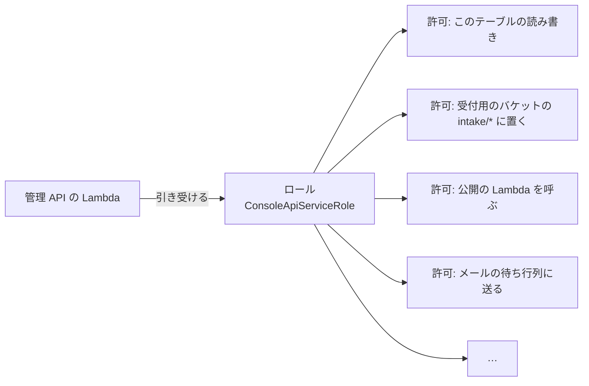

# 8-1 AWS の基本

[目次](../README.md) ＞ 第 8 部 ＞ 8-1

> IAM の仕組みと最小の使い方は [技術カード: IAM](../ref/iam.md) にあります。

## この章で学ぶこと

- AWS の基本の言葉（アカウント、リージョン、サービス、ARN）
- 「サーバーレス」とは何か。管理システムがそれを選んだ理由
- 運営の AWS にある 3 つのスタックと、そこで使っている AWS のサービスの全体像。CDK から生成した図の読み方
- **IAM**: AWS の中で「だれが何をしてよいか」を決める仕組み。最小の権限
- 料金の考え方と、費用を見張る仕組み（タグ・予算）

第 8 部では、**AWS に配備したり、本物の AWS の部品を作ったりはしません**（お金がかかるため）。CDK でテンプレートを手元で作る（`cdk synth`）、テストを流す、Docker で DynamoDB Local を動かす、といった **手元でできること** で確かめます。

## AWS とは

**AWS**（Amazon Web Services）は、Amazon のクラウドです。サーバー、データベース、ファイルの置き場、メールの送信など、200 を超える **サービス** を、インターネット越しに借りられます。

| 言葉 | 意味 | 管理システムでは |
|---|---|---|
| **アカウント** | AWS を使う単位。請求も、部品も、権限も、アカウントごとに分かれる | 開発用と本番用の 2 つ（ADR-001 A-2） |
| **リージョン** | AWS のデータセンターがある地域 | 東京（`ap-northeast-1`） |
| **サービス** | AWS が貸してくれる機能の種類 | Lambda、DynamoDB、S3 など（下の表） |
| **リソース** | サービスの中に作った 1 つの部品 | 「公開用の S3 バケット」「公開の Lambda」 |
| **ARN** | リソースの住所（世界で 1 つの名前） | `arn:aws:kms:ap-northeast-1:123456789012:key/…` |

開発用と本番用でアカウントを分けるのは、開発中の失敗（データを消す、権限を広げすぎる）が本番に及ばないようにするためです。開発用のリストは、本番とは別のルート鍵を持ち、アプリには組み込まれません（[6-4](../06-trust/04-two-tier-keys.md)）。

## サーバーレス

昔ながらの作り方では、サーバー（コンピューター）を借りて、OS を入れ、プログラムを動かし続けます。だれも使っていない夜中も、サーバーは動き続け、お金がかかり、OS の更新や故障への備えも自分で行います。

**サーバーレス** は、サーバーを自分で持たず、AWS が用意した部品を組み合わせる作り方です。

| | サーバーを借りる | サーバーレス |
|---|---|---|
| 動かすもの | サーバーで、ずっと | 要求が来たときだけ、関数（Lambda）を |
| 料金 | 時間で（使わなくてもかかる） | 使った分だけ（使わなければほぼ 0） |
| OS の更新・故障への備え | 自分で | AWS が |
| 利用者が増えたとき | サーバーを足す設定を自分で | 自動で増える |

管理システムは、使う人が運営とチャンネル提供者だけで、1 日に数回しか使われないこともあります。アプリが取りに来るのは、CDN に置いた静的なファイルだけです（[0-1](../00-overview/01-what-we-build.md)）。こうした使われ方には、使った分だけ払うサーバーレスがよく合います。開発用の環境の費用は、月に約 1.5 USD です（[docs/operations/cost.md](https://github.com/duwenji/yorisoi-console/blob/main/docs/operations/cost.md)）。

## 運営の AWS にある 3 つのスタック

第 8 部はおもに管理システムを読みますが、運営の AWS アカウントには、yorisoi-console の [infra/](https://github.com/duwenji/yorisoi-console/tree/main/infra) から配備する **3 つのスタック**（まとめて作り・まとめて消す部品の一式。[8-2](02-cdk.md)）があります。

| スタック | CDK のアプリ | 何をするか | 読む章 |
|---|---|---|---|
| `YorisoiConsole-<env>` | [bin/app.ts](https://github.com/duwenji/yorisoi-console/blob/main/infra/bin/app.ts) | チャンネル管理システム。申請を審査し、承認済みチャンネル・リストを署名して公開する | 8-2〜8-8 |
| `YorisoiAiRelay-<env>` | [bin/relay.ts](https://github.com/duwenji/yorisoi-console/blob/main/infra/bin/relay.ts) | 運営の AI の中継。アプリからの AI の呼び出しを運営の負担で中継する | [8-9](09-ai-relay.md) |
| `YorisoiSpotTiles-<env>` | [bin/tiles.ts](https://github.com/duwenji/yorisoi-console/blob/main/infra/bin/tiles.ts) | スポットのタイル。OpenStreetMap から毎週タイルを作って配る | [8-10](10-spot-tiles.md) |

`<env>` は `dev`（開発用）か `prod`（本番）です。3 つは同じアカウントに置きますが、CDK のアプリごと分けています。1 つの配備の失敗や障害が、ほかの 2 つを巻き込まないようにするためです。3 つに共通する「止まったら運営に知らせる」仕組みと費用の見方は [8-11](11-watch-and-cost.md) でまとめて読みます。

### CDK から生成した図

次の 3 枚の図は、CDK のコードから [cdk-dia](https://github.com/pistazie/cdk-dia) というツールで描いたものです。手で描いた図ではないので、**いま配備される部品とそのつながりが、そのまま出ます**。描き方と作り直し方は yorisoi-console の [docs/aws-diagrams.md](https://github.com/duwenji/yorisoi-console/blob/main/docs/aws-diagrams.md) にあります。この章の図は、yorisoi-console の `docs/diagrams/` からコピーしたものです（[images/](images/)）。

| 見た目 | 意味 |
|---|---|
| アイコン | AWS の部品（リソース）1 つ。上の英語は CDK で `new …(this, '名前')` と書いた名前、下の日本語はその役割 |
| 矢印 | 矢元が矢先を **使う**（呼ぶ・読み書きする・見張る）。CloudFormation の上の参照から描く |
| 破線の枠と矢印 | このスタックの外（アプリ・ブラウザ・運営のメール・Bedrock など）とのやりとり |
| 外の枠 | スタック。中の枠は CDK のコンストラクト |
| 並び | 左端が入ってくる人、右へ進むほど使われる側（データ・鍵・設定）、右端が外へ出ていく先 |

矢印は「使う」向きで、**データが流れる順番とは限りません**。たとえば受付用のバケットにパッケージが届くと機械審査の Lambda が動きますが、矢印は「機械審査がバケットを使う」向きです。流れの順番は、下の手で描いた構成図で読みます。

読みやすくするため、ロググループ・IAM のロール・CloudWatch の警報・CDK が自分で足す部品は省いています。省いたものも含めた全部の図は、各図の下のリンクから見られます。

**管理システム（YorisoiConsole）**


全部の図: [console-all.png](images/console-all.png)

- 内側の枠が「管理の面」（ログインが要る）。運営・提供者のブラウザは ConsoleDistribution から入り、HttpApi（UserPool で JWT を確かめる）を通って ConsoleApi を呼ぶ。申請のパッケージだけは IntakeBucket に直接上げる
- 内側の枠の外が「公開の面」。DailyPublish と ConsoleApi が PublishFunction を呼び、PublishFunction は Table を読み、SigningKey（KMS）で署名し、PublicBucket に置く。アプリは PublicDistribution から読む
- Table と RecordsBucket には、多くの Lambda から矢印が集まる。どの Lambda がどのデータを使うかが、一目でわかる

**AI の中継（YorisoiAiRelay）**



全部の図: [relay-all.png](images/relay-all.png)

- アプリが Api を呼び、Relay が Table・3 つの設定（Parameter Store。運営が配備し直さずに変えられる）を使い、外の Bedrock と Play Integrity を呼ぶ

**スポットのタイル（YorisoiSpotTiles）**


全部の図: [tiles-all.png](images/tiles-all.png)

- Weekly が Batch（Fargate）を Cluster の上・Vpc の中で動かす。Batch は外の Geofabrik から抽出を取り、Tiles に置き、Cdn のキャッシュを消す。アプリは Cdn から読む
- BatchFailed は Cluster を見張り、バッチの失敗を Alarms に渡し、運営にメールが届く

手で描いた [構成図（architecture.md）](https://github.com/duwenji/yorisoi-console/blob/main/docs/architecture.md) と比べてみてください。手で描いた図は **だれが何をして、どの順に動くか**（流れ）を、生成した図は **その流れを支える部品が、実際にどう組まれているか** を見せます。たとえば手で描いた図の「公開の Lambda」が、生成した図では PublishFunction として、署名鍵・テーブル・公開用のバケットへの矢印を持っています。

### サービスの一覧

3 つのスタックで使っている AWS のサービスと、それを読む章です。各サービスの仕組みは [技術カード](../ref/README.md#aws-をサービスの種類から引く) にあります。

| サービス | 何をするものか | 管理システム | AI の中継 | スポットのタイル | 章 |
|---|---|---|---|---|---|
| **CloudFormation**・**CDK** | 部品の一式をまとめて作る・コードで定義する | ✓ | ✓ | ✓ | [8-2](02-cdk.md) |
| **IAM** | 権限 | ✓ | ✓ | ✓ | この章 |
| **Lambda** | 要求が来たときだけ関数を動かす | 管理 API・公開・メール・機械審査・登録の後処理 | 中継 | — | [8-3](03-lambda-apigw.md)・[8-8](08-kotlin-lambda.md)・[8-9](09-ai-relay.md) |
| **ECS**（Fargate） | コンテナを、終わるまで動かす | — | — | 毎週のバッチ | [8-10](10-spot-tiles.md) |
| **VPC** | 部品をつなぐ自分専用の網 | — | — | バッチの網 | [8-10](10-spot-tiles.md) |
| **API Gateway** | HTTP の入口 | HTTP API（ログインの確認） | REST API | — | [8-3](03-lambda-apigw.md)・[8-9](09-ai-relay.md) |
| **Cognito** | ログインの仕組み | 運営・提供者のログイン、MFA | — | — | [8-4](04-cognito.md) |
| **DynamoDB** | キーと値のデータベース | すべての記録（1 テーブル） | 回数・使い捨ての値・トークン | — | [8-5](05-dynamodb.md)・[8-9](09-ai-relay.md) |
| **S3** | ファイルの置き場 | 受付・公開・記録・画面 | — | タイル | [8-6](06-s3-cloudfront.md)・[8-10](10-spot-tiles.md) |
| **CloudFront** | CDN（世界中から速く配る） | 公開ファイル、画面と API の入口 | — | タイルの配信 | [8-6](06-s3-cloudfront.md)・[8-10](10-spot-tiles.md) |
| **SQS** | 待ち行列 | 提供者への知らせ | — | — | [8-7](07-sqs-ses-kms.md) |
| **SES** | メールの送信 | 提供者への知らせ | — | — | [8-7](07-sqs-ses-kms.md) |
| **KMS** | 鍵の管理 | 承認済みチャンネル・リストへの署名 | — | — | [8-7](07-sqs-ses-kms.md)・[6-4](../06-trust/04-two-tier-keys.md) |
| **Bedrock** | 生成 AI のモデルを呼ぶ | — | 語りを作る | — | [8-9](09-ai-relay.md) |
| **Parameter Store** | 設定の置き場 | — | 1 日の上限・月の予算・モデル | — | [8-9](09-ai-relay.md) |
| **Secrets Manager** | 秘密の置き場 | 本番だけ、一覧のカーソルの鍵 | 本番だけ、端末の ID のハッシュの鍵と Play Integrity の鍵 | — | [8-3](03-lambda-apigw.md)・[8-9](09-ai-relay.md) |
| **EventBridge** | 決まった時刻・出来事で何かを動かす | 毎日 03:00 の公開 | — | 毎週のバッチ、失敗を拾う | [8-3](03-lambda-apigw.md)・[8-10](10-spot-tiles.md) |
| **CloudWatch**・**SNS** | ログ・警報・知らせ | ✓ | ✓ | ✓ | [8-11](11-watch-and-cost.md) |
| **WAF** | 攻撃の遮断 | 本番だけ、ログインの回数の制限 | 本番だけ、送信元ごとの制限 | — | [8-4](04-cognito.md)・[8-9](09-ai-relay.md) |
| **Budgets** | 費用の見張り | 開発用で月 5 USD | — | — | この章・[8-11](11-watch-and-cost.md) |

## IAM: だれが何をしてよいか

AWS で最も大事な仕組みが **IAM**（Identity and Access Management）です。AWS の中のすべての操作は、「**だれが**（主体）、**何に**（リソース）、**何を**（アクション）してよいか」を IAM で確かめてから行われます。何も許されていなければ、何もできません（**既定は拒否**）。

### ロール: 部品に与える「役」

Lambda の関数が DynamoDB に書き込むには、その関数に「DynamoDB のこのテーブルに書いてよい」という許可が要ります。許可は **ロール**（役）にまとめ、関数はそのロールを **引き受けて** 動きます。



ロールには、だれが引き受けてよいかも書かれています（「Lambda のサービスが引き受けてよい」）。人の **パスワードやアクセスキーを関数に持たせない** のが要点です。関数は、動くたびに AWS から一時的な鍵を受け取り、ロールの許可の範囲だけで動きます。

### 最小の権限

IAM の大原則は **最小の権限**（least privilege）です。部品には、仕事に要る **最小限** の許可だけを与えます。乗っ取られたり、プログラムに誤りがあったりしても、被害がその範囲に収まるからです。

CDK では、`grant…` という関数で許可を与えます。[infra/lib/console-app.ts](https://github.com/duwenji/yorisoi-console/blob/main/infra/lib/console-app.ts) から:

```ts
// Presigning needs the right to put; moving to archive/ needs read, put and delete.
intakeBucket.grantPut(consoleFn, 'intake/*');
intakeBucket.grantRead(consoleFn, 'intake/*');
intakeBucket.grantDelete(consoleFn, 'intake/*');
intakeBucket.grantPut(consoleFn, 'archive/*');
// Leaving deletes the user (API-001 C-4).
consoleFn.addToRolePolicy(new iam.PolicyStatement({ actions: ['cognito-idp:AdminDeleteUser'], resources: [userPool.userPoolArn] }));
props.table.grantReadWriteData(consoleFn);
props.publisher.grantInvoke(consoleFn);
```

- バケット全体ではなく、`intake/*`・`archive/*` という **場所（接頭辞）** に絞っている
- Cognito では、ユーザーを消す（`AdminDeleteUser`）という **1 つの操作** だけ、このユーザープールにだけ
- コメントに、なぜその許可が要るのかが書かれている

`grant…` は、要る操作の一覧（`s3:PutObject` など）と、リソースの ARN を組み立てて、ロールの許可に足してくれます。ハンズオンで、できあがった許可の一覧を見ます。

### リソースの側の許可

許可は、主体（ロール）の側だけでなく、**リソースの側** にも書けます。第 6 部で見た KMS の鍵の許可（**鍵ポリシー**）がその例です（[6-4](../06-trust/04-two-tier-keys.md)）。

```ts
key.addToResourcePolicy(
  new iam.PolicyStatement({
    actions: ['kms:Sign'],
    principals: [new iam.ArnPrincipal(publisher.role!.roleArn)],
    resources: ['*'],
    conditions: { StringEquals: { 'kms:SigningAlgorithm': 'ED25519_SHA_512', 'kms:MessageType': 'RAW' } },
  }),
);
// No key.grant(): it would add an unconditional IAM allowance next to the conditioned key policy.
```

「この鍵で署名してよいのは、公開の Lambda のロールだけ。しかも、この方式でだけ」と、鍵の側で決めています。コメントのとおり、便利な `key.grant()` を使わないのは、条件のない許可がロールの側に別に足されてしまうからです。**どこに許可を書くかで、守りの強さが変わる** ことがあります。

S3 のバケットの許可（バケットポリシー）や、Lambda を呼んでよい相手（`AWS::Lambda::Permission`）も、リソースの側の許可です。

## 料金の考え方

サーバーレスの料金は、ほとんどが **使った分だけ** です。

| サービス | 料金の決まり方（おおまかに） | 開発用では |
|---|---|---|
| Lambda | 呼ばれた回数と、動いた時間 × メモリ | 無料枠の範囲 |
| DynamoDB（オンデマンド） | 読み書きの回数と、保存した量 | ほぼ 0 |
| S3 | 保存した量と、要求の回数 | ほぼ 0 |
| CloudFront | 配った量 | 無料枠の範囲 |
| Cognito | 月に使った人の数（1 万人まで無料） | 0 |
| **KMS** | **鍵 1 つにつき月 1 USD** ＋ 呼び出し | **1 USD**（費用のほとんど） |
| CloudWatch の警報 | 警報 1 つにつき月額 | 約 0.3 USD |
| WAF | 月額 ＋ 要求の回数 | 本番だけ（約 7 USD） |

使った分だけの料金は、使わなければ安い反面、**思わぬ使われ方で急に高くなる** こともあります。そこで、費用を見張る仕組みを入れています。

### タグと予算

[infra/bin/app.ts](https://github.com/duwenji/yorisoi-console/blob/main/infra/bin/app.ts):

```ts
// Cost allocation tags: activate `project` once in the Billing console so the budget can count it.
Tags.of(stack).add('project', PROJECT_TAG);
Tags.of(stack).add('environment', name);
```

すべてのリソースに `project=yorisoi-console` と `environment=dev`（または `prod`）の **タグ**（名札）を付けています。同じアカウントにほかのプロジェクトがあっても、タグで絞れば、このプロジェクトの費用だけを見られます。

開発用では、そのタグで絞った費用の **予算**（AWS Budgets）を月 5 USD にし、実績が 80% を超えたとき、または予測が 100% を超えたときにメールで知らせます（`console-stack.ts` の `MonthlyBudget`）。

[docs/operations/cost.md](https://github.com/duwenji/yorisoi-console/blob/main/docs/operations/cost.md) には、開発用で外したもの（WAF、DynamoDB の PITR など）と、その理由、採らなかった案まで書かれています。**費用も設計の一部として、理由とともに記録する** のが、この管理システムの進め方です。

## ハンズオン: 部品の一覧と権限を見る

AWS のアカウントは要りません。CDK でテンプレートを手元に作り、中を調べます（CDK のくわしい話は [8-2](02-cdk.md)）。

### 1. テンプレートを作る

画面のビルド結果（`web/dist`）と機械審査の zip（`validator/build/lambda/validator.zip`）が要ります。ないときは、先に作ります。

```sh
cd /c/Dev/apps/yorisoi-console
npm run build -w web                              # web/dist がなければ
(cd validator && ./gradlew lambdaZip)             # validator.zip がなければ（コアとプロンプト・パックの取得が要る。5-3）
```

使い捨てのルート鍵の公開鍵を渡して、テンプレートを作ります（AWS にはつながりません）。

```sh
cd infra
KEY=$(node -e "console.log(require('crypto').randomBytes(32).toString('base64url'))")
npx cdk synth -c env=dev -c rootPublicKey=$KEY -o ../.local/cdkout --quiet
cd ..
```

`.local/cdkout/YorisoiConsole-dev.template.json` ができます（4,000 行ほどの JSON）。`.local/` は Git の対象外です。以下のコマンドは、いちばん上のフォルダ（`yorisoi-console`）で実行します。

### 2. 部品の一覧を数える

```sh
python -X utf8 - <<'EOF'
import json, collections
t = json.load(open('.local/cdkout/YorisoiConsole-dev.template.json', encoding='utf-8'))
c = collections.Counter(r['Type'] for r in t['Resources'].values())
print(len(t['Resources']), 'resources')
for k, v in sorted(c.items(), key=lambda x: -x[1]): print(v, k)
EOF
```

```
80 resources
9 AWS::IAM::Role
8 AWS::Lambda::Function
8 AWS::IAM::Policy
5 AWS::Logs::LogGroup
4 AWS::S3::Bucket
…
1 AWS::DynamoDB::GlobalTable
1 AWS::KMS::Key
…
```

上の表のサービスが、80 個の部品として並んでいます。`AWS::IAM::Role` と `AWS::IAM::Policy` が多いのは、部品ごとに別のロールと許可を作っているからです（最小の権限）。

### 3. 管理 API の Lambda の権限を見る

```sh
python -X utf8 - <<'EOF'
import json
t = json.load(open('.local/cdkout/YorisoiConsole-dev.template.json', encoding='utf-8'))
R = t['Resources']
fn = [k for k, v in R.items() if v['Type'] == 'AWS::Lambda::Function' and k.startswith('ConsoleConsoleApi')][0]
role = R[fn]['Properties']['Role']['Fn::GetAtt'][0]
for v in R.values():
    if v['Type'] == 'AWS::IAM::Policy' and any(r.get('Ref') == role for r in v['Properties']['Roles']):
        for st in v['Properties']['PolicyDocument']['Statement']:
            a = st['Action'] if isinstance(st['Action'], list) else [st['Action']]
            print('-', ', '.join(a)[:100])
print('引き受けてよい相手:', R[role]['Properties']['AssumeRolePolicyDocument']['Statement'][0]['Principal'])
EOF
```

```
- s3:GetBucket*, s3:GetObject*, s3:List*
- s3:Abort*, s3:DeleteObject*, s3:GetBucket*, s3:GetObject*, s3:List*, s3:PutObject, …
- s3:Abort*, s3:PutObject, s3:PutObjectLegalHold, …
- s3:DeleteObject*
- cognito-idp:AdminDeleteUser
- dynamodb:BatchGetItem, dynamodb:BatchWriteItem, dynamodb:ConditionCheckItem, …
- lambda:InvokeFunction
- kms:DescribeKey, kms:GetPublicKey
- kms:GetPublicKey
- sqs:GetQueueAttributes, sqs:GetQueueUrl, sqs:SendMessage
引き受けてよい相手: {'Service': 'lambda.amazonaws.com'}
```

`console-app.ts` の `grant…` が、こうした許可の一覧になっています。管理 API の Lambda には **`kms:Sign` がない** ことに注目してください。管理 API が試用チケットに署名する許可は、ロールの側ではなく、KMS の鍵ポリシーの側（条件つき）にあります（[技術カード: AWS KMS](../ref/aws-kms.md)）。

テンプレートの JSON を VS Code で開き、`"Resource"` の中の `"/intake/*"` などを検索すると、場所（接頭辞）に絞られた許可も確かめられます。

### 4. 図を自分で描く（Graphviz があれば）

この章の 3 枚の図は、手元でも描けます。[Graphviz](https://graphviz.org/download/) を入れて `dot` を PATH に通してから、次を実行します（AWS にはつながりません）。

```sh
npm run diagrams -w infra
```

3 つのアプリを合成し、`docs/diagrams/` の 6 枚（主要な図と全部の図）を描き直します。`console.png` と `console-all.png` を見比べてください。全部の図では、2 で数えた 80 個の部品のうち、ロググループ・ロール・警報まで並び、線が絡み合います。主要な図が省いているものは、[infra/tools/diagrams.mjs](https://github.com/duwenji/yorisoi-console/blob/main/infra/tools/diagrams.mjs) の `hiddenIcons` と `hiddenPaths` に書いてあります。

## つまずきやすいところ

- **IAM は既定で拒否**: 許可を書かなければ、何もできない。動かないときは、まず権限を疑う
- **許可は最小に**: `*`（すべて）を使いたくなったら、本当に要るのか考える
- **関数にアクセスキーを持たせない**: ロールを使う
- **使った分だけの料金は、急に高くなることもある**: タグと予算で見張る
- **鍵（KMS）など、月額のかかる部品もある**: すべてが使った分だけではない
- **生成した図の矢印は「使う」向きで、流れの順番ではない**: イベントで呼ばれる関係も、使う側から描かれる。順番は手で描いた構成図で読む

## 確認問題

<details>
<summary>問 1. 管理システムが、サーバーを借りるのではなくサーバーレスを選んだのはなぜですか。</summary>

使う人が運営とチャンネル提供者だけで、使われる回数が少ないからです。サーバーレスなら、使った分だけ払うので、使わない時間の費用がほぼかかりません。OS の更新や故障への備えも AWS に任せられます。

</details>

<details>
<summary>問 2. 管理 API の Lambda が、受付用のバケット全体ではなく <code>intake/*</code> と <code>archive/*</code> にだけ書けるようにしているのはなぜですか。</summary>

最小の権限の考え方です。仕事に要る場所だけに書けるようにしておけば、プログラムの誤りや乗っ取りがあっても、被害がその範囲に収まります。

</details>

<details>
<summary>問 3. 全リソースに <code>project</code> のタグを付けているのはなぜですか。</summary>

同じ AWS アカウントのほかのプロジェクトと分けて、このプロジェクトの費用だけを見たり、予算で見張ったりするためです。

</details>

<details>
<summary>問 4. CDK から生成した図と、手で描いた構成図は、それぞれ何を確かめるのに向いていますか。</summary>

生成した図は、CDK のコードから機械的に描くので、いま配備される部品とそのつながりを確かめるのに向いています（部品を足し忘れた・つなぎ忘れた、がそのまま出ます）。ただし矢印は「使う」向きで、どの順に動くかはわかりません。手で描いた構成図は、だれが何をして、どの順に動くかという流れを読むのに向いています。

</details>

---

次: [8-2 CDK でインフラを書く](02-cdk.md)
