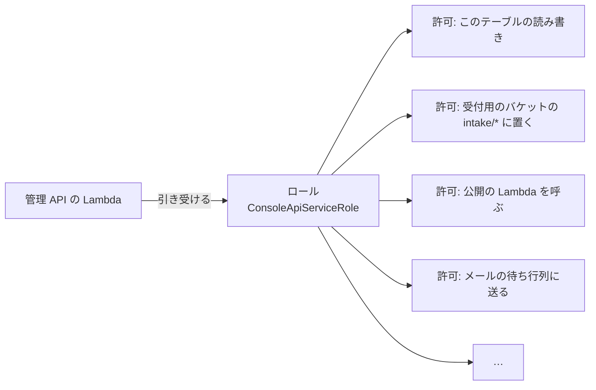

# 8-1 AWS の基本

[目次](../README.md) ＞ 第 8 部 ＞ 8-1

> IAM の仕組みと最小の使い方は [技術カード: IAM](../ref/iam.md) にあります。

## この章で学ぶこと

- AWS の基本の言葉（アカウント、リージョン、サービス、ARN）
- 「サーバーレス」とは何か。管理システムがそれを選んだ理由
- 管理システムが使っている AWS のサービスの全体像
- **IAM**: AWS の中で「だれが何をしてよいか」を決める仕組み。最小の権限
- 料金の考え方と、費用を見張る仕組み（タグ・予算）

第 8 部では、**AWS に配備したり、本物の AWS の部品を作ったりはしません**（お金がかかるため）。CDK でテンプレートを手元で作る（`cdk synth`）、テストを流す、Docker で DynamoDB Local を動かす、といった **手元でできること** で確かめます。

## AWS とは

**AWS**（Amazon Web Services）は、Amazon のクラウドです。サーバー、データベース、ファイルの置き場、メールの送信など、200 を超える **サービス** を、インターネット越しに借りられます。

| 言葉 | 意味 | 管理システムでは |
|---|---|---|
| **アカウント** | AWS を使う単位。請求も、部品も、権限も、アカウントごとに分かれる | 開発用と本番用の 2 つ（ADR-001 A-2） |
| **リージョン** | AWS のデータセンターがある地域 | 東京（`ap-northeast-1`） |
| **サービス** | AWS が貸してくれる機能の種類 | Lambda、DynamoDB、S3 など（下の表） |
| **リソース** | サービスの中に作った 1 つの部品 | 「公開用の S3 バケット」「公開の Lambda」 |
| **ARN** | リソースの住所（世界で 1 つの名前） | `arn:aws:kms:ap-northeast-1:123456789012:key/…` |

開発用と本番用でアカウントを分けるのは、開発中の失敗（データを消す、権限を広げすぎる）が本番に及ばないようにするためです。開発用のリストは、本番とは別のルート鍵を持ち、アプリには組み込まれません（[6-4](../06-trust/04-two-tier-keys.md)）。

## サーバーレス

昔ながらの作り方では、サーバー（コンピューター）を借りて、OS を入れ、プログラムを動かし続けます。だれも使っていない夜中も、サーバーは動き続け、お金がかかり、OS の更新や故障への備えも自分で行います。

**サーバーレス** は、サーバーを自分で持たず、AWS が用意した部品を組み合わせる作り方です。

| | サーバーを借りる | サーバーレス |
|---|---|---|
| 動かすもの | サーバーで、ずっと | 要求が来たときだけ、関数（Lambda）を |
| 料金 | 時間で（使わなくてもかかる） | 使った分だけ（使わなければほぼ 0） |
| OS の更新・故障への備え | 自分で | AWS が |
| 利用者が増えたとき | サーバーを足す設定を自分で | 自動で増える |

管理システムは、使う人が運営とチャンネル提供者だけで、1 日に数回しか使われないこともあります。アプリが取りに来るのは、CDN に置いた静的なファイルだけです（[0-1](../00-overview/01-what-we-build.md)）。こうした使われ方には、使った分だけ払うサーバーレスがよく合います。開発用の環境の費用は、月に約 1.5 USD です（[docs/operations/cost.md](../../sanpo-channel-console/docs/operations/cost.md)）。

## 管理システムが使う AWS のサービス

[構成図（architecture.md）](../../sanpo-channel-console/docs/architecture.md) の図 1 を思い出しながら見てください。

| サービス | 何をするものか | 管理システムでの役割 | 章 |
|---|---|---|---|
| **CloudFormation**・**CDK** | 部品の一式をまとめて作る・コードで定義する | すべての部品の定義 | [8-2](02-cdk.md) |
| **Lambda** | 要求が来たときだけ関数を動かす | 管理 API・公開の処理・メール・機械審査・登録の後処理 | [8-3](03-lambda-apigw.md) |
| **API Gateway**（HTTP API） | HTTP の入口 | 管理 API の受付、ログインの確認、流量の制限 | [8-3](03-lambda-apigw.md) |
| **Cognito** | ログインの仕組み | 運営・チャンネル提供者のログイン、MFA、グループ | [8-4](04-cognito.md) |
| **DynamoDB** | キーと値のデータベース | すべての記録（1 テーブル） | [8-5](05-dynamodb.md) |
| **S3** | ファイルの置き場 | パッケージの受付、公開ファイル、記録、画面 | [8-6](06-s3-cloudfront.md) |
| **CloudFront** | CDN（世界中から速く配る） | 公開ファイルの配信、画面と API の入口 | [8-6](06-s3-cloudfront.md) |
| **SQS** | 待ち行列 | チャンネル提供者へのメールの待ち行列 | [8-7](07-sqs-ses-kms.md) |
| **SES** | メールの送信 | チャンネル提供者への知らせ | [8-7](07-sqs-ses-kms.md) |
| **KMS** | 鍵の管理 | 承認済みチャンネル・リストへの署名 | [8-7](07-sqs-ses-kms.md)、[6-4](../06-trust/04-two-tier-keys.md) |
| **EventBridge Scheduler** | 決まった時刻に何かを動かす | 毎日 03:00 のリストの作り直し | [8-3](03-lambda-apigw.md) |
| **CloudWatch**・**SNS** | 記録・警報・知らせ | 公開が止まったら運営に知らせる | [8-3](03-lambda-apigw.md) |
| **IAM** | 権限 | 部品ごとに、してよいことを決める | この章 |
| **WAF** | 攻撃の遮断 | 本番だけ、ログインの回数の制限 | [8-4](04-cognito.md) |
| **Budgets** | 費用の見張り | 開発用で月 5 USD を超えそうなら知らせる | この章 |

## IAM: だれが何をしてよいか

AWS で最も大事な仕組みが **IAM**（Identity and Access Management）です。AWS の中のすべての操作は、「**だれが**（主体）、**何に**（リソース）、**何を**（アクション）してよいか」を IAM で確かめてから行われます。何も許されていなければ、何もできません（**既定は拒否**）。

### ロール: 部品に与える「役」

Lambda の関数が DynamoDB に書き込むには、その関数に「DynamoDB のこのテーブルに書いてよい」という許可が要ります。許可は **ロール**（役）にまとめ、関数はそのロールを **引き受けて** 動きます。



ロールには、だれが引き受けてよいかも書かれています（「Lambda のサービスが引き受けてよい」）。人の **パスワードやアクセスキーを関数に持たせない** のが要点です。関数は、動くたびに AWS から一時的な鍵を受け取り、ロールの許可の範囲だけで動きます。

### 最小の権限

IAM の大原則は **最小の権限**（least privilege）です。部品には、仕事に要る **最小限** の許可だけを与えます。乗っ取られたり、プログラムに誤りがあったりしても、被害がその範囲に収まるからです。

CDK では、`grant…` という関数で許可を与えます。[infra/lib/console-app.ts](../../sanpo-channel-console/infra/lib/console-app.ts) から:

```ts
// Presigning needs the right to put; moving to archive/ needs read, put and delete.
intakeBucket.grantPut(consoleFn, 'intake/*');
intakeBucket.grantRead(consoleFn, 'intake/*');
intakeBucket.grantDelete(consoleFn, 'intake/*');
intakeBucket.grantPut(consoleFn, 'archive/*');
// Leaving deletes the user (API-001 C-4).
consoleFn.addToRolePolicy(new iam.PolicyStatement({ actions: ['cognito-idp:AdminDeleteUser'], resources: [userPool.userPoolArn] }));
props.table.grantReadWriteData(consoleFn);
props.publisher.grantInvoke(consoleFn);
```

- バケット全体ではなく、`intake/*`・`archive/*` という **場所（接頭辞）** に絞っている
- Cognito では、ユーザーを消す（`AdminDeleteUser`）という **1 つの操作** だけ、このユーザープールにだけ
- コメントに、なぜその許可が要るのかが書かれている

`grant…` は、要る操作の一覧（`s3:PutObject` など）と、リソースの ARN を組み立てて、ロールの許可に足してくれます。ハンズオンで、できあがった許可の一覧を見ます。

### リソースの側の許可

許可は、主体（ロール）の側だけでなく、**リソースの側** にも書けます。第 6 部で見た KMS の鍵の許可（**鍵ポリシー**）がその例です（[6-4](../06-trust/04-two-tier-keys.md)）。

```ts
key.addToResourcePolicy(
  new iam.PolicyStatement({
    actions: ['kms:Sign'],
    principals: [new iam.ArnPrincipal(publisher.role!.roleArn)],
    resources: ['*'],
    conditions: { StringEquals: { 'kms:SigningAlgorithm': 'ED25519_SHA_512', 'kms:MessageType': 'RAW' } },
  }),
);
// No key.grant(): it would add an unconditional IAM allowance next to the conditioned key policy.
```

「この鍵で署名してよいのは、公開の Lambda のロールだけ。しかも、この方式でだけ」と、鍵の側で決めています。コメントのとおり、便利な `key.grant()` を使わないのは、条件のない許可がロールの側に別に足されてしまうからです。**どこに許可を書くかで、守りの強さが変わる** ことがあります。

S3 のバケットの許可（バケットポリシー）や、Lambda を呼んでよい相手（`AWS::Lambda::Permission`）も、リソースの側の許可です。

## 料金の考え方

サーバーレスの料金は、ほとんどが **使った分だけ** です。

| サービス | 料金の決まり方（おおまかに） | 開発用では |
|---|---|---|
| Lambda | 呼ばれた回数と、動いた時間 × メモリ | 無料枠の範囲 |
| DynamoDB（オンデマンド） | 読み書きの回数と、保存した量 | ほぼ 0 |
| S3 | 保存した量と、要求の回数 | ほぼ 0 |
| CloudFront | 配った量 | 無料枠の範囲 |
| Cognito | 月に使った人の数（1 万人まで無料） | 0 |
| **KMS** | **鍵 1 つにつき月 1 USD** ＋ 呼び出し | **1 USD**（費用のほとんど） |
| CloudWatch の警報 | 警報 1 つにつき月額 | 約 0.3 USD |
| WAF | 月額 ＋ 要求の回数 | 本番だけ（約 7 USD） |

使った分だけの料金は、使わなければ安い反面、**思わぬ使われ方で急に高くなる** こともあります。そこで、費用を見張る仕組みを入れています。

### タグと予算

[infra/bin/app.ts](../../sanpo-channel-console/infra/bin/app.ts):

```ts
// Cost allocation tags: activate `project` once in the Billing console so the budget can count it.
Tags.of(stack).add('project', PROJECT_TAG);
Tags.of(stack).add('environment', name);
```

すべてのリソースに `project=sanpo-channel-console` と `environment=dev`（または `prod`）の **タグ**（名札）を付けています。同じアカウントにほかのプロジェクトがあっても、タグで絞れば、このプロジェクトの費用だけを見られます。

開発用では、そのタグで絞った費用の **予算**（AWS Budgets）を月 5 USD にし、実績が 80% を超えたとき、または予測が 100% を超えたときにメールで知らせます（`console-stack.ts` の `MonthlyBudget`）。

[docs/operations/cost.md](../../sanpo-channel-console/docs/operations/cost.md) には、開発用で外したもの（WAF、DynamoDB の PITR など）と、その理由、採らなかった案まで書かれています。**費用も設計の一部として、理由とともに記録する** のが、この管理システムの進め方です。

## ハンズオン: 部品の一覧と権限を見る

AWS のアカウントは要りません。CDK でテンプレートを手元に作り、中を調べます（CDK のくわしい話は [8-2](02-cdk.md)）。

### 1. テンプレートを作る

画面のビルド結果（`web/dist`）と機械審査の zip（`validator/build/lambda/validator.zip`）が要ります。ないときは、先に作ります。

```sh
cd /c/Dev/apps/sanpo-channel-console
npm run build -w web                              # web/dist がなければ
(cd validator && ./gradlew lambdaZip)             # validator.zip がなければ（station-format の取得が要る。5-3）
```

使い捨てのルート鍵の公開鍵を渡して、テンプレートを作ります（AWS にはつながりません）。

```sh
cd infra
KEY=$(node -e "console.log(require('crypto').randomBytes(32).toString('base64url'))")
npx cdk synth -c env=dev -c rootPublicKey=$KEY -o ../.local/cdkout --quiet
cd ..
```

`.local/cdkout/SanpoChannelConsole-dev.template.json` ができます（4,000 行ほどの JSON）。`.local/` は Git の対象外です。以下のコマンドは、いちばん上のフォルダ（`sanpo-channel-console`）で実行します。

### 2. 部品の一覧を数える

```sh
python -X utf8 - <<'EOF'
import json, collections
t = json.load(open('.local/cdkout/SanpoChannelConsole-dev.template.json', encoding='utf-8'))
c = collections.Counter(r['Type'] for r in t['Resources'].values())
print(len(t['Resources']), 'resources')
for k, v in sorted(c.items(), key=lambda x: -x[1]): print(v, k)
EOF
```

```
80 resources
9 AWS::IAM::Role
8 AWS::Lambda::Function
8 AWS::IAM::Policy
5 AWS::Logs::LogGroup
4 AWS::S3::Bucket
…
1 AWS::DynamoDB::GlobalTable
1 AWS::KMS::Key
…
```

上の表のサービスが、80 個の部品として並んでいます。`AWS::IAM::Role` と `AWS::IAM::Policy` が多いのは、部品ごとに別のロールと許可を作っているからです（最小の権限）。

### 3. 管理 API の Lambda の権限を見る

```sh
python -X utf8 - <<'EOF'
import json
t = json.load(open('.local/cdkout/SanpoChannelConsole-dev.template.json', encoding='utf-8'))
R = t['Resources']
fn = [k for k, v in R.items() if v['Type'] == 'AWS::Lambda::Function' and k.startswith('ConsoleConsoleApi')][0]
role = R[fn]['Properties']['Role']['Fn::GetAtt'][0]
for v in R.values():
    if v['Type'] == 'AWS::IAM::Policy' and any(r.get('Ref') == role for r in v['Properties']['Roles']):
        for st in v['Properties']['PolicyDocument']['Statement']:
            a = st['Action'] if isinstance(st['Action'], list) else [st['Action']]
            print('-', ', '.join(a)[:100])
print('引き受けてよい相手:', R[role]['Properties']['AssumeRolePolicyDocument']['Statement'][0]['Principal'])
EOF
```

```
- s3:GetBucket*, s3:GetObject*, s3:List*
- s3:Abort*, s3:DeleteObject*, s3:GetBucket*, s3:GetObject*, s3:List*, s3:PutObject, …
- s3:Abort*, s3:PutObject, s3:PutObjectLegalHold, …
- s3:DeleteObject*
- cognito-idp:AdminDeleteUser
- dynamodb:BatchGetItem, dynamodb:BatchWriteItem, dynamodb:ConditionCheckItem, …
- lambda:InvokeFunction
- kms:DescribeKey, kms:GetPublicKey
- kms:GetPublicKey
- sqs:GetQueueAttributes, sqs:GetQueueUrl, sqs:SendMessage
引き受けてよい相手: {'Service': 'lambda.amazonaws.com'}
```

`console-app.ts` の `grant…` が、こうした許可の一覧になっています。管理 API の Lambda には **`kms:Sign` がない** ことに注目してください。管理 API が試用チケットに署名する許可は、ロールの側ではなく、KMS の鍵ポリシーの側（条件つき）にあります（[技術カード: AWS KMS](../ref/aws-kms.md)）。

テンプレートの JSON を VS Code で開き、`"Resource"` の中の `"/intake/*"` などを検索すると、場所（接頭辞）に絞られた許可も確かめられます。

## つまずきやすいところ

- **IAM は既定で拒否**: 許可を書かなければ、何もできない。動かないときは、まず権限を疑う
- **許可は最小に**: `*`（すべて）を使いたくなったら、本当に要るのか考える
- **関数にアクセスキーを持たせない**: ロールを使う
- **使った分だけの料金は、急に高くなることもある**: タグと予算で見張る
- **鍵（KMS）など、月額のかかる部品もある**: すべてが使った分だけではない

## 確認問題

<details>
<summary>問 1. 管理システムが、サーバーを借りるのではなくサーバーレスを選んだのはなぜですか。</summary>

使う人が運営とチャンネル提供者だけで、使われる回数が少ないからです。サーバーレスなら、使った分だけ払うので、使わない時間の費用がほぼかかりません。OS の更新や故障への備えも AWS に任せられます。

</details>

<details>
<summary>問 2. 管理 API の Lambda が、受付用のバケット全体ではなく <code>intake/*</code> と <code>archive/*</code> にだけ書けるようにしているのはなぜですか。</summary>

最小の権限の考え方です。仕事に要る場所だけに書けるようにしておけば、プログラムの誤りや乗っ取りがあっても、被害がその範囲に収まります。

</details>

<details>
<summary>問 3. 全リソースに <code>project</code> のタグを付けているのはなぜですか。</summary>

同じ AWS アカウントのほかのプロジェクトと分けて、このプロジェクトの費用だけを見たり、予算で見張ったりするためです。

</details>

---

次: [8-2 CDK でインフラを書く](02-cdk.md)
