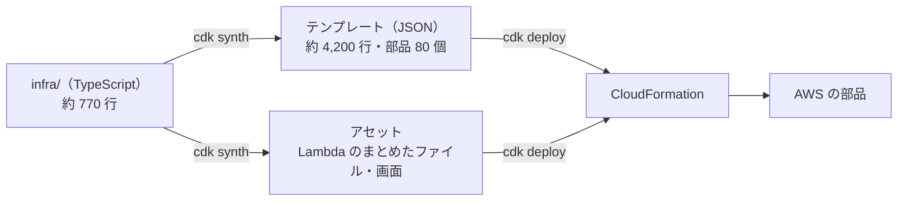
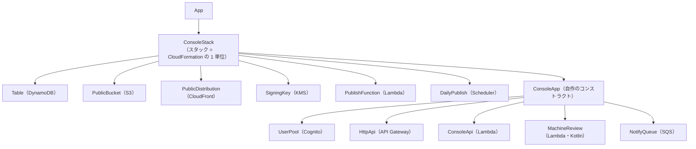

# 8-2 CDK でインフラを書く

[目次](../README.md) ＞ 第 8 部 ＞ 8-2

> AWS CDK の仕組みと最小の使い方は [技術カード: AWS CDK](../ref/aws-cdk.md) にあります。

## この章で学ぶこと

- 「インフラをコードで書く」とはどういうことか
- CloudFormation（スタック・テンプレート）と CDK（TypeScript で書く）の関係
- CDK の部品（コンストラクト）と、管理システムの組み立て方
- 環境（開発用・本番用）ごとの設定の切り替え
- `cdk synth` で何ができるか（テンプレートと、Lambda のまとめたファイル）
- CDK の定義をテストする

## インフラをコードで書く

AWS の部品は、AWS の画面（マネジメントコンソール）からクリックで作ることもできます。でも、それには困ったことがあります。

- 何を、どんな設定で作ったかが残らない。同じものをもう一度（たとえば本番用に）作れない
- 変更の履歴が残らない。だれが、いつ、なぜ変えたか分からない
- 開発用と本番用で、設定が少しずつずれていく

そこで、作る部品とその設定を **コードで書き**、Git で管理し、そのコードから部品を作ります。これを **Infrastructure as Code**（IaC、インフラをコードで）と呼びます。

## CloudFormation と CDK

AWS には **CloudFormation** という、部品の一式をまとめて作るサービスがあります。

- 作りたい部品とその設定を、**テンプレート**（JSON か YAML）に書く
- テンプレートを渡すと、CloudFormation が部品をまとめて作る。この一式を **スタック** と呼ぶ
- テンプレートを変えて渡し直すと、差分だけを変える。スタックを消すと、部品もまとめて消える（消さない設定にしたものを除く）

ただ、CloudFormation のテンプレートを手で書くのは大変です。管理システムのテンプレートは 4,000 行を超えます（[8-1](01-aws-basics.md) のハンズオン）。

**AWS CDK**（Cloud Development Kit）は、テンプレートを **TypeScript などのプログラミング言語で書く** ための道具です。



- `cdk synth`（synthesize、合成）: TypeScript を動かして、テンプレートとアセット（Lambda のコードなど）を **手元に作る**。AWS にはつながらない
- `cdk deploy`: テンプレートとアセットを AWS に送り、CloudFormation に部品を作らせる（このチュートリアルでは実行しない）

プログラミング言語で書けるので、関数・変数・`if`・ループ・型が使えます。`grant…` のような便利な関数が、IAM の許可のような細かい設定を組み立ててくれます。

## 管理システムの CDK

```
infra/
├── bin/app.ts             入口。環境を選び、スタックを作る
├── lib/config.ts          環境（dev・prod）ごとの設定
├── lib/console-stack.ts   スタック: テーブル・公開の部品・鍵・公開の Lambda・警報・予算
├── lib/console-app.ts     コンストラクト: ログイン・管理 API・画面・機械審査・メール
├── lib/common.ts          共通の部品（ログの残し方、タグ）
├── test/                  CDK の定義のテスト
└── cdk.json               cdk の設定（どう動かすか）
```

### 入口: bin/app.ts

[infra/bin/app.ts](../../sanpo-channel-console/infra/bin/app.ts):

```ts
// npx cdk synth -c env=dev -c rootPublicKey=<base64url of the dev root key>
const app = new App();
const name = (app.node.tryGetContext('env') ?? 'dev') as EnvConfig['name'];
const base = configs[name];
if (!base) throw new Error(`unknown env ${name}; use dev or prod`);
const rootPublicKey = app.node.tryGetContext('rootPublicKey') as string | undefined;
if (!rootPublicKey) {
  throw new Error('pass -c rootPublicKey=<base64url>: the root public key of this provider (tools/root-key generate; ADR-001 T-5)');
}
const config: EnvConfig = { ...base, rootPublicKey, /* … */ };

const stack = new ConsoleStack(app, `SanpoChannelConsole-${name}`, {
  config,
  env: { region: config.region, ...(config.account ? { account: config.account } : {}) },
  description: `SanpoGuide channel management system (${name})`,
});
```

- `-c env=dev` のように、コマンドから渡す値を **コンテキスト** と呼ぶ。`tryGetContext` で読む
- **ルート鍵の公開鍵** は、必ず外から渡させる。渡し忘れたら止まる。公開の処理は、この鍵につながる鍵セットだけを使う（[6-4](../06-trust/04-two-tier-keys.md)）。本物の鍵はリポジトリに入れない
- スタックの名前は `SanpoChannelConsole-dev` のように環境ごとに分ける

`cdk.json` の `"app": "npx tsx bin/app.ts"` が、`cdk synth` のたびに、この入口を tsx で動かす、という設定です。

### 環境ごとの設定: lib/config.ts

[infra/lib/config.ts](../../sanpo-channel-console/infra/lib/config.ts) は、開発用と本番用の違いを 1 か所にまとめています。

```ts
export interface EnvConfig {
  name: 'dev' | 'prod';
  region: 'ap-northeast-1';
  providerName: string;
  rootPublicKey: string;
  /** Signing keys in KMS, one per period (ADR-001 A-8: a new key every six months). */
  signingKeyIds: string[];
  notify: { mode: 'log' } | { mode: 'ses'; from: string; configurationSet?: string };
  /**
   * The app version (versionCode) each app stage of material needs (API-001 C-21, DES-008 K-6):
   * 0 no material, 1 text and images, 2 audio, 3 video. Changed here, through a pull request, as
   * app versions ship; until then material needs a version no app has.
   */
  appStageVersions: Record<number, number>;
  cost: {
    waf: boolean;
    pointInTimeRecovery: boolean;
    logRetentionDays?: 14;
    cursorKey: 'secret' | 'environment';
    budget?: { monthlyUsd: number; email: string };
  };
  // …
}
```

| 設定 | 開発用 | 本番用 |
|---|---|---|
| `providerName` | SanpoGuide チャンネル（開発） | SanpoGuide 公式チャンネル |
| `notify` | `log`（メールは送らず記録だけ） | 今は `log`。送信のドメインができたら `ses` |
| `cost.waf` | なし | あり |
| `cost.pointInTimeRecovery` | なし | あり |
| `cost.logRetentionDays` | 14 日 | 消さない |
| `appStageVersions` | `{ 0: 1, 1: 2, 2: 9999, 3: 9999 }` | 同じ |

`notify` の型に注目してください。`{ mode: 'log' } | { mode: 'ses'; from: string; … }` は、[7-1](../07-typescript/01-typescript-syntax.md) の **判別できるユニオン** です。`ses` にしたのに送り主（`from`）を書き忘れると、コンパイルエラーになります。インフラの設定も、型で守られています。

`appStageVersions` は、素材の段（[5-2](../05-station-format/02-package-format.md)）ごとに、どの版のアプリ（`versionCode`）から使えるかの表です。チャンネルを承認するとき、管理システムはこれを見て、リストの `minAppVersion` を決めます。文字と画像（段 1）は `versionCode` 2 のアプリから。音声・映像（段 2・3）を出せるアプリはまだないので、`9999`（どのアプリも届かない版）にしてあります。新しいアプリを出したら、ここをプルリクエストで書き換えます。

### スタックとコンストラクト

CDK の部品は **コンストラクト**（construct）と呼ばれ、木の形に組み立てます。



[console-stack.ts](../../sanpo-channel-console/infra/lib/console-stack.ts) が公開に要る部品を、[console-app.ts](../../sanpo-channel-console/infra/lib/console-app.ts) が管理の面（ログイン・API・画面）の部品を作っています。`ConsoleApp` は、部品をまとめた **自作のコンストラクト** です。

```ts
export class ConsoleApp extends Construct {
  /** The console API, which also signs test tickets (the stack lets it sign in the key policy). */
  readonly consoleFunction: lambda.IFunction;

  constructor(scope: Construct, id: string, props: ConsoleAppProps) {
    super(scope, id);
    // … Cognito・API・画面・機械審査・メール …
  }
}
```

スタックから必要な部品（テーブル、公開の Lambda、署名鍵など）を `props` で受け取り、作った管理 API の Lambda を `consoleFunction` として外に見せています。[2-3](../02-compose/03-manual-di.md) の「依存を外から渡す」と同じ形で、インフラの部品もつないでいるわけです。

### 部品を作る: L2 コンストラクト

テーブルを作るコード:

```ts
// DM-001: one table, two GSIs; PITR and deletion protection (M-3 keeps the audit records forever).
const table = new dynamodb.TableV2(this, 'Table', {
  partitionKey: { name: 'PK', type: dynamodb.AttributeType.STRING },
  sortKey: { name: 'SK', type: dynamodb.AttributeType.STRING },
  billing: dynamodb.Billing.onDemand(),
  pointInTimeRecoverySpecification: { pointInTimeRecoveryEnabled: config.cost.pointInTimeRecovery },
  deletionProtection: prod,
  timeToLiveAttribute: 'ttl',
  removalPolicy: prod ? RemovalPolicy.RETAIN : RemovalPolicy.DESTROY,
  globalSecondaryIndexes: [ /* GSI1・GSI2 */ ],
});
```

`dynamodb.TableV2` のような、よく使う設定を覚えやすい形にした部品を **L2 コンストラクト** と呼びます。`grantReadWriteData` のような便利な関数も持っています。CloudFormation の項目をそのまま書く **L1 コンストラクト**（`Cfn` で始まる。`wafv2.CfnWebACL`・`budgets.CfnBudget` など）もあり、L2 がない部品や細かい設定に使います。

`deletionProtection: prod` のように、環境によって値を変えるのも、ただの TypeScript の式です。

### 消してよいもの、消してはいけないもの

```ts
const keep = prod ? RemovalPolicy.RETAIN : RemovalPolicy.DESTROY;
```

**`removalPolicy`** は、スタックを消したり、その部品を定義から外したりしたときに、部品も消すか（`DESTROY`）、残すか（`RETAIN`）を決めます。

| 部品 | 開発用 | 本番用 | 理由 |
|---|---|---|---|
| テーブル | 消す | 残す（削除保護も） | 本番の操作の記録は消さない（DM-001 M-3） |
| 公開用・記録用のバケット | 消す（中身ごと） | 残す | 公開の履歴を残す（M-13） |
| KMS の署名鍵 | **残す** | **残す** | 鍵を消すと、その鍵の署名を確かめられなくなる（[技術カード: AWS KMS](../ref/aws-kms.md)） |
| 画面のバケット | 消す | 消す | ビルドすればまた作れる |

開発用は作り直せるので消してよく、本番のデータと鍵は、間違ってスタックを消しても残るようにしています。

### 作る前に確かめる

```ts
if (!existsSync(`${props.webDist}/index.html`)) throw new Error(`build the SPA first (npm run build -w web): ${props.webDist}`);
if (!existsSync(props.validatorZip)) throw new Error(`build the machine review first (cd validator && ./gradlew build): ${props.validatorZip}`);
```

画面のビルド結果や、機械審査の zip がなければ、合成の時点で止めます。何をすればよいかもメッセージに書いてあります。配備してから「画面が空っぽ」と気づくより、ずっと早く気づけます。

## cdk synth で何ができるか

[8-1](01-aws-basics.md) のハンズオンで `cdk synth` を実行すると、出力のフォルダに次のものができました。

| ファイル | 中身 |
|---|---|
| `SanpoChannelConsole-dev.template.json` | CloudFormation のテンプレート（部品 80 個） |
| `SanpoChannelConsole-dev.assets.json` | アセットの一覧（どこに上げるか） |
| `asset.…/` | Lambda のまとめたファイル、画面のファイル、機械審査の zip など |

### Lambda のまとめたファイル

Node.js の Lambda は、`nodejs.NodejsFunction` で定義しています。

```ts
const lambdaDefaults = (repoRoot: string): Partial<nodejs.NodejsFunctionProps> => ({
  projectRoot: repoRoot,
  depsLockFilePath: `${repoRoot}package-lock.json`,
  runtime: lambda.Runtime.NODEJS_22_X,
  architecture: lambda.Architecture.ARM_64,
  bundling: { format: nodejs.OutputFormat.ESM, target: 'node22', minify: true, sourceMap: true },
});

const consoleFn = new nodejs.NodejsFunction(this, 'ConsoleApi', {
  ...lambdaDefaults(repoRoot),
  entry: `${repoRoot}api/src/console/handler.ts`,
  memorySize: 512,
  timeout: Duration.seconds(15),
});
```

`NodejsFunction` は、合成のときに **esbuild** を動かして、`entry` の `.ts` から始めて、使っているコード（`api/src/console/…`、`packages/protocol` の `.ts` まで）を **1 つの `.js` にまとめます**（[7-2](../07-typescript/02-workspaces.md) の表の「Lambda は esbuild」）。

できたファイルは、どれも小さなものです。

| Lambda | まとめたファイル |
|---|---|
| 登録の後処理（post-confirmation） | 約 1KB |
| メール（notify） | 約 8KB |
| 公開の処理（publish） | 約 16KB |
| 管理 API（console） | 約 76KB |

AWS の SDK（`@aws-sdk/…`）は含まれていません。Node.js 22 の Lambda には SDK が最初から入っているので、CDK は既定でそれを外します。ファイルが小さいほど、Lambda が起動するのが速くなります。

- `architecture: ARM_64`: AWS の ARM の CPU（Graviton）で動かす。同じ性能なら x86 より安い
- `minify: true`: 余白や長い名前を削って小さくする
- `sourceMap: true` と `NODE_OPTIONS: '--enable-source-maps'`: 失敗したときのログに、まとめる前の `.ts` のどの行かを出す

## CDK の定義をテストする

インフラの定義も、テストできます。[infra/test/console-stack.test.ts](../../sanpo-channel-console/infra/test/console-stack.test.ts) は、合成したテンプレートに、大事な設定が入っているかを確かめています。

```ts
import { Match, Template } from 'aws-cdk-lib/assertions';

it('runs one publisher at a time, daily, with alarms', () => {
  prod.hasResourceProperties('AWS::Lambda::Function', {
    Runtime: 'nodejs22.x',
    ReservedConcurrentExecutions: 1,
    Environment: { Variables: Match.objectLike({ ROOT_PUBLIC_KEY: 'A'.repeat(43), PROVIDER_NAME: 'SanpoGuide 公式チャンネル' }) },
  });
  prod.hasResourceProperties('AWS::Scheduler::Schedule', {
    ScheduleExpression: 'cron(0 18 * * ? *)',
    Target: Match.objectLike({ Input: '{"trigger":"daily"}' }),
  });
  prod.resourceCountIs('AWS::CloudWatch::Alarm', 3);
});
```

- `Template.fromStack(stack)`: スタックを合成して、テンプレートを調べられる形にする
- `hasResourceProperties(種類, { … })`: その種類の部品のうち、書いた設定を持つものがあるか
- `Match.objectLike({ … })`: 書いた項目だけが一致すればよい
- `resourceCountIs(種類, 数)`: その種類の部品の数

テストの名前を並べると、管理システムが守りたい設定の一覧になります。

- has the DM-001 table with both GSIs, TTL and PITR
- signs with Ed25519 keys in KMS, only from the publisher and only as pure Ed25519
- keeps the public bucket private behind CloudFront with HTTPS only
- runs one publisher at a time, daily, with alarms
- keeps production data on stack deletion, but not development data
- requires TOTP MFA from everyone and lets only sign-ups become publishers

ADR-001 で決めた設計（A-4・A-7・A-8・A-10 など）が、テストで守られています。だれかがうっかり設定を変えても、配備の前に気づけます。

## ハンズオン: CDK の定義を壊す

[8-1](01-aws-basics.md) のハンズオンで `cdk synth` を実行したので、ここではテストを使います。

### 1. CDK のテストを流す

```sh
cd /c/Dev/apps/sanpo-channel-console
npx vitest run infra
```

```
      Tests  13 passed (13)
   Duration  3.47s
```

テストの中で、開発用と本番用の両方のスタックを合成して確かめています。テストのファイルの冒頭を見ると、画面のビルド結果と機械審査の zip の **代わりの小さなファイル** を作って渡し、Lambda のまとめ（esbuild）も飛ばしています（`'aws:cdk:bundling-stacks': []`）。テストが見たいのは部品の設定で、まとめたコードではないからです。だから画面をビルドしていなくても、テストは数秒で終わります。

### 2. 「同時に 1 つだけ」を壊す

[infra/lib/console-stack.ts](../../sanpo-channel-console/infra/lib/console-stack.ts) の公開の Lambda で、

```ts
// A-10: one run at a time; the conditional write on seq guards the rest.
reservedConcurrentExecutions: 1,
```

を `2` に変えて、テストを流します。

```
     × runs one publisher at a time, daily, with alarms
      Tests  1 failed | 12 passed (13)
```

公開の処理が同時に 2 つ動けるようになると、同じ `seq` のリストが 2 つできるおそれがあります（[6-4](../06-trust/04-two-tier-keys.md)）。それをテストが止めました。元に戻します。

```sh
git checkout -- infra/lib/console-stack.ts
git status
```

### 3. 合成したテンプレートで、同じ設定を見る

[8-1](01-aws-basics.md) で作ったテンプレート（`.local/cdkout/`）が残っていれば、公開の Lambda と毎日のスケジュールを取り出してみましょう。

```sh
python -X utf8 - <<'EOF'
import json
t = json.load(open('.local/cdkout/SanpoChannelConsole-dev.template.json', encoding='utf-8'))
for lid, r in t['Resources'].items():
    p = r['Properties']
    if r['Type'] == 'AWS::Lambda::Function' and p.get('ReservedConcurrentExecutions'):
        print(lid, p['Runtime'], p['Architectures'], p['MemorySize'], 'MB', p['Timeout'], '秒', '同時に', p['ReservedConcurrentExecutions'])
    if r['Type'] == 'AWS::Scheduler::Schedule':
        print(lid, p['ScheduleExpression'])
EOF
```

```
PublishFunctionB6602567 nodejs22.x ['arm64'] 512 MB 360 秒 同時に 1
DailyPublishF5C111C1 cron(0 18 * * ? *)
```

CDK の `Duration.minutes(6)` がテンプレートでは `360`（秒）に、`cron({ minute: '0', hour: '18' })` が `cron(0 18 * * ? *)` になっています。`18` 時は世界標準時（UTC）なので、日本時間の 03:00 です。6 分なのは、リストを出すのに 1 分、毎日の作り直しのあとに素材集の外の素材を確かめるのに最大 5 分とってあるからです（コメント: "A minute to publish; the daily run then checks outside resources for up to 5"、[8-3](03-lambda-apigw.md)）。

確かめたら `rm -rf .local/cdkout` で消してかまいません。

## つまずきやすいところ

- **`cdk synth` と `cdk deploy` は違う**: synth は手元で作るだけ。deploy は AWS に部品を作る（お金がかかる）
- **消してはいけない部品は `RETAIN`**: データ・鍵・記録。開発用でも、鍵は消さない
- **秘密をコードやテンプレートに書かない**: テンプレートは、AWS の画面や CI のログで読めてしまう。ルート鍵は公開鍵だけを、外から渡す
- **時刻は UTC**: スケジュールの `cron` は、既定では世界標準時
- **大事な設定はテストで守る**: 設定の値をうっかり変えても、配備の前に気づける

## 確認問題

<details>
<summary>問 1. <code>cdk synth</code> を実行すると、AWS に部品ができますか。</summary>

できません。`cdk synth` は、TypeScript を動かして、CloudFormation のテンプレートとアセット（Lambda のまとめたファイルなど）を手元に作るだけです。AWS に部品を作るのは `cdk deploy` です。

</details>

<details>
<summary>問 2. KMS の署名鍵を、開発用でも <code>RemovalPolicy.RETAIN</code>（残す）にしているのはなぜですか。</summary>

鍵を消すと、その鍵で署名した過去の文書を確かめられなくなるからです。また KMS の鍵の削除は待ち期間のあとで行われ、作り直すたびに署名鍵と鍵セットの登録もやり直しになります。

</details>

<details>
<summary>問 3. 管理 API の Lambda のまとめたファイルに、AWS の SDK が入っていないのはなぜですか。</summary>

Node.js 22 の Lambda には AWS の SDK が最初から入っているので、CDK の `NodejsFunction` が既定でそれを外すからです。ファイルが小さいほど、Lambda の起動が速くなります。

</details>

---

前: [8-1 AWS の基本](01-aws-basics.md) ／ 次: [8-3 Lambda と API Gateway](03-lambda-apigw.md)
