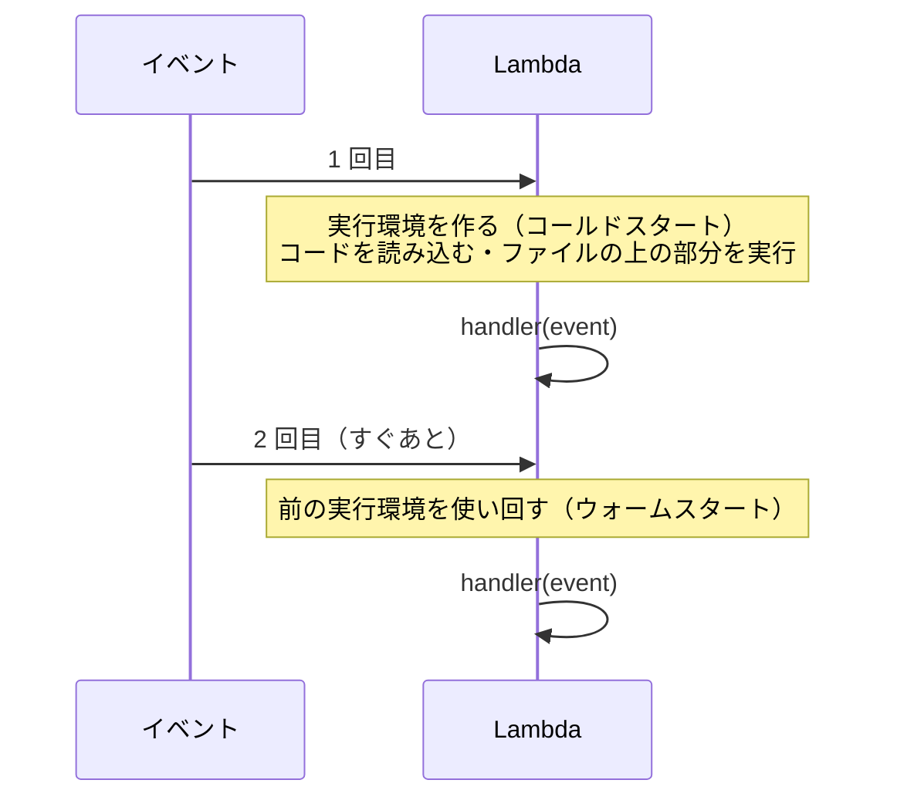
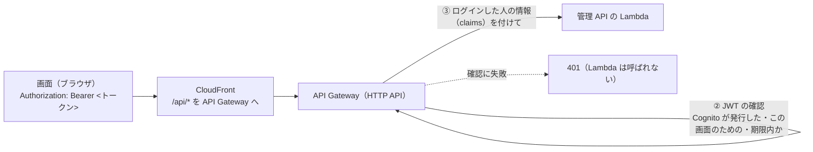

# 8-3 Lambda と API Gateway

[目次](../README.md) ＞ 第 8 部 ＞ 8-3

> Lambda と API Gateway の仕組みと最小の使い方は [技術カード: Lambda](../ref/lambda.md)・[技術カード: API Gateway（HTTP API）](../ref/api-gateway.md) にあります。

## この章で学ぶこと

- Lambda の関数の形（ハンドラ）と、何がきっかけで呼ばれるか
- 起動の遅さ（コールドスタート）への備え
- API Gateway（HTTP API）が、要求を Lambda に渡すまでにすること（ログインの確認・流量の制限）
- 1 つの Lambda の中で、自分で道を振り分ける作り
- 公開の Lambda を「同時に 1 つだけ」「あとで」動かす方法、毎日の作り直し、警報

## 管理システムの Lambda

管理システムには、Node.js の Lambda が 4 つと、Kotlin の Lambda が 1 つあります。

| Lambda | 入口 | 何がきっかけで呼ばれるか |
|---|---|---|
| 管理 API | [api/src/console/handler.ts](../../yorisoi-console/api/src/console/handler.ts) | API Gateway（画面からの HTTP の要求） |
| 公開の処理 | [api/src/publish/handler.ts](../../yorisoi-console/api/src/publish/handler.ts) | 管理 API（承認・取り下げのあと）、EventBridge Scheduler（毎日） |
| メール | [api/src/notify/handler.ts](../../yorisoi-console/api/src/notify/handler.ts) | SQS（待ち行列にたまった知らせ）、[8-7](07-sqs-ses-kms.md) |
| 登録の後処理 | [api/src/console/post-confirmation.ts](../../yorisoi-console/api/src/console/post-confirmation.ts) | Cognito（登録が確かめられたとき）、[8-4](04-cognito.md) |
| 機械審査（Kotlin） | `validator/…/Handler.kt` | S3（受付用のバケットにファイルが届いたとき）、[8-8](08-kotlin-lambda.md) |

**Lambda** は、何かが起きたとき（**イベント**）に、AWS が関数を呼び出して動かすサービスです。関数は、イベントを受け取って、結果を返すだけです。サーバーを動かし続ける必要はありません（[8-1](01-aws-basics.md)）。

## ハンドラ: Lambda の関数の形

いちばん小さい、登録の後処理の Lambda です。

```ts
import { AdminAddUserToGroupCommand, CognitoIdentityProviderClient } from '@aws-sdk/client-cognito-identity-provider';
import type { PostConfirmationTriggerEvent } from 'aws-lambda';

const cognito = new CognitoIdentityProviderClient({});

/**
 * Cognito post-confirmation trigger: whoever signs up and confirms their address becomes a
 * publisher (ADR-001 D-7). …
 */
export async function handler(event: PostConfirmationTriggerEvent) {
  if (event.triggerSource === 'PostConfirmation_ConfirmSignUp') {
    await cognito.send(new AdminAddUserToGroupCommand({ UserPoolId: event.userPoolId, Username: event.userName, GroupName: 'publisher' }));
  }
  return event;
}
```

- `export async function handler(event)` が入口。CDK の `entry` で指したファイルの `handler` が呼ばれる
- `event` の形は、きっかけによって違う。型は `aws-lambda` の型の定義（`@types/aws-lambda`）から取る（`PostConfirmationTriggerEvent`・`APIGatewayProxyEventV2WithJWTAuthorizer`・`SQSEvent` など）
- AWS の SDK の部品（`cognito`）は、**関数の外**（ファイルの上）で作る（下で説明）

### コールドスタートと、部品の作り方

Lambda は、呼ばれたときに、関数を動かす入れ物（**実行環境**）を用意します。



1 回目は、実行環境を作り、コードを読み込むので時間がかかります（**コールドスタート**）。しばらくは同じ実行環境が使い回され、2 回目からは速くなります。

だから、**AWS の SDK の部品や、設定の読み込みのような「1 回でよい準備」は、関数の外で行い、使い回します**。管理 API の Lambda:

```ts
const kms = new KMSClient({});
const lambda = new LambdaClient({});
const s3 = new S3Client({});
// …
let deps: Deps | undefined;

export async function handler(event: APIGatewayProxyEventV2WithJWTAuthorizer): Promise<APIGatewayProxyResultV2> {
  const requestId = event.requestContext.requestId;
  try {
    deps ??= await load();
    // …
  }
}
```

`deps ??= await load()` は「`deps` がまだなければ、作って入れる」という書き方です。1 回目の呼び出しで、データベースの部品やカーソルの鍵（本番では Secrets Manager から読む）を用意し、2 回目からは使い回します。

[8-2](02-cdk.md) で見た、まとめたファイルが小さいこと（AWS の SDK を含めない）も、コールドスタートを速くするためでした。

### 設定は環境変数で

```ts
function env(name: string): string {
  return process.env[name] || (() => { throw new Error(`${name} is not set`); })();
}

// …
table: env('TABLE_NAME'),
rootPublicKey: env('ROOT_PUBLIC_KEY'),
```

テーブルの名前やバケットの名前は、CDK が配備のときに決まる名前を **環境変数** で渡します（`consoleFn.addEnvironment('TABLE_NAME', props.table.tableName)`、[console-app.ts](../../yorisoi-console/infra/lib/console-app.ts)）。コードに名前を書かないので、同じコードが開発用でも本番用でも動きます。ないときは、すぐに例外で止めます。

### メモリと時間の上限

```ts
const consoleFn = new nodejs.NodejsFunction(this, 'ConsoleApi', {
  // …
  memorySize: 512,
  timeout: Duration.seconds(15),
});
```

| 設定 | 意味 | 管理 API では |
|---|---|---|
| `memorySize` | 使えるメモリ。多いほど CPU も速くなる（料金も上がる） | 512MB |
| `timeout` | これを超えたら止める | 15 秒 |

API Gateway も、要求に 30 秒ほどの上限があります。管理 API は、時間のかかる仕事（公開の処理、機械審査、メール）を自分で抱えず、ほかの Lambda に任せています（下で説明）。

## API Gateway: HTTP の入口

**API Gateway** は、HTTP の要求を受けて、Lambda などに渡す入口です。管理システムは、安くて単純な **HTTP API** を使っています（ADR-001 A-3）。

[console-app.ts](../../yorisoi-console/infra/lib/console-app.ts):

```ts
const httpApi = new apigw.HttpApi(this, 'HttpApi', { apiName: `yorisoi-console-${config.name}`, createDefaultStage: true });
const stage = httpApi.defaultStage?.node.defaultChild as apigw.CfnStage;
stage.defaultRouteSettings = { throttlingRateLimit: 20, throttlingBurstLimit: 40 };

// …

httpApi.addRoutes({
  path: '/api/{proxy+}',
  methods: [apigw.HttpMethod.ANY],
  integration: new integrations.HttpLambdaIntegration('ConsoleIntegration', consoleFn),
  authorizer: new authorizers.HttpJwtAuthorizer('Jwt', issuer, { jwtAudience: [client.userPoolClientId] }),
});
```



- **`/api/{proxy+}` を `ANY` で 1 つの Lambda に**: 66 の操作を、全部 1 つの Lambda に渡す。振り分けは Lambda の中のルーター（[7-3](../07-typescript/03-openapi.md) の `router.ts`）が行う
- **JWT の確認**（`HttpJwtAuthorizer`）: 画面が付けてくるログインのトークン（JWT、[8-4](04-cognito.md)）を、API Gateway が確かめる。発行元（`issuer`、この Cognito のユーザープール）と、宛先（`jwtAudience`、この画面のクライアント）と、期限。合わなければ、Lambda を呼ばずに `401` を返す
- **流量の制限**（throttling）: 1 秒に 20 回（一瞬なら 40 回）まで。超えたら `429`。ログインを開いたときの備え（ADR-001 A-18）
- 画面と同じ CloudFront の `/api/*` から入る（[8-6](06-s3-cloudfront.md)）。画面と API が同じ場所（オリジン）にあるので、ブラウザの面倒な決まり（CORS）が要らない

### 1 つの Lambda に全部の道

操作ごとに Lambda を分ける作り方もあります。管理システムが 1 つにまとめているのは、

- 66 の操作が、同じデータベースの部品や、同じ確かめの関数（`ifMatch`・`requireOperator`）を使う
- 1 つにまとめれば、コールドスタートの回数が減る（どの操作でも同じ実行環境が温まる）
- テストでは、ルーター（`route`）に要求を渡すだけで、API 全体を確かめられる（[7-4](../07-typescript/04-testing.md)）

からです。

### 入口の Lambda がすること

管理 API の `handler` は、API Gateway のイベントを、ルーターが扱う形（`Request`、[7-3](../07-typescript/03-openapi.md)）に直すだけの **つなぎ** です。

```ts
const MAX_BODY = 1024 * 1024;

/** The console API behind API Gateway's JWT authorizer (ADR-001 A-3, API-001). */
export async function handler(event: APIGatewayProxyEventV2WithJWTAuthorizer): Promise<APIGatewayProxyResultV2> {
  const requestId = event.requestContext.requestId;
  try {
    deps ??= await load();
    const raw = event.body ? (event.isBase64Encoded ? Buffer.from(event.body, 'base64').toString('utf8') : event.body) : undefined;
    if (raw && raw.length > MAX_BODY) return problem(new ApiError('payload_too_large', 'the body is over 1MB'), requestId);
    let body: unknown;
    try {
      body = raw ? JSON.parse(raw) : undefined;
    } catch {
      return problem(new ApiError('invalid_request', 'the body is not JSON'), requestId);
    }
    const headers = Object.fromEntries(Object.entries(event.headers ?? {}).map(([k, v]) => [k.toLowerCase(), v]));
    return await route(deps, {
      method: event.requestContext.http.method,
      path: event.rawPath,
      query: event.queryStringParameters ?? {},
      headers,
      body,
      caller: callerFrom(event.requestContext.authorizer.jwt.claims as Record<string, unknown>),
      requestId,
    });
  } catch (e) {
    if (e instanceof ApiError) return problem(e, requestId);
    console.error(JSON.stringify({ requestId, error: e instanceof Error ? e.stack : String(e) }));
    return problem(new ApiError('internal', 'internal error'), requestId);
  }
}
```

1. 本文が 1MB を超えたら断る。JSON でなければ断る（`body` は `unknown`、[7-1](../07-typescript/01-typescript-syntax.md)）
2. ヘッダーの名前を小文字にそろえる（`If-Match` も `if-match` も同じに扱うため）
3. API Gateway が確かめたトークンの中身（`claims`）から、ログインした人とその役割（`cognito:groups`）を取り出す（`callerFrom`）
4. ルーターに渡す
5. 思わぬ例外は、ログに残して、利用者には `500`（`internal`）とだけ返す。中の事情を外に漏らさない

「API Gateway がログインを確かめた」あとでも、Lambda の中で **役割を確かめ直します**（`requireOperator`、ADR-001 A-3）。API Gateway が確かめるのは「ログインしているか」までで、「運営か」はアプリの決まりだからです。

`callerFrom` が、グループを `[operator publisher]` という文字列でも配列でも読めるようにしているのは、コメントのとおり、HTTP API がグループを文字列で渡してくることがあるからです。

## 公開の Lambda: あとで、同時に 1 つだけ

承認や取り下げのあと、管理 API は公開の Lambda に「リストを作り直して」と頼みます。

```ts
requestPublish: async (trigger) => {
  await lambda.send(new InvokeCommand({ FunctionName: env('PUBLISH_FUNCTION'), InvocationType: 'Event', Payload: JSON.stringify({ trigger }) }));
},
```

`InvocationType: 'Event'` は **非同期の呼び出し** です。「頼んだ」ことだけを確かめて、公開の処理が終わるのを待ちません。運営の画面は、承認の操作のあと、リストの署名や S3 への書き込みを待たずにすぐ戻れます。

公開の Lambda の入口（[api/src/publish/handler.ts](../../yorisoi-console/api/src/publish/handler.ts)）:

```ts
/**
 * The publishing Lambda (ADR-001 A-10). Invoked asynchronously by the API after an approval,
 * revocation, key transfer or keyset registration, and daily by EventBridge Scheduler.
 * Reserved concurrency 1 keeps runs apart; the conditional write on `seq` guards the rest.
 */
export async function handler(event: { trigger?: string } = {}) {
  const trigger = TRIGGERS.includes(event.trigger as Trigger) ? (event.trigger as Trigger) : 'manual';
  let record;
  try {
    record = await publish(deps, trigger);
  } catch (e) {
    // Another run took the next seq in between: build again on top of it, once.
    if (!(e instanceof SeqConflictError)) throw e;
    record = await publish(deps, trigger);
  }
  if (trigger === 'daily') await dailyExternalCheck();
  return record;
}
```

[6-4](../06-trust/04-two-tier-keys.md) で見た「`seq` を二重に使わない」守りが、2 重になっています。

1. **予約された同時実行数 1**（`reservedConcurrentExecutions: 1`、[8-2](02-cdk.md)）: この Lambda は、同時に 1 つしか動かない。2 つ目の呼び出しは、1 つ目が終わるまで待たされる（非同期の呼び出しなら、Lambda が自動でやり直す）
2. **`seq` の条件つき書き込み**（[8-5](05-dynamodb.md)）: それでも重なったら、データベースが 2 つ目の書き込みを断る。断られたら（`SeqConflictError`）、1 回だけ、新しい `seq` で作り直す

毎日の作り直し（`daily`）のときだけ、リストを出したあとに **素材集の外の素材の確認**（`dailyExternalCheck`、DES-009 M-7）も行います。素材集は、画像などを外の URL に置けます。その URL がまだあって、申告した大きさのままかを毎日確かめ、問題が見つかったら素材提供者にメールで知らせます（[8-7](07-sqs-ses-kms.md) の待ち行列を通して）。この確認は `try`/`catch` で包まれていて、失敗しても公開の結果には響きません。この Lambda の本来の仕事は、リストを出すことだからです。

### 毎日の作り直し: EventBridge Scheduler

```ts
// A-10: rebuild daily so the list (14 days) never runs out, even with nothing to change.
new scheduler.Schedule(this, 'DailyPublish', {
  schedule: scheduler.ScheduleExpression.cron({ minute: '0', hour: '18' }), // 03:00 JST
  target: new targets.LambdaInvoke(publisher, { input: scheduler.ScheduleTargetInput.fromObject({ trigger: 'daily' }) }),
  description: 'Rebuild and re-sign the approved channel list',
});
```

承認済みチャンネル・リストの期限は 14 日です（[6-1](../06-trust/01-why-signatures.md)）。何も承認しない日が続いても期限が切れないよう、毎日 03:00（日本時間）に作り直して署名し直します。**EventBridge Scheduler** が、決まった時刻に Lambda を `{"trigger":"daily"}` で呼びます。

### 止まったら知らせる: CloudWatch の警報

公開が止まると、14 日後にアプリの第三者のチャンネルが使えなくなります。だから、止まったことにすぐ気づく必要があります（ADR-001 A-16）。

```ts
const failures = new cloudwatch.Alarm(this, 'PublishFailures', {
  metric: publisher.metricErrors({ period: Duration.minutes(5), statistic: 'Sum' }),
  threshold: 1,
  // …
  alarmDescription: 'The channel list could not be published',
});
const successes = new cloudwatch.MathExpression({
  expression: 'invocations - errors',
  usingMetrics: {
    invocations: publisher.metricInvocations({ period: Duration.days(1), statistic: 'Sum' }),
    errors: publisher.metricErrors({ period: Duration.days(1), statistic: 'Sum' }),
  },
  period: Duration.days(1),
});
const stale = new cloudwatch.Alarm(this, 'NoRecentPublication', {
  metric: successes,
  threshold: 1,
  evaluationPeriods: 2,
  comparisonOperator: cloudwatch.ComparisonOperator.LESS_THAN_THRESHOLD,
  treatMissingData: cloudwatch.TreatMissingData.BREACHING,
  alarmDescription: 'No successful publication for two days; the list expires 14 days after the last one',
});
for (const alarm of [failures, stale]) alarm.addAlarmAction(new cwActions.SnsAction(alarms));
```

| 警報 | 鳴るとき |
|---|---|
| `PublishFailures` | 公開の Lambda が 5 分の間に 1 回でも失敗した |
| `NoRecentPublication` | 成功した回数（呼ばれた回数 − 失敗した回数）が、2 日続けて 0 だった |

2 つ目の工夫が大事です。失敗の警報だけでは、「そもそも呼ばれなくなった」（スケジュールが消えた、など）ことに気づけません。**成功が来ないこと** を見張ります。`treatMissingData: BREACHING` は「数字が届かないことも、異常とみなす」という指定です。

警報は SNS のトピックを通して、運営にメールで届きます。

## ハンズオン: 管理 API の Lambda を手元で呼ぶ

本物の Lambda や API Gateway は使わず、管理 API の `handler` に、API Gateway が渡すのと同じ形の **偽のイベント** を渡して、手元で動かします。データベースは Docker の DynamoDB Local です（Docker Desktop を起動しておいてください）。

### 1. スクリプトを置き、DynamoDB Local を起動する

[scripts/invoke-console.ts](scripts/invoke-console.ts) をコピーします。

```sh
cd /c/Dev/apps/yorisoi-console
cp ../yorisoi-tutorial/08-aws/scripts/invoke-console.ts .local/
ID=$(docker run -d --rm -p 127.0.0.1::8000 amazon/dynamodb-local:latest -jar DynamoDBLocal.jar -inMemory)
PORT=$(docker port $ID 8000/tcp | head -1 | sed 's/.*://')
```

### 2. 動かす

```sh
DDB_PORT=$PORT npx tsx .local/invoke-console.ts
```

```
1. ログインしている人 → 200 application/json
   {"sub":"user-1","roles":["publisher"],"publisher":null}
2. チャンネル提供者が運営の API を呼ぶ → 403 application/problem+json
   {"type":"about:blank","title":"Forbidden","status":403,"code":"forbidden","detail":"operators only","instance":"req-…"}
3. ない道 → 404 application/problem+json
   {…,"status":404,"code":"not_found","detail":"GET /api/nothing",…}
4. JSON でない本文 → 400 application/problem+json
   {…,"status":400,"code":"invalid_request","detail":"the body is not JSON",…}
```

スクリプトの中身を見てみましょう。

- Lambda の **環境変数** の代わりに、`process.env` に `TABLE_NAME` などを入れている。`AWS_ENDPOINT_URL_DYNAMODB` は、AWS の SDK の接続先を DynamoDB Local に向ける決まった名前の環境変数
- 環境変数を入れてから `handler.ts` を読み込んでいる（`await import(…)`）。`handler.ts` は、読み込まれたときにファイルの上で AWS の部品を作るため（コールドスタートの準備）
- `event(…)` が、API Gateway が JWT を確かめたあとに渡すイベントの形を作る。`authorizer.jwt.claims` に、ログインした人（`sub`）とグループ（`cognito:groups`）が入っている

1 と 2 の違いは、`cognito:groups` が `publisher` か `operator` かだけです。運営の API（`/api/admin/…`）をチャンネル提供者が呼ぶと、Lambda の中の `requireOperator` が `403` で断ります。

### 3. 運営として呼んでみる

スクリプトの 2 つ目の `['publisher']` を `['operator']` に変えて、もう一度動かしてください。今度はチャンネル提供者の一覧（まだ空）が返ります。

```
2. チャンネル提供者が運営の API を呼ぶ → 200 application/json
   {"items":[],"nextCursor":null}
```

チャンネル提供者の一覧は、テーブルの索引 GSI2 を使って引きます（[8-5](05-dynamodb.md)）。スクリプトがテーブルを本物と同じ形（GSI1・GSI2 つき）で作っているのはそのためです。試しにスクリプトの `GlobalSecondaryIndexes: [gsi(1), gsi(2)],` の行を消して動かすと、運営の一覧は `500` になり、画面には `internal error` とだけ返り、ログ（`console.error`）には `ValidationException: The table does not have the specified index: GSI2` が出ます。**思わぬ例外の中身はログにだけ残し、利用者には返さない**、という `handler` の作りが、そのまま見えます。

### 4. 片付け

```sh
docker stop $ID
rm .local/invoke-console.ts
```

## つまずきやすいところ

- **1 回でよい準備は、関数の外で**: SDK の部品や設定の読み込みを、呼ばれるたびに行わない
- **API Gateway がログインを確かめても、役割は Lambda で確かめ直す**: 「ログインしている」と「運営である」は別
- **時間のかかる仕事は、非同期で別の Lambda に**: API の応答を長く待たせない。API Gateway にも時間の上限がある
- **失敗だけでなく、成功が来ないことも見張る**: 呼ばれなくなったことに気づけるように
- **思わぬ例外の中身を、利用者に返さない**: ログに残し、利用者には `500` とだけ

## 確認問題

<details>
<summary>問 1. 管理 API の Lambda が、AWS の SDK の部品を <code>handler</code> の中ではなくファイルの上で作るのはなぜですか。</summary>

同じ実行環境が使い回される間（ウォームスタート）、部品も使い回せるからです。呼ばれるたびに作ると、そのたびに時間がかかります。

</details>

<details>
<summary>問 2. ログインしていない人が <code>/api/me</code> を呼ぶと、管理 API の Lambda は呼ばれますか。</summary>

呼ばれません。API Gateway の JWT の確認（`HttpJwtAuthorizer`）が、トークンがない・正しくない要求を `401` で断るからです。

</details>

<details>
<summary>問 3. 「公開の Lambda が 2 日間成功していない」ことを見張る警報が、失敗の警報とは別に要るのはなぜですか。</summary>

失敗の警報は、Lambda が呼ばれて失敗したときにしか鳴りません。スケジュールが消えるなどして、そもそも呼ばれなくなったときには鳴りません。成功が来ないことを見張れば、どちらの場合も気づけます。

</details>

---

前: [8-2 CDK でインフラを書く](02-cdk.md) ／ 次: [8-4 Cognito でログイン](04-cognito.md)
