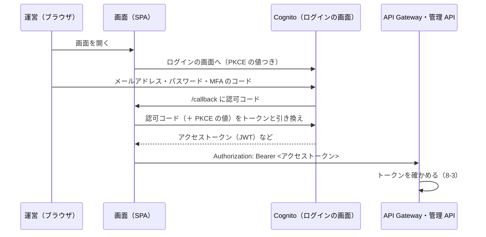

# 8-4 Cognito でログイン

[目次](../README.md) ＞ 第 8 部 ＞ 8-4

> Cognito の仕組みと最小の使い方は [技術カード: Cognito](../ref/cognito.md) にあります。

## この章で学ぶこと

- Cognito のユーザープールで、ログインの仕組みを丸ごと借りる
- 運営とチャンネル提供者を、グループで分ける。だれが運営になれるか
- 全員に MFA（2 段階の確認）を求める
- 画面（SPA）のためのログインの流れ（認可コード ＋ PKCE）と、秘密を持たないクライアント
- JWT（ログインのトークン）の中身と、API Gateway がそれを確かめる仕組み
- 登録を誰でもできるようにしたときの備え

## Cognito とは

**Amazon Cognito** は、ログインの仕組みを貸してくれるサービスです。

- 利用者の登録・ログイン・パスワードの再設定・メールアドレスの確認
- MFA（パスワードに加えて、スマートフォンのアプリのコードなどで確かめる）
- ログインの画面（**マネージドログイン**）
- ログインしたことを示す **トークン**（JWT）の発行

パスワードを安全に保存する、総当たりの攻撃を防ぐ、といった難しくて間違えやすい仕事を、自分で作らずに済みます。管理システムは、利用者の名前やパスワードを自分のデータベースに **一切持っていません**。

## ユーザープール

利用者の名簿を **ユーザープール** と呼びます。[console-app.ts](../../michizure-console/infra/lib/console-app.ts):

```ts
// ---- Cognito (ADR-001 A-4, 1.2: one pool, TOTP MFA for everyone) ----
const userPool = new cognito.UserPool(this, 'UserPool', {
  userPoolName: `michizure-console-${config.name}`,
  // Publishers register themselves (D-7); operators are created by an administrator.
  selfSignUpEnabled: true,
  signInAliases: { email: true },
  autoVerify: { email: true },
  standardAttributes: { email: { required: true, mutable: true } },
  mfa: cognito.Mfa.REQUIRED,
  mfaSecondFactor: { sms: false, otp: true },
  passwordPolicy: { minLength: 12, requireLowercase: true, requireUppercase: true, requireDigits: true, requireSymbols: true },
  accountRecovery: cognito.AccountRecovery.EMAIL_ONLY,
  featurePlan: cognito.FeaturePlan.ESSENTIALS,
  deletionProtection: prod,
  // …
});
```

| 設定 | 意味 |
|---|---|
| `selfSignUpEnabled: true` | 自分で登録できる（チャンネル提供者のため） |
| `signInAliases: { email: true }` | メールアドレスでログインする |
| `autoVerify: { email: true }` | 登録のとき、メールアドレスに確認のコードを送る |
| `mfa: REQUIRED`、`otp: true`・`sms: false` | **全員に MFA を求める**。スマートフォンの認証アプリ（TOTP）で。SMS は使わない |
| `passwordPolicy` | 12 文字以上、大文字・小文字・数字・記号を含む |
| `accountRecovery: EMAIL_ONLY` | パスワードを忘れたら、メールで |

ADR-001 の A-4（1.2 で改訂）は「MFA（TOTP）は全員に必須」としています。Cognito の MFA はユーザープールの単位で決まるので、運営だけに求めることはできません。運営が署名を出す操作（承認・取り下げ・鍵セットの登録）を担う以上、運営の MFA は外せない。だから全員に求める、という判断です。

## グループで分ける: 運営とチャンネル提供者

```ts
new cognito.UserPoolGroup(this, 'OperatorGroup', { userPool, groupName: 'operator', precedence: 0, description: 'Operators (added by an administrator only)' });
new cognito.UserPoolGroup(this, 'PublisherGroup', { userPool, groupName: 'publisher', precedence: 10, description: 'Publishers (added on sign-up)' });
```

利用者は `operator`（運営）か `publisher`（チャンネル提供者）の **グループ** に入ります。グループは、ログインのトークンの `cognito:groups` に入り、管理 API はそれで役割を判断します（[8-3](03-lambda-apigw.md) の `callerFrom`・`requireOperator`）。

素材提供者（[0-1](../00-overview/01-what-we-build.md)）のグループはありません。素材提供者は、チャンネル提供者と **同じアカウント** で、画面の「素材提供者として始める」を押すと、データベースのアカウントの項目の `roles` に `producer` が足されます（DM-001 M-16）。Cognito のグループは「運営か、そうでないか」という守りの境目にだけ使い、そうでない人の中の役割の違いはアプリのデータで持つ、という分け方です。

### だれが運営になれるか

ここが大事です。自分で登録できるのに、運営に **なれてしまっては困ります**。

```ts
// Everyone who signs up is a publisher; operators are never made this way.
const postConfirmation = new nodejs.NodejsFunction(this, 'PostConfirmation', {
  // …
  entry: `${repoRoot}api/src/console/post-confirmation.ts`,
});
// …
userPool.addTrigger(cognito.UserPoolOperation.POST_CONFIRMATION, postConfirmation);
```

**トリガー** は、Cognito の決まった場面で Lambda を呼ぶ仕組みです。「登録が確かめられたあと」（Post confirmation）に、[8-3](03-lambda-apigw.md) で見た小さな Lambda が、その人を **`publisher` のグループにだけ** 入れます。

```ts
export async function handler(event: PostConfirmationTriggerEvent) {
  if (event.triggerSource === 'PostConfirmation_ConfirmSignUp') {
    await cognito.send(new AdminAddUserToGroupCommand({ UserPoolId: event.userPoolId, Username: event.userName, GroupName: 'publisher' }));
  }
  return event;
}
```

- 登録した人は、必ずチャンネル提供者になる
- 運営のグループに入れる道は、AWS の管理者が手で入れることだけ（[docs/operations/deploy.md](../../michizure-console/docs/operations/deploy.md) の「運営の担当者を足す」）
- だから、どんな登録も、運営の API には届かない

この Lambda に許しているのは `cognito-idp:AdminAddUserToGroup` だけです。コメントのとおり、許可のリソースを `userpool/*` にしているのは、ユーザープールとトリガーが互いを参照する **循環** を避けるためです（ユーザープールはトリガーを名指しし、トリガーの許可がユーザープールを名指しすると、どちらを先に作ればよいか決まらない）。

## ログインの流れ: 画面には秘密を置かない

管理システムの画面は、ブラウザで動く **SPA**（[9-1](../09-console/01-react-vite.md)）です。ブラウザで動くコードは、だれでも中身を読めます。だから **画面に秘密（クライアントシークレット）を置けません**。

```ts
// A public client: no secret, authorization code with PKCE (aws-auth: never a secret on an SPA).
const client = userPool.addClient('WebClient', {
  generateSecret: false,
  authFlows: {},
  oAuth: {
    flows: { authorizationCodeGrant: true },
    scopes: [cognito.OAuthScope.OPENID, cognito.OAuthScope.EMAIL, cognito.OAuthScope.PROFILE],
    callbackUrls: [`${consoleUrl}/callback`, ...(prod ? [] : ['http://localhost:5173/callback'])],
    logoutUrls: [`${consoleUrl}/`, ...(prod ? [] : ['http://localhost:5173/'])],
  },
  accessTokenValidity: Duration.minutes(60),
  idTokenValidity: Duration.minutes(60),
  refreshTokenValidity: Duration.hours(12),
  enableTokenRevocation: true,
  preventUserExistenceErrors: true,
});
```

| 設定 | 意味 |
|---|---|
| `generateSecret: false` | 秘密を持たない **公開クライアント** |
| `authorizationCodeGrant`（＋ PKCE） | ログインの画面で確かめたあと、使い捨ての「認可コード」を受け取り、トークンと引き換える。PKCE で、コードを横取りされても使えないようにする |
| `authFlows: {}` | 画面から直接パスワードを送る方式は使わない（Cognito のログインの画面だけ） |
| `callbackUrls` | ログインのあとに戻ってよい場所。開発用だけ `localhost:5173`（手元で動かす画面）も |
| `accessTokenValidity: 60 分` | トークンの期限。漏れても、長くは使えない |
| `preventUserExistenceErrors` | 「そのメールアドレスは登録されていません」と答えない。登録されているかどうかを探らせない |



画面の側の作り（oidc-client-ts）は [9-2](../09-console/02-browser-login.md) で見ます。ここでは「パスワードと MFA のコードは Cognito の画面だけが受け取り、管理システムの画面も API も、パスワードに触れない」ことを押さえてください。

ログインの画面は、Cognito が用意する **マネージドログイン** です（`userPool.addDomain(…)` の `NEWER_MANAGED_LOGIN`）。コメントのとおり、新しいマネージドログインは、クライアントごとに見た目の設定（`CfnManagedLoginBranding`）がないと、画面が正しく出ません。

## JWT: ログインのトークン

**JWT**（JSON Web Token）は、「だれが、いつまで、何をしてよいか」を書いた JSON に、発行元が **署名** したものです。`ヘッダー.中身.署名` の 3 つを `.` でつないだ文字列で、それぞれ base64url です（[技術カード: base64url と base32](../ref/base64url-base32.md)）。

アクセストークンの中身（例）:

```json
{
  "sub": "0f1e…-user-1",
  "cognito:groups": ["publisher"],
  "iss": "https://cognito-idp.ap-northeast-1.amazonaws.com/ap-northeast-1_XXXXXXXX",
  "client_id": "<画面のクライアントの ID>",
  "token_use": "access",
  "scope": "openid email profile",
  "exp": 1791200000,
  "iat": 1791196400
}
```

| 項目 | 意味 |
|---|---|
| `sub` | 利用者の ID（変わらない）。管理システムは、これで利用者を見分ける（`USER#{sub}`、[8-5](05-dynamodb.md)） |
| `cognito:groups` | 入っているグループ |
| `iss` | 発行元（このユーザープール） |
| `client_id` | どのクライアント（画面）のためのトークンか |
| `exp`・`iat` | 期限と、発行した時刻（UNIX の秒） |

第 6 部の署名つき文書と、考え方は同じです。中身はだれでも読めますが、署名があるので書き換えられません。API Gateway は、Cognito が公開している公開鍵で署名を確かめ、`iss`（このユーザープールが発行したか）・`client_id`（この画面のためか）・`exp`（期限内か）を確かめてから、Lambda を呼びます（[8-3](03-lambda-apigw.md) の `HttpJwtAuthorizer`）。

```ts
const issuer = `https://cognito-idp.${stack.region}.${stack.urlSuffix}/${userPool.userPoolId}`;
// …
authorizer: new authorizers.HttpJwtAuthorizer('Jwt', issuer, { jwtAudience: [client.userPoolClientId] }),
```

**管理 API の Lambda の中では、署名を確かめていません**。API Gateway が確かめたあとの中身（`claims`）を受け取るだけです。確かめる仕事を入口に任せ、Lambda は確かめた結果を使う、という分担です。

## 登録を開くことへの備え

チャンネル提供者は自分で登録できます（ADR-001 D-7）。だれでも登録できるということは、悪意のある大量の登録や、パスワードの総当たりも来うる、ということです。ADR-001 の A-18 は、そのための備えを決めています。

| 備え | 場所 |
|---|---|
| ① ユーザープールに **AWS WAF** を付け、送信元の IP ごとに、5 分で 300 回を超える要求を止める。評判の悪い IP（AWS が管理する一覧）も止める | `console-app.ts` の `UserPoolWaf`（本番だけ） |
| ② API Gateway の流量の制限（1 秒 20 回） | [8-3](03-lambda-apigw.md) |
| ③ チャンネル提供者ごとの上限（チャンネルは 5 つ、申請は 1 日 20 回、試用チケットは 1 日 10 回） | DM-001 M-2、[8-5](05-dynamodb.md) |
| ④ 全員に MFA | この章 |

WAF は月に約 7 USD かかるので、登録を公開していない開発用では外しています（`config.cost.waf`、[docs/operations/cost.md](../../michizure-console/docs/operations/cost.md)）。

## ハンズオン: ログインの設定と、トークンの中身を見る

### 1. テンプレートで、ユーザープールの設定を見る

[8-1](01-aws-basics.md) のハンズオンのとおりにテンプレートを `.local/cdkout/` に作り、いちばん上のフォルダで:

```sh
python -X utf8 - <<'EOF'
import json
t = json.load(open('.local/cdkout/MichizureConsole-dev.template.json', encoding='utf-8'))
for r in t['Resources'].values():
    p = r['Properties']
    if r['Type'] == 'AWS::Cognito::UserPool':
        print('MFA:', p['MfaConfiguration'], p['EnabledMfas'])
        print('パスワード:', p['Policies']['PasswordPolicy'])
        print('トリガー:', list(p['LambdaConfig'].keys()))
    if r['Type'] == 'AWS::Cognito::UserPoolClient':
        print('秘密:', p['GenerateSecret'], '／ 方式:', p['AllowedOAuthFlows'], '／ 存在を探らせない:', p['PreventUserExistenceErrors'])
    if r['Type'] == 'AWS::ApiGatewayV2::Authorizer':
        print('API Gateway の確認:', p['AuthorizerType'])
EOF
```

```
MFA: ON ['SOFTWARE_TOKEN_MFA']
パスワード: {'MinimumLength': 12, 'RequireLowercase': True, 'RequireNumbers': True, 'RequireSymbols': True, 'RequireUppercase': True}
トリガー: ['PostConfirmation']
秘密: False ／ 方式: ['code'] ／ 存在を探らせない: ENABLED
API Gateway の確認: JWT
```

CDK の `mfa: REQUIRED`・`otp: true` が、テンプレートでは `MfaConfiguration: ON`・`SOFTWARE_TOKEN_MFA` になっています。

[infra/test/console-stack.test.ts](../../michizure-console/infra/test/console-stack.test.ts) の `requires TOTP MFA from everyone and lets only sign-ups become publishers` は、これらの設定をテストで守っています。

### 2. JWT の中身を開いてみる

JWT の構造を、手元で作った **偽物のトークン** で確かめます（本物の署名はありません）。

```sh
node -e "
const b = (o) => Buffer.from(JSON.stringify(o)).toString('base64url');
const token = [b({ alg: 'RS256', kid: 'example-key-id' }),
  b({ sub: 'user-1', 'cognito:groups': ['publisher'], iss: 'https://cognito-idp.ap-northeast-1.amazonaws.com/ap-northeast-1_EXAMPLE', client_id: 'example-client-id', token_use: 'access', exp: 1791200000 }),
  'signature-not-real'].join('.');
console.log(token.slice(0, 60) + '…');
const [h, p] = token.split('.');
console.log(JSON.parse(Buffer.from(h, 'base64url')));
console.log(JSON.parse(Buffer.from(p, 'base64url')));
"
```

```
eyJhbGciOiJSUzI1NiIsImtpZCI6ImV4YW1wbGUta2V5LWlkIn0.eyJzdWIi…
{ alg: 'RS256', kid: 'example-key-id' }
{ sub: 'user-1', 'cognito:groups': [ 'publisher' ], iss: '…', client_id: 'example-client-id', token_use: 'access', exp: 1791200000 }
```

- 中身は base64url なので、だれでも読める。**JWT に秘密を入れてはいけない**
- ヘッダーの `kid` は、どの公開鍵で署名を確かめるかの印。API Gateway は、Cognito が公開している公開鍵の一覧から、この `kid` の鍵を選ぶ
- この偽物を API Gateway に送っても、署名が合わないので `401` になる

[8-3](03-lambda-apigw.md) のハンズオンの `invoke-console.ts` で、偽のイベントに入れた `claims` は、このトークンの中身を API Gateway が取り出したものに当たります。

## つまずきやすいところ

- **画面（SPA）に秘密を置かない**: 公開クライアント（`generateSecret: false`）と、認可コード ＋ PKCE
- **登録できる人が、強い権限に届かないようにする**: 登録した人が入るグループは、トリガーで決める。強い権限は管理者が手で
- **JWT の中身は読める**: 秘密を入れない。書き換えられないのは、署名があるから
- **トークンを確かめるのは入口で、役割を確かめるのはアプリで**: API Gateway は「ログインしているか」、Lambda は「運営か」
- **ユーザープールとトリガーの循環**: 許可を `userpool/*` にするなどで避ける

## 確認問題

<details>
<summary>問 1. 自分で登録した人が、運営のグループに入ることはありますか。</summary>

ありません。登録が確かめられたあとのトリガーの Lambda が、その人を `publisher` のグループにだけ入れます。`operator` のグループに入れるのは、AWS の管理者が手で行うときだけです。

</details>

<details>
<summary>問 2. 画面のクライアントに秘密（クライアントシークレット）を持たせないのはなぜですか。代わりに何で守っていますか。</summary>

ブラウザで動くコードは、だれでも中身を読めるので、秘密を置いても秘密にならないからです。代わりに、認可コードの方式と PKCE で、ログインの途中のコードを横取りされても使えないようにしています。

</details>

<details>
<summary>問 3. 管理 API の Lambda が、JWT の署名を自分で確かめていないのはなぜですか。</summary>

API Gateway の JWT の確認が、署名・発行元・宛先・期限を確かめてから Lambda を呼ぶからです。確かめられなかった要求は、Lambda に届く前に `401` で断られます。Lambda は、確かめたあとの中身（`claims`）を使って役割を判断します。

</details>

---

前: [8-3 Lambda と API Gateway](03-lambda-apigw.md) ／ 次: [8-5 DynamoDB の 1 テーブル設計](05-dynamodb.md)
