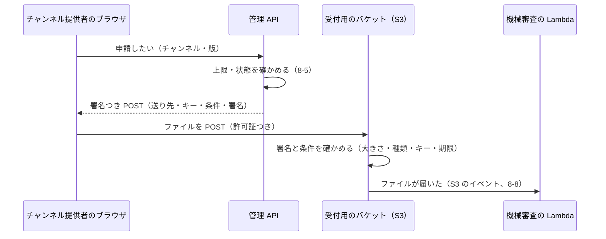
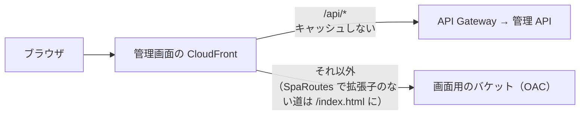

# 8-6 S3 と CloudFront

[目次](../README.md) ＞ 第 8 部 ＞ 8-6

> S3 と CloudFront の仕組みと最小の使い方は [技術カード: S3](../ref/s3.md)・[技術カード: CloudFront](../ref/cloudfront.md) にあります。

## この章で学ぶこと

- S3 のバケットを、役割ごとに分ける。どれも公開しない設定
- 署名つき POST で、ブラウザから S3 に直接アップロードさせる（大きさと種類を S3 自身に確かめさせる）
- ライフサイクルで、決まった日数のあとに自動で消す
- CloudFront で、公開しないバケットの中身を配る（OAC）
- キャッシュ: 短く持つもの（リスト）と、長く持つもの（中身の SHA-256 の名前のファイル）
- 画面と API を 1 つの CloudFront から出す。SPA の道の振り分け、安全のためのヘッダー

## S3: ファイルの置き場

**Amazon S3** は、ファイル（**オブジェクト**）を置く場所です。置き場の単位を **バケット** と呼び、その中にキー（`pkg/abc….zip` のような名前）でファイルを置きます。フォルダのように見える `/` は、名前の一部です。

管理システムには、役割の違うバケットが 4 つあります。

| バケット | 何を置くか | だれが書く | だれが読む | 章 |
|---|---|---|---|---|
| **公開用**（PublicBucket） | 承認済みチャンネル・リスト、検出の文書、承認したパッケージ・アイコン、試用のパッケージ | 公開の Lambda、管理 API | CloudFront だけ（アプリはその先） | [6-4](../06-trust/04-two-tier-keys.md) |
| **記録用**（RecordsBucket） | 公開したリストの履歴、審査の見本、審査の記録 | 公開の Lambda、管理 API、機械審査 | 管理 API | DM-001 M-13 |
| **受付用**（IntakeBucket） | チャンネル提供者が上げたパッケージ・アイコン（審査の前） | チャンネル提供者のブラウザ（署名つき POST） | 機械審査、管理 API | この章 |
| **画面用**（WebBucket） | 管理画面（SPA）のファイル | 配備（CDK） | CloudFront だけ | [9-1](../09-console/01-react-vite.md) |

役割ごとに分けると、権限を役割ごとに絞れます（[8-1](01-aws-basics.md)）。たとえば、審査の前のパッケージ（受付用）が、うっかり公開用に紛れ込むことがありません。

### どのバケットも公開しない

[console-stack.ts](../../yorisoi-console/infra/lib/console-stack.ts):

```ts
const bucketDefaults: s3.BucketProps = {
  blockPublicAccess: s3.BlockPublicAccess.BLOCK_ALL,
  enforceSSL: true,
  encryption: s3.BucketEncryption.S3_MANAGED,
  removalPolicy: keep,
  autoDeleteObjects: !prod,
};
```

| 設定 | 意味 |
|---|---|
| `blockPublicAccess: BLOCK_ALL` | だれでも読める設定を、うっかり付けられないようにする |
| `enforceSSL: true` | 暗号化されていない通信（HTTP）での読み書きを断る |
| `encryption: S3_MANAGED` | 置いたファイルを、S3 が暗号化して保存する |
| `autoDeleteObjects: !prod` | 開発用では、スタックを消すときに中身も消す（中身があるとバケットを消せないため） |

公開用のバケットさえ、**それ自体は公開しません**。アプリが読むのは、その前に置いた CloudFront です（下で説明）。

### ライフサイクル: 決まった日数で消す

```ts
// A-7: read only through CloudFront (OAC); only the publisher writes. `trial/` lasts 7 days (A-13).
const publicBucket = new s3.Bucket(this, 'PublicBucket', {
  ...bucketDefaults,
  lifecycleRules: [{ prefix: 'trial/', expiration: Duration.days(7) }],
});
// M-13: every published list, keyset and review sample, kept for good.
const recordsBucket = new s3.Bucket(this, 'RecordsBucket', { ...bucketDefaults, versioned: true });
```

受付用のバケット（[console-app.ts](../../yorisoi-console/infra/lib/console-app.ts)）:

```ts
lifecycleRules: [
  // Settled submissions are kept 90 days (DM-001 M-4); uploads that never got a result go after 30.
  { prefix: 'archive/', expiration: Duration.days(90) },
  { prefix: 'intake/', expiration: Duration.days(30) },
  // Collections the same way, under their own prefixes (DM-001 1.3: their ids may equal a channel's).
  { prefix: 'archive-col/', expiration: Duration.days(90) },
  { prefix: 'intake-col/', expiration: Duration.days(30) },
  { abortIncompleteMultipartUploadAfter: Duration.days(1) },
],
```

| 場所 | 消すまで | 理由 |
|---|---|---|
| 公開用の `trial/` | 7 日 | 試用チケットの期限が 7 日（API-002） |
| 受付用の `archive/` | 90 日 | 承認されなかったパッケージは、結果が出てから 90 日残す（DM-001 M-4） |
| 受付用の `intake/` | 30 日 | 上げたまま結果が出なかったもの |
| 受付用の `archive-col/`・`intake-col/` | 90 日・30 日 | 素材集の申請。チャンネルと同じ決まりで、場所だけ分ける（素材集の ID はチャンネルの ID と同じでもよいので、混ざらないように） |
| 記録用 | 消さない（`versioned: true` で、上書きしても前の版も残す） | 公開の履歴は永く残す（M-13） |

**ライフサイクル** は、決まった日数を過ぎたファイルを、S3 が自動で消す仕組みです。消すための Lambda やスケジュールを作らなくて済みます。

## 署名つき POST: ブラウザから S3 に直接上げる

チャンネル提供者は、チャンネルのパッケージ（最大 2MB）とアイコンを上げます。管理 API の Lambda を通して上げると、Lambda が大きなファイルを受け取って S3 に書き直すことになり、時間もお金もかかります。API Gateway には本文の大きさの上限もあります。

そこで、**ブラウザから S3 に直接** 上げさせます（API-001 C-10、ADR-001 A-11）。ただし、だれでも何でも置けては困るので、管理 API が **署名つき POST**（presigned POST）という「この条件でなら置いてよい」という許可証を作って渡します。



[api/src/console/handler.ts](../../yorisoi-console/api/src/console/handler.ts) の `presignUpload`:

```ts
presignUpload: async (key, contentType, maxBytes) => {
  // S3 itself refuses a larger file or another type (API-001 C-10).
  const post = await createPresignedPost(s3, {
    Bucket: env('INTAKE_BUCKET'),
    Key: key,
    Conditions: [['content-length-range', 1, maxBytes], ['eq', '$Content-Type', contentType]],
    // …
  });
  // …
},
```

許可証の中の **ポリシー**（条件）に、

- 置いてよいキー（`intake/{channelId}/{submissionId}.zip` のような、決まった名前だけ）
- 大きさ（`content-length-range` で 1 バイト〜2MB）
- 種類（`Content-Type` が `application/zip`）
- 期限

を書き、管理 API の Lambda のロールの鍵で **署名** します。S3 は、署名と条件を確かめ、合わなければ断ります。**大きさの上限を S3 自身が守る** ので、管理 API の Lambda はファイルの中身に一切触れません。

署名つき POST を作れるのは、その場所に置く権限（`intakeBucket.grantPut(consoleFn, 'intake/*')`）を持つロールだけです。許可証は、その権限を、決まった条件で、少しの間だけブラウザに貸すものです。

受付用のバケットの CORS（ほかの場所の画面から送ってよいかの設定）が「どこからでも POST してよい」になっているのは、コメントのとおり、署名つきのポリシーがなければ POST できないので、場所を絞る意味が薄いからです（絞ると、バケットと画面の CloudFront が互いを参照する循環にもなる）。

## CloudFront: 世界中から速く、安全に配る

**Amazon CloudFront** は CDN です。世界中にある AWS の拠点（エッジ）にファイルを写して持ち（**キャッシュ**）、近くの拠点から速く配ります。

### 公開用の配信: OAC

[console-stack.ts](../../yorisoi-console/infra/lib/console-stack.ts):

```ts
const distribution = new cloudfront.Distribution(this, 'PublicDistribution', {
  comment: `SanpoGuide channel provider (${config.name})`,
  defaultBehavior: {
    origin: origins.S3BucketOrigin.withOriginAccessControl(publicBucket),
    viewerProtocolPolicy: cloudfront.ViewerProtocolPolicy.HTTPS_ONLY,
    allowedMethods: cloudfront.AllowedMethods.ALLOW_GET_HEAD,
    // Honors the Cache-Control the publisher sets: 5 minutes for the lists, long for hashed files.
    cachePolicy: cloudfront.CachePolicy.CACHING_OPTIMIZED,
  },
  httpVersion: cloudfront.HttpVersion.HTTP2_AND_3,
});
```

- **OAC**（Origin Access Control）: このバケットを読めるのは **この CloudFront だけ**、とバケットの許可（バケットポリシー）に書く。バケット自体は公開しないまま、CloudFront を通してだけ配れる
- `HTTPS_ONLY`: 暗号化されていない HTTP では受け付けない（API-002 は HTTPS を求める）
- `ALLOW_GET_HEAD`: 読むことだけ。書き込みの要求は受け付けない

第 6 部で見たとおり、アプリは CloudFront も S3 も信用しません。署名とハッシュで確かめます。それでも、置き場所を固く守るのは、**守りを重ねる** ためです。

### キャッシュの長さを、ファイルごとに

CloudFront は、ファイルに付いた `Cache-Control` のヘッダーに従って、キャッシュする長さを決めます（`CACHING_OPTIMIZED`）。管理システムは、ファイルの性質に合わせて長さを変えています。

| ファイル | `Cache-Control` | 理由 |
|---|---|---|
| `/v1/channels.json`（リスト）、`/.well-known/sanpo-channels` | `public, max-age=300`（5 分） | 承認や取り下げのたびに変わる。古いものを長く配らない |
| `/pkg/{sha256}.zip`、`/icons/{sha256}.png` | `public, max-age=31536000, immutable`（1 年、変わらない） | 名前が中身の SHA-256 なので、中身が変われば名前も変わる。同じ名前のファイルは永遠に同じ |

[6-4](../06-trust/04-two-tier-keys.md) の `publish` は、リストを置いたあと、CloudFront のキャッシュを **消して**（invalidation）、新しいリストがすぐに配られるようにしています。

```ts
await deps.storage.putPublic(LIST_PATH, listBytes, 'application/json', 'public, max-age=300');
await deps.storage.putPublic(DISCOVERY_PATH, payloadBytes(discovery), 'application/json', 'public, max-age=300');
await deps.cdn.invalidate([`/${LIST_PATH}`, `/${DISCOVERY_PATH}`]);
```

承認したパッケージは、名前を中身の SHA-256 にして公開用のバケットに写します（`publishApproved`）。

```ts
publishApproved: async ({ packageKey, packageSha256, iconKey, iconSha256 }) => {
  // Named by their hashes, so they are immutable and cached for long (ADR-001 A-7).
  const copy = (from: string, to: string, contentType: string) =>
    s3.send(new CopyObjectCommand({
      Bucket: env('PUBLIC_BUCKET'), Key: to, CopySource: `${env('INTAKE_BUCKET')}/${from}`,
      MetadataDirective: 'REPLACE', ContentType: contentType, CacheControl: 'public, max-age=31536000, immutable',
    }));
  await copy(packageKey, `pkg/${packageSha256}.zip`, 'application/zip');
  await copy(iconKey, `icons/${iconSha256}.png`, 'image/png');
  // …
},
```

**中身のハッシュを名前にする** のは、キャッシュの古さに悩まされないための、よく使われる工夫です。名前が同じなら中身も同じなので、いくら長くキャッシュしても困りません。新しい版は別の名前になるので、キャッシュを消す必要もありません。

## 画面と API を 1 つの CloudFront から

管理画面の CloudFront（[console-app.ts](../../yorisoi-console/infra/lib/console-app.ts)）は、画面のファイルと API の両方の入口です（API-001 C-5）。

```ts
const consoleDistribution = new cloudfront.Distribution(this, 'ConsoleDistribution', {
  defaultRootObject: 'index.html',
  defaultBehavior: {
    origin: origins.S3BucketOrigin.withOriginAccessControl(webBucket),
    viewerProtocolPolicy: cloudfront.ViewerProtocolPolicy.REDIRECT_TO_HTTPS,
    cachePolicy: cloudfront.CachePolicy.CACHING_OPTIMIZED,
    responseHeadersPolicy: headers,
    functionAssociations: [{ eventType: cloudfront.FunctionEventType.VIEWER_REQUEST, function: /* SpaRoutes */ }],
  },
  additionalBehaviors: {
    'api/*': {
      origin: new origins.HttpOrigin(`${httpApi.apiId}.execute-api.${stack.region}.${stack.urlSuffix}`),
      viewerProtocolPolicy: cloudfront.ViewerProtocolPolicy.HTTPS_ONLY,
      allowedMethods: cloudfront.AllowedMethods.ALLOW_ALL,
      cachePolicy: cloudfront.CachePolicy.CACHING_DISABLED,
      originRequestPolicy: cloudfront.OriginRequestPolicy.ALL_VIEWER_EXCEPT_HOST_HEADER,
    },
  },
});
```



- **`api/*` は API Gateway へ**: キャッシュしない（`CACHING_DISABLED`）。ログインのトークン（`Authorization` のヘッダー）などを、そのまま渡す（`ALL_VIEWER_EXCEPT_HOST_HEADER`）
- 画面と API が同じ場所（オリジン）なので、ブラウザの CORS の決まりが要らない（[8-3](03-lambda-apigw.md)）

### SPA の道の振り分け

画面は SPA で、`/channels/kamakura-history` のような道は、ブラウザの中のプログラム（[9-1](../09-console/01-react-vite.md) の react-router）が描き分けます。でも、その道を直接開いたり、再読み込みしたりすると、CloudFront は `channels/kamakura-history` というファイルをバケットから探して、見つからずに失敗します。

```ts
// Paths without a file extension are routes of the SPA.
function: new cloudfront.Function(this, 'SpaRoutes', {
  code: cloudfront.FunctionCode.fromInline(
    "function handler(event) { var r = event.request; if (r.uri.indexOf('.') === -1) { r.uri = '/index.html'; } return r; }",
  ),
  runtime: cloudfront.FunctionRuntime.JS_2_0,
}),
```

**CloudFront Functions** は、エッジで要求を書き換える小さな関数です。「道に `.` がない（拡張子がない）なら、`/index.html` を返す」ことで、どの道から開いても SPA が読み込まれ、あとはブラウザの中で描き分けます。

### 安全のためのヘッダー

```ts
const headers = new cloudfront.ResponseHeadersPolicy(this, 'ConsoleHeaders', {
  securityHeadersBehavior: {
    contentSecurityPolicy: {
      override: true,
      contentSecurityPolicy: [
        "default-src 'self'",
        "script-src 'self'",
        // …
        `connect-src 'self' https://${authDomain} … https://api.openai.com https://api.deepseek.com`,
        "frame-ancestors 'none'",
        // …
      ].join('; '),
    },
    strictTransportSecurity: { override: true, accessControlMaxAge: Duration.days(365), includeSubdomains: true },
    // …
  },
});
```

| ヘッダー | 意味 |
|---|---|
| **CSP**（Content-Security-Policy） | 画面が読み込んでよいもの・通信してよい相手を、決めた場所だけに絞る。もし悪いコードが紛れ込んでも、ほかのサイトにデータを送れない |
| `script-src 'self'` | スクリプトは、この画面のものだけ |
| `connect-src` | 通信してよい相手: 自分（API）、Cognito、受付用のバケット、審査の見本のための AI（OpenAI・DeepSeek） |
| `frame-ancestors 'none'` | ほかのサイトの中に埋め込ませない（クリックをだます攻撃への備え） |
| HSTS（Strict-Transport-Security） | 1 年間、このサイトには HTTPS でしかつながないよう、ブラウザに覚えさせる |

`connect-src` に AI のサービスが入っているのは、運営の画面が、運営の API キーで **ブラウザから直接** AI を呼んで審査の見本を作るからです（ADR-001 A-14、[9-3](../09-console/03-keys-in-browser.md)）。キーはサーバーに送りません。

### 画面の設定は、配備のときに書く

```ts
new s3deploy.BucketDeployment(this, 'DeployWeb', {
  destinationBucket: webBucket,
  sources: [
    s3deploy.Source.asset(props.webDist),
    // Read by the SPA at start-up, so one build serves every environment.
    s3deploy.Source.jsonData('config.json', {
      authority: issuer,
      clientId: client.userPoolClientId,
      authDomain: `https://${authDomain}`,
      environment: config.name,
    }),
  ],
  distribution: consoleDistribution,
  distributionPaths: ['/index.html', '/config.json'],
  prune: true,
});
```

配備のときに、画面のビルド結果（`web/dist`）と、`config.json`（ログインのための Cognito の値など）を画面用のバケットに置きます。画面は起動したときに `config.json` を読みます。こうすると、**1 回のビルドで、開発用にも本番用にも使える**（ビルドに環境ごとの値を埋め込まない）ようになります。

## ハンズオン

### 1. 署名つき POST を手元で作って、中の条件を読む

署名つき POST は、署名を **手元で計算するだけ** なので、AWS につながらなくても作れます（使い捨ての偽の鍵を使います。この許可証で実際に上げることはできません）。

[scripts/presigned-post.mjs](scripts/presigned-post.mjs) をコピーして動かします。

```sh
cd /c/Dev/apps/yorisoi-console
cp ../yorisoi-tutorial/08-aws/scripts/presigned-post.mjs .local/
node .local/presigned-post.mjs
```

```
送り先: https://intake-bucket-example.s3.ap-northeast-1.amazonaws.com/
フォームの項目: [ 'Content-Type', 'bucket', 'X-Amz-Algorithm', 'X-Amz-Credential', 'X-Amz-Date', 'key', 'Policy', 'X-Amz-Signature' ]
ポリシー（S3 が確かめる条件）:
{
  "expiration": "2026-10-04T21:50:35Z",
  "conditions": [
    [ "content-length-range", 1, 2097152 ],
    [ "eq", "$Content-Type", "application/zip" ],
    { "Content-Type": "application/zip" },
    { "bucket": "intake-bucket-example" },
    …
    { "key": "intake/kamakura-history/01J0000000000000000000000B.zip" }
  ]
}
```

- ブラウザは、この `fields` をフォームの項目にして、ファイルと一緒に `url` へ POST する
- `Policy` は、条件を base64 にしたもの。`X-Amz-Signature` は、その条件への署名
- 条件（`content-length-range` で 2MB まで、`Content-Type`、`key`、`expiration`）を書き換えると、署名が合わなくなり、S3 が断る

第 6 部の署名つき文書と同じく、**中身（条件）は読めるが、書き換えられない** ものです。

片付け: `rm .local/presigned-post.mjs`

### 2. テンプレートで、バケットの設定を見る

[8-1](01-aws-basics.md) のとおりにテンプレートを `.local/cdkout/` に作り:

```sh
python -X utf8 - <<'EOF'
import json
t = json.load(open('.local/cdkout/YorisoiConsole-dev.template.json', encoding='utf-8'))
for lid, r in t['Resources'].items():
    if r['Type'] == 'AWS::S3::Bucket':
        p = r['Properties']
        rules = [(x.get('Prefix'), x.get('ExpirationInDays')) for x in p.get('LifecycleConfiguration', {}).get('Rules', [])]
        print(lid, '版の記録:', bool(p.get('VersioningConfiguration')), '／ 自動で消す:', rules, '／ CORS:', bool(p.get('CorsConfiguration')))
EOF
```

```
PublicBucketA6745C15 版の記録: False ／ 自動で消す: [('trial/', 7)] ／ CORS: False
RecordsBucket880EC200 版の記録: True ／ 自動で消す: [] ／ CORS: False
ConsoleIntakeBucketB128EAD7 版の記録: False ／ 自動で消す: [('archive/', 90), ('intake/', 30), ('archive-col/', 90), ('intake-col/', 30), (None, None)] ／ CORS: True
ConsoleWebBucket3DCD9452 版の記録: False ／ 自動で消す: [] ／ CORS: False
```

この章の表のとおりです。受付用の 3 つ目の決まり（`None`）は、途中で止まったアップロードを 1 日で片付ける決まりです。

## つまずきやすいところ

- **バケットは公開しない**: 配るなら CloudFront（OAC）を前に置く
- **大きなファイルを Lambda に通さない**: 署名つき POST（や署名つき URL）で、ブラウザから S3 に直接。大きさの上限は、許可証の条件で S3 に守らせる
- **キャッシュの長さは、ファイルの性質で決める**: よく変わるものは短く、変わらないもの（ハッシュの名前）は長く
- **SPA は、どの道から開いても `index.html` を返す**: 返さないと、再読み込みで失敗する
- **CSP で、通信してよい相手を絞る**: 新しい相手（AI のサービスなど）を足すときは、CSP にも足す

## 確認問題

<details>
<summary>問 1. チャンネル提供者が 3MB のパッケージを上げようとすると、どこで断られますか。</summary>

S3 で断られます。管理 API が作った署名つき POST のポリシーに `content-length-range` で 2MB までと書かれていて、S3 がそれを確かめるからです。管理 API の Lambda はファイルの中身に触れません。

</details>

<details>
<summary>問 2. パッケージは 1 年キャッシュしてよいのに、リストは 5 分にしているのはなぜですか。</summary>

パッケージは名前が中身の SHA-256 なので、同じ名前のファイルの中身は変わらず、長くキャッシュしても困りません。リストは承認や取り下げのたびに中身が変わるので、古いものを長く配らないよう短くし、公開のたびにキャッシュも消しています。

</details>

<details>
<summary>問 3. 管理画面の <code>/channels/kamakura-history</code> を直接開いても画面が出るのはなぜですか。</summary>

CloudFront Functions（`SpaRoutes`）が、拡張子のない道を `/index.html` に書き換えるからです。`index.html` が読み込まれたあと、ブラウザの中のプログラムが道を見て、その画面を描きます。

</details>

---

前: [8-5 DynamoDB の 1 テーブル設計](05-dynamodb.md) ／ 次: [8-7 SQS・SES・KMS](07-sqs-ses-kms.md)
