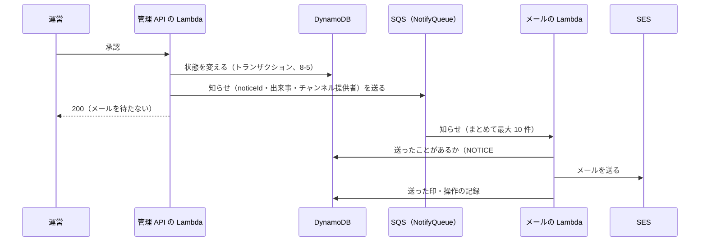

# 8-7 SQS・SES・KMS

[目次](../README.md) ＞ 第 8 部 ＞ 8-7

> SQS と SES の仕組みと最小の使い方は [技術カード: SQS](../ref/sqs.md)・[技術カード: SES](../ref/ses.md) にあります。KMS は [技術カード: AWS KMS](../ref/aws-kms.md) と [6-4](../06-trust/04-two-tier-keys.md) で扱いました。

## この章で学ぶこと

- 待ち行列（SQS）で、「すぐにはしなくてよい仕事」を切り離す
- 失敗したらやり直し、何度やってもだめなら脇に置く（デッドレターキュー）
- 同じ知らせが 2 回届いても、メールは 1 通だけにする（冪等）
- SES でメールを送る。送る準備ができるまでは「記録だけ」にする
- 個人情報（メールアドレス）を、記録に残さない
- KMS のふりかえり: 管理システムの中での位置づけ

## チャンネル提供者への知らせ

運営が申請を承認・差し戻し・却下したとき、チャンネルを取り下げたとき、鍵の移し替えを判断したとき、チャンネル提供者にメールで知らせます（ADR-001 A-19、API-001 C-14）。



管理 API は、**メールを自分で送りません**。知らせを待ち行列に入れるだけです。

## SQS: 待ち行列

**Amazon SQS**（Simple Queue Service）は、**メッセージの待ち行列** です。送る側がメッセージを入れ、受け取る側が取り出して処理します。

なぜ、管理 API から直接 SES でメールを送らないのでしょうか。

- **運営を待たせない**: メールの送信は、相手のサービスの都合で遅れることがある。待ち行列に入れるだけなら一瞬
- **メールの失敗で、承認を失敗させない**: 承認はデータベースで済んでいる。メールが一時的に送れなくても、承認は取り消したくない
- **やり直しを任せられる**: 送れなかったら、SQS がメッセージを残しておき、あとでもう一度渡してくれる

```ts
// api/src/console/deps.ts
export async function notifyAfter(deps: Deps, notice: Omit<Notice, 'noticeId'>): Promise<void> {
  try {
    await deps.notify({ noticeId: ulid(deps.now().getTime()), ...notice });
  } catch (e) {
    console.error(JSON.stringify({ notice: notice.event, publisherId: notice.publisherId, error: e instanceof Error ? e.message : String(e) }));
  }
}
```

`notifyAfter` は、待ち行列に入れるのに失敗しても、例外を投げずにログに残すだけです。承認そのものは、もう成功しているからです。知らせごとに ID（`noticeId`、ULID）を付けています（下で使います）。

### 待ち行列の設定

[console-app.ts](../../yorisoi-console/infra/lib/console-app.ts):

```ts
const deadNotices = new sqs.Queue(this, 'NotifyDeadLetters', { retentionPeriod: Duration.days(14), enforceSSL: true });
const notices = new sqs.Queue(this, 'NotifyQueue', {
  visibilityTimeout: Duration.minutes(2),
  deadLetterQueue: { queue: deadNotices, maxReceiveCount: 3 }, // the notifier's MAX_ATTEMPTS
  enforceSSL: true,
});
// …
notifier.addEventSource(new SqsEventSource(notices, { batchSize: 10, reportBatchItemFailures: true }));
```

| 設定 | 意味 |
|---|---|
| `SqsEventSource` | 待ち行列にメッセージが来たら、Lambda を呼ぶ（Lambda の側から取りに行く仕組みを、AWS が動かしてくれる） |
| `batchSize: 10` | 1 回の呼び出しで、最大 10 件をまとめて渡す |
| `visibilityTimeout: 2 分` | 渡したメッセージを、2 分のあいだほかの受け取り手から隠す。その間に処理を終えて消せば完了。終わらなければ、また見えるようになり、渡し直される |
| `maxReceiveCount: 3` | 3 回渡してもだめなら、**デッドレターキュー**（`NotifyDeadLetters`）に移す |
| `reportBatchItemFailures: true` | 10 件のうち失敗したものだけを伝えられる（下で説明） |

### 失敗したものだけをやり直す

メールの Lambda（[api/src/notify/handler.ts](../../yorisoi-console/api/src/notify/handler.ts)）:

```ts
export async function handler(event: SQSEvent): Promise<SQSBatchResponse> {
  const batchItemFailures: SQSBatchResponse['batchItemFailures'] = [];
  for (const record of event.Records) {
    try {
      const notice = JSON.parse(record.body) as Notice;
      const outcome = await deliver(ports, notice, Number(record.attributes.ApproximateReceiveCount), MAX_ATTEMPTS);
      console.log(JSON.stringify({ noticeId: notice.noticeId, event: notice.event, outcome }));
    } catch (e) {
      console.error(JSON.stringify({ messageId: record.messageId, error: e instanceof Error ? e.message : String(e) }));
      batchItemFailures.push({ itemIdentifier: record.messageId });
    }
  }
  return { batchItemFailures };
}
```

10 件のうち 1 件だけ失敗したとき、全部を失敗にすると、成功した 9 件まで渡し直されてしまいます。`batchItemFailures` に **失敗したものだけ** を入れて返せば、SQS はそれだけを渡し直します。

`record.attributes.ApproximateReceiveCount` は、このメッセージを何回渡したか（何回目の挑戦か）です。

### 何度やってもだめなら: デッドレターキューと警報

3 回渡しても送れなかったメッセージは、デッドレターキューに移ります。そして、デッドレターキューにメッセージがたまったら、運営に知らせます。

```ts
new cloudwatch.Alarm(this, 'NoticesNotSent', {
  metric: deadNotices.metricApproximateNumberOfMessagesVisible({ period: Duration.minutes(5), statistic: 'Maximum' }),
  threshold: 1,
  // …
  alarmDescription: 'A publisher notice could not be sent after retries (dead-letter queue)',
}).addAlarmAction(new cwActions.SnsAction(props.alarms));
```

一時的な失敗（相手のサービスが混んでいる）は、やり直しで自然に直ります。直らない失敗だけが脇に置かれ、人が気づけるようになっています。

## 同じ知らせを 2 回送らない: 冪等

SQS は、メッセージを **少なくとも 1 回** 渡すことを約束します。裏を返すと、**まれに同じメッセージを 2 回渡す** ことがあります。また、メールは送れたのに、その直後に Lambda が止まって「完了」を伝えられず、渡し直される、ということも起こりえます。

何も備えなければ、チャンネル提供者に同じメールが 2 通届きます。そこで、メールの処理を **冪等**（何回行っても、1 回行ったのと同じ結果になる）にしています。[api/src/notify/notify.ts](../../yorisoi-console/api/src/notify/notify.ts) の `deliver`:

```ts
export async function deliver(ports: NotifyPorts, notice: Notice, attempt: number, maxAttempts: number): Promise<'sent' | 'skipped' | 'duplicate'> {
  const key = { PK: `NOTICE#${notice.noticeId}`, SK: 'NOTICE' };
  if ((await ports.db.send(new GetCommand({ TableName: ports.table, Key: key, ConsistentRead: true }))).Item) return 'duplicate';
  // … 送り先を調べる …
  let messageId: string;
  try {
    messageId = await ports.send({ to, ...render(notice, ports.consoleUrl) });
  } catch (e) {
    if (attempt >= maxAttempts) {
      await ports.db.send(new TransactWriteCommand({ TransactItems: [record('notification.failed', { /* … */ })] }));
    }
    throw e;
  }
  const ttl = Math.floor(ports.now().getTime() / 1000) + REMEMBER_DAYS * 86_400;
  await ports.db.send(
    new TransactWriteCommand({
      TransactItems: [
        { Put: { TableName: ports.table, Item: { ...key, type: 'notice', event: notice.event, messageId, ttl } } },
        record('notification.sent', { messageId }),
      ],
    }),
  );
  return 'sent';
}
```

1. **送ったことがあるか**: `NOTICE#{noticeId}` の項目があれば、送らずに `duplicate` で終える
2. メールを送る
3. **送った印**（`NOTICE#{noticeId}`）と操作の記録を、1 つのトランザクションで書く。印は 30 日の TTL で自動で消える（[8-5](05-dynamodb.md)）
4. 送れなかったら例外を投げる（SQS がやり直す）。最後の挑戦（3 回目）なら、その前に失敗を記録する

知らせごとの ID（`noticeId`）を管理 API が付けていたのは、このためです。同じ知らせが何回届いても、ID が同じなので 1 回しか送りません。

> 厳密には、2 でメールを送ったあと、3 で印を書く前に止まると、やり直しでもう 1 通送ってしまいます。この「ごくまれに 2 通」は受け入れ、その代わり「送れたはずなのに 1 通も届かない」ことがないようにしています。外のサービスへの送信を、完全に 1 回だけにするのは、一般にとても難しいことです。

## SES: メールを送る

**Amazon SES**（Simple Email Service）は、メールを送るサービスです。

```ts
send: async (mail) => {
  // Development has no sending domain yet (ADR-001 T-2): record what would be sent, without the address or text.
  if (env('NOTIFY_MODE') === 'log') {
    console.log(JSON.stringify({ wouldSend: mail.subject, bodyLength: mail.body.length }));
    return 'log-only';
  }
  const out = await ses.send(
    new SendEmailCommand({
      FromEmailAddress: env('NOTIFY_FROM'),
      Destination: { ToAddresses: [mail.to] },
      Content: { Simple: { Subject: { Data: mail.subject, Charset: 'UTF-8' }, Body: { Text: { Data: mail.body, Charset: 'UTF-8' } } } },
      // …
    }),
  );
  return out.MessageId ?? '';
},
```

SES でメールを送るには、準備が要ります。

- **送り主のドメインの確認**: 自分のドメイン（`example.com`）から送ってよいことを、DNS の設定で示す。なりすましのメールを送らせないため（ADR-001 T-7）
- **サンドボックスを出る**: 最初は「確認済みのアドレスにしか送れない」状態（サンドボックス）で、AWS に申し出て解除してもらう（T-8）

その準備ができるまで、管理システムは **`log` モード** で動いています（[8-2](02-cdk.md) の `config.notify`）。メールは送らず、「何を送るはずだったか」（件名と本文の長さ）だけをログに残します。**宛先と本文はログに書きません**。送信の準備ができたら、設定を `ses` に変えるだけで、本当に送るようになります。

### 個人情報を残さない

- 送り先は、データベースに **持っていません**。送るたびに Cognito から、確認済みのメールアドレスを引きます（`emailOf`）。確認していないアドレスや、退会したチャンネル提供者には送りません（`skipped`）
- 操作の記録には、送ったこと（`notification.sent`）と、SES のメッセージ ID だけを残し、宛先は書きません

テスト（[api/test/notify.test.ts](../../yorisoi-console/api/test/notify.test.ts)）の名前が、この決まりを表しています。

- sends once to the verified address and records it without the address（確認済みのアドレスに 1 回だけ送り、宛先なしで記録する）
- retries a failed send and records the failure on the last attempt（失敗したらやり直し、最後の挑戦で失敗を記録する）
- skips a publisher with no verified address, or one that has left（確認済みのアドレスがない、退会したチャンネル提供者には送らない）

1 つ目のテストには、`expect(JSON.stringify(log)).not.toContain('alice@example.com')` という確かめもあります。**記録にメールアドレスが入っていないこと** を、テストで守っています。

## KMS のふりかえり

KMS（署名の鍵）は、第 6 部で中心に扱いました。第 8 部のほかの部品とのつながりを整理しておきます。

| つながり | 内容 | 章 |
|---|---|---|
| CDK | `ECC_NIST_EDWARDS25519` の鍵を作る。`RemovalPolicy.RETAIN`（消さない） | [8-2](02-cdk.md) |
| IAM（鍵ポリシー） | 署名してよいのは公開の Lambda と管理 API の Lambda だけ、`ED25519_SHA_512`・`RAW` だけ | [8-1](01-aws-basics.md)、[6-4](../06-trust/04-two-tier-keys.md) |
| Lambda | 公開の Lambda がリストの要約に、管理 API が試用チケットに署名する | [8-3](03-lambda-apigw.md) |
| 管理 API | 運営が署名鍵を登録するとき、`GetPublicKey` で鍵の種類を確かめ、公開鍵を取り出す | [技術カード: AWS KMS](../ref/aws-kms.md) |
| テスト | aws-sdk-client-mock で、頼み方（`RAW`・`ED25519_SHA_512`）を確かめる | [7-4](../07-typescript/04-testing.md) |
| 費用 | 鍵 1 つにつき月 1 USD。開発用の費用のほとんど | [8-1](01-aws-basics.md) |

## ハンズオン: 2 回送らない守りを外す

メールの処理のテストを使います（Docker の DynamoDB Local を使うので、Docker Desktop を起動しておきます）。

### 1. テストを流す

```sh
cd /c/Dev/apps/yorisoi-console
npx vitest run api/test/notify.test.ts
```

4 件のテストが通ります。テストでは、SES の代わりに、送ったメールを配列（`sent`）に記録する代役を使っています（[7-4](../07-typescript/04-testing.md) のメモリの代役）。

### 2. 「送ったことがあるか」の確かめを外す

[api/src/notify/notify.ts](../../yorisoi-console/api/src/notify/notify.ts) の `deliver` の、

```ts
if ((await ports.db.send(new GetCommand({ TableName: ports.table, Key: key, ConsistentRead: true }))).Item) return 'duplicate';
```

の行を消して、もう一度テストを流します。

```
     × sends once to the verified address and records it without the address
Expected: "duplicate"
Received: "sent"
      Tests  1 failed | 3 passed (4)
```

同じ知らせ（同じ `noticeId`）を 2 回渡すと、2 回とも送ってしまうことを、テストが見つけました。SQS がまれに同じメッセージを 2 回渡すと、チャンネル提供者に同じメールが 2 通届く不具合です。元に戻します。

```sh
git checkout -- api/src/notify/notify.ts
git status
```

## つまずきやすいところ

- **すぐにしなくてよい仕事は、待ち行列に**: 利用者を待たせない。失敗で本来の操作を巻き添えにしない
- **SQS は同じメッセージを 2 回渡すことがある**: 処理を冪等に（ID で、したことがあるかを確かめる）
- **まとめて受け取ったら、失敗したものだけを返す**: `reportBatchItemFailures`
- **何度やってもだめなものは脇に置き、人に知らせる**: デッドレターキューと警報
- **個人情報をログや記録に残さない**: 宛先や本文を書かない。テストで守る
- **SES は準備が要る**: ドメインの確認とサンドボックスの解除。それまでは送らずに記録だけ

## 確認問題

<details>
<summary>問 1. 承認の操作のあと、管理 API の Lambda が SES で直接メールを送らないのはなぜですか。</summary>

メールの送信の遅れや一時的な失敗で、運営を待たせたり、承認そのものを失敗させたりしないためです。待ち行列に入れるだけなら一瞬で、送れなかったときのやり直しも SQS に任せられます。

</details>

<details>
<summary>問 2. 同じ知らせが SQS から 2 回届いたとき、チャンネル提供者にメールは何通届きますか。</summary>

1 通です。1 回目に送ったあと、`NOTICE#{noticeId}` の印を書いているので、2 回目はそれを見つけて送らずに終えます（`duplicate`）。

</details>

<details>
<summary>問 3. 開発用では、チャンネル提供者へのメールはどうなっていますか。</summary>

送られません。送信のドメインがまだないため `log` モードで動いていて、何を送るはずだったか（件名と本文の長さ）だけをログに残します。宛先と本文はログに書きません。

</details>

---

前: [8-6 S3 と CloudFront](06-s3-cloudfront.md) ／ 次: [8-8 Kotlin の Lambda](08-kotlin-lambda.md)
