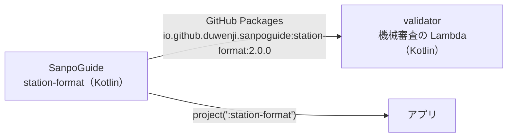
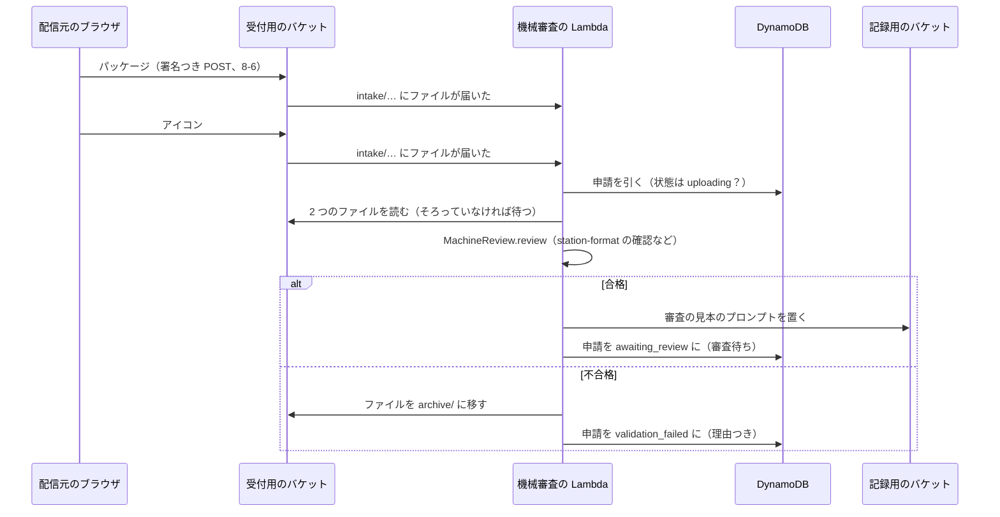

# 8-8 Kotlin の Lambda

[目次](../README.md) ＞ 第 8 部 ＞ 8-8

## この章で学ぶこと

- なぜ機械審査だけ Kotlin で書いたのか（アプリと同じコードで確かめるため）
- JVM の Lambda の形（`RequestHandler`）と、配備するための zip の作り方
- JVM の Lambda の起動の遅さへの備え
- S3 のイベントで Lambda を呼ぶ。2 つのファイルのイベントが同時に来たときの守り
- 判断（純粋な関数）と、読み書き（Lambda）を分ける作り

## なぜ Kotlin なのか

管理システムは TypeScript で書かれていますが、**機械審査の Lambda**（[validator/](../../sanpo-channel-console/validator/)）だけは Kotlin です。

配信元が上げたチャンネルのパッケージを確かめるとき、**アプリと同じ確認** をしなければなりません。管理システムで合格したのにアプリで読み込めない、ということが起きないようにするためです（[6-6](../06-trust/06-same-rules.md)）。アプリの確認は、Kotlin で書かれた `station-format` のライブラリにあります（第 5 部）。それを **そのまま使う** ために、機械審査は Kotlin（JVM）で書いています。



Lambda は、Node.js だけでなく、Java（JVM）など、いくつもの言語で書けます。言語を部品ごとに選べるのも、Lambda の良いところです。

## 機械審査がすること



合格すると、申請は「審査待ち」（運用者の一覧の GSI2 の `QUEUE#REVIEW`、[8-5](05-dynamodb.md)）になります。不合格なら、理由を付けて配信元に返します。

## 判断と、読み書きを分ける

機械審査のコードは、2 つのファイルに分かれています。

| ファイル | 役割 | Android・AWS への依存 |
|---|---|---|
| [MachineReview.kt](../../sanpo-channel-console/validator/src/main/kotlin/console/validator/MachineReview.kt) | 判断する（純粋な関数） | なし |
| [Handler.kt](../../sanpo-channel-console/validator/src/main/kotlin/console/validator/Handler.kt) | S3・DynamoDB を読み書きする（Lambda の入口） | AWS の SDK |

`MachineReview.review` は、ファイルの中身を受け取って、結果を返すだけです。

```kotlin
/**
 * The machine review (ADR-001 A-11, API-003 確認の手順 2〜10): station-format's checks, the same the
 * app runs, plus what only the console knows (which channel, which publisher, which version came
 * before) and the icon. Pure: the Lambda reads and writes, this decides.
 */
object MachineReview {
    const val VALIDATOR = "station-format 2.0.0"

    fun review(upload: Upload, zip: ByteArray, icon: ByteArray): Outcome {
        // …
        when (val result = StationValidator.checkArchive(zip, listedAs = null, verifier = JcaEd25519)) {
            is StationCheck.Rejected -> findings += Finding(result.code.json, result.detail)
            is StationCheck.Ok -> {
                val manifest = result.station.manifest
                if (manifest.id != upload.channelId) findings += Finding("id_mismatch", /* … */)
                if (manifest.publisher != upload.accountId) findings += Finding("publisher_mismatch", /* … */)
                upload.latestApprovedVersion?.let { latest ->
                    if (manifest.version <= latest) findings += Finding("version_not_newer", /* … */)
                }
                // …
            }
        }
        findings += iconFindings(icon)
        // …
    }
}
```

- **アプリと同じ確認**: `StationValidator.checkArchive`（[5-2](../05-station-format/02-package-format.md)）。署名の確認には、Java 標準の `JcaEd25519` を渡す（アプリは Tink。[6-5](../06-trust/05-verify-in-app.md) の差し替え口）
- **管理システムだけが知っていること**: どのチャンネルへの申請か、どの配信元か、前に承認した版はいくつか。アプリはリストを見て確かめるが、申請の時点では管理システムが確かめる
- **アイコン**: PNG で、256×256 以下、100KB 以下か。PNG の先頭の決まったバイト（シグネチャ）と、`IHDR` の幅と高さを読んで確かめる

結果は sealed（`Outcome.Passed`・`Outcome.Failed`、[1-1](../01-kotlin-android/01-kotlin-syntax.md)）で返します。問題が複数あれば、すべてを並べて返します（配信元が 1 つ直すたびに出し直さなくて済むように）。

コメントの「Pure: the Lambda reads and writes, this decides.」（純粋な関数。読み書きは Lambda が、判断はこれが）が要点です。[2-3](../02-compose/03-manual-di.md)・[3-4](../03-walk/04-maybe-talk.md) で見た「判断を、外の世界に依存しない小さな部品に分ける」作りが、ここでも使われています。だから、AWS なしでテストできます。

## JVM の Lambda の形

[Handler.kt](../../sanpo-channel-console/validator/src/main/kotlin/console/validator/Handler.kt):

```kotlin
class Handler(
    private val s3: S3Client = S3Client.builder().httpClient(UrlConnectionHttpClient.create()).build(),
    private val db: DynamoDbClient = DynamoDbClient.builder().httpClient(UrlConnectionHttpClient.create()).build(),
    private val table: String = env("TABLE_NAME"),
    private val intakeBucket: String = env("INTAKE_BUCKET"),
    private val recordsBucket: String = env("RECORDS_BUCKET"),
    private val clock: () -> Instant = Instant::now,
) : RequestHandler<S3Event, String> {

    override fun handleRequest(event: S3Event, context: Context?): String {
        val results = event.records.map { record ->
            val key = URLDecoder.decode(record.s3.`object`.key, Charsets.UTF_8)
            runCatching { process(key) }.getOrElse { e ->
                context?.logger?.log("failed on $key: ${e.stackTraceToString()}")
                throw e
            }
        }
        return results.joinToString("; ")
    }
    // …
}
```

- `RequestHandler<S3Event, String>`: AWS の Lambda の Java のライブラリ（`aws-lambda-java-core`・`aws-lambda-java-events`）の約束。S3 のイベントを受け取り、文字列を返す
- **コンストラクタの引数に既定値**: Lambda が呼ぶときは引数なし（既定値で本物の S3・DynamoDB・時計）。テストでは代役を渡せる（[2-3](../02-compose/03-manual-di.md)、Kotlin の既定値の引数は [1-1](../01-kotlin-android/01-kotlin-syntax.md)）
- S3 のイベントのキーは URL 形式で符号化されているので、`URLDecoder.decode` で戻す

CDK の定義（[console-app.ts](../../sanpo-channel-console/infra/lib/console-app.ts)）:

```ts
const validator = new lambda.Function(this, 'MachineReview', {
  runtime: lambda.Runtime.JAVA_21,
  architecture: lambda.Architecture.ARM_64,
  handler: 'console.validator.Handler::handleRequest',
  code: lambda.Code.fromAsset(props.validatorZip),
  memorySize: 1536,
  timeout: Duration.minutes(1),
  environment: {
    TABLE_NAME: props.table.tableName,
    INTAKE_BUCKET: intakeBucket.bucketName,
    RECORDS_BUCKET: props.recordsBucket.bucketName,
    JAVA_TOOL_OPTIONS: '-XX:+TieredCompilation -XX:TieredStopAtLevel=1',
  },
});
// …
intakeBucket.addEventNotification(s3.EventType.OBJECT_CREATED, new s3n.LambdaDestination(validator), { prefix: 'intake/' });
```

- `handler: 'console.validator.Handler::handleRequest'`: どのクラスのどの関数を呼ぶか
- `code: fromAsset(validatorZip)`: Gradle で作った zip（下で説明）。Node.js の Lambda のように CDK がまとめるのではなく、作った zip をそのまま上げる
- `addEventNotification(OBJECT_CREATED, …, { prefix: 'intake/' })`: 受付用のバケットの `intake/` にファイルができたら、この Lambda を呼ぶ

## 配備するための zip

[validator/build.gradle.kts](../../sanpo-channel-console/validator/build.gradle.kts):

```kotlin
dependencies {
    implementation("io.github.duwenji.sanpoguide:station-format:2.0.0")
    // station-format leaves org.json to its users (Android ships one).
    implementation("org.json:json:20240303")
    implementation("com.amazonaws:aws-lambda-java-core:1.4.0")
    implementation("com.amazonaws:aws-lambda-java-events:3.16.1")
    implementation(platform("software.amazon.awssdk:bom:2.55.11"))
    implementation("software.amazon.awssdk:s3") {
        exclude(group = "software.amazon.awssdk", module = "netty-nio-client")
        exclude(group = "software.amazon.awssdk", module = "apache-client")
    }
    // … dynamodb も同じ …
    // The JDK's HTTP client: smaller and quicker to start than Apache or Netty.
    implementation("software.amazon.awssdk:url-connection-client")
}

/** The Lambda deployment package: classes at the root, dependencies in lib/. */
val lambdaZip by tasks.registering(Zip::class) {
    archiveFileName.set("validator.zip")
    destinationDirectory.set(layout.buildDirectory.dir("lambda"))
    from(tasks.compileKotlin)
    from(tasks.processResources)
    into("lib") { from(configurations.runtimeClasspath) }
}
tasks.build { dependsOn(lambdaZip) }
```

- `station-format:2.0.0` を GitHub Packages から取る（[5-3](../05-station-format/03-publish.md)）。`org.json` は自分で足す（[5-1](../05-station-format/01-jvm-library.md) の `compileOnly`）
- **JVM の Lambda の zip の決まり**: クラスのファイルは zip のいちばん上に、依存の jar は `lib/` に。自作のタスク `lambdaZip`（[1-2](../01-kotlin-android/02-gradle.md) の `channelIndex` と同じく、Gradle のタスクを自分で作る）がそう並べる
- AWS の SDK の BOM（[1-2](../01-kotlin-android/02-gradle.md) の Compose の BOM と同じ考え方）で、SDK の部品の版をそろえる

## JVM の起動の遅さへの備え

JVM の Lambda は、Node.js より **起動（コールドスタート）が遅い** ことが知られています。JVM そのものを立ち上げ、たくさんのクラスを読み込むからです。機械審査は、いくつかの工夫をしています。

| 工夫 | 効き目 |
|---|---|
| HTTP の部品を JDK のもの（`url-connection-client`）にし、Netty・Apache の部品を外す | 依存が減り、読み込むクラスが減る。コメント: "smaller and quicker to start than Apache or Netty" |
| `JAVA_TOOL_OPTIONS: '-XX:+TieredCompilation -XX:TieredStopAtLevel=1'` | JIT コンパイルを、手早い最初の段階で止める。長く動かすときの最適化より、すぐに動き出すことを優先する |
| `memorySize: 1536` | Lambda はメモリに応じて CPU も増える。起動と ZIP の展開・確認を速くする |

機械審査は、配信元が申請したときにだけ動き、数秒かかっても困りません。それでも、待たせる時間を短くするための工夫です。

## 2 つのファイルのイベントが同時に来たら

配信元は、パッケージとアイコンの 2 つのファイルを上げます。S3 は、**それぞれのファイルについて** イベントを出すので、機械審査は 2 回呼ばれます。しかも、ほぼ同時に。

```kotlin
/**
 * … Both files raise events, possibly at once: the write is conditional on `uploading`, so only one
 * run records an outcome.
 */
fun process(key: String): String {
    val match = KEY.matchEntire(key) ?: return "skip $key"
    val (channelId, submissionId) = match.destructured
    val sub = getItem("CH#$channelId", "SUB#$submissionId") ?: return "no submission for $key"
    if (sub.str("state") != "uploading") return "already ${sub.str("state")}: $key"
    // …
    // The other file's event will do the work if it isn't here yet.
    val zip = read(zipKey) ?: return "waiting for $zipKey"
    val icon = read(iconKey) ?: return "waiting for $iconKey"
    // … 審査する …
    return try {
        when (outcome) {
            is Outcome.Passed -> passed(upload, outcome, now)
            is Outcome.Failed -> failed(upload, outcome, now, zipKey, iconKey)
        }
    } catch (e: TransactionCanceledException) {
        "someone else recorded $submissionId"
    }
}
```

1. **S3 のキーから申請を引く**: キーに `channelId` と `submissionId` を入れてある（`intake/{channelId}/{submissionId}.zip`・`.png`）ので、データベースを探さずに申請を引ける（DM-001 AP-21）
2. **もう結果が出ていれば何もしない**: 状態が `uploading` でなければ終える
3. **もう 1 つのファイルがまだなら待つ**: 先に届いた方のイベントは「待っている」と返して終える。あとから届いた方のイベントが審査する
4. **結果を書くのは、状態が `uploading` のときだけ**（条件つき書き込み、[8-5](05-dynamodb.md)）: 2 つのイベントが同時に審査まで進んでも、先に書いた方だけが成功する。あとの方は `TransactionCanceledException` になり、「ほかの実行が書いた」として終える

[8-7](07-sqs-ses-kms.md) のメールの冪等と同じく、**同じ仕事が 2 回来ても、結果は 1 回分** にする作りです。分散したシステムでは、イベントが重なったり、2 回届いたりすることを前提に作ります。

## ハンズオン: 機械審査をビルドして、テストを壊す

機械審査のビルドには、`station-format` の 2.0.0 が要ります。GitHub Packages のトークン（[5-3](../05-station-format/03-publish.md)）を設定するか、SanpoGuide で手元に公開したもの（`~/.m2`）を使います。

### 1. テストを流して、zip を作る

```sh
cd /c/Dev/apps/sanpo-channel-console/validator
./gradlew test lambdaZip
ls -la build/lambda/
```

`validator.zip`（15MB ほど）ができます。

### 2. zip の中を見る

```sh
unzip -l build/lambda/validator.zip | awk '{print $4}' | grep -v '^lib/' | grep '\.class$' | head -5
unzip -l build/lambda/validator.zip | awk '{print $4}' | grep '^lib/' | head -8
```

```
console/validator/Finding.class
console/validator/Handler$1.class
…
lib/station-format-2.0.0.jar
lib/kotlin-stdlib-2.2.0.jar
lib/json-20240303.jar
lib/aws-lambda-java-core-1.4.0.jar
lib/aws-lambda-java-events-3.16.1.jar
lib/s3-2.55.11.jar
lib/dynamodb-2.55.11.jar
lib/url-connection-client-2.55.11.jar
…
```

いちばん上に自分のクラス、`lib/` に依存の jar が並んでいます。`lib/station-format-2.0.0.jar` が、アプリと同じ確認のコードです。

### 3. テストを読む

[MachineReviewTest.kt](../../sanpo-channel-console/validator/src/test/kotlin/console/validator/MachineReviewTest.kt) のテストの名前:

- a signed package by the publisher, newer than the approved one, passes with its samples（配信元が署名した、承認済みより新しいパッケージは、見本つきで合格する）
- the package must be for this channel, by this publisher, and newer（このチャンネルの、この配信元の、より新しい版でなければならない）
- station-format's own checks come through with their codes（station-format の確認の結果が、そのコードのまま出てくる）
- the icon must be a small PNG, and both problems are reported（アイコンは小さな PNG でなければならず、問題は両方とも伝える）

`MachineReview` が純粋な関数なので、テストは S3 も DynamoDB も使わず、パッケージとアイコンのバイト列を渡すだけで書けています。

### 4. アイコンの上限を変えてみる

[MachineReview.kt](../../sanpo-channel-console/validator/src/main/kotlin/console/validator/MachineReview.kt) の

```kotlin
const val MAX_ICON_SIDE = 256
```

を `128` に変えて、テストを流します。

```sh
./gradlew test
```

```
5 tests completed, 3 failed
```

レポート（`build/reports/tests/test/index.html`）を開くと、たとえば合格するはずのテストが、

```
Failed(findings=[Finding(code=bad_icon, detail=256×256 (max 128×128))], version=3)
```

で落ちています。テストの見本のアイコンは 256×256 で、API-001 の決まり（256×256 以下）どおりです。上限を勝手に変えると、決まりどおりのアイコンまで断ってしまうことを、テストが見つけました。元に戻します。

```sh
git checkout -- src/main/kotlin/console/validator/MachineReview.kt
git status
```

## つまずきやすいところ

- **同じコードを使うためなら、言語を合わせる**: 確認の規則をもう 1 つの言語で書き直すより、同じライブラリを使う方が確か
- **判断を純粋な関数に分ける**: Lambda の入口は読み書きだけ。判断は AWS なしでテストできる
- **JVM の Lambda の zip の形**: クラスはいちばん上、依存は `lib/`
- **JVM は起動が遅い**: 依存を減らす、JIT の設定、メモリ
- **S3 のイベントは、ファイルごとに来る。重なることもある**: 条件つき書き込みで、結果を 1 回だけ書く

## 確認問題

<details>
<summary>問 1. 機械審査だけを Kotlin で書いたのはなぜですか。</summary>

アプリと同じ確認をするために、アプリの確認のコード（Kotlin の `station-format`）をそのまま使うためです。同じコードで確かめれば、管理システムで合格したのにアプリで読み込めない、ということが起きません。

</details>

<details>
<summary>問 2. パッケージとアイコンのイベントがほぼ同時に届き、両方の実行が審査まで進みました。結果は 2 回書かれますか。</summary>

書かれません。結果は「状態が `uploading` のときだけ」という条件つきで書くので、先に書いた方だけが成功し、あとの方は `TransactionCanceledException` になって何もせずに終わります。

</details>

<details>
<summary>問 3. 機械審査の Lambda が、HTTP の部品に Netty や Apache ではなく JDK のもの（url-connection-client）を使うのはなぜですか。</summary>

依存が小さく、起動が速いからです。JVM の Lambda は起動（コールドスタート）が遅くなりがちなので、読み込むクラスを減らしています。

</details>

---

前: [8-7 SQS・SES・KMS](07-sqs-ses-kms.md) ／ 次: [9-1 React と Vite](../09-console/01-react-vite.md)
