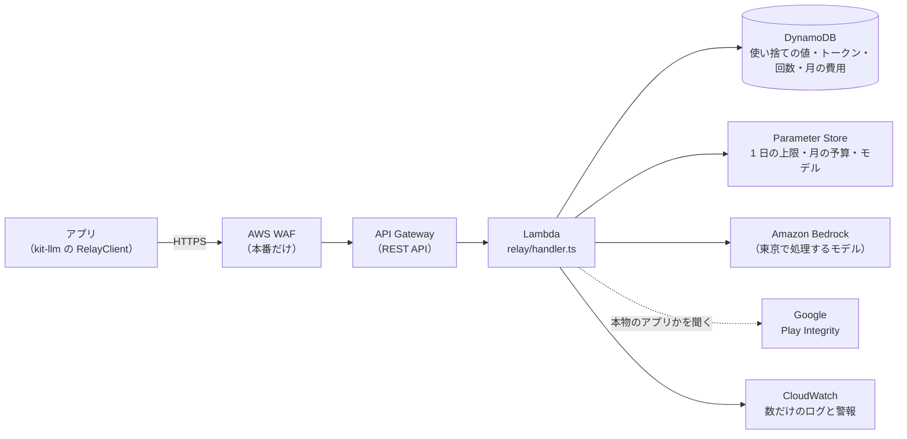
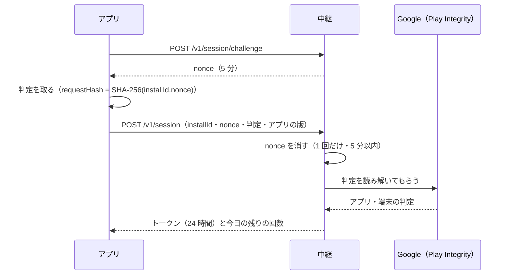

# 8-9 運営の AI の中継

[目次](../README.md) ＞ 第 8 部 ＞ 8-9

> Bedrock の仕組みと最小の使い方は [技術カード: Amazon Bedrock](../ref/bedrock.md)、設定の置き場所は [技術カード: Parameter Store](../ref/parameter-store.md) にあります。

## この章で学ぶこと

- 端末に AI のキーを置かずに、運営の負担で AI を使わせる「中継」の形
- 本物のアプリだけに使わせる仕組み（使い捨ての値・Play Integrity・トークン）
- 1 日の回数と 1 か月の費用を、DynamoDB の条件つきの更新で守る方法
- 設定を配備し直さずに変える（Parameter Store）
- Amazon Bedrock の Converse API で、モデルを差し替えられるように呼ぶ
- 「残さないもの」をテストで守る
- 管理システムとは別のスタックにする理由

## 何を作ったのか

[4-3](../04-outside/03-ai.md) で見たように、散策ガイドには AI を呼ぶ経路が 2 つあります。散策者のキーで AI サービスを直接呼ぶ「自分のキー」と、運営のサーバーを通す「運営の AI」です。この章は、後者のサーバーの側、**中継**（relay）を読みます。

決めたことは platform の [ADR-AI-RELAY](https://github.com/duwenji/yorisoi-platform/blob/main/docs/decisions/ADR-AI-RELAY.md)、やりとりの形は [API-AI-RELAY](https://github.com/duwenji/yorisoi-platform/blob/main/docs/contracts/API-AI-RELAY.md) にあります。コードは yorisoi-console の [api/src/relay/](https://github.com/duwenji/yorisoi-console/tree/main/api/src/relay) と [infra/lib/relay-stack.ts](https://github.com/duwenji/yorisoi-console/blob/main/infra/lib/relay-stack.ts) です。



中継がすることは、言ってしまえば **プロンプトを受け取って Bedrock に渡し、返事を返す** だけです。難しいのは、その手前の守りです。キーのいらない AI の入口は、放っておけば世界中から使い放題になります。守るものは 3 つです。

| 守るもの | どう守るか | 決定 |
|---|---|---|
| だれが使えるか | Play から入れた本物のアプリだけ | R-7 |
| どれだけ使えるか | 1 台 1 日 30 回（運営が 5〜100 で変えられる）、1 か月の予算 | R-2・R-10・R-14 |
| 何を残すか | プロンプトと返事は保存しない。数だけを残す | R-13 |

## 管理システムとは別のスタックにする

中継は、管理システムと同じ AWS アカウントに置きますが、**別のスタック**、それも別の CDK のアプリです（[infra/bin/relay.ts](https://github.com/duwenji/yorisoi-console/blob/main/infra/bin/relay.ts)）。

```ts
// The relay is its own CDK app, so it deploys without the console's builds and keys:
// npx cdk -a "npx tsx bin/relay.ts" deploy -c env=dev
const stack = new RelayStack(app, `YorisoiAiRelay-${name}`, { /* … */ });
```

- 管理システムが止まっても、散策中の AI は止まらない。逆も同じ（R-6）
- 管理システムの画面のビルドや鍵がなくても、中継だけを配備できる
- 配備の失敗や巻き戻しが、もう一方を巻き込まない

API は、管理システム（[8-3](03-lambda-apigw.md)）の **HTTP API** ではなく **REST API** にしています。安くて速いのは HTTP API ですが、AWS WAF（送信元ごとの要求の数を制限する防火壁）を付けられるのは REST API だけだからです。キーのいらない入口なので、送信元ごとの制限を付けられることを優先しました。WAF は月に数ドルかかるので、本番だけに付けます。

## 判断と、読み書きを分ける

[relay.ts](https://github.com/duwenji/yorisoi-console/blob/main/api/src/relay/relay.ts) の関数は、AWS の SDK を直接は作りません。外の世界は `RelayPorts` という形で受け取ります。

```ts
export interface RelayPorts {
  db: DynamoDBDocumentClient;
  table: string;
  now: () => Date;
  random: (bytes: number) => string;
  installKey: string;
  packages: string[];
  settings: () => Promise<Settings>;
  verifyIntegrity?: (token: string, expect: { packageName: string; requestHash: string; now: Date }) => Promise<string | undefined>;
  generate: (model: ModelChoice, system: string, user: string) => Promise<ModelReply>;
  metric: (name: string, value: number) => void;
}
```

本物は [aws.ts](https://github.com/duwenji/yorisoi-console/blob/main/api/src/relay/aws.ts) の `awsPorts` が作り、テストは代役を渡します。時計（`now`）・乱数（`random`）・AI（`generate`）まで外から受け取るので、テストでは「日本時間の 0 時をまたぐ」「AI が失敗する」「月の予算を超える」を一瞬で作れます。[2-3](../02-compose/03-manual-di.md) の `ChannelSync`、[8-8](08-kotlin-lambda.md) の機械審査と同じ作りです。

`verifyIntegrity` が `?`（なくてもよい）なのは、開発用の中継では Play Integrity を確かめないからです（下で見ます）。

## 本物のアプリだけに: セッション

アプリは、AI を呼ぶ前にセッションを開きます。手順は 2 回の往復です。



### 使い捨ての値（nonce）

`challenge` は、乱数の値を 5 分の期限つきで DynamoDB に置きます。`session` は、その値を **条件つきで消します**。

```ts
await ports.db.send(
  new DeleteCommand({
    TableName: ports.table,
    Key: { PK: `NONCE#${nonce}`, SK: 'NONCE' },
    ConditionExpression: 'attribute_exists(PK) AND expiresAt > :now',
    ExpressionAttributeValues: { ':now': now.toISOString() },
  }),
);
```

「あって、期限内なら消す」を 1 回の操作で行うので、同じ値で 2 回セッションを開こうとしても、2 回目は条件に外れて失敗します（`nonce_invalid`）。[8-5](05-dynamodb.md) の条件つき書き込みの使い方です。期限の切れた値は、TTL で DynamoDB が自動で消します。

### Play Integrity

アプリは、Google Play の **Play Integrity API** から「Play から入れた本物のアプリが、まともな端末で動いている」という判定を受け取り、中継に送ります。判定には、アプリが決めた `requestHash`（`installId` と `nonce` を SHA-256 にかけたもの）が入るので、別のセッションの判定を使い回せません。

中継は判定を Google に読み解いてもらい、[integrity.ts](https://github.com/duwenji/yorisoi-console/blob/main/api/src/relay/integrity.ts) の `checkVerdict` で中身を確かめます。

```ts
if (request?.requestPackageName !== expect.packageName) return 'package';
if (request.requestHash !== expect.requestHash) return 'request_hash';
// … 5 分より古い判定は使わない …
if (payload.appIntegrity.appRecognitionVerdict !== 'PLAY_RECOGNIZED') return 'app';
if (!payload.deviceIntegrity?.deviceRecognitionVerdict?.includes('MEETS_DEVICE_INTEGRITY')) return 'device';
return undefined;
```

Google に読み解いてもらうには、運営の Google Cloud のサービスアカウントでログインします。その鍵は Secrets Manager に、手で入れて置きます（CDK のコードには書かない）。Play Integrity とサービスアカウントは、Google Play の側の準備が要るので、詳しくは第 10 部で扱います。

開発用の中継には、この確かめがありません（`verifyIntegrity` がない）。開発中のアプリは Play から入れたものではないので、判定が通らないからです。代わりに、開発用は月の予算を小さくしています（[relay-config.ts](https://github.com/duwenji/yorisoi-console/blob/main/infra/lib/relay-config.ts)）。

### installId とトークン

```ts
const install = createHmac('sha256', ports.installKey).update(installId, 'utf8').digest('base64url');
// … 1 台 1 日 5 回まで（SESSIONS#…）…
const token = ports.random(32);
await ports.db.send(
  new PutCommand({ TableName: ports.table, Item: { PK: `TOKEN#${sha256(token)}`, SK: 'TOKEN', install, /* … */ } }),
);
```

- `installId` はそのまま残さず、中継だけが知る鍵（`installKey`）で **HMAC** にしてから使います。テーブルを見られても、どの端末の記録かは分かりません
- トークンも、そのものではなく **SHA-256 のハッシュ** を鍵にして置きます。テーブルが漏れても、そこからトークンを作り直せません（パスワードを平文で置かないのと同じ考え方）
- セッションは 1 台 1 日 5 回まで。トークンを何度も取り直して回数の数え方をすり抜けることを防ぎます

## 回数を守る: 先に 1 つ取る

`generate` は、AI を呼ぶ **前に**、今日の回数を 1 つ取ります。

```ts
// Take one of today's calls before calling, so parallel calls can't pass the limit; give it back
// when the model's service fails (API-AI-RELAY「回数の数え方」).
const out = await ports.db.send(
  new UpdateCommand({
    TableName: ports.table,
    Key: quotaKey(install, now),
    UpdateExpression: 'ADD #n :one SET #ttl = :ttl',
    ConditionExpression: 'attribute_not_exists(#n) OR #n < :limit',
    // …
    ReturnValues: 'UPDATED_NEW',
  }),
);
```

もし「今の回数を読む → 上限より少なければ AI を呼ぶ → 回数を足す」と 3 回に分けて書くと、同じ端末から 2 つの要求が同時に来たとき、どちらも「まだ 29 回」と読んで、31 回目まで通ってしまいます。**読んで確かめて足す、を 1 回の条件つき更新で行う** ので、同時に来ても上限を超えません。

回数の鍵は `QUOTA#<install>` と `DAY#<日本の日付>` です。日付が鍵に入っているので、日本時間の 0 時を過ぎれば新しい日の記録になり、数え直しの処理は要りません。古い記録は TTL で 7 日後に消えます。

先に取った回数は、AI のサービスが失敗したら返します（`ADD #n :minus`）。散策者のせいでない失敗で、回数を減らさないためです。一方、AI が答えを断った（`model_refused`）・途中で切れた（`incomplete_output`）ときは、AI を呼んだ費用がかかっているので、返しません。

## 費用を守る: 月の予算

1 台ずつの上限があっても、使う人が増えれば費用は増えます。そこで、中継全体の 1 か月の予算も持っています（R-10）。

```ts
const microUsd = Math.ceil(reply.inputTokens * model.price.inputPerMTok + reply.outputTokens * model.price.outputPerMTok);
await ports.db.send(
  new UpdateCommand({ TableName: ports.table, Key: spendKey, UpdateExpression: 'ADD microUsd :c', /* … */ }),
);
```

- 単価は「100 万トークンあたり何ドル」なので、トークンの数に掛けると、ちょうど **100 万分の 1 ドル**（マイクロドル）の単位になります。小数を足し上げると誤差がたまるので、整数で足しています
- 呼ぶ前に今月の合計を読み、予算に達していれば `relay_paused` で止めます。アプリは定型文で続け、「設定で自分のキーに切り替えられます」と知らせます
- 予算の 80% と、止まったときに、運営にメールが届きます（CloudWatch の警報 → SNS）

AWS には予算を見張る **AWS Budgets** もありますが、請求の反映が数時間〜1 日遅れます。その間に使われすぎるので、止める判断には使わず、中継が自分で足し上げています。

## 設定を配備し直さずに変える: Parameter Store

1 日の上限・月の予算・使うモデルは、コードではなく **Parameter Store**（AWS Systems Manager）に置いています（R-14）。

```ts
settings: async () => {
  if (settings && settings.until > Date.now()) return settings.value;
  const out = await ssm.send(new GetParametersCommand({ Names: [limitParam, budgetParam, modelParam] }));
  // …
  const read = readSettings(/* 読んだ値 */, defaults, emitMetric);
  settings = { value: read, until: Date.now() + SETTINGS_SECONDS * 1000 };
  return read;
},
```

- 運営は、AWS のコンソールで値を書き換えるだけで変えられます。配備し直す必要はありません
- 中継は読んだ値を 5 分覚えておきます（`SETTINGS_SECONDS`）。呼び出しのたびに読むと遅く、費用もかかるからです。だから、書き換えてから効くまでに最大 5 分かかります
- 値がおかしい（上限が 5〜100 の整数でない、一覧にないモデル）ときは、止まらずに既定の値で動き、`InvalidSetting` の数を出して警報で知らせます（`readSettings`）。設定の打ち間違いで、散策者の AI が全部止まるのは避けたいからです

CDK は、この 3 つのパラメータを最初の値で作ります。CloudFormation は、CDK のコードの値が変わったときにしかパラメータを書き換えないので、運営が手で変えた値は、ほかの理由で配備し直しても戻りません（[relay-stack.ts](https://github.com/duwenji/yorisoi-console/blob/main/infra/lib/relay-stack.ts) のコメント）。

## Bedrock を呼ぶ

AI は **Amazon Bedrock** で呼びます。AWS の中で、いくつもの会社のモデルを同じやり方で呼べるサービスです。

```ts
const out = await bedrock.send(
  new ConverseCommand({
    modelId: model.profile,
    system: [{ text: system }],
    messages: [{ role: 'user', content: [{ text: user }] }],
    inferenceConfig: { maxTokens: MAX_OUTPUT_TOKENS },
  }),
);
```

- **Converse API** は、モデルによらず同じ形で呼べます。だから運営は、Parameter Store の値を変えるだけで、DeepSeek V3.2 と Claude Haiku 4.5 を切り替えられます（R-5）
- **キーを持ちません**。Lambda の IAM ロールに「一覧のモデルだけを呼んでよい」という許可を付けています。漏れて困るキーが、そもそもありません（[8-1](01-aws-basics.md) の最小の権限）
- 呼ぶのは、日本の中で処理されるモデル（東京で動くモデルか、東京・大阪で処理する `jp.` の推論プロファイル）だけです
- 出力の上限（`MAX_OUTPUT_TOKENS`）と入力の長さの上限を中継が決めます。散策の語りより長い使い方をしても得にならないようにするためです（R-9）

モデルの答えの終わり方（`stopReason`）は、「最後まで書いた」「断った（`content_filtered` など）」「長さの上限で切れた（`max_tokens`）」の 3 つにまとめ、アプリには `model_refused`・`incomplete_output` として返します。

## 残さないもの

中継は、散策者がどこで何を聞いたかを知りうる場所です。だから「残さないもの」を決めています（R-13）。

- プロンプトと返事は、DynamoDB にもログにも書かない。Bedrock のモデルの呼び出しのログも有効にしない
- ログに書くのは、種類・モデル・トークンの数・かかった時間・エラーの種類だけ

```ts
// Counts and sizes only: never the prompt, the reply or the install (ADR-AI-RELAY R-13).
console.log(JSON.stringify({ event: 'generate', kind, model: model.id, stop: reply.stop, inputTokens: reply.inputTokens, outputTokens: reply.outputTokens, ms: Date.now() - started }));
```

「書かない」という決まりは、うっかり 1 行足しただけで破れます。そこでテストで守っています（[relay.test.ts](https://github.com/duwenji/yorisoi-console/blob/main/api/test/relay.test.ts)）。

```ts
it('keeps no prompt, reply or install id in the table (V-08)', async () => {
  const t = await token();
  await narrate(t, { system: 'SYSTEM-SECRET', user: 'USER-SECRET' });
  // … テーブルを全部読む …
  for (const secret of ['SYSTEM-SECRET', 'USER-SECRET', 'こんにちは', INSTALL, t]) expect(items).not.toContain(secret);
});
```

目印の文字列を送ってから、テーブルを全部読み、どこにも入っていないことを確かめます。`INSTALL`（installId そのもの）と `t`（トークンそのもの）も入っていないので、HMAC とハッシュで置いていることも同時に確かめられます。

## ハンズオン: 中継のテストを流して、回数の条件を壊す

DynamoDB Local を使うので、Docker が要ります（[7-4](../07-typescript/04-testing.md)）。AWS のアカウントは要りません。

### 1. 流す

```sh
cd ../yorisoi-console
npx vitest run api/test/relay.test.ts
```

```
 Test Files  1 passed (1)
      Tests  19 passed (19)
```

テストの名前を眺めてみてください。セッション・回数・予算・設定・判定・日本の日付と、この章で見た守りが 1 つずつ並んでいます。

### 2. 上限ちょうどのテストを読む

```ts
it('stops at the limit and starts again after midnight in Japan (V-03, V-04)', async () => {
  const t = await token();
  for (let i = 0; i < 3; i++) expect((await narrate(t)).status).toBe(200);
  const over = await narrate(t);
  expect(over.status).toBe(429);
  expect(over.body).toMatchObject({ code: 'daily_limit_reached', quota: { limit: 3, remaining: 0, resetsAt: '2026-10-19T15:00:00.000Z' } });
  expect(calls).toHaveLength(3);

  now = new Date('2026-10-19T15:00:00.000Z');
  expect((await narrate(t)).body.quota.remaining).toBe(2);
});
```

- 上限 3 回の設定で、3 回は通り、4 回目は `429`（`daily_limit_reached`）。AI は 3 回しか呼ばれていない（`calls`）
- 時計を日本時間の 0 時（UTC の 15 時）に進めると、また使える

### 3. 条件を 1 文字変える

[relay.ts](https://github.com/duwenji/yorisoi-console/blob/main/api/src/relay/relay.ts) の `generate` の中の、

```ts
ConditionExpression: 'attribute_not_exists(#n) OR #n < :limit',
```

の `<` を `<=` に変えて、もう一度流します。

```
 FAIL  api/test/relay.test.ts > generating > stops at the limit and starts again after midnight in Japan (V-03, V-04)
AssertionError: expected 200 to be 429 // Object.is equality
      Tests  1 failed | 18 passed (19)
```

4 回目まで通ってしまいました。費用に直結する「1 回多い」を、テストが見つけています。

### 4. 元に戻す

```sh
git checkout -- api/src/relay/relay.ts
git status
```

## つまずきやすいところ

- **「読んで、確かめて、書く」を分けない**: 同時に来た要求で上限を超えます。条件つきの更新 1 回にまとめます
- **失敗の回数の扱いを決めておく**: サービスの失敗は返し、AI を呼んで費用がかかったものは返さない
- **設定の打ち間違いで止めない**: おかしな値は既定の値で動かし、警報で知らせる
- **キーを持たない**: AWS の中のサービスは IAM ロールで呼べます。持たないキーは漏れません
- **「残さない」はテストで守る**: ログの 1 行で破れる決まりは、目印の文字列で確かめます
- **開発用と本番の違いを把握する**: 開発用は Play Integrity を確かめず、WAF もありません。本番に出す前に、本番の設定で確かめます

## 確認問題

<details>
<summary>問 1. AI を呼ぶ前に回数を 1 つ取り、失敗したら返すのはなぜですか。呼んだあとに足すのではいけませんか。</summary>

呼んだあとに足す形では、同じ端末から同時に来た要求が、どちらも「まだ上限に達していない」と読んで、両方とも AI を呼んでしまうからです。先に条件つきの更新で 1 つ取れば、上限を超える要求は AI を呼ぶ前に止まります。失敗したときに返すのは、散策者のせいでないサービスの失敗で回数を減らさないためです。

</details>

<details>
<summary>問 2. 1 か月の予算を、AWS Budgets ではなく中継が自分で足し上げているのはなぜですか。</summary>

AWS Budgets は請求の反映が数時間〜1 日遅れるので、止める判断に使うと、その間に予算を超えて使われてしまうからです。中継は呼び出しのたびにトークン数と単価から費用を足し上げるので、予算に達したその場で止められます。

</details>

<details>
<summary>問 3. installId やトークンを、そのまま DynamoDB に置かないのはなぜですか。</summary>

テーブルが見られたり漏れたりしても、困らないようにするためです。installId は中継だけが知る鍵で HMAC にするので、どの端末の記録かが分かりません。トークンは SHA-256 のハッシュを置くので、テーブルからトークンを作り直して使うことができません。

</details>

<details>
<summary>問 4. 中継の API を、管理システムと同じ HTTP API にしなかったのはなぜですか。</summary>

キーのいらない入口なので、送信元ごとの要求の数を AWS WAF で制限したかったからです。WAF を付けられるのは REST API で、HTTP API には付けられません。

</details>

---

前: [8-8 Kotlin の Lambda](08-kotlin-lambda.md) ／ 次: [9-1 React と Vite](../09-console/01-react-vite.md)
