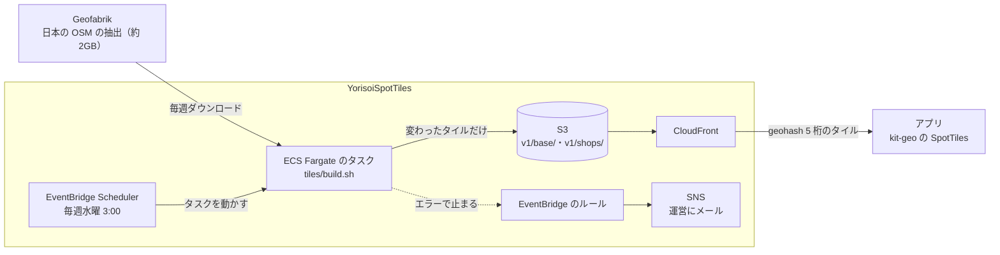

# 8-10 スポットのタイル配信

[目次](../README.md) ＞ 第 8 部 ＞ 8-10

> コンテナを動かす仕組みは [技術カード: ECS と Fargate](../ref/ecs-fargate.md)、網の仕組みは [技術カード: VPC](../ref/vpc.md)、時刻と出来事で動かす仕組みは [技術カード: EventBridge](../ref/eventbridge.md) にあります。

## この章で学ぶこと

- 公開のサーバーに毎回問い合わせる代わりに、運営が前もって作ったタイルを配る形
- Lambda では収まらない長いバッチを、**ECS の Fargate** でコンテナとして動かす
- **VPC** を公開サブネットだけにして、NAT ゲートウェイの費用を払わない
- **EventBridge Scheduler** で毎週動かし、**EventBridge のルール** で失敗を拾う
- 中身が変わったタイルだけを上げて、アプリの取り直しを安くする
- 壊れたデータで差し替えない守り

## 何を作ったのか

散策ガイドと CycleGuide は、近くのスポット（史跡・公園・お店など）を OpenStreetMap（OSM）から探します。[4-1](../04-outside/01-http-json.md) で見たように、もとは公開の **Overpass** のサーバーに、散歩のたびに問い合わせていました。Overpass はだれでも使える代わりに混みやすく、取れないことがあります。散策者の位置（検索の中心）も、そのたびに第三者のサーバーに届きます。

そこで、運営が **日本全体のスポットを週に 1 回まとめて作り、地域ごとの小さなファイル（タイル）にして配る** ことにしました。決めたことは platform の [ADR-SPOT-TILES](https://github.com/duwenji/yorisoi-platform/blob/main/docs/decisions/ADR-SPOT-TILES.md)、タイルの形は [API-SPOT-TILES](https://github.com/duwenji/yorisoi-platform/blob/main/docs/contracts/API-SPOT-TILES.md) にあります。コードは yorisoi-console の [infra/lib/tiles-stack.ts](https://github.com/duwenji/yorisoi-console/blob/main/infra/lib/tiles-stack.ts) と [tiles/](https://github.com/duwenji/yorisoi-console/tree/main/tiles)、運用の手順は [docs/operations/spot-tiles.md](https://github.com/duwenji/yorisoi-console/blob/main/docs/operations/spot-tiles.md) です。



| 決定 | 中身 |
|---|---|
| S-2 | タイルは geohash 5 桁（約 4km × 5km、[技術カード: ジオハッシュ](../ref/geohash.md)）ごとに 1 枚 |
| S-5 | 日本全体を、週に 1 回作り直す |
| S-6 | Geofabrik の抽出から作る。バッチは EventBridge Scheduler から ECS Fargate で動かす。前の週より大きく減っていれば差し替えない |
| S-7 | 管理システムとも AI の中継とも別のスタック。S3 に置き、CloudFront で配る。だれでも読める |
| S-8 | URL は版を含まない固定の形。中身が変わったタイルだけ `ETag` が変わる |
| S-12 | CloudFront のアクセスログを取らない |

アプリの側は、platform の [kit-geo の SpotTiles](https://github.com/duwenji/yorisoi-platform/blob/main/kit-geo/src/main/java/io/github/duwenji/yorisoi/kit/geo/SpotTiles.kt) がタイルを取り、取れないときだけ Overpass に問い合わせます。この章は、タイルを作って配るサーバーの側を読みます。

## 3 つ目のスタック

AI の中継（[8-9](09-ai-relay.md)）と同じく、タイルは **別の CDK のアプリ**（[infra/bin/tiles.ts](https://github.com/duwenji/yorisoi-console/blob/main/infra/bin/tiles.ts)）から配備する別のスタックです。

```ts
// The spot tiles are their own CDK app, so they deploy without the console's builds and keys:
// npx cdk -a "npx tsx bin/tiles.ts" deploy -c env=dev
const stack = new TilesStack(app, `YorisoiSpotTiles-${name}`, { /* … */ });
```

管理システムの画面のビルドや鍵がなくても配備でき、バッチの失敗が管理システムや中継を巻き込みません。[8-1](01-aws-basics.md) の図のとおり、このスタックの部品は、ほかの 2 つのスタックとつながっていません。

## Lambda ではなく Fargate

管理システムの処理は、すべて Lambda でした（[8-3](03-lambda-apigw.md)）。タイルを作るバッチは Lambda に収まりません。

| | Lambda の上限 | タイルのバッチ |
|---|---|---|
| 動いてよい時間 | 15 分 | 1 回目は約 32 分（ダウンロード約 9 分・絞り込み約 1.5 分・タイル作り約 3 分・書き出し約 18 分） |
| メモリ | 10GB | 16GB（タイルをメモリに持つ） |
| 使う道具 | 関数のコード | `osmium`（C++ のコマンド）・Python の pyosmium と shapely |

**ECS**（Elastic Container Service）はコンテナを動かすサービスで、**Fargate** はそのコンテナを動かす計算機を AWS に任せる形です。Lambda と同じくサーバーを自分で持ちませんが、時間の上限がなく、コンテナに入れればどんな道具でも使えます。動いた時間 × CPU とメモリの分だけ払い、終われば費用は止まります。

コンテナの中身は [tiles/Dockerfile](https://github.com/duwenji/yorisoi-console/blob/main/tiles/Dockerfile) です。

```dockerfile
FROM python:3.12-slim-bookworm
RUN apt-get update \
 && apt-get install -y --no-install-recommends osmium-tool curl ca-certificates \
 && rm -rf /var/lib/apt/lists/*
# …
CMD ["/app/build.sh"]
```

CDK では、タスクの大きさとコンテナを決めます（`tiles-stack.ts`）。

```ts
const task = new ecs.FargateTaskDefinition(this, 'Batch', {
  cpu: config.cpu,                       // 4096（4 vCPU）
  memoryLimitMiB: config.memoryMiB,      // 16384（16GB）
  ephemeralStorageGiB: config.diskGiB,   // 40（抽出とタイルを置くディスク）
  runtimePlatform: { cpuArchitecture: ecs.CpuArchitecture.X86_64, operatingSystemFamily: ecs.OperatingSystemFamily.LINUX },
});
task.addContainer('make', {
  // Built for x86-64 Fargate, whatever machine deploys it.
  image: ecs.ContainerImage.fromAsset(tilesDir, { platform: ecrAssets.Platform.LINUX_AMD64 }),
  logging: ecs.LogDrivers.awsLogs({ streamPrefix: 'tiles', logGroup: new logs.LogGroup(this, 'BatchLogs', { /* … */ }) }),
  environment: { BUCKET: bucket.bucketName, DISTRIBUTION_ID: distribution.distributionId },
});
```

- `ContainerImage.fromAsset(tilesDir)`: `tiles/` の Dockerfile から、配備のときにイメージを組み立てて ECR（コンテナの置き場）に上げる。だから配備には Docker が要る。合成（`cdk synth`）だけなら要らない
- `platform: LINUX_AMD64`: Apple Silicon などの Arm の PC から配備しても、x86-64 のイメージを作る
- 置き場所（バケット）と配信（CloudFront）の名前は、Lambda と同じく環境変数で渡す（[8-3](03-lambda-apigw.md)）

権限も Lambda と同じ考え方です。タスクが引き受けるロールに、要るものだけを与えます。

```ts
bucket.grantReadWrite(task.taskRole);
bucket.grantDelete(task.taskRole);
task.taskRole.addToPrincipalPolicy(
  new iam.PolicyStatement({
    actions: ['cloudfront:CreateInvalidation'],
    resources: [`arn:${this.partition}:cloudfront::${this.account}:distribution/${distribution.distributionId}`],
  }),
);
```

キャッシュの無効化（[8-6](06-s3-cloudfront.md)）は、**自分の配信だけ** に絞っています（`Resource: "*"` にしない）。

## VPC: 公開サブネットだけ、NAT なし

Lambda と違い、Fargate のタスクは **VPC**（Virtual Private Cloud、AWS の中の自分専用の網）の中で動きます。タスクは Geofabrik から抽出をダウンロードし、S3 に書くので、インターネットへ出られる必要があります。

よくある作りは、タスクを **プライベートサブネット**（外から入れない網）に置き、**NAT ゲートウェイ** を通して外へ出す形です。ただ、NAT ゲートウェイは置いておくだけで月に数十 USD かかります。週に 30 分動くバッチのために払う額ではありません。

```ts
const vpc = new ec2.Vpc(this, 'Vpc', {
  maxAzs: 2,
  natGateways: 0,
  subnetConfiguration: [{ name: 'public', subnetType: ec2.SubnetType.PUBLIC }],
});
const securityGroup = new ec2.SecurityGroup(this, 'BatchSecurityGroup', { vpc, description: 'The spot tiles batch: out only', allowAllOutbound: true });
```

- **公開サブネットだけ** にし、タスクに公開 IP を付けて（下の `assignPublicIp: true`）、インターネットゲートウェイから直接出す
- **セキュリティグループ**（部品ごとの防火壁）は、出ていく通信だけを許し、入ってくる通信は 1 つも許さない。公開 IP があっても、外からタスクにはつながらない
- `natGateways: 0` は、CDK のテストでも守っている（下のハンズオン）

## 毎週動かす: EventBridge Scheduler

[8-3](03-lambda-apigw.md) で、毎日 03:00 に公開の Lambda を呼ぶ EventBridge Scheduler を見ました。ここでは、同じ Scheduler が **Fargate のタスクを動かします**。

```ts
new scheduler.Schedule(this, 'Weekly', {
  description: 'Make the spot tiles from the week’s OpenStreetMap (ADR-SPOT-TILES S-5)',
  schedule: scheduler.ScheduleExpression.cron({ minute: '0', hour: config.schedule.hour, weekDay: config.schedule.weekDay, timeZone: TimeZone.ASIA_TOKYO }),
  target: new schedulerTargets.EcsRunFargateTask(cluster, {
    taskDefinition: task,
    assignPublicIp: true,
    vpcSubnets: { subnetType: ec2.SubnetType.PUBLIC },
    securityGroups: [securityGroup],
  }),
});
```

管理システムの `DailyPublish` と見比べてください。

| | 管理システムの `DailyPublish` | タイルの `Weekly` |
|---|---|---|
| 時刻の書き方 | `hour: '18'`（UTC）に「03:00 JST」とコメント | `hour: '3'` ＋ `timeZone: TimeZone.ASIA_TOKYO` |
| 動かすもの | Lambda（`LambdaInvoke`） | Fargate のタスク（`EcsRunFargateTask`）。網とセキュリティグループも渡す |

cron の時刻は、何も書かなければ UTC です。`timeZone` を書けば、日本時間のまま書けます。水曜 3:00 なのは、Geofabrik のその日の抽出が出そろったあとだからです（`tiles-config.ts` のコメント）。

## バッチがすること

タスクのコマンドは [tiles/build.sh](https://github.com/duwenji/yorisoi-console/blob/main/tiles/build.sh) です。4 つの段階ごとに、1 行の JSON をログに出します。

```sh
echo '{"event":"download"}'
curl -fsSL --retry 3 -A "$ua" -o japan.osm.pbf https://download.geofabrik.de/asia/japan-latest.osm.pbf
# …
echo '{"event":"filter"}'
osmium tags-filter japan.osm.pbf nwr/historic … --overwrite -o filtered.osm.pbf
echo '{"event":"make"}'
python /app/make_tiles.py filtered.osm.pbf japan.poly out --timestamp "$timestamp"
echo '{"event":"publish"}'
python /app/publish.py out ${PUBLISH_ARGS:-}
```

1. **download**: Geofabrik から日本の抽出を取る。`-A` で、だれが取りに来たかを名乗る
2. **filter**: `osmium tags-filter` で、アプリが探す種類（API-SPOT-TILES「抜き出しの条件」）だけに絞る
3. **make**: `make_tiles.py` で、geohash 5 桁ごとの JSON にする
4. **publish**: `publish.py` で、S3 に上げる

### 中身が変わったタイルだけ上げる

日本全体は約 49 万ファイルです。毎週全部を上げ直すと、S3 への書き込みの回数だけ費用がかかり、アプリも全部を取り直すことになります。[tiles/publish.py](https://github.com/duwenji/yorisoi-console/blob/main/tiles/publish.py) は、前回のタイルの中身のハッシュ（`_state/manifest.json`）と比べて、**変わったタイルだけ** を上げます。

```python
def changes(old: dict | None, new: dict) -> tuple[list[str], list[str]]:
    """The tiles to upload and the ones to delete."""
    before = (old or {}).get("tiles", {})
    upload = [k for k, h in new["tiles"].items() if before.get(k) != h]
    delete = [k for k in before if k not in new["tiles"]]
    return upload, delete

def put(key: str) -> None:
    body = (a.out / "v1" / f"{key}.json").read_bytes()
    # mtime=0: the same tile gzips to the same bytes.
    s3.put_object(
        Bucket=bucket, Key=f"v1/{key}.json", Body=gzip.compress(body, mtime=0),
        ContentType="application/json", ContentEncoding="gzip", CacheControl=CACHE_CONTROL,
    )
```

上げなかったタイルは、S3 の `ETag`（中身の指紋）が変わりません。アプリは端末に残したタイルを `If-None-Match` つきで取り直し、変わっていなければ `304`（中身なし）で済みます（S-8、[4-5](../04-outside/05-storage.md) のスポット検索のキャッシュ）。`gzip.compress(…, mtime=0)` は小さな工夫です。gzip は既定で圧縮した時刻を中に書くので、同じ中身でも圧縮するたびにバイト列が変わってしまいます。

上げ終えたら、`/v1/*` のキャッシュを CloudFront で無効化します（[8-6](06-s3-cloudfront.md)）。何も変わらなかった週は、無効化もしません。

### 壊れたデータで差し替えない

Geofabrik の抽出が途中で切れていた、OSM で大きな削除があった、といったとき、そのまま差し替えると、アプリからスポットが消えてしまいます。`publish.py` は、前の週と比べて **タイルの枚数か要素の数が 1 割を超えて減っていたら、何も変えずに止まります**（S-6）。

```python
def dropped(old: dict | None, new: dict) -> str | None:
    """Why the new tiles look broken next to the old ones, if they do."""
    if not old:
        return None
    if len(new["tiles"]) < len(old["tiles"]) * (1 - MAX_DROP):
        return f"tiles dropped from {len(old['tiles'])} to {len(new['tiles'])}"
    # …

why = dropped(old, new)
if why and not a.force:
    print(json.dumps({"event": "not_published", "reason": why}), flush=True)
    return 2
```

終了コード `2` で止まるので、前の週のタイルがそのまま配られ続けます。減ったのが正しいと運営が確かめたときだけ、`PUBLISH_ARGS=--force` を渡して動かし直します（手順は [docs/operations/spot-tiles.md](https://github.com/duwenji/yorisoi-console/blob/main/docs/operations/spot-tiles.md)）。

## 失敗を拾う: EventBridge のルール

管理システムでは、Lambda の失敗の数（メトリクス）に CloudWatch の警報を付けました（[8-3](03-lambda-apigw.md)）。Fargate のタスクは、止まったときに **出来事（イベント）** を EventBridge に流します。それを **ルール** で拾って、SNS に渡します。

```ts
// A batch that fails, or refuses to publish because the tiles dropped (exit 2), tells the operator.
const alarms = new sns.Topic(this, 'Alarms', { displayName: `Yorisoi spot tiles (${config.name})` });
if (config.alarmEmail) alarms.addSubscription(new subscriptions.EmailSubscription(config.alarmEmail));
new events.Rule(this, 'BatchFailed', {
  description: 'The spot tiles batch stopped with an error; the previous tiles stay',
  eventPattern: {
    source: ['aws.ecs'],
    detailType: ['ECS Task State Change'],
    detail: {
      clusterArn: [cluster.clusterArn],
      lastStatus: ['STOPPED'],
      containers: { exitCode: [{ 'anything-but': 0 }] },
    },
  },
  targets: [new eventTargets.SnsTopic(alarms)],
});
```

「このクラスターのタスクが止まり（`STOPPED`）、コンテナの終了コードが `0` 以外」という形（**イベントパターン**）に合う出来事だけが、運営へのメールになります。ダウンロードの失敗（`set -eu` で `build.sh` が止まる）も、上の「減ったので差し替えない」（終了コード `2`）も、同じルールで拾えます。

## 配信: CloudFront と S3

置き場所と配信は、管理システムの公開用（[8-6](06-s3-cloudfront.md)）とほぼ同じです。バケットは公開せず、CloudFront だけが OAC で読みます。違うところが 3 つあります。

```ts
// LIST lets S3 answer 404 for a tile outside the range, as API-SPOT-TILES asks, not 403.
const distribution = new cloudfront.Distribution(this, 'Cdn', {
  defaultBehavior: {
    origin: origins.S3BucketOrigin.withOriginAccessControl(bucket, {
      originAccessLevels: [cloudfront.AccessLevel.READ, cloudfront.AccessLevel.LIST],
    }),
    // …
  },
  // The bucket's root would list its keys; show the license there instead.
  defaultRootObject: 'LICENSE.txt',
  enableLogging: false,
});
```

| 設定 | 理由 |
|---|---|
| `AccessLevel.LIST`（一覧も許す） | 一覧の権限がないと、S3 はないファイルに `403` を返す。日本の外のタイルには `404` を返す約束（API-SPOT-TILES）なので、一覧を許す。中身はすべて公開の OSM のデータで、隠すものがない |
| `defaultRootObject: 'LICENSE.txt'` | 根（`/`）を開くと、一覧ではなくライセンスと出典を出す（S-13、ODbL） |
| `enableLogging: false` | アクセスログを取らない。運営に届くのはタイルの番号（約 4km × 5km）と IP アドレスだけで、それも残さない（S-12） |

もう 1 つ、本番だけタイルを残します。

```ts
removalPolicy: config.retainTiles ? RemovalPolicy.RETAIN : RemovalPolicy.DESTROY,
autoDeleteObjects: !config.retainTiles,
```

開発用はスタックを消すとタイルも消え、本番は残ります（[8-2](02-cdk.md) の「消してよいもの、消してはいけないもの」）。

## 費用

| 項目 | 目安 |
|---|---|
| Fargate（4 vCPU・16GB を週に約 30 分） | 1 回 0.2 USD ほど |
| S3 への書き込み | 1 回目は約 49 万ファイルで 2〜3 USD。2 回目からは変わったタイルだけ |
| S3 の保存・CloudFront の配信 | 日本全体でも gzip 後で約 100MB（S-5）。配った量に応じて |
| VPC・NAT ゲートウェイ | 0（NAT を置かない） |

公開されている単価からの目安です。実際の額は、タグ `project=yorisoi-spot-tiles` で絞って請求の画面で見ます（[8-11](11-watch-and-cost.md)）。

## ハンズオン: タイルのスタックを合成して、守りを壊す

AWS のアカウントも Docker も要りません。以下は yorisoi-console のいちばん上のフォルダで実行します。

### 1. テンプレートを作る

```sh
cd /c/Dev/apps/yorisoi-console/infra
npx cdk synth -a "npx tsx bin/tiles.ts" -c env=dev -o ../.local/cdkout-tiles --quiet
cd ..
```

管理システムと違い、画面のビルドもルート鍵も要りません（別のアプリにした理由の 1 つです）。

### 2. 部品の一覧を数える

```sh
python -X utf8 - <<'EOF'
import json, collections
t = json.load(open('.local/cdkout-tiles/YorisoiSpotTiles-dev.template.json', encoding='utf-8'))
c = collections.Counter(r['Type'] for r in t['Resources'].values())
print(len(t['Resources']), 'resources')
for k, v in sorted(c.items(), key=lambda x: -x[1]): print(v, k)
EOF
```

```
34 resources
4 AWS::IAM::Role
3 AWS::IAM::Policy
2 AWS::EC2::Subnet
2 AWS::EC2::RouteTable
2 AWS::EC2::SubnetRouteTableAssociation
2 AWS::EC2::Route
1 AWS::S3::Bucket
…
1 AWS::EC2::VPC
1 AWS::EC2::InternetGateway
…
```

CDK の `new ec2.Vpc(…)` の 1 文が、VPC・サブネット 2 つ・ルートテーブル 2 つとその関連付け 2 つ・ルート 2 つ・インターネットゲートウェイとその取り付けの 11 個の部品になっています。`AWS::EC2::NatGateway` がないことも確かめてください。

### 3. スケジュールとルールを読む

```sh
python -X utf8 - <<'EOF'
import json
t = json.load(open('.local/cdkout-tiles/YorisoiSpotTiles-dev.template.json', encoding='utf-8'))
for r in t['Resources'].values():
    p = r.get('Properties', {})
    if r['Type'] == 'AWS::Scheduler::Schedule':
        print(p['ScheduleExpression'], p['ScheduleExpressionTimezone'], p['Target']['EcsParameters']['LaunchType'])
    if r['Type'] == 'AWS::Events::Rule':
        print(json.dumps(p['EventPattern'], ensure_ascii=False))
EOF
```

```
cron(0 3 ? * WED *) Asia/Tokyo FARGATE
{"source": ["aws.ecs"], "detail-type": ["ECS Task State Change"], "detail": {"clusterArn": [{"Fn::GetAtt": …}], "lastStatus": ["STOPPED"], "containers": {"exitCode": [{"anything-but": 0}]}}}
```

CDK の `weekDay: 'WED'` と `timeZone` が、cron の式とタイムゾーンになっています。

### 4. テストを流して、NAT の守りを壊す

```sh
npx vitest run infra/test/tiles-stack.test.ts
```

7 つのテストが通ります。[infra/test/tiles-stack.test.ts](https://github.com/duwenji/yorisoi-console/blob/main/infra/test/tiles-stack.test.ts) の最後のテストが、NAT ゲートウェイがないことを守っています。

```ts
it('pays for no NAT gateway', () => {
  expect(Object.keys(prod.findResources('AWS::EC2::NatGateway'))).toHaveLength(0);
});
```

`infra/lib/tiles-stack.ts` の `natGateways: 0` を `1` にして、もう一度流します。

```
 × pays for no NAT gateway
AssertionError: expected [ Array(1) ] to have a length of +0 but got 1
      Tests  1 failed | 6 passed (7)
```

月に数十 USD かかる変更が、配備の前にテストで止まりました。確かめたら元に戻します。

```sh
git checkout infra/lib/tiles-stack.ts
```

## つまずきやすいところ

- **Lambda の 15 分を超える処理は、Fargate などに分ける**: 時間・メモリ・使う道具で選ぶ
- **NAT ゲートウェイは、置くだけで費用がかかる**: 外へ出るだけなら、公開サブネットと出るだけのセキュリティグループで足りることがある
- **cron は既定で UTC**: Scheduler なら `timeZone` を書く
- **gzip は時刻を中に書く**: 同じ中身を同じバイト列にしたいなら `mtime=0`
- **S3 は、一覧の権限がないとないファイルに 403 を返す**: 404 が欲しいなら一覧を許す（中身が公開してよいものに限る）
- **Fargate の失敗は、出来事で拾える**: メトリクスの警報だけでなく、EventBridge のルールも使う

## 確認問題

<details>
<summary>問 1. タイルを作るバッチを、Lambda ではなく Fargate で動かすのはなぜですか。</summary>

1 回目は約 32 分かかり、Lambda の 15 分を超えるからです。メモリも 16GB 要り（Lambda は 10GB まで）、`osmium` などのコマンドも使います。Fargate なら時間の上限がなく、コンテナに入れればどんな道具でも使えます。

</details>

<details>
<summary>問 2. VPC に NAT ゲートウェイを置かず、公開サブネットだけにしているのはなぜですか。外から攻撃されませんか。</summary>

NAT ゲートウェイは置くだけで月に数十 USD かかり、週に 30 分動くバッチには見合わないからです。タスクには公開 IP を付けますが、セキュリティグループが出ていく通信だけを許し、入ってくる通信を 1 つも許さないので、外からはつながりません。

</details>

<details>
<summary>問 3. 毎週全部のタイルを上げ直さず、中身が変わったものだけ上げるのはなぜですか。</summary>

S3 への書き込みの回数（約 49 万ファイル）の費用を抑えるためと、上げなかったタイルの `ETag` を変えないためです。`ETag` が変わらなければ、アプリは `If-None-Match` で取り直したときに `304` を受け取るだけで済み、中身を送らずに済みます。

</details>

<details>
<summary>問 4. タイルの数が前の週より 1 割を超えて減ったとき、バッチはどうしますか。運営はそれをどう知りますか。</summary>

何も変えずに終了コード `2` で止まり、前の週のタイルがそのまま配られ続けます。タスクが `0` 以外の終了コードで止まると、EventBridge のルールがその出来事を拾い、SNS から運営にメールが届きます。

</details>

---

前: [8-9 運営の AI の中継](09-ai-relay.md) ／ 次: [8-11 見張りと費用](11-watch-and-cost.md)
