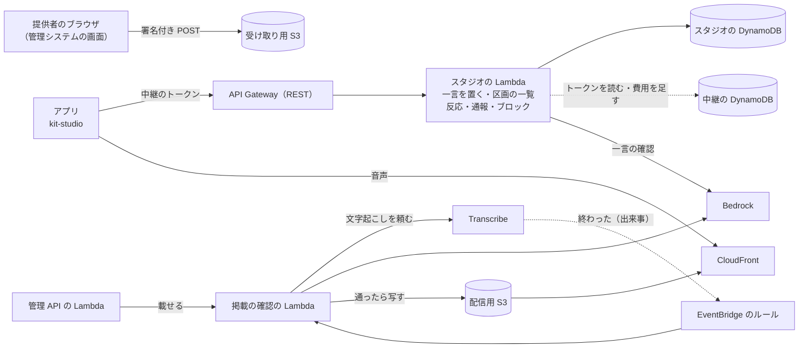

# 8-12 スタジオ

[目次](../README.md) ＞ 第 8 部 ＞ 8-12

> 音声を文字に起こす仕組みは [技術カード: Amazon Transcribe](../ref/transcribe.md)、出来事で Lambda を動かす仕組みは [技術カード: EventBridge](../ref/eventbridge.md)、区画の名前は [技術カード: ジオハッシュ](../ref/geohash.md) にあります。

## この章で学ぶこと

- スタック同士を **Parameter Store の名前** でつなぎ、CloudFormation の出力（Export）に縛られない形
- 別のスタックの DynamoDB を、**IAM の条件でキーを絞って** 読む
- 位置で引くデータを、ジオハッシュの区画ごとの **パーティション** に写しておく
- ブラウザから S3 に直接音声を上げる **署名付き POST**
- 時間のかかる処理（文字起こし）を、**EventBridge の出来事** で同じ Lambda に戻して続ける
- 安い確認を先に、高い確認（AI）を後に。確かめられないものは通さない

## 何を作ったのか

スタジオは、散策者・走る人がその場所に残した 60 文字までの **一言** と、運営が承認した提供者の **掲載**（店や地域のお知らせ。文と 30 秒までの音声）を、近くを通る人のアプリで読み上げる仕組みです。決めたことは platform の [REQ-STUDIO](https://github.com/duwenji/yorisoi-platform/blob/main/docs/requirements/REQ-STUDIO.md)・[ADR-STUDIO](https://github.com/duwenji/yorisoi-platform/blob/main/docs/decisions/ADR-STUDIO.md)、アプリとの約束は [API-STUDIO](https://github.com/duwenji/yorisoi-platform/blob/main/docs/contracts/API-STUDIO.md)、サーバーの設計は yorisoi-console の [DES-013](https://github.com/duwenji/yorisoi-console/blob/main/docs/design/DES-013-studio.md) にあります。コードは [infra/lib/studio-stack.ts](https://github.com/duwenji/yorisoi-console/blob/main/infra/lib/studio-stack.ts) と [api/src/studio/](https://github.com/duwenji/yorisoi-console/tree/main/api/src/studio)、運用の手順は [docs/operations/studio.md](https://github.com/duwenji/yorisoi-console/blob/main/docs/operations/studio.md) です。



アプリの側（platform の [kit-studio](https://github.com/duwenji/yorisoi-platform/blob/main/kit-studio/README.md)）は、散歩・走行の間に区画ごとの一覧を取り、話すことがないときに 1 つずつ読み上げます。この章は、サーバーの側を読みます。

## 4 つ目のスタックと、スタック同士のつなぎ方

スタジオも、中継（[8-9](09-ai-relay.md)）・タイル（[8-10](10-spot-tiles.md)）と同じく、別の CDK のアプリ（[infra/bin/studio.ts](https://github.com/duwenji/yorisoi-console/blob/main/infra/bin/studio.ts)）から配備する別のスタック `YorisoiStudio-<env>` です。ただし、ほかの 2 つと違って、スタジオは **ほかのスタックとつながっています**。

| つながり | 向き | なぜ |
|---|---|---|
| 中継の表のトークンを読む | スタジオ → 中継 | アプリは中継のセッション（[8-9](09-ai-relay.md)）を開いている。もう 1 つ認証を作らずに、同じトークンで呼べるようにする |
| 中継の月の費用に足す | スタジオ → 中継 | 一言の確認も運営の AI を使う。予算を 1 つにまとめる |
| スタジオの表・バケットを読み書きする | 管理システム → スタジオ | 提供者が掲載を作り、運営が通報に対応する画面は管理システムにある |

CDK には、スタックの値を別のスタックに渡す **出力（Export）** があります。ところが Export は、使っている側があるかぎり、出している側で消したり名前を変えたりできません。そこでこのリポジトリでは、名前を **Parameter Store** に書いておき、使う側が配備のときに読む形にしました（DES-013 K-2）。

```ts
// 中継の側（relay-stack.ts）: 表の名前を Parameter Store に書く
new ssm.StringParameter(this, 'TableNameParameter', {
  parameterName: `/yorisoi-ai-relay/${config.name}/table-name`,
  stringValue: table.tableName,
  // …
});

// スタジオの側（studio-stack.ts）: 配備のときに読む
const relayTableName = ssm.StringParameter.valueForStringParameter(this, relayParam('table-name'));
```

`valueForStringParameter` は、CloudFormation の **パラメータ** として値を読みます。合成（`cdk synth`）では値が要らず、配備のときに CloudFormation が今の値を入れます。かわりに、**配備の順番** を守る必要があります。中継 → スタジオ → 管理システムの順です（[運用の手順](https://github.com/duwenji/yorisoi-console/blob/main/docs/operations/studio.md#配備)）。

### 別のスタックの表を、キーで絞って読む

スタジオの Lambda に、中継の表を丸ごと読み書きさせる必要はありません。トークンを読むことと、月の費用に足すことだけです。IAM の **条件** で、触れるパーティションのキーを絞ります（[8-5](05-dynamodb.md) のキーの設計がここで効きます）。

```ts
// K-3: in the relay's table, only tokens are read and only the month's spend is added to.
new iam.PolicyStatement({
  actions: ['dynamodb:GetItem', 'dynamodb:UpdateItem'],
  resources: [`arn:${this.partition}:dynamodb:${this.region}:${this.account}:table/${relayTableName}`],
  conditions: { 'ForAllValues:StringLike': { 'dynamodb:LeadingKeys': ['TOKEN#*', 'SPEND'] } },
}),
```

`dynamodb:LeadingKeys` は、操作するパーティションのキーです。`TOKEN#…` と `SPEND` のほか（たとえば端末ごとの回数）には、スタジオの Lambda は触れません。トークンの確かめ方は、中継と同じくハッシュで引くだけです（[api/src/studio/studio.ts](https://github.com/duwenji/yorisoi-console/blob/main/api/src/studio/studio.ts)）。

```ts
const item = (await ports.db.send(new GetCommand({ TableName: ports.relayTable, Key: { PK: `TOKEN#${sha256(token)}`, SK: 'TOKEN' } }))).Item;
if (!item || String(item.expiresAt) <= ports.now().toISOString()) throw new StudioError('token_invalid', 'The token is unknown or expired');
return String(item.install);
```

返す `install` は、中継が端末の ID から作った HMAC です。スタジオは、置いた人・ブロック・締め出しをこの値だけで扱い、端末の ID そのものは知りません。

## 区画ごとのパーティション

アプリは「今いる辺りの一言と掲載」を取ります。DynamoDB は位置で探すのが得意ではありません（[8-5](05-dynamodb.md)）。そこで、一言と載っている掲載を、**ジオハッシュ 6 文字の区画**（約 1.2 km × 0.6 km）ごとのパーティション `CELL#{geohash6}` にも写して書いておきます（DES-013 K-7）。

| 項目 | PK | SK |
|---|---|---|
| 一言そのもの | `NOTE#{id}` | `NOTE` |
| 区画の一言（写し） | `CELL#xn77k2` | `N#{id}` |
| 区画の掲載（写し。載っている間だけ） | `CELL#xn77k2` | `P#{id}` |

アプリは今の区画と周りの 8 つ、合わせて 9 つの区画の名前を送ります。Lambda は区画ごとに 1 回の Query をして、期限・状態・ブロックで外します。読む量は区画の数で決まり、全体の件数が増えても変わりません。一言を消すときは、もとの項目と写しを `TransactWrite` で一緒に書き換えます。

アプリに送るのは区画の名前だけで、緯度・経度は送りません。一言そのものも、ジオハッシュ 7 文字（約 150 m）に丸めて置きます（[技術カード: ジオハッシュ](../ref/geohash.md)）。

## 一言の確認: 安いものから

一言には事前の審査がありません。かわりに、置くときに自動で確かめます（[api/src/studio/check.ts](https://github.com/duwenji/yorisoi-console/blob/main/api/src/studio/check.ts)）。

1. **決まった形**: URL・メールアドレス・電話番号・SNS のアカウントを正規表現で止める。費用はかからない
2. **運営の AI**: 通ったものだけを Bedrock に渡し、利用規約の項目に当たるかを JSON で答えさせる

```ts
// Ten or more digits, allowing the separators people speak or type between them; full-width too.
const PHONE = /(?:[0-9０-９][\s\-－ー‐()（）.]*){10,}/;
```

声から文字にした一言は「ゼロキュウゼロ」ではなく数字になることが多いので、全角の数字と、話したときに入りやすい区切りも許しています。

AI の呼び出しが失敗したら、一言は **置きません**（`502 upstream_error`）。確かめられなかったものを通すと、確認がないのと同じになるからです。

## 掲載の音声: 直接上げて、出来事で続ける

### ブラウザから S3 へ

提供者は、管理システムの画面から音声を選びます。音声は Lambda を通さず、**署名付き POST**（[8-6](06-s3-cloudfront.md) のパッケージの受付と同じ仕組み）で、受け取り用のバケットの `uploads/` に直接上げます。大きさの上限（512 KB）は、署名した条件に入れて S3 が守ります。

```ts
const intake = new s3.Bucket(this, 'Intake', {
  // …
  cors: [{ allowedMethods: [s3.HttpMethods.POST], allowedOrigins: ['*'], allowedHeaders: ['*'], maxAge: 3600 }],
  lifecycleRules: [
    { prefix: 'uploads/', expiration: Duration.days(1) },
    { prefix: 'held/', expiration: Duration.days(30) },
    { prefix: 'transcripts/', expiration: Duration.days(30) },
  ],
});
```

置き場所（接頭辞）ごとに消える日を変えています。上げたままのものは 1 日、確認を始めたものは申し出に備えて 30 日です。

### 文字起こしは待たない

掲載を「載せる」と、管理 API が確認の Lambda を **待たずに** 呼びます。確認の Lambda（[api/src/studio/placement.ts](https://github.com/duwenji/yorisoi-console/blob/main/api/src/studio/placement.ts)）は、まず安いものから確かめます。

1. 音声が届いているか、512 KB 以内か
2. M4A のファイルの頭（`mvhd`）から長さを読み、30 秒以内か
3. Amazon Transcribe に、日本語の文字起こしを頼む

Transcribe は、30 秒の音声でも 1 分ほどかかります。Lambda がその間ずっと待つと、待つ時間にも料金がかかります。そこで Lambda は **頼んだところで終わり**、終わったことを EventBridge の出来事で受け取って続きをします。

```ts
new events.Rule(this, 'TranscribeDone', {
  eventPattern: {
    source: ['aws.transcribe'],
    detailType: ['Transcribe Job State Change'],
    detail: { TranscriptionJobName: [{ prefix: jobPrefix }], TranscriptionJobStatus: ['COMPLETED', 'FAILED'] },
  },
  targets: [new targets.LambdaFunction(checkFn)],
});
```

同じアカウントのほかの文字起こしを拾わないよう、ジョブの名前の **接頭辞** で絞っています。1 つの Lambda が 3 種類の呼ばれ方を受けます。

```ts
export async function handler(event: PlacementEvent): Promise<void> {
  if ('check' in event) return startCheck(cached, event.check);          // 管理 API から: 確認を始める
  if ('publish' in event) return goLive(cached, event.publish, 'appealed'); // 運営が申し出を受けて載せる
  if (event.source === 'aws.transcribe') return finishTranscription(/* … */); // EventBridge から: 続き
}
```

続きでは、起こした文と掲載の文を運営の AI で掲載の決まりに照らし、通れば配信用のバケットの `placements/{id}/audio.m4a` に写して、区画の写し（`CELL#…`）を書きます。アプリはこの音声を CloudFront から取り、SHA-256 を確かめてから流します。当たれば、当たった項目を付けて提供者に返します。

状態を書き換えるときは、どれも `ConditionExpression: '#s = :checking'` を付けています。同じ出来事が 2 度届いたり、その間に提供者が掲載を止めたりしても、確認中のものだけを動かすためです。

## 名前を出さない数

掲載者には聞いた数を見せますが、**だれが聞いたか** は残しません（API-STUDIO ST-5）。アプリは散歩の終わりに、聞いた一言・掲載の ID だけをまとめて送り、Lambda は掲載ごと・日ごとの合計（`STATS#{id}` / `DAY#…`）に足すだけです。見せるときも、3 未満は出さず、3・10・30・100・300・1,000 の区切りの下限だけを返します。少ない数は、聞いた人の居場所の手がかりになるからです。

ログにも、一言・掲載の本文、区画、`install` は書きません。書くのは、操作の種類・件数・時間とエラーの `code` だけです（DES-013 K-6）。

## やってみよう: 中継のトークンでスタジオを呼ぶ

開発用のスタジオは、中継のセッションのトークンで呼べます（開発用の中継は Play Integrity を確かめません）。

```sh
R=https://teevxbmiaj.execute-api.ap-northeast-1.amazonaws.com/api
S=https://x568icz881.execute-api.ap-northeast-1.amazonaws.com/api

curl -s $S/v1/studio/terms     # トークンなしで読める

NONCE=$(curl -s -X POST $R/v1/session/challenge | sed -E 's/.*"nonce":"([^"]+)".*/\1/')
TOKEN=$(curl -s -X POST $R/v1/session -H 'content-type: application/json' \
  -d "{\"installId\":\"$(node -e "console.log(crypto.randomUUID())")\",\"nonce\":\"$NONCE\",\"app\":{\"package\":\"io.github.duwenji.yorisoi.sanpoguide\",\"versionCode\":1}}" \
  | sed -E 's/.*"token":"([^"]+)".*/\1/')

curl -s "$S/v1/studio/cells?cells=xn77k2&kinds=note,placement" -H "authorization: Bearer $TOKEN"
```

連絡先の入った一言は、AI に渡る前に止まります。

```sh
curl -s -X POST $S/v1/studio/notes -H "authorization: Bearer $TOKEN" -H 'content-type: application/json' \
  -d '{"text":"詳しくは 090-1234-5678 へ","cell":"xn77k2n","ttl":"1h","termsVersion":1}'
# 422 と code "note_rejected"（アプリは「置けませんでした」と出す）
```

## つまずきやすいところ

- **Export はスタックを縛る**: 使う側がある間は消せない。Parameter Store の名前で渡すなら、配備の順番を守る
- **別のスタックの表への権限は、キーで絞れる**: `dynamodb:LeadingKeys` の条件
- **待つ処理を Lambda で待たない**: 頼んだら終わり、出来事で戻る。出来事は 2 度届くことがあるので、条件付きの書き込みで守る
- **確かめられないものは通さない**: AI が失敗したら置かない
- **数を見せるなら、少ない数に気をつける**: 少ない数は人の居場所の手がかりになる

## 確認問題

<details>
<summary>問 1. スタジオのスタックが中継の表の名前を CloudFormation の出力（Export）ではなく Parameter Store から読むのはなぜですか。かわりに何に気をつける必要がありますか。</summary>

Export は、使っている側のスタックがあるかぎり、出している側で消したり変えたりできないからです。Parameter Store の名前で渡せば縛られません。かわりに、名前を書く側を先に配備する順番（中継 → スタジオ → 管理システム）を守る必要があります。

</details>

<details>
<summary>問 2. スタジオの Lambda が中継の表の端末ごとの回数を書き換えられないのは、どの仕組みによりますか。</summary>

IAM のポリシーの条件 `dynamodb:LeadingKeys` で、触れるパーティションのキーを `TOKEN#*` と `SPEND` に絞っているからです。

</details>

<details>
<summary>問 3. 掲載の確認の Lambda が、Transcribe の文字起こしが終わるのを待たないのはなぜですか。終わったことはどう知りますか。</summary>

文字起こしは 1 分ほどかかり、Lambda が待つとその時間にも料金がかかるからです。頼んだところで終わり、Transcribe の「Transcribe Job State Change」の出来事を EventBridge のルールが拾って、同じ Lambda を呼び直します。

</details>

<details>
<summary>問 4. 一言の確認で、運営の AI の呼び出しが失敗したときに一言を置かないのはなぜですか。</summary>

置いてしまうと、確かめていない一言がほかの人に読み上げられ、確認がないのと同じになるからです。置けなかった人には「今は置けません」と出し、あとでやり直してもらいます。

</details>

---

前: [8-11 見張りと費用](11-watch-and-cost.md) ／ 次: [第 9 部 9-1 React と Vite](../09-console/01-react-vite.md)
