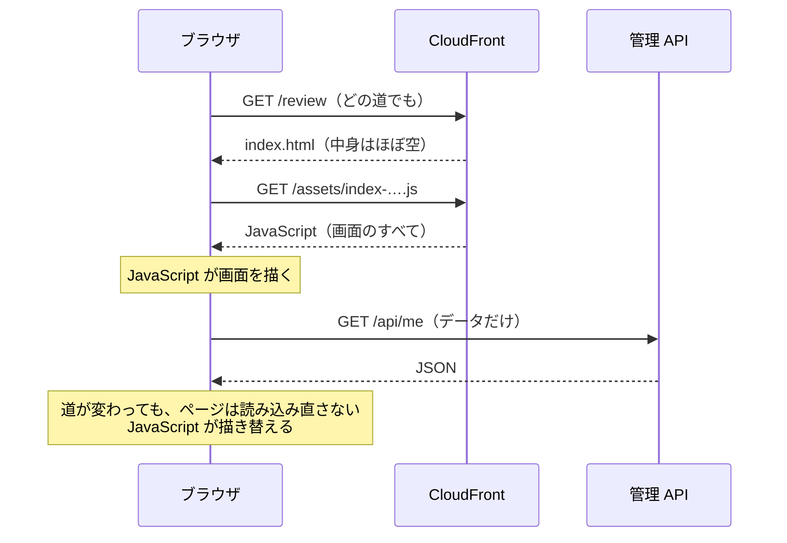
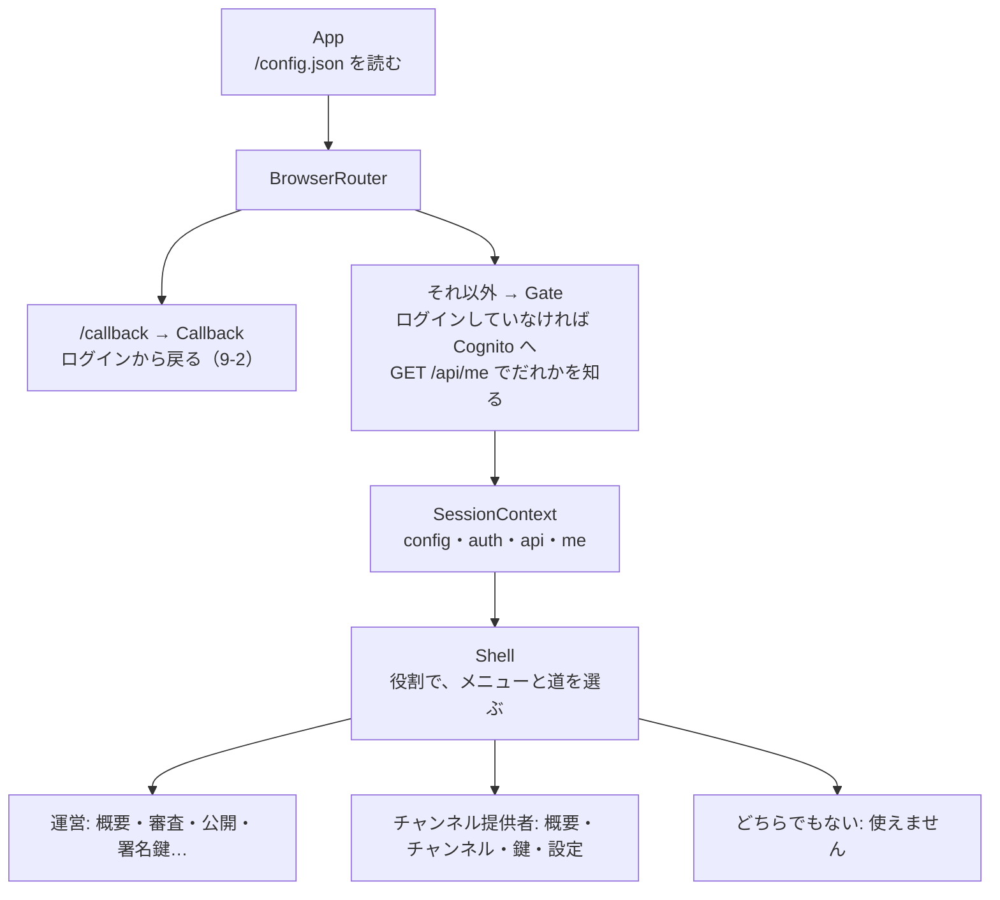

# 9-1 React と Vite

[目次](../README.md) ＞ 第 9 部 ＞ 9-1

> React の仕組みと最小の使い方は [技術カード: React](../ref/react.md)、Vite は [技術カード: Vite](../ref/vite.md) にあります。

## この章で学ぶこと

- SPA（1 枚のページの中で画面を描き替えるアプリ）の形
- React の部品（コンポーネント）、JSX、状態（`useState`）、副作用（`useEffect`）
- 管理画面の部品の木: 設定を読む → ログイン → 役割で画面を分ける
- react-router で、道（URL）ごとに描くものを選ぶ
- OpenAPI から作った型で、API を呼ぶ（openapi-fetch）
- Vite の 2 つの顔: 開発用のサーバーと、配る前のビルド。そして **Vite は型を確かめない** こと

## SPA とは

管理画面（[web/](../../michizure-console/web/)）は **SPA**（Single Page Application）です。



サーバーから届くのは、空に近い [index.html](../../michizure-console/web/index.html) と、1 つにまとめた JavaScript だけです。

```html
<body>
  <div id="root"></div>
  <script type="module" src="/src/main.tsx"></script>
</body>
```

画面は、ブラウザの中の JavaScript が `<div id="root">` の中に描きます。サーバーとやりとりするのはデータ（JSON）だけです。だから:

- 画面のファイルは、S3 と CloudFront に置くだけで配れる（サーバーの処理が要らない。[8-6](../08-aws/06-s3-cloudfront.md)）
- どの道（`/review` など）を開いても `index.html` を返す必要がある（8-6 の CloudFront Functions はそのため）

Android のアプリ（第 2 部）と同じく、**画面はクライアントの中で描き、サーバーは API だけ** という分け方です。

## React の考え方

**React** は、画面を **部品（コンポーネント）** の組み合わせで書くライブラリです。部品は「データを受け取り、画面の形を返す関数」です。

```tsx
function Empty({ children }: { children: ReactNode }) {
  return <p className="muted empty">{children}</p>;
}
```

（[pages/common.tsx](../../michizure-console/web/src/pages/common.tsx)）

- 関数の名前は大文字で始める（`Empty`）。使うときは `<Empty>まだありません</Empty>` と、HTML の要素のように書く
- 引数（**props**）は 1 つのオブジェクト。`children` は、開きと閉じの間に書いた中身
- 返しているのは **JSX**: JavaScript の中に書ける HTML に似た記法。`{…}` の中には式を書ける。`class` ではなく `className`

> **文法メモ: JSX は関数の呼び出し**
>
> `<p className="muted">{text}</p>` は、ビルドのときに `jsx('p', { className: 'muted', children: text })` のような関数の呼び出しに変わります。だから JSX の中に `if` は書けず、`{error && <p>…</p>}`（`error` があるときだけ描く）や `{ok ? <A /> : <B />}` を使います。リストは `{items.map((c) => <li key={c.channelId}>…</li>)}` のように配列で描き、それぞれに **`key`**（並びの中で変わらない ID）を付けます。

### Compose とそっくり

第 2 部の Jetpack Compose を思い出してください。

| | Jetpack Compose（第 2 部） | React |
|---|---|---|
| 部品 | `@Composable fun Empty(…)` | `function Empty(props)` |
| 描くもの | `Text(…)`・`Column { … }` | `<p>…</p>`・`<section>…</section>` |
| 状態 | `remember { mutableStateOf(0) }` | `useState(0)` |
| 状態が変わると | 再コンポーズ | 再レンダリング（関数をもう一度呼ぶ） |
| 画面に出たあとの処理 | `LaunchedEffect(key) { … }` | `useEffect(() => { … }, [key])` |

どちらも **「今の状態なら、画面はこう」を宣言する** 書き方です。書き換えの手順（「このボタンの文字を変える」）は書きません。状態を変えれば、ライブラリが描き直します。実は Compose が React の考え方を取り入れたので、似ているのは当然です。

## 状態: useState

```tsx
const [reason, setReason] = useState('');
// …
<input required maxLength={500} value={reason} onChange={(e) => setReason(e.target.value)} />
<button disabled={busy || reason.trim() === ''}>{label}</button>
```

（[pages/common.tsx](../../michizure-console/web/src/pages/common.tsx) の `ReasonForm`。運営の操作には必ず理由を書かせる部品）

- `useState('')` は「今の値」と「値を変える関数」の組を返す
- `setReason` を呼ぶと、React は `ReasonForm` の関数をもう一度呼び、新しい `reason` で描き直す
- 入力欄の値は状態から決め（`value={reason}`）、打つたびに状態を変える（`onChange`）。これを **制御されたコンポーネント** と呼ぶ。ボタンの `disabled` も状態から決まる

状態は **書き換えずに、新しい値に取り替えます**。審査の画面で、AI のサービスごとの API キーを持つ状態:

```tsx
const [keys, setKeys] = useState<Record<string, string>>({});
// …
onChange={(e) => setKeys((k) => ({ ...k, [service.id]: e.target.value }))}
```

（[pages/review.tsx](../../michizure-console/web/src/pages/review.tsx)）

`k[service.id] = …` と中身を書き換えると、React は「同じオブジェクトだ」と見て描き直しません。`{ ...k, … }` で新しいオブジェクトを作ります。`setKeys((k) => …)` と関数を渡すと、「その時点の最新の値」を元に作れます。

## 副作用: useEffect

画面を描く関数は、何度呼ばれてもよいように **描くことだけ** をします。API を呼ぶ・タイマーを始めるといった「外の世界に働きかけること（副作用）」は、`useEffect` に書きます。描いたあとで React が呼びます。

管理画面は、データの読み込みを 1 つの部品（自作のフック）にまとめています。

```tsx
/** Loads data once and on demand; shows errors in the operator's words. */
export function useLoad<T>(load: () => Promise<T | undefined>, deps: unknown[]) {
  const [data, setData] = useState<T>();
  const [error, setError] = useState<string>();
  const [loading, setLoading] = useState(true);
  const reload = useCallback(() => {
    setLoading(true);
    setError(undefined);
    load().then(
      (d) => { setData(d); setLoading(false); },
      (e: unknown) => { setError(describe(e)); setLoading(false); },
    );
  }, deps);
  useEffect(reload, [reload]);
  return { data, error, loading, reload };
}
```

使う側は、こう書くだけです（[pages/home.tsx](../../michizure-console/web/src/pages/home.tsx)）。

```tsx
const keys = useLoad(async () => (await api.GET('/api/admin/signing-keys')).data, [api]);
// …
<Status error={keys.error} loading={keys.loading} />
{keys.data?.items.map((k) => <li key={k.keyId}>…</li>)}
```

- `use` で始まる関数は **フック**。部品の関数の中（いちばん外側）でだけ呼べる。`if` の中で呼んではいけない（React は呼ばれた順番で、どの状態かを見分けている）
- `useEffect(処理, [依存])`: 依存の値が変わったときだけ、処理をやり直す。`[]` なら最初の 1 回だけ
- `useCallback(関数, deps)`: deps が変わらない限り、同じ関数を使い回す。ここでは「`api` が変わったら読み込み直す」を作っている
- 「読み込み中・失敗・成功」の 3 つを、いつも描き分ける。第 2 部の `UiState` と同じ考え方

### StrictMode が 2 回呼ぶ

[main.tsx](../../michizure-console/web/src/main.tsx) は、全体を `<StrictMode>` で包んでいます。開発中、React は **わざと `useEffect` を 2 回呼び**、片付けの漏れや「2 回呼ばれると困る処理」をあぶり出します。

ログインから戻ったときの処理（[9-2](02-browser-login.md)）は、まさに 2 回呼ばれると困ります。Cognito から受け取ったコードは 1 回しか使えないからです。

```tsx
// The code in the callback URL can be redeemed once; StrictMode runs effects twice in development.
let finishing: Promise<string> | undefined;

function Callback({ auth }: { auth: Auth }) {
  // …
  useEffect(() => {
    finishing ??= auth.finishSignIn();
    finishing.then((to) => navigate(to, { replace: true }), (e: unknown) => setError(String(e)));
  }, [auth, navigate]);
```

部品の外の変数に Promise を取っておき、2 回目は同じ Promise を待つだけにしています（`??=` は「まだなければ入れる」、[7-1](../07-typescript/01-typescript-syntax.md)）。8-3 の `deps ??= await load()` と同じ形です。

## 管理画面の部品の木

[main.tsx](../../michizure-console/web/src/main.tsx) の全体の形です。



### 設定を外から読む

```tsx
export async function loadConfig(): Promise<ConsoleConfig> {
  const res = await fetch('/config.json', { cache: 'no-store' });
  // …
}
```

（[auth.ts](../../michizure-console/web/src/auth.ts)）

Cognito の場所やクライアントの ID は、環境（開発用・本番）ごとに違います。それをビルドに焼き込まず、配備のときに CDK が `config.json` を画面の横に置きます（[8-6](../08-aws/06-s3-cloudfront.md) の `BucketDeployment`）。だから **同じビルドを、どの環境にも配れます**。

### Context: 下の部品に配る

ログインした人の情報（`me`）や API の呼び出し口（`api`）は、ほとんどの画面が使います。props で 1 段ずつ渡すのは大変なので、**Context** で木の下全体に配ります。

```tsx
const SessionContext = createContext<Session | null>(null);

export function useSession(): Session {
  const session = useContext(SessionContext);
  if (!session) throw new Error('no session');
  return session;
}
```

`Gate` が `<SessionContext.Provider value={session}>` で包み、その下のどの部品も `const { api } = useSession();` で取り出せます。

### 役割で画面を分ける

```tsx
const operator = session.me.roles.includes('operator');
const publisher = session.me.roles.includes('publisher');
// …
{operator ? (
  <Routes>
    <Route path="/" element={<HomePage />} />
    <Route path="/review/:channelId/:submissionId" element={<ReviewPage />} />
    {/* … */}
  </Routes>
) : publisher ? (
  <Routes>{/* チャンネル提供者の画面 */}</Routes>
) : (
  <section><h1>このアカウントでは使えません</h1>…</section>
)}
```

チャンネル提供者の画面には、素材集の画面（`/collections`、[pages/publisher/collections.tsx](../../michizure-console/web/src/pages/publisher/collections.tsx)）もあります。素材提供者は別のアカウントではなく、同じアカウントの役割（`roles` の `producer`）なので、同じ画面の中で「素材提供者として始める」を押して使い始めます（[8-4](../08-aws/04-cognito.md)）。運営の側にも、素材集の審査の画面（`/review/collections/…`、[pages/collection-review.tsx](../../michizure-console/web/src/pages/collection-review.tsx)）が加わっています。

役割は、トークンの中身ではなく **API（`GET /api/me`）が答えたもの** を使います。そして、画面で運営のメニューを隠すのは **使いやすさのため** で、守りではありません。ブラウザのコードは書き換えられるからです。守りは API が、呼ばれるたびにグループを確かめることで行っています（[8-3](../08-aws/03-lambda-apigw.md)、[8-4](../08-aws/04-cognito.md)）。

## react-router: 道ごとに描くもの

**react-router** は、URL の道に合わせて描く部品を選ぶライブラリです。

| 書き方 | 意味 |
|---|---|
| `<BrowserRouter>` | ブラウザの URL を使う（いちばん外側に 1 つ） |
| `<Route path="/channels/:channelId" element={…} />` | この道ならこれを描く。`:channelId` は変わる部分 |
| `<Route path="*" …>` | どれにも合わないとき |
| `const { channelId = '' } = useParams();` | 道の変わる部分を取り出す |
| `<NavLink to="/review">審査</NavLink>` | ページを読み込み直さずに道を変えるリンク。今の道なら印が付く |
| `const navigate = useNavigate(); navigate('/')` | コードから道を変える |

`<a href>` でなく `<Link>`・`<NavLink>` を使うのは、ページを読み込み直さず、JavaScript の中で描き替えるためです（読み込み直すと、ログインの状態などを最初から作り直すことになる）。

## API を呼ぶ: OpenAPI の型つき

[7-3](../07-typescript/03-openapi.md) で、OpenAPI から TypeScript の型（`@michizure-console/api-types`）を作りました。画面は、その型を **openapi-fetch** に渡して API を呼びます（[api.ts](../../michizure-console/web/src/api.ts)）。

```ts
const client = createClient<paths>({ baseUrl: window.location.origin });
client.use(bearer);
```

```tsx
const { data } = await api.POST('/api/channels/{channelId}/submissions', {
  params: { path: { channelId } },
  body: { description, tags: split(tags) },
});
```

- 道（`'/api/channels/{channelId}/submissions'`）は、OpenAPI にある道しか書けない。打ち間違えればコンパイルで止まる
- `params.path`・`body` の形も、返ってくる `data` の型も、OpenAPI から決まる
- `baseUrl` は今の場所。画面と API は同じ CloudFront の下にあるので（[8-6](../08-aws/06-s3-cloudfront.md)）、CORS が要らない

### すべての呼び出しに共通の処理: ミドルウェア

```ts
const bearer: Middleware = {
  async onRequest({ request }) {
    const user = await auth.user();
    if (user?.access_token) request.headers.set('Authorization', `Bearer ${user.access_token}`);
    return request;
  },
  async onResponse({ response }) {
    if (response.status === 401) await auth.signIn();
    if (!response.ok && response.headers.get('content-type')?.includes('problem+json')) {
      throw new ApiProblem((await response.clone().json()) as Problem);
    }
    return response;
  },
};
```

- 送る前に、アクセストークンを `Authorization` のヘッダーに付ける（API Gateway が確かめる。[8-3](../08-aws/03-lambda-apigw.md)）
- `401`（ログインが切れた）なら、ログインし直す
- 失敗の応答が Problem Details（[7-3](../07-typescript/03-openapi.md)）なら、`ApiProblem` という例外にする。画面は `describe(e)` で、運営に分かる言葉に直して見せる（`precondition_failed` → 「ほかの人が先に変更しました。読み込み直してから…」）

変更の操作には `ifMatch(rev)` で `If-Match` のヘッダーを付けます（[7-3](../07-typescript/03-openapi.md)、[8-5](../08-aws/05-dynamodb.md) の `rev`）。2 人の運営の担当者が同時に同じものを変えても、後の人の操作は `412` で止まり、上書きされません。

## Vite: 開発用のサーバーとビルド

**Vite** は、画面のコードを動かすための道具です。2 つの顔があります。

| | 開発（`npm run dev -w web`） | ビルド（`npm run build -w web`） |
|---|---|---|
| 何をする | 手元にサーバーを立て、ブラウザが頼んだファイルを、その場で変換して返す | すべてを 1 つ（数個）のファイルにまとめ、小さくして `web/dist/` に書く |
| 速さ | まとめないので、起動も書き換えの反映も一瞬 | 数百ミリ秒〜数秒 |
| ファイル名 | `/src/main.tsx` のまま | `index-CAyaEGz9.js` のように、中身のハッシュが付く |
| 使う人 | 開発者 | 配備（CDK が S3 に置く） |

ビルドの名前にハッシュが付くので、中身が変われば名前も変わります。だから CloudFront で **1 年キャッシュ** させても、新しい版を配ったときに古いものが残りません（[8-6](../08-aws/06-s3-cloudfront.md)）。`index.html` だけは毎回確かめさせます。

[web/vite.config.ts](../../michizure-console/web/vite.config.ts):

```ts
// `npm run dev -w web` with CONSOLE_URL set to a deployed console serves its config and API
// through this origin (http://localhost:5173 is a registered callback in the dev user pool).
const target = process.env.CONSOLE_URL;

export default defineConfig({
  plugins: [react()],
  build: { outDir: 'dist', sourcemap: true },
  server: target
    ? { proxy: { '/api': { target, changeOrigin: true }, '/config.json': { target, changeOrigin: true } } }
    : {},
});
```

- `plugins: [react()]`: React のための部品（JSX の変換、書き換えたらその場で画面に反映する仕組み）
- `server.proxy`: 開発中、`/api` と `/config.json` だけを **配備済みの開発用の管理システム** に中継する。手元の画面のコードで、本物の API とログインを使える。`http://localhost:5173/callback` は、開発用のユーザープールに戻り先として登録してある（[8-4](../08-aws/04-cognito.md)）

### Vite は型を確かめない

大事な性質です。Vite は TypeScript を **型を消して JavaScript に変えるだけ** で、型が合っているかは確かめません（そのほうが速いから）。型を確かめるのは `tsc` の仕事です。だから CI は `npx tsc -b` と `npm run build -w web` の **両方** を流します（[9-4](04-ci.md)）。

`web/tsconfig.json` の `emitDeclarationOnly` も、この分担から来ています。JavaScript を書き出すのは Vite なので、`tsc` は型を確かめ、型の宣言だけを書き出します。

## ハンズオン: 小さな React の画面を動かす

管理画面と同じ部品（`useState`・`useEffect`・react-router）だけで作った練習用の画面です。ログインも AWS も要りません。

[scripts/react-demo/](scripts/react-demo/) を、管理システムの `.local/`（Git の対象外）にコピーします。React や Vite は、管理システムの `node_modules` にあるものを使います。

```sh
cd /c/Dev/apps/michizure-console
mkdir -p .local && cp -r ../sanpo-tutorial/09-console/scripts/react-demo .local/react-demo
cd .local/react-demo
```

### 1. JSX が何になるかを見る（ブラウザなし）

[render.tsx](scripts/react-demo/render.tsx) は、部品を HTML の文字列にして表示します（`react-dom/server`）。道を 3 つ変えて描きます。

```sh
npx tsx render.tsx
```

```text
/
  <section><h1>チャンネル</h1><p>押した回数: <!-- -->0<!-- --> <button>押す</button></p><p>読み込んでいます…</p></section>

/channels/kamakura-history
  <section><h1>チャンネル: <!-- -->kamakura-history</h1><a href="/" data-discover="true">一覧へ戻る</a></section>

/nothing
  <p>このページはありません。</p>
```

- 道ごとに、`Routes` が違う部品を選んでいる
- `/` では一覧が「読み込んでいます…」のまま。`useEffect` は **描いたあと** にブラウザで動くので、文字列にするだけでは呼ばれない

### 2. ブラウザで動かす

```sh
npx vite --port 5180
```

http://localhost:5180 を開きます。

- 「押す」を押すと数が増える（`useState`）
- 0.3 秒後に一覧が出る（`useEffect`）
- 「鎌倉歴史散歩」を押すと、ページを読み込み直さずに道が変わる（`Link`）。そのまま再読み込みしても、同じ画面が出る

最後の点に注目してください。Vite の開発用のサーバーは、知らない道（`/channels/kamakura-history`）にも `index.html` を返してくれます。本番では、それを CloudFront Functions が受け持っています（[8-6](../08-aws/06-s3-cloudfront.md)）。

ターミナルで `Ctrl+C` を押して止めます。

### 3. ビルドする

```sh
npx vite build --outDir ../react-demo-dist --emptyOutDir
```

```text
✓ 91 modules transformed.
../react-demo-dist/index.html                  0.24 kB │ gzip:  0.20 kB
../react-demo-dist/assets/index-BAPdQ7Pi.js  258.55 kB │ gzip: 82.37 kB
✓ built in 114ms
```

91 のモジュール（React・react-router・自分のコード）が、ハッシュの付いた 1 つのファイルにまとまりました。管理画面の本物のビルド（`npm run build -w web`）は、113 のモジュールで約 437 KB です。

### 4. 型の誤りを、Vite は通す

[app.tsx](scripts/react-demo/app.tsx) の `setCount(count + 1)` を、`setCount(count + "1")`（数ではなく文字列）に書き換えて、ビルドと型の確認を流します。

```sh
npx vite build --outDir ../react-demo-dist --emptyOutDir   # ✓ built …（通ってしまう）
npx tsc -p .
```

```text
app.tsx(26,54): error TS2345: Argument of type 'string' is not assignable to parameter of type 'SetStateAction<number>'.
```

Vite のビルドは成功し、`tsc` だけが止めます。CI が両方を流す理由です。確かめたら元に戻します（`cp ../../../sanpo-tutorial/09-console/scripts/react-demo/app.tsx .`）。

## つまずきやすいところ

- **状態は書き換えず、取り替える**: `{ ...k, [id]: v }`・`[...items, x]`。書き換えると描き直されない
- **フックは部品のいちばん外側で、毎回同じ順番に呼ぶ**: `if` やループの中で呼ばない
- **`useEffect` の依存の配列を忘れない**: 書かないと、描くたびに処理が走る（API を呼び続ける）
- **開発中に `useEffect` が 2 回呼ばれるのは StrictMode のしわざ**: 2 回呼ばれても困らない作りに
- **画面で隠すのは守りではない**: 権限は API が確かめる
- **Vite は型を確かめない**: `tsc` も流す
- **リストの `key` に配列の番号を使わない**: 並べ替えや削除で、別の行の状態が混ざる。ID を使う

## 確認問題

<details>
<summary>問 1. 管理画面のファイルは S3 と CloudFront に置くだけで配れます。なぜサーバーの処理が要らないのですか。</summary>

SPA だからです。届けるのは `index.html` と、まとめた JavaScript と CSS だけで、画面はブラウザの中の JavaScript が描きます。サーバーとやりとりするのはデータ（JSON）だけで、それは管理 API（Lambda）が受け持ちます。

</details>

<details>
<summary>問 2. チャンネル提供者のアカウントで、ブラウザの開発者ツールを使って運営のメニューを出せたとします。運営の操作ができてしまいますか。</summary>

できません。メニューを分けているのは使いやすさのためで、運営の操作の API は、呼ばれるたびにトークンのグループを確かめ、運営でなければ `403` を返します。

</details>

<details>
<summary>問 3. 同じビルド（web/dist）を、開発用にも本番にも配れるのはなぜですか。</summary>

環境ごとに違う値（Cognito の場所・クライアントの ID・環境の名前）をビルドに焼き込まず、画面が起動したときに `/config.json` から読むからです。`config.json` は配備のときに CDK が環境ごとに書きます。

</details>

<details>
<summary>問 4. `npm run build -w web` が成功すれば、型の誤りはないと言えますか。</summary>

言えません。Vite は型を消して JavaScript にするだけで、型を確かめないからです。型は `npx tsc -b` で確かめます。CI は両方を流しています。

</details>

---

前: [8-8 Kotlin の Lambda](../08-aws/08-kotlin-lambda.md) ／ 次: [9-2 ブラウザでログインする](02-browser-login.md)
