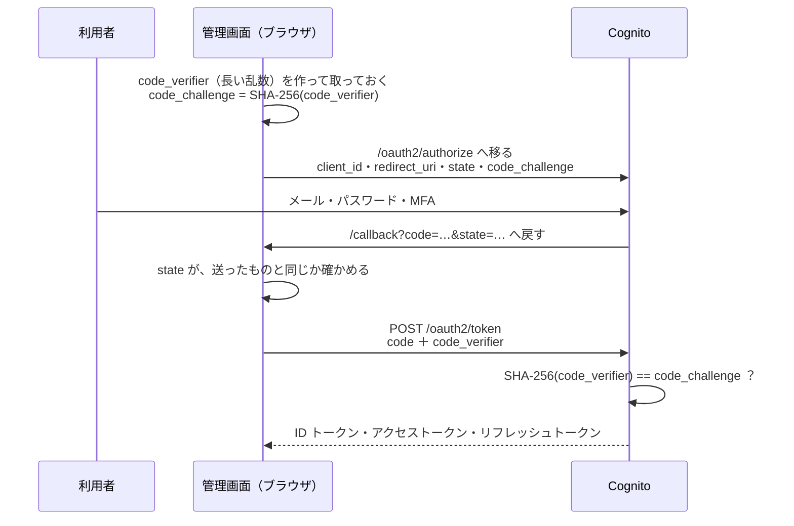

# 9-2 ブラウザでログインする

[目次](../README.md) ＞ 第 9 部 ＞ 9-2

> OIDC の仕組みと最小の使い方は [技術カード: OIDC](../ref/oidc.md) にあります。Cognito の側は [8-4](../08-aws/04-cognito.md) と [技術カード: Cognito](../ref/cognito.md) で見ました。

## この章で学ぶこと

- OIDC（OpenID Connect）と、ブラウザのアプリのためのログインの流れ（認可コード ＋ PKCE）
- PKCE が、横取りされたコードを使えなくする仕組み
- oidc-client-ts が代わりにしてくれること
- 管理画面の [auth.ts](../../michizure-console/web/src/auth.ts): ログイン・戻り・ログアウト・トークンの置き場所
- ログインが切れたとき、取り直すとき

## なぜ自分でパスワードを受け取らないのか

[8-4](../08-aws/04-cognito.md) で見たとおり、管理画面はパスワードも MFA のコードも受け取りません。ログインは Cognito の画面（マネージドログイン）に任せ、管理画面は **「この人はログインした」という証明（トークン）** だけを受け取ります。

このやりとりの決まりが **OIDC**（OpenID Connect）です。OAuth 2.0 という「アクセスの許可を渡す」決まりの上に、「だれがログインしたか」を伝える ID トークンを足したものです。Google や Microsoft のアカウントでログインする仕組みも、同じ決まりで動いています。

| 言葉 | この管理システムでは |
|---|---|
| OpenID プロバイダー（ログインを受け持つ側） | Cognito のユーザープール |
| クライアント（ログインを頼む側） | 管理画面（SPA）。秘密を持たない公開クライアント |
| 認可の窓口（authorization endpoint） | `https://<ドメイン>.auth.ap-northeast-1.amazoncognito.com/oauth2/authorize`（ログインの画面） |
| トークンの窓口（token endpoint） | 同 `/oauth2/token` |
| 戻り先（redirect URI） | `https://<管理画面>/callback`、開発では `http://localhost:5173/callback` |

## 認可コード ＋ PKCE の流れ



なぜこんなに回りくどいのでしょう。いちばん単純なのは「ログインしたら、トークンを URL に付けて戻す」ですが、URL はブラウザの履歴やログに残り、ほかのアプリに横取りされることもあります。そこで:

1. URL で戻すのは、**1 回しか使えない、すぐに期限が切れるコード** だけにする
2. コードをトークンに引き換えるのは、ブラウザから窓口への直接の POST にする
3. でも SPA は秘密（クライアントシークレット）を持てない（[8-4](../08-aws/04-cognito.md)）。ならば、コードを横取りした人と本物をどう見分けるか → **PKCE**

### PKCE: 「最初に頼んだ人」だけが引き換えられる

**PKCE**（Proof Key for Code Exchange、「ピクシー」と読む）は、ログインのたびに使い捨ての秘密を作る仕組みです。

- 最初に `code_verifier`（長い乱数）を作り、ブラウザの中に取っておく
- ログインの画面へ移るときは、そのハッシュ `code_challenge = base64url(SHA-256(code_verifier))` だけを送る
- コードを引き換えるときに、`code_verifier` そのものを送る
- 窓口は、ハッシュを計算して、最初の `code_challenge` と一致するときだけトークンを渡す

コードを横取りした人は `code_verifier` を知らないので、引き換えられません。ハッシュから元の値は戻せません（[6-1](../06-trust/01-why-signatures.md) の SHA-256）。**`state`** は別の守りで、「自分が始めたログインの戻りか」を確かめ、他人が仕組んだ戻りを受け付けないためのものです。

## oidc-client-ts が代わりにすること

この流れを自分で正しく作るのは大変です。管理画面は **oidc-client-ts** というライブラリに任せています。

| すること | oidc-client-ts の中 |
|---|---|
| プロバイダーの窓口の場所を知る | `authority` の `/.well-known/openid-configuration`（ディスカバリー文書）を読む |
| `code_verifier`・`code_challenge`・`state` を作る | ログインのたびに作り、戻ってくるまで保存しておく |
| ログインの画面へ移る | `signinRedirect()` |
| 戻りを受け、`state` を確かめ、コードを引き換える | `signinRedirectCallback()`。使った保存は消す |
| トークンを保存し、期限を見る | `User` として `userStore` に |
| 期限の前に取り直す | `automaticSilentRenew`。リフレッシュトークンがあれば、それで取り直す |

## 管理画面の auth.ts

[auth.ts](../../michizure-console/web/src/auth.ts) の `createAuth` を見ます。

```ts
/**
 * Sign-in with Cognito's managed login: authorization code with PKCE, no client secret.
 * Tokens stay in sessionStorage (gone when the tab closes), not localStorage (aws-auth).
 */
export function createAuth(config: ConsoleConfig) {
  const origin = window.location.origin;
  const manager = new UserManager({
    authority: config.authority,
    client_id: config.clientId,
    redirect_uri: `${origin}/callback`,
    post_logout_redirect_uri: `${origin}/`,
    response_type: 'code',
    scope: 'openid email profile',
    userStore: new WebStorageStateStore({ store: window.sessionStorage }),
    automaticSilentRenew: true,
  });
```

| 設定 | 意味 |
|---|---|
| `authority` | ユーザープールの発行元（`https://cognito-idp.ap-northeast-1.amazonaws.com/<プールの ID>`）。`config.json` から（[9-1](01-react-vite.md)） |
| `client_id` | 管理画面のクライアントの ID。秘密ではない |
| `redirect_uri` | 戻り先。Cognito に登録したものと **完全に一致** しないと、Cognito が断る |
| `response_type: 'code'` | 認可コードの流れ。PKCE は oidc-client-ts が自動で付ける |
| `scope` | `openid`（OIDC を使う）・`email`・`profile` |
| `userStore: sessionStorage` | トークンを、タブを閉じれば消える場所に置く |
| `automaticSilentRenew` | 期限の少し前に、自動で取り直す |

### ログインと、戻ってきたとき

```ts
signIn: () => manager.signinRedirect({ state: window.location.pathname }),
/** Finishes the redirect back from Cognito and returns where the user was going. */
finishSignIn: async (): Promise<string> => {
  const user = await manager.signinRedirectCallback();
  return typeof user.state === 'string' && user.state.startsWith('/') ? user.state : '/';
},
```

- ログインに出かけるとき、今いた道（`/review/kamakura-history/01J…` など）を `state` に預ける。戻ってきたら、そこへ連れて行く（運営がメールのリンクから来ても、ログインのあとに目的の画面へ着く）
- 戻り先が `/` で始まるときだけ使う。`https://evil.example` のような外の場所へ飛ばされないため（オープンリダイレクトの防止）
- [9-1](01-react-vite.md) の `Callback` の部品が `finishSignIn` を呼ぶ。コードは 1 回しか引き換えられないので、StrictMode で 2 回呼ばれても 1 回にしている

`Gate`（[main.tsx](../../michizure-console/web/src/main.tsx)）は、トークンがなければ `signIn()` で Cognito へ送り出し、あれば `GET /api/me` を呼びます。API がトークンを確かめ、役割を答えます。

### ログアウト

```ts
/** Cognito has no OIDC end-session endpoint; its own /logout ends the managed login session. */
signOut: async () => {
  await manager.removeUser();
  const url = new URL('/logout', config.authDomain);
  url.searchParams.set('client_id', config.clientId);
  url.searchParams.set('logout_uri', `${origin}/`);
  window.location.assign(url.toString());
},
```

ログアウトは 2 段です。

1. ブラウザのトークンを消す（`removeUser()`）
2. Cognito の `/logout` へ移り、**Cognito の側のログインの記憶** も消す。これをしないと、次に「ログイン」を押したとき、パスワードを聞かれずに同じ人でログインできてしまう（共用のパソコンで困る）

Cognito の `/logout` は、`client_id` と `logout_uri`（ログアウトのあとに戻る場所）という引数を求めます。OIDC の標準のログアウトの引数（`post_logout_redirect_uri` など）とは名前が違うので、oidc-client-ts の `signoutRedirect()` に任せず、自分で URL を組み立てています。

> **メモ**: コードのコメントは「Cognito には OIDC のログアウトの窓口がない」と書いています。2026-10-05 に開発用のユーザープールのディスカバリー文書を見ると、`end_session_endpoint` として `/logout` が載っていました。ただ、求める引数の名前は上のとおり Cognito 独自のもので、自分で組み立てるやり方はそのまま使えます。

## トークンの置き場所

ブラウザでトークンをどこに置くかは、悩ましい選択です。

| 置き場所 | 長所 | 短所 |
|---|---|---|
| メモリ（変数）だけ | 盗まれにくい | 再読み込みで消え、毎回ログインし直す |
| `sessionStorage` | タブを閉じれば消える。再読み込みでは残る | 同じページの JavaScript からは読める |
| `localStorage` | ブラウザを閉じても残る | 残り続ける。同じページの JavaScript から読める |

管理画面は `sessionStorage` を選びました（コメントの「aws-auth」は、開発のときに確かめた AWS のログインの決まりの名前です。[開発の記録](../../michizure-console/docs/skill-logs/feature_implementation_2026-10-04.md) に、公開クライアントに秘密を付けない・PKCE などと並んで出てきます）。置かれるのは `oidc.user:<authority>:<client_id>` という名前の 1 項目です。

`sessionStorage` も `localStorage` も、**そのページで動く JavaScript からは読めます**。だから一番の脅威は、ページに悪いスクリプトを入れられること（XSS）です。管理画面はそれを次の重ねで防いでいます。

- React は、`{…}` で描く文字を自動でエスケープする（申請の説明文に `<script>` が書かれていても、文字として出る）
- CSP（[8-6](../08-aws/06-s3-cloudfront.md)）で、スクリプトは自分の場所から来たものだけ（`script-src 'self'`）、通信先も決めた場所だけ（`connect-src`）
- アクセストークンの期限は 60 分、リフレッシュトークンは 12 時間（[console-app.ts](../../michizure-console/infra/lib/console-app.ts)）。漏れても長くは使えない

ちなみに、ログインの途中の値（`code_verifier` と `state`）は、`stateStore` を指定していないので、oidc-client-ts の既定の `localStorage` に `oidc.` で始まる名前で置かれ、戻ってきて引き換えたときに消されます。

## ログインが切れたら

| 場面 | 何が起きるか |
|---|---|
| アクセストークンの期限が近い | `automaticSilentRenew` がリフレッシュトークンで取り直す（画面は何も変わらない） |
| API が `401` を返した | [api.ts](../../michizure-console/web/src/api.ts) のミドルウェアが `signIn()` を呼び、Cognito へ。戻ったら同じ道へ |
| タブを閉じた | `sessionStorage` ごと消える。次に開いたらログインから |
| 運営のグループから外された | API は役割を、トークンの中の `cognito:groups` から決める（[router.ts](../../michizure-console/api/src/console/router.ts)）。トークンを取り直すまでは古いままなので、グループの変更が効くのは次にトークンを取ったとき（最長 60 分） |

## ハンズオン: PKCE を手で作る

ブラウザの中で oidc-client-ts が作っているものを、Node.js で作って見ます。どこにも送りません。

[scripts/pkce.mjs](scripts/pkce.mjs) を好きな場所で動かします（Node.js 20 以上）。

```sh
cd /c/Dev/apps/sanpo-tutorial/09-console/scripts
node pkce.mjs
```

```text
1. RFC 7636 の例
   code_challenge = E9Melhoa2OwvFrEMTJguCHaoeK1t8URWbuGJSstw-cM
   期待する値     = E9Melhoa2OwvFrEMTJguCHaoeK1t8URWbuGJSstw-cM

2. 今回のログインのための値
   code_verifier  = 87VOlMDD64iwfbDSN2ekNiecHBy5qT1Lsc6mIgOe7Jg （秘密。ブラウザの中だけ）
   code_challenge = OfNixvTYEny3DG1SgGoj5-fUXqMPhUiqSbo-O76AzPc （ハッシュ。外に出してよい）
   state          = qsb17kZbo2MqtVxpGOqZbw

3. ログインの画面へ
   https://sanpo-example.auth.ap-northeast-1.amazoncognito.com/oauth2/authorize?client_id=exampleclientid0123456789
     &redirect_uri=http%3A%2F%2Flocalhost%3A5173%2Fcallback
     &response_type=code
     &scope=openid+email+profile
     &state=qsb17kZbo2MqtVxpGOqZbw
     &code_challenge=OfNixvTYEny3DG1SgGoj5-fUXqMPhUiqSbo-O76AzPc
     &code_challenge_method=S256

4. トークンの窓口へ POST する本文（クライアントの秘密はない）
   POST https://sanpo-example.auth.ap-northeast-1.amazoncognito.com/oauth2/token
   grant_type=authorization_code
     &client_id=exampleclientid0123456789
     &code=…
     &redirect_uri=http%3A%2F%2Flocalhost%3A5173%2Fcallback
     &code_verifier=87VOlMDD64iwfbDSN2ekNiecHBy5qT1Lsc6mIgOe7Jg

5. 窓口の確かめ
   本物の verifier → 一致（トークンを渡す）
   別の verifier   → 不一致（invalid_grant）
```

（乱数を使うので、2〜5 の値は毎回変わります）

- 1 は、PKCE の仕様（RFC 7636）の付録にある例と同じ答えになることの確認。計算の仕方が仕様どおりだと分かる
- 3 の URL に、`code_verifier` は入っていない。入っているのはハッシュだけ
- 4 の本文に、クライアントの秘密はない。代わりに `code_verifier` を出す
- 5 で、別の `code_verifier` では一致しない

（oidc-client-ts は、`code_verifier` を UUID を 3 つつないだ文字列で作ります。長い乱数であればよく、作り方の細部は違ってかまいません）

### やってみよう: ディスカバリー文書を見る

自分のユーザープールがあれば（または公開されている OIDC のプロバイダーで）、ブラウザで次の URL を開くと、oidc-client-ts が最初に読む文書が見えます。読むだけで、費用はかかりません。

```text
https://cognito-idp.ap-northeast-1.amazonaws.com/<ユーザープールの ID>/.well-known/openid-configuration
```

`authorization_endpoint`・`token_endpoint`・`jwks_uri`（トークンの署名を確かめる公開鍵の場所）などが並んでいます。

## つまずきやすいところ

- **戻り先の URL は、登録したものと完全に一致させる**: `http://localhost:5173/callback` と `http://127.0.0.1:5173/callback` は別物。末尾の `/` の有無も
- **`crypto.subtle` は安全な場所（HTTPS か localhost）でしか使えない**: PKCE のハッシュに要る。ほかのパソコンから `http://192.168.…` で開くと、ログインが始まらない
- **コードは 1 回しか使えない**: 戻りの処理を 2 回走らせると、2 回目は失敗する（StrictMode に注意）
- **ログアウトは、ブラウザと Cognito の両方で**: 片方だけだと、パスワードなしでまたログインできてしまう
- **グループの変更は、トークンを取り直すまで効かない**
- **トークンを置ける場所はどれも、ページの JavaScript から読める**: XSS を防ぐ（CSP・エスケープ）ことが前提

## 確認問題

<details>
<summary>問 1. ログインの画面から戻ってくる URL の code を、だれかに盗み見られました。その人はトークンを手に入れられますか。</summary>

手に入れられません。コードをトークンに引き換えるには `code_verifier` が要り、それはログインを始めたブラウザの中にしかありません。窓口は `SHA-256(code_verifier)` が最初の `code_challenge` と一致するかを確かめます。

</details>

<details>
<summary>問 2. ログアウトで、ブラウザのトークンを消すだけでは足りないのはなぜですか。</summary>

Cognito の側にもログインの記憶（セッション）が残っているからです。そのままだと、次に「ログイン」を押したとき、パスワードを聞かれずに同じ人としてログインできてしまいます。だから Cognito の `/logout` にも移ります。

</details>

<details>
<summary>問 3. finishSignIn は、state が / で始まるときだけ、その道へ移ります。なぜですか。</summary>

外の場所（`https://…`）へ飛ばされないためです。戻り先を外から操れると、ログインした直後の利用者を偽のページへ連れて行けてしまいます（オープンリダイレクト）。

</details>

<details>
<summary>問 4. 管理画面がトークンを localStorage ではなく sessionStorage に置くのはなぜですか。</summary>

タブを閉じれば消えるからです。共用のパソコンで閉じ忘れても、次の人に残りにくく、漏れたときの期間も短くなります。その代わり、新しいタブではログインし直します。

</details>

---

前: [9-1 React と Vite](01-react-vite.md) ／ 次: [9-3 ブラウザの中で鍵を作る](03-keys-in-browser.md)
