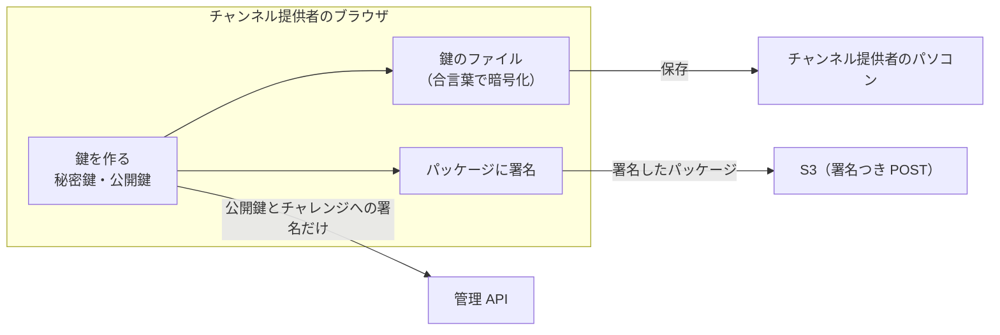
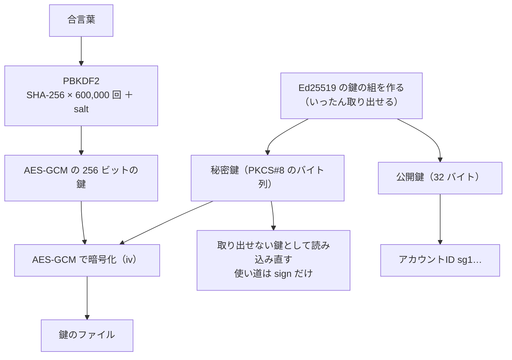
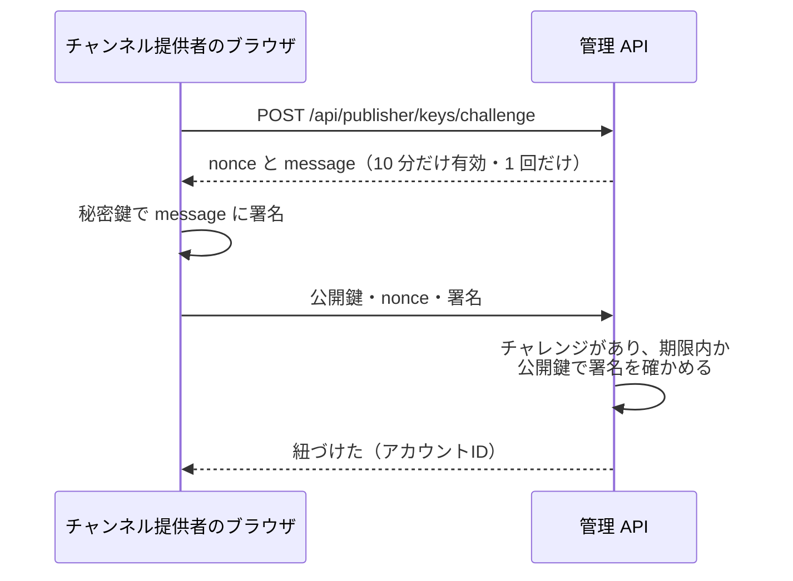

# 9-3 ブラウザの中で鍵を作る

[目次](../README.md) ＞ 第 9 部 ＞ 9-3

> WebCrypto の仕組みと最小の使い方は [技術カード: WebCrypto](../ref/webcrypto.md) にあります。Ed25519 とアカウントID は [6-2](../06-trust/02-ed25519-and-ids.md)、パッケージの署名の形は [5-2](../05-station-format/02-package-format.md) で見ました。

## この章で学ぶこと

- チャンネル提供者の秘密鍵を、サーバーに一度も送らない設計
- ブラウザの暗号の道具 WebCrypto（`crypto.subtle`）: 鍵の作成・署名・暗号化
- 取り出せない鍵（`extractable: false`）
- 合言葉で秘密鍵を暗号化して、ファイルに保存する（PBKDF2 ＋ AES-GCM）
- 「この鍵を持っている」ことをサーバーに示す（チャレンジへの署名）
- パッケージにブラウザの中で署名し、S3 に直接送る
- 運営の AI の API キーも、同じ考え方でサーバーに送らない

## なぜブラウザの中で作るのか

第 6 部で見たとおり、チャンネルのパッケージには **チャンネル提供者の署名** が付きます（[6-5](../06-trust/05-verify-in-app.md)）。アプリは、その署名で「だれが作ったか」を確かめます。

ここで、もし管理システムがチャンネル提供者の秘密鍵を預かっていたらどうでしょう。管理システムが乗っ取られれば、だれでも好きなチャンネル提供者になりすませます。運営でさえ、チャンネル提供者の名前で勝手にパッケージを作れてしまいます。それでは「チャンネル提供者の署名」が意味をなしません。

そこで DES-003（[チャンネル提供者の画面の設計](../../michizure-console/docs/design/DES-003-publisher-console.md)）は、こう決めています。

- 鍵は **チャンネル提供者のブラウザの中で作る**
- 秘密鍵は **サーバーに送らない**。合言葉で暗号化したファイルとして、チャンネル提供者が自分で保存する
- サーバーが知るのは **公開鍵**（とそこから計算したアカウントID）だけ



これは [6-4](../06-trust/04-two-tier-keys.md) の運営のルート鍵（オフラインの端末に置く）と同じ考え方です。**鍵を持つ人の手元から、秘密鍵を出さない**。

## WebCrypto

ブラウザには、暗号の道具が最初から入っています。**Web Crypto API**（WebCrypto）です。`crypto.subtle` から使います。

```ts
const subtle = globalThis.crypto.subtle;
const ED25519 = { name: 'Ed25519' } as const;
```

（[publisher-crypto.ts](../../michizure-console/web/src/publisher-crypto.ts)）

| 関数 | すること |
|---|---|
| `generateKey(方式, 取り出せるか, 使い道)` | 鍵（または鍵の組）を作る |
| `sign`・`verify` | 署名する・確かめる |
| `encrypt`・`decrypt` | 暗号化する・戻す |
| `digest('SHA-256', データ)` | ハッシュ |
| `importKey`・`exportKey` | 鍵をバイト列から読み込む・バイト列に書き出す |
| `deriveKey` | 合言葉などから鍵を作る |

特徴が 3 つあります。

- **どれも非同期**（Promise を返す）。`await` で待つ
- 鍵は **`CryptoKey`** という入れ物で扱う。中身のバイト列は直接見えない
- 鍵ごとに **取り出せるか**（`extractable`）と **使い道**（`usages`: `sign`・`verify`・`encrypt`…）が決まっていて、ほかの使い方はできない

Ed25519 は、2023〜2025 年にかけて主なブラウザ（Safari・Firefox・Chrome・Edge）で順に使えるようになった、WebCrypto の中では新しい方式です。古いブラウザのために、画面は最初に使えるかを試します。

```ts
/** Whether this browser can make and use Ed25519 keys (recent Chrome, Edge, Firefox and Safari can). */
export async function ed25519Supported(): Promise<boolean> {
  try {
    await subtle.generateKey(ED25519, false, ['sign', 'verify']);
    return true;
  } catch {
    return false;
  }
}
```

使えなければ「このブラウザは Ed25519 の鍵を扱えません」と出します（[pages/publisher/home.tsx](../../michizure-console/web/src/pages/publisher/home.tsx) の `KeySetup`）。

## 鍵を作り、合言葉で包む

`createKey` の流れです。

```ts
export async function createKey(passphrase: string): Promise<{ key: PublisherKey; file: KeyFile }> {
  if (passphrase.length < MIN_PASSPHRASE) throw new Error(`合言葉は ${MIN_PASSPHRASE} 文字以上にしてください`);
  const pair = (await subtle.generateKey(ED25519, true, ['sign', 'verify'])) as CryptoKeyPair;
  const publicKey = bytes(await subtle.exportKey('raw', pair.publicKey));
  const pkcs8 = bytes(await subtle.exportKey('pkcs8', pair.privateKey));
  const salt = globalThis.crypto.getRandomValues(new Uint8Array(16));
  const iv = globalThis.crypto.getRandomValues(new Uint8Array(12));
  const encrypted = bytes(await subtle.encrypt({ name: 'AES-GCM', iv: buf(iv) }, await wrappingKey(passphrase, salt, PBKDF2_ITERATIONS), buf(pkcs8)));
  const accountId = await accountIdOf(publicKey);
  // The usable key is not extractable: from here on, only the encrypted file holds it.
  const privateKey = await subtle.importKey('pkcs8', buf(pkcs8), ED25519, false, ['sign']);
  // …
}
```



1. 鍵の組を作る。ファイルに保存するため、このときだけ取り出せる（`true`）ようにする
2. 公開鍵を 32 バイトのまま（`raw`）、秘密鍵を PKCS#8 という標準の形で書き出す
3. 合言葉から、暗号化のための鍵を作る（下で説明）
4. 秘密鍵を AES-GCM で暗号化する
5. 使うための秘密鍵は **取り出せない鍵として読み込み直す**（`false`、使い道は `sign` だけ）。このあと、画面のどこかに悪いスクリプトが入っても、`exportKey` で秘密鍵を抜き出せない

アカウントID は、サーバーやコア（`core-format`）と **同じ計算** です（`sg1` ＋ SHA-256 の base32 の先頭 32 文字、[6-2](../06-trust/02-ed25519-and-ids.md)）。[web/test/publisher-crypto.test.ts](../../michizure-console/web/test/publisher-crypto.test.ts) は、決まった公開鍵から決まった ID になることを確かめています。

### 合言葉から鍵を作る: PBKDF2

合言葉はそのままでは暗号の鍵になりません。長さもまちまちで、総当たりで試されやすいからです。そこで **PBKDF2** で、合言葉から 256 ビットの鍵を作ります。

```ts
async function wrappingKey(passphrase: string, salt: Uint8Array, iterations: number) {
  const material = await subtle.importKey('raw', buf(new TextEncoder().encode(passphrase)), 'PBKDF2', false, ['deriveKey']);
  return subtle.deriveKey({ name: 'PBKDF2', hash: 'SHA-256', salt: buf(salt), iterations }, material, { name: 'AES-GCM', length: 256 }, false, ['encrypt', 'decrypt']);
}
```

- **わざと遅くする**: ハッシュを 600,000 回重ねる。1 回試すのに時間がかかるので、鍵のファイルを盗んだ人が合言葉を総当たりするのに、とても時間がかかる。本物のチャンネル提供者は、開くときに一度待つだけ
- **salt**（16 バイトの乱数）: 同じ合言葉でも、ファイルごとに違う鍵になる。あらかじめ作った表で一度に破られない
- 合言葉は 12 文字以上（`MIN_PASSPHRASE`）

### AES-GCM: 暗号化と改ざんの検出

**AES-GCM** は、暗号化と同時に、改ざんを見つけるための印（認証タグ）も付ける方式です。

- `iv`（12 バイトの乱数）は、暗号化のたびに新しく作る。同じ鍵で同じ `iv` を使い回してはいけない
- 戻すとき、鍵が違ったり、暗号文が 1 ビットでも変わっていたりすると、**失敗する**（でたらめな値が返るのではない）

だから合言葉を間違えると、`decrypt` が例外を投げます。画面はそれを「合言葉が違うか、鍵のファイルが壊れています」と伝えます。

### 鍵のファイル

保存されるファイルは、こんな JSON です（ハンズオンで実際に作ったもの）。

```json
{
  "type": "sanpo-publisher-key",
  "version": 1,
  "accountId": "sg16sttiqspucs3cidujh6w3ssfqzpb24em",
  "publicKey": "SD2AF9wjDDQepAX8ijF6q4-lE-pVXlD_iIVEgJNb-Lo",
  "kdf": { "name": "PBKDF2", "hash": "SHA-256", "iterations": 600000, "salt": "I1t3Ym9W1jdbQiKtLV5rdw" },
  "cipher": { "name": "AES-GCM", "iv": "0qEn8neyRyH6tBVg" },
  "encryptedPrivateKey": "_iF6Mgydp2diaNf6ecWxBUWu…"
}
```

- `type` と `version` で、何のファイルかと形の版を示す（あとで形を変えても読み分けられる）
- 戻すのに要るもの（方式・回数・salt・iv）は、すべてファイルに書く。秘密なのは合言葉だけ
- ファイルは、ブラウザの中で作った `Blob` を、リンクの `download` で保存させる（`download()`、[pages/publisher/home.tsx](../../michizure-console/web/src/pages/publisher/home.tsx)）。サーバーを通らない

### 開くとき: 中身が合っているかも確かめる

```ts
const privateKey = await subtle.importKey('pkcs8', buf(pkcs8), ED25519, false, ['sign']);
const publicKey = b64url.decode(file.publicKey);
// The file must hold the key it says it does.
const probe = new TextEncoder().encode('sanpo-key-check');
const publicCrypto = await subtle.importKey('raw', buf(publicKey), ED25519, false, ['verify']);
const signature = await subtle.sign(ED25519, privateKey, buf(probe));
if (!(await subtle.verify(ED25519, publicCrypto, signature, buf(probe)))) throw new Error('鍵のファイルの中身が合っていません');
```

`publicKey` の欄は暗号化されていないので、書き換えられるかもしれません。そこで、戻した秘密鍵で試しに署名し、ファイルの公開鍵で確かめます。合わなければ使いません。ハンズオンで、この確かめを外すとテストが落ちることを見ます。

## 「この鍵を持っている」と示す

鍵を作ったら、チャンネル提供者のアカウントに **紐づけ** ます。でも、公開鍵を送るだけでは足りません。他人の公開鍵（アプリやパッケージから誰でも手に入る）を送って、「これは自分の鍵だ」と言い張れてしまうからです。

そこで、**サーバーが出した一度きりの文字列（チャレンジ）に署名させます**（ADR-001 A-5）。



秘密鍵を持っている人にしか、その場で出された文字列に署名できません。サーバーは秘密鍵を見ないまま、持っていることだけを確かめられます。チャレンジは DynamoDB に TTL つきで置かれ（[8-5](../08-aws/05-dynamodb.md)）、使ったら消えるので、同じ署名を使い回せません。

鍵をなくしたり漏れたりしたときの **移し替え**（[pages/publisher/keys.tsx](../../michizure-console/web/src/pages/publisher/keys.tsx)、ADR-001 A-15）も、同じように新しい鍵でチャレンジに署名して申し出ます。ただし、鍵をなくした人は古い鍵で証明できないので、運営が **鍵とは別の経路**（登録した連絡先など）で本人を確かめてから承認します。

## パッケージに署名して送る

チャンネル提供者が新しい版を申請するとき（[pages/publisher/channels.tsx](../../michizure-console/web/src/pages/publisher/channels.tsx)）、画面の中でこう進みます。

```ts
setProgress('鍵を開いています…');
const key = await openKeyFile(keyText, passphrase);
setProgress('パッケージに署名しています…');
const signed = await signPackage(new Uint8Array(await zip.arrayBuffer()), key, { channel: channelId });
if (signed.zip.length > 2 * 1024 * 1024) throw new Error('署名したパッケージが 2MB を超えています');
setProgress('申請を作っています…');
const { data } = await api.POST('/api/channels/{channelId}/submissions', { /* … */ });
setProgress('パッケージを送っています…');
await upload(data.uploads.package, new Blob([new Uint8Array(signed.zip)], { type: 'application/zip' }));
```

1. 鍵のファイルを、合言葉で開く
2. ZIP を **ブラウザの中で** 開き（fflate というライブラリ）、`signature.json` を作って ZIP に入れ直す（[5-2](../05-station-format/02-package-format.md) の形）
3. 申請を作ると、API が S3 の **署名つき POST** を返す（[8-6](../08-aws/06-s3-cloudfront.md)）
4. パッケージとアイコンを、管理 API を通さず S3 に直接送る

`signPackage` は、署名する前に確かめます。

- `channel.json` の `id` が、このチャンネルか
- `version` が整数か
- `publisher` が、**自分のアカウントID** か

間違ったまま署名して送ると、機械審査（[8-8](../08-aws/08-kotlin-lambda.md)）で落ちるまで分かりません。手元で先に分かるほうが、チャンネル提供者にとって親切です。古い `signature.json` が入っていれば、署名の対象から外して作り直します。

素材提供者が素材集に署名するときも、同じ鍵とほぼ同じ処理です（`signCollectionPackage`）。違いは「何の」「だれの」を表す項目の名前だけなので、[publisher-crypto.ts](../../michizure-console/web/src/publisher-crypto.ts) は違いを 1 つの値にまとめて、共通の関数（`signAs`）に渡しています。

```ts
/** A channel package (API-003 F-6). */
export async function signPackage(zip: Uint8Array, key: PublisherKey, expect: { channel: string }): Promise<SignedPackage> {
  const signed = await signAs(
    { manifest: 'channel.json', type: 'channel-package', subjectKey: 'channel', ownerKey: 'publisher', what: 'チャンネル' },
    zip, key, expect.channel,
  );
  return { ...signed, channel: expect.channel };
}
```

素材集では `collection.json`・`collection-package`・`collection`・`producer` を渡します。アプリの側（Kotlin）も、同じ違いを `SignedKind` という enum で表して、確かめる関数を 1 つにしています（[5-2](../05-station-format/02-package-format.md)）。2 つの言語で、同じところで分けているわけです。

## もう 1 つの「サーバーに送らない秘密」: AI の API キー

運営の審査の画面は、申請されたプロンプトで AI に話させた見本を作ります（DES-005、[ai.ts](../../michizure-console/web/src/ai.ts)）。そのための OpenAI・DeepSeek の API キーは **運営のもの** で、管理システムには預けません（ADR-001 D-4・A-14）。

```ts
const [keys, setKeys] = useState<Record<string, string>>({});
```

（[pages/review.tsx](../../michizure-console/web/src/pages/review.tsx)）

- キーは React の状態（ページのメモリ）にだけある。保存しない。ページを閉じれば消える
- AI はブラウザから直接呼ぶ。CSP の `connect-src` に `https://api.openai.com` と `https://api.deepseek.com` を入れてあるのはそのため（[8-6](../08-aws/06-s3-cloudfront.md)）
- 入力欄は `type="password" autoComplete="off"`（ブラウザに覚えさせない）

チャンネル提供者の秘密鍵と同じく、「サーバーが持たなければ、サーバーから漏れない」という設計です。

## ハンズオン: チャンネル提供者の鍵を Node.js で作る

WebCrypto は Node.js にも入っています。画面と **同じ** [publisher-crypto.ts](../../michizure-console/web/src/publisher-crypto.ts) を、Node.js から呼んでみます。

[scripts/key-in-browser.ts](scripts/key-in-browser.ts) を管理システムの `.local/` にコピーし、`web` のフォルダで動かします。

```sh
cd /c/Dev/apps/michizure-console
mkdir -p .local && cp ../michizure-tutorial/09-console/scripts/key-in-browser.ts .local/
cd web
npx tsx ../.local/key-in-browser.ts
```

```text
1. 鍵を作った（78 ms。ほとんどは PBKDF2 の 600,000 回）
   アカウントID: sg16sttiqspucs3cidujh6w3ssfqzpb24em
   鍵のファイル: { "type": "sanpo-publisher-key", "version": 1, … "iterations": 600000, "salt": "I1t3Ym9W1jdbQiKtLV5rdw" }, "cipher": { "name": "AES-GCM", "iv": "0qEn8neyRyH6tBVg" }, "encryptedPrivateKey": "_iF6Mgydp2diaNf6ecWxBUWu…" }

2. 秘密鍵を取り出そうとする
   extractable = false ／ usages = sign
   断られた: InvalidAccessException

3. 鍵のファイルを開く
   違う合言葉 → 合言葉が違うか、鍵のファイルが壊れています
   正しい合言葉 → sg16sttiqspucs3cidujh6w3ssfqzpb24em（72 ms）

4. 署名したパッケージ
   中のファイル: channel.json, prompts/guide/focus.md, signature.json
   署名した中身: {"type":"channel-package","channel":"kamakura-history","version":1,"publisher":"sg16sttiqspucs3cidujh6w3ssfqzpb24em","files":{"channel.json":"3bad3de7…","prompts/guide/focus.md":"8a27f51a…"}}

5. 公開鍵で確かめる → 正しい署名

6. 他人の publisher → channel.json の publisher を、あなたのアカウントID sg16sttiqspucs3cidujh6w3ssfqzpb24em にしてください
```

（鍵は毎回新しく作るので、ID などの値は毎回変わります。時間はパソコンによって違い、ブラウザではもっとかかることがあります）

- 2: 使うための秘密鍵は取り出せない。WebCrypto が断る（エラーの名前は Node.js とブラウザで違う。ブラウザでは `InvalidAccessError`）
- 3: 合言葉が違うと、AES-GCM が戻すのを断る
- 4: 署名の中身は、ファイルごとの SHA-256 と、チャンネル・版・チャンネル提供者。[5-2](../05-station-format/02-package-format.md) の形
- 5: 受け取る側は、`signature.json` の中の公開鍵だけで確かめられる
- 6: 自分の ID でないパッケージには、署名する前に止まる

### やってみよう: 鍵のファイルの照合を外す

[publisher-crypto.ts](../../michizure-console/web/src/publisher-crypto.ts) の `openKeyFile` で、最後の照合の行

```ts
if (!(await subtle.verify(ED25519, publicCrypto, signature, buf(probe)))) throw new Error('鍵のファイルの中身が合っていません');
```

を消して（または `void publicCrypto; void signature;` に置き換えて）、画面のテストを流します。

```sh
cd /c/Dev/apps/michizure-console
npx vitest run web
```

```text
     × refuse a key file whose public key was swapped 223ms
 FAIL  web/test/publisher-crypto.test.ts > publisher keys in the browser > refuse a key file whose public key was swapped
AssertionError: promise resolved "{ …(3) }" instead of rejecting
      Tests  1 failed | 10 passed (11)
```

公開鍵の欄を別の鍵のものに書き換えたファイルを、開けてしまうようになりました。こうしたファイルで署名すると、ファイルに書いてあるアカウントID と、実際に署名した鍵が食い違います。確かめたら `git checkout web/src/publisher-crypto.ts` で元に戻し、`git status` が空になったことを確かめます。

## つまずきやすいところ

- **秘密鍵は、持つ人の手元から出さない**: サーバーは公開鍵と署名だけを受け取る
- **使うための鍵は `extractable: false` に**: 保存のために一度だけ取り出し、あとは取り出せない鍵で使う
- **合言葉は PBKDF2 などで鍵にする**: そのまま使わない。salt と、十分な回数
- **AES-GCM の iv は毎回新しく**: 同じ鍵で使い回すと、暗号が破れる
- **公開鍵を送るだけでは、持っている証明にならない**: その場で出されたチャレンジに署名させる
- **WebCrypto は安全な場所（HTTPS か localhost）でしか使えない**: [9-2](02-browser-login.md) と同じ
- **鍵のファイルをなくすと、自分では取り戻せない**: 画面は「保存しました」の確認を取ってから紐づけさせる。取り戻すには、運営の本人確認を経た移し替えが要る

## 確認問題

<details>
<summary>問 1. 管理システムのデータベースがまるごと盗まれました。チャンネル提供者になりすましてパッケージに署名できますか。</summary>

できません。管理システムが持っているのはチャンネル提供者の公開鍵とアカウントID だけで、秘密鍵はチャンネル提供者の手元の、合言葉で暗号化したファイルにしかないからです。

</details>

<details>
<summary>問 2. 鍵のファイルを盗まれました。すぐに使われてしまいますか。</summary>

すぐには使えません。秘密鍵は合言葉から作った鍵で暗号化されていて、合言葉を総当たりするには、1 回ごとに PBKDF2 の 600,000 回の計算が要るからです。ただ、合言葉が弱ければ破られるおそれがあるので、漏れたおそれがあれば、鍵の移し替えを申し出ます。

</details>

<details>
<summary>問 3. 鍵を紐づけるとき、公開鍵だけでなく、チャレンジへの署名も送るのはなぜですか。</summary>

その公開鍵の秘密鍵を本当に持っていることを示すためです。公開鍵はだれでも手に入るので、送るだけなら他人の鍵でも紐づけられてしまいます。サーバーがその場で出した一度きりの文字列に署名できるのは、秘密鍵を持つ人だけです。

</details>

<details>
<summary>問 4. 合言葉を間違えたとき、でたらめな秘密鍵が戻るのではなく、エラーになるのはなぜですか。</summary>

AES-GCM が、暗号化のときに認証タグを付けているからです。戻すときに、鍵が違うか暗号文が変わっていれば、タグが合わずに失敗します。

</details>

---

前: [9-2 ブラウザでログインする](02-browser-login.md) ／ 次: [9-4 CI](04-ci.md)
