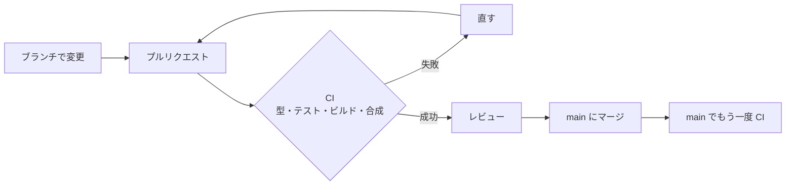

# 9-4 CI

[目次](../README.md) ＞ 第 9 部 ＞ 9-4

> GitHub Actions の仕組みと最小の使い方は [技術カード: GitHub Actions](../ref/github-actions.md) にあります。SanpoGuide の公開のワークフローは [5-3](../05-station-format/03-publish.md) で見ました。

## この章で学ぶこと

- CI（継続的インテグレーション）が、何を、いつ確かめるのか
- 管理システムの [ci.yml](../../michizure-console/.github/workflows/ci.yml) を 1 行ずつ読む
- サービスコンテナ（DynamoDB Local）、2 つの言語（Node.js と Java）、捨てる鍵での合成
- CI が **しない** こと（配備）と、その理由
- CI と同じ手順を手元で流す。CI の注意書き（アノテーション）を読む

## CI とは

**CI**（Continuous Integration、継続的インテグレーション）は、変更を入れるたびに、決まった確かめを **自動で、まっさらな環境で** 流すことです。



- 「自分のパソコンでは動く」を防ぐ。ランナーは毎回まっさらなので、入れ忘れたファイルや、手元にだけある設定に頼っていれば失敗する
- レビューする人は、テストが通っていることを前提に、設計や読みやすさに集中できる
- 第 7・8 部で書いたテスト（DynamoDB Local・CDK のテンプレート・機械審査）は、CI で毎回流れて初めて「守り」になる

## ci.yml を読む

### きっかけと権限

```yaml
name: CI

on:
  push:
    branches: [main]
  pull_request:

permissions:
  contents: read
  # station-format from SanpoGuide's GitHub Packages (a public repository: GITHUB_TOKEN can read it).
  packages: read
```

- プルリクエストを作ったり更新したりしたとき、そして `main` に入ったときに動く
- `GITHUB_TOKEN`（実行のたびに発行される一時的なトークン）には、読むことだけを許す。`packages: read` は、機械審査が SanpoGuide の station-format を GitHub Packages から読むため（[5-3](../05-station-format/03-publish.md)）

SanpoGuide の公開のワークフローは `packages: write` でした。**ワークフローごとに、要る権限だけ** を与えます（[技術カード: IAM](../ref/iam.md) の最小の権限と同じ考え方）。

### サービスコンテナ: DynamoDB Local

```yaml
jobs:
  check:
    runs-on: ubuntu-latest
    services:
      # The console API tests need conditions, transactions and GSIs (api/test/dynamo-local.ts).
      dynamodb:
        image: amazon/dynamodb-local:latest
        ports:
          - 8000:8000
    env:
      DYNAMODB_ENDPOINT: http://localhost:8000
```

`services` に書いたコンテナは、ジョブの間ずっと横で動きます。管理 API のテストは、条件つき書き込み・トランザクション・GSI を本物と同じように試したいので、DynamoDB Local を使います（[7-4](../07-typescript/04-testing.md)）。

[api/test/dynamo-local.ts](../../michizure-console/api/test/dynamo-local.ts) は、`DYNAMODB_ENDPOINT` があればそれを使い、なければ自分で Docker のコンテナを立てます。

```ts
if (process.env.DYNAMODB_ENDPOINT) return { endpoint: process.env.DYNAMODB_ENDPOINT, stop: () => {} };
```

だから、同じテストが手元（コンテナを自動で立てる）でも CI（サービスコンテナを使う）でも、書き換えずに動きます。

### 手順

```yaml
    steps:
      - uses: actions/checkout@v4
      - uses: actions/setup-node@v4
        with:
          node-version: '22'
          cache: npm
      - run: npm ci
      - name: Typecheck
        run: npx tsc -b
      - name: Test
        run: npx vitest run
      - name: Build the SPA
        run: npm run build -w web
```

| 手順 | 何を確かめるか | 章 |
|---|---|---|
| `setup-node`（22、`cache: npm`） | Lambda と同じ Node.js 22 にする。ダウンロードした部品を次の実行のために取っておく | [8-3](../08-aws/03-lambda-apigw.md) |
| `npm ci` | `package-lock.json` のとおりに入れる。`npm install` と違い、ロックファイルを書き換えず、食い違えば失敗する | [7-2](../07-typescript/02-workspaces.md) |
| `npx tsc -b` | すべてのパッケージの型（プロジェクト参照の順に） | [7-2](../07-typescript/02-workspaces.md) |
| `npx vitest run` | すべてのテスト（API・画面・CDK・プロトコル） | [7-4](../07-typescript/04-testing.md) |
| `npm run build -w web` | 画面をビルドできるか。Vite は型を見ないので、`tsc` と両方が要る | [9-1](01-react-vite.md) |

```yaml
      - uses: actions/setup-java@v4
        with:
          distribution: temurin
          java-version: '17'
      - uses: gradle/actions/setup-gradle@v4
      - name: Test and build the machine review
        working-directory: validator
        run: ./gradlew test lambdaZip --console=plain
        env:
          GITHUB_ACTOR: ${{ github.actor }}
          GITHUB_TOKEN: ${{ secrets.GITHUB_TOKEN }}
```

同じジョブの中で Java も用意し、Kotlin の機械審査（[8-8](../08-aws/08-kotlin-lambda.md)）のテストと zip の作成を流します。

- Java 17 で組み立てる。[validator/build.gradle.kts](../../michizure-console/validator/build.gradle.kts) は、Java 17 向けのクラスファイルを作る設定で、それを Lambda の Java 21 のランタイムで動かす（新しい Java は古い向けのクラスファイルを動かせる）。station-format（Java 17）とそろえている
- `GITHUB_TOKEN` を渡すのは、station-format を GitHub Packages から読むため（[validator/settings.gradle.kts](../../michizure-console/validator/settings.gradle.kts)）

```yaml
      - name: Synthesize (throwaway root key)
        working-directory: infra
        run: |
          key=$(node -e "console.log(require('crypto').randomBytes(32).toString('base64url'))")
          npx cdk synth -c env=dev -c rootPublicKey=$key --quiet
          npx cdk synth -c env=prod -c rootPublicKey=$key --quiet
```

最後に、CDK のテンプレートを **開発用と本番の両方** で合成します（[8-2](../08-aws/02-cdk.md)）。

- 合成は AWS につながらないので、CI でも費用はかからない
- ルート鍵の公開鍵は、配備には本物が要るが、合成が通るかを見るだけなら何でもよい。そこで **その場で作った乱数を捨てる鍵として渡す**。本物の公開鍵を CI に置かずに済む
- 本番だけの設定（WAF・`RETAIN`・削除の保護など）は、本番を合成しないと試されない。両方を流すのはそのため

## CI がしないこと: 配備

この CI は **配備をしません**。確かめるだけです。

ADR-001 の A-17 は「GitHub Actions から OIDC で AWS に入る（長期のアクセスキーを持たない）。本番への配備は手動で承認する」と決めています。でも 2026-10-05 の時点では、配備は開発者が自分の端末から、手順書（[docs/operations/deploy.md](../../michizure-console/docs/operations/deploy.md)）のとおりに行っています。

```sh
aws sso login --profile sanpo-dev
npm run build -w web
cd infra
npx cdk diff   -c env=dev -c rootPublicKey=<ルート鍵の公開鍵>
npx cdk deploy -c env=dev -c rootPublicKey=<ルート鍵の公開鍵>
```

配備を自動にするなら、GitHub Actions に AWS の鍵を持たせる必要があります。A-17 は、その鍵を **長く使えるアクセスキーにしない**（GitHub が発行する OIDC のトークンを、AWS の IAM ロールと引き換える）と決めています。[9-2](02-browser-login.md) で見た OIDC が、ここでは「GitHub のワークフローがだれか」を AWS に示すのに使われるわけです。

## 実際の実行を見る

GitHub のリポジトリの「Actions」のタブ、または `gh` のコマンドで、実行の記録が見られます。

```sh
cd /c/Dev/apps/michizure-console
gh run list --limit 3
```

```text
completed	success	docs: 構成図（architecture.md と architecture.html）を追加	CI	docs/architecture	pull_request	37189629675	1m16s	2026-10-04T08:39:29Z
completed	success	docs: 構成図（architecture.md と architecture.html）を追加	CI	docs/architecture	pull_request	37183670331	1m17s	2026-10-04T06:44:14Z
completed	success	Merge pull request #12 from duwenji/docs/dm-1.2	CI	main	push	37174465034	1m14s	2026-10-04T03:34:37Z
```

プルリクエスト（`pull_request`）と、マージしたあとの `main`（`push`）の両方で動いています。1 回およそ 1 分 15 秒です。手順ごとの時間（あるときの実行）:

| 手順 | 時間 |
|---|---|
| コンテナの準備（DynamoDB Local） | 7 秒 |
| `npm ci` | 8 秒 |
| 型（`tsc -b`） | 2 秒 |
| テスト（`vitest run`） | 10 秒 |
| 画面のビルド | 1 秒 |
| 機械審査（Gradle） | 24 秒 |
| CDK の合成（2 回） | 11 秒 |

### 注意書き（アノテーション）を読む

`gh run view <実行の番号>` で詳しく見ると、成功していても **注意書き** が出ていることがあります。2026-10-04 の実行では:

```text
ANNOTATIONS
! Node.js 20 is deprecated. The following actions target Node.js 20 but are being forced to run on Node.js 24: actions/checkout@v4, actions/setup-java@v4, actions/setup-node@v4, gradle/actions/setup-gradle@v4. …
! setup-java v4 is deprecated and will no longer receive updates. Please migrate to actions/setup-java@v5.
- "The ubuntu-latest label will migrate to Ubuntu 26 beginning October 19, 2026. …"
```

- 使っているアクション（`@v4`）が、古い Node.js 向けに作られている。今は GitHub が新しい Node.js で無理に動かしている
- `setup-java@v4` は、もう更新されない。`@v5` に上げるよう勧めている
- `ubuntu-latest` が指すランナーが、近いうちに新しい Ubuntu に変わる

どれも今は失敗していませんが、放っておくと、ある日突然 CI が壊れる原因になります。**成功していても、注意書きはときどき読む**。アクションの版を上げる変更は、それだけの小さなプルリクエストにして、CI が通ることを確かめて入れます。

## ハンズオン: CI と同じ手順を手元で流す

CI の手順のうち、Node.js の部分を手元で流します。DynamoDB Local は、テストが自分で Docker のコンテナを立てます（Docker が要ります。[技術カード: Docker](../ref/docker.md)）。

```sh
cd /c/Dev/apps/michizure-console
npx tsc -b && echo "型 OK"
npx vitest run
npm run build -w web
```

```text
型 OK
 Test Files  13 passed (13)
      Tests  135 passed (135)
…
dist/assets/index-CC4e6DL8.js   465.81 kB │ gzip: 138.64 kB │ map: 2,167.80 kB
✓ built in 243ms
```

CI と同じく、サービスコンテナの代わりに自分で DynamoDB Local を立てて、`DYNAMODB_ENDPOINT` で渡すこともできます。

```sh
docker run -d --rm --name ci-ddb -p 8000:8000 amazon/dynamodb-local:latest
DYNAMODB_ENDPOINT=http://localhost:8000 npx vitest run
docker stop ci-ddb
```

機械審査と CDK の合成は、[8-8](../08-aws/08-kotlin-lambda.md) と [8-2](../08-aws/02-cdk.md) のハンズオンと同じです。

### やってみよう: CI を落とす変更を、手元で先に見つける

[9-3](03-keys-in-browser.md) の「鍵のファイルの照合を外す」や、[8-3](../08-aws/03-lambda-apigw.md) の「同時実行の数を変える」をしてから、上の 3 行を流してみてください。プルリクエストを出す前に、CI と同じ失敗を手元で見られます。確かめたら元に戻し、`git status` が空になったことを確かめます。

## つまずきやすいところ

- **`npm install` ではなく `npm ci`**: ロックファイルのとおりに入れ、食い違いを見逃さない
- **型とビルドは別**: `tsc -b` と Vite のビルドの両方を流す
- **CI の権限は最小に**: `contents: read`。書き込みは、それが要るワークフローだけ
- **本物の秘密を CI に置かない**: 合成だけなら捨てる鍵で足りる。配備するなら、長期のアクセスキーではなく OIDC で
- **成功していても注意書きを読む**: アクションやランナーの古さは、ある日の失敗の種
- **CI が通らないものはマージしない**: このリポジトリでは、GitHub の設定で「CI の成功を必須にする」ことはまだしていないので、人の側の決まりで守っている

## 確認問題

<details>
<summary>問 1. CI の CDK の合成で、ルート鍵の公開鍵に乱数を渡しているのはなぜですか。</summary>

合成は、テンプレートが作れるかを確かめるだけで、AWS に配備しないからです。公開鍵の値は何でもよく、本物の公開鍵を CI の設定に置く必要がありません。

</details>

<details>
<summary>問 2. 開発用だけでなく本番も合成するのはなぜですか。</summary>

本番だけの設定（WAF、データや鍵を消さない設定、削除の保護など）があり、本番を合成しないとそれらが試されないからです。本番の設定の誤りに、配備の当日になって気づくのを防げます。

</details>

<details>
<summary>問 3. API のテストは、手元と CI で、どうやって DynamoDB Local を用意していますか。</summary>

CI では、ワークフローの `services` で DynamoDB Local のコンテナを立て、`DYNAMODB_ENDPOINT` で場所を渡します。手元では、`DYNAMODB_ENDPOINT` がなければ、テストが自分で Docker のコンテナを立てます。テストのコードは同じです。

</details>

<details>
<summary>問 4. この CI は配備をしません。ADR-001 は、配備を自動にするとき、どんな決まりを置いていますか。</summary>

GitHub Actions から AWS に入るときは、長期のアクセスキーを持たせず、OIDC で一時的に入ること。そして本番への配備は、人が手で承認することです（A-17）。

</details>

---

前: [9-3 ブラウザの中で鍵を作る](03-keys-in-browser.md) ／ 次: [9-5 決めたことを残す](05-docs.md)
