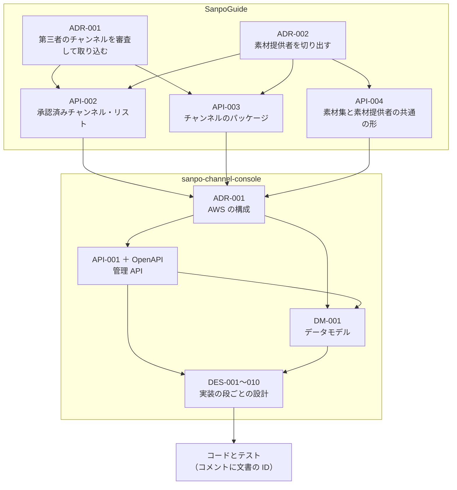
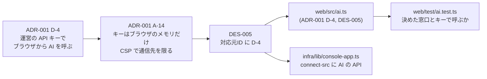

# 9-5 決めたことを残す

[目次](../README.md) ＞ 第 9 部 ＞ 9-5

## この章で学ぶこと

- 2 つのリポジトリの `docs/` にある文書の種類と、それぞれの役目
- ADR: 何を、なぜ決めたか。捨てた案も残す
- 契約書・データモデル・設計書と、文書の ID でコードまでたどる仕組み（トレーサビリティ）
- 決めたことが実装の途中で変わるときの進め方
- 文書の ID を手がかりに、決定からコードとテストまでたどる

## なぜ書いて残すのか

ここまでの章で、何度も「ADR-001 A-14」「API-001 C-8」「DM-001」といった記号が出てきました。コードのコメントにも出てきます。

```ts
/** The `If-Match` value for a resource read earlier (API-001 C-8). */
export const ifMatch = (rev: number) => ({ 'If-Match': `"${rev}"` });
```

コードは **何をするか** を語りますが、**なぜそうしたのか**、**ほかに何を考えて捨てたのか** は語りません。半年後の自分や、新しく加わった人が「なぜ秘密鍵をサーバーに置かないのか」「なぜリストを API でなく静的なファイルで出すのか」と疑問に思ったとき、答えがどこかに書いてあれば、同じ議論を繰り返さずに済みます。間違って「直して」しまうことも防げます。

この 2 つのリポジトリは、**決めてから作る**、**決めたことを文書に残す**、**コードから文書へたどれるようにする** を徹底しています。

## 文書の種類

管理システムの [docs/](../../sanpo-channel-console/docs/) を例にします。

| 種類 | 文書 | 答える問い |
|---|---|---|
| ADR（設計の決定の記録） | [ADR-001](../../sanpo-channel-console/docs/adr/ADR-001-aws-architecture.md) | 何を、なぜ選んだか。ほかの案はなぜ捨てたか |
| API 契約書 | [API-001](../../sanpo-channel-console/docs/console-api.md) ＋ [OpenAPI](../../sanpo-channel-console/docs/api/console.openapi.yaml) | 画面と API の間で、何をどんな形でやりとりするか（[7-3](../07-typescript/03-openapi.md)） |
| データモデル | [DM-001](../../sanpo-channel-console/docs/data-model.md) | 何をどんなキーで保存し、どう取り出すか（[8-5](../08-aws/05-dynamodb.md)） |
| 機能設計書 | [DES-001〜010](../../sanpo-channel-console/docs/design/) | 実装の 1 段ごとに、どう作り、どう確かめたか（DES-007〜010 は素材集） |
| 利用ガイド | [guide/](../../sanpo-channel-console/docs/guide/README.md) | 運営・チャンネル提供者・素材提供者・保守する人は、どう使うか |
| 運用の手順 | [operations/](../../sanpo-channel-console/docs/operations/) | 配備の手順（[deploy.md](../../sanpo-channel-console/docs/operations/deploy.md)）、費用（[cost.md](../../sanpo-channel-console/docs/operations/cost.md)） |
| 構成図 | [architecture.md](../../sanpo-channel-console/docs/architecture.md) | 全体がどうつながっているか |
| TODO | [TODO.md](../../sanpo-channel-console/docs/TODO.md) | 次に何をするか。決めたことの一覧 |
| 作業の記録 | [skill-logs/](../../sanpo-channel-console/docs/skill-logs/) | 文書や実装を、どんな段取りで作り、何に気づいたか |

SanpoGuide の [docs/](../../SanpoGuide/docs/) にも、同じ種類の文書があります。アプリと管理システムの境界を決める文書（API-002 [channel-list-api.md](../../SanpoGuide/docs/channel-list-api.md)・API-003 [channel-package-format.md](../../SanpoGuide/docs/channel-package-format.md)・API-004 [material-producer-api.md](../../SanpoGuide/docs/material-producer-api.md)）は、アプリの側に置いています（[0-1](../00-overview/01-what-we-build.md)）。アプリが受け取るものの形は、アプリが決めるからです。素材提供者を切り出す決定（[ADR-002](../../SanpoGuide/docs/adr/ADR-002-material-producers.md)）と、2 つのリポジトリに共通する関係者の呼び方（[stakeholders.md](../../SanpoGuide/docs/stakeholders.md)）も、SanpoGuide の側にあります。



上の文書が「何を守るか」を決め、下の文書がそれを満たす作り方を決め、コードが実際に作ります。

## ADR: 何を、なぜ決めたか

**ADR**（Architecture Decision Record、設計の決定の記録）は、大事な設計の決定を 1 つずつ残す文書です。[ADR-001](../../sanpo-channel-console/docs/adr/ADR-001-aws-architecture.md) の章立ては次のとおりです。

| 章 | 中身 |
|---|---|
| 文書情報 | ID・種類・作成者・**承認者**・**ステータス**（草案・承認済）・**版** |
| 目的・背景 | なぜ決める必要があるか。開発者が示した条件 |
| スコープ・非スコープ | この文書が決めること・決めないこと |
| 対応元ID | どの上位の文書の、どの決まりに応えるか |
| 方針・決定事項 | 決めたことを、1 行ずつ ID 付きで（D-1…・A-1…） |
| 判断テーマ | 何について悩んだか |
| 検討した代替案と比較軸 | 案ごとの評価。**捨てた案と、捨てた理由** |
| 採用案と採否理由 | 選んだ組み合わせと、その理由 |
| 影響範囲・追従タスク | この決定で、ほかに何をしなければならないか（T-1…） |
| 未決事項・リスク | まだ決めていないこと、いつ決めるか |
| 変更履歴 | いつ、何を、だれが変え、だれが承認したか |

いちばん価値があるのは **「検討した代替案」** です。ADR-001 の表から抜き出します。

| 案 | 評価 |
|---|---|
| 公開 1. API Gateway と Lambda でリストを返す | 管理システムが止まるとアプリが取得できない（P-7 に反する）。呼ばれるたびに費用がかかる → **不採用** |
| 公開 2. S3 と CloudFront で静的ファイルとして出す | P-7 のとおり。費用はほぼ配信量だけ → **採用（A-7）** |
| 署名 C. 秘密鍵を KMS で暗号化して保管し、Lambda で署名 | 契約は変わらない。秘密鍵が Lambda のメモリに出る → **不採用** |
| ログイン 1. チャンネル提供者の鍵だけで入る（署名でログイン） | パスワードが要らない。鍵をなくすとログインもできず、移し替えの本人確認ができない → **不採用** |

「Lambda で返したほうが簡単では？」「鍵でログインさせればパスワードは要らないのでは？」と思った人は、ここを読めば、同じことを考えて捨てた理由が分かります。

### 決定に ID を付ける

決定事項は、1 行ずつ ID を持ちます。

- `D-1`〜: 開発者が決めたこと（「審査の見本は、運営の API キーでブラウザから AI を呼ぶ」= D-4）
- `A-1`〜: 構成の決定（Claude が提案し、開発者が承認したもの。「審査の見本の作り方」= A-14）
- `T-1`〜: 追従タスク（「ルート鍵の手順書」= T-5）

ID があるので、ほかの文書やコードのコメントから **1 行単位で指せます**。

## ID でたどる: 決定からコードとテストまで

[9-3](03-keys-in-browser.md) で見た「AI の API キーをサーバーに送らない」を、文書からコードまでたどってみます。



- [ADR-001](../../sanpo-channel-console/docs/adr/ADR-001-aws-architecture.md) の D-4 と A-14 が決める
- [DES-005](../../sanpo-channel-console/docs/design/DES-005-review.md) の「対応元ID（トレーサビリティ）」の表が、`ADR-001 … D-4（AI の見本は運営のキーでブラウザから） | 実装` と、応えたことを記録する
- [web/src/ai.ts](../../sanpo-channel-console/web/src/ai.ts) の先頭のコメント `The review samples' AI (ADR-001 D-4, DES-005)` が、どの決定を実装したかを示す
- [infra/lib/console-app.ts](../../sanpo-channel-console/infra/lib/console-app.ts) の CSP にも同じ ID のコメント
- [web/test/ai.test.ts](../../sanpo-channel-console/web/test/ai.test.ts) が、決めた窓口とキーで呼ぶことを確かめる

逆向きにもたどれます。コードを読んでいて「なぜブラウザから直接 AI を呼ぶのだろう、サーバーを通したほうが安全では？」と思ったら、コメントの `ADR-001 D-4` から決定に、そこから比較と理由にたどり着けます。

## 決めたことが変わるとき

決めたことが、実装してみて合わないと分かることもあります。そのときは、**文書を黙って無視せず、文書を直してから（または同時に）コードを変えます**。

実際に起きた例です。ADR-001 の A-4 は、最初「運営だけ MFA を必須にする」と決めていました。ところが運営の画面を作る段で、Cognito の MFA は **ユーザープール単位** でしか決められないと分かりました（[8-4](../08-aws/04-cognito.md)）。

1. 作業の記録（[skill-logs/feature_implementation_2026-10-04.md](../../sanpo-channel-console/docs/skill-logs/feature_implementation_2026-10-04.md)）に、気づいたことを書く: 「ADR-001 A-4 の『運営だけ MFA 必須』は、Cognito の MFA がプール単位のためそのままでは作れない」
2. 開発者に判断を仰ぐ → 「全員に MFA を求める」と決める
3. ADR-001 の A-4 を書き換え（「（1.2 で改訂）」と明記）、版を 1.2 に上げ、変更履歴に「A-4 を改訂: MFA は全員に必須（ユーザープール単位でしか決められないため）… Claude（決定: 開発者）」と残す
4. コードのコメントも `(ADR-001 A-4, 1.2: one pool, TOTP MFA for everyone)` と、改訂後の版を指す

こうしておけば、「ADR には運営だけと書いてあるのに、コードは全員に MFA を求めている。どちらが正しい？」という混乱が起きません。

### 承認とステータス

文書には **ステータス**（草案 → 承認済）と **承認者** があります。このリポジトリでは、文書は Claude が開発者と相談しながら書き、**開発者が承認** してから、それに沿って実装に進みます。承認を待っている文書は TODO.md やメモに「承認待ち」と書き、承認前のものに沿って勝手に実装を進めません。

## ハンズオン: 文書の ID でたどる

読むだけのハンズオンです。何も変えません。

### 1. コードが、どの文書をいくつ指しているか

```sh
cd /c/Dev/apps/sanpo-channel-console
grep -rhoE "\b(ADR-001|API-00[0-9]|DM-001|DES-0[0-9][0-9])" api/src web/src infra/lib infra/bin validator/src packages \
  --include=*.ts --include=*.tsx --include=*.kt | sort | uniq -c | sort -rn
```

```text
     64 DM-001
     50 API-001
     37 API-002
     37 ADR-001
     24 DES-007
     19 DES-008
     16 DES-009
     10 API-003
      6 API-004
      5 DES-010
      4 DES-006
      2 DES-005
      1 DES-003
```

（2026-10-12 の main で数えたもの。コードが変われば数も変わります）

データモデル・API 契約書・ADR がよく指されています。SanpoGuide の文書（API-002・API-003・API-004）も、管理システムのコードから指されています。アプリとの境界を守るコードだからです。素材集を足した段（DES-007〜010）の設計書が多く指されているのは、新しく書いたコードほど、どの決定に従ったかをコメントに残しているからです。

### 2. 1 つの決定をたどる

```sh
grep -n "^| D-4 \|^| A-14 " docs/adr/ADR-001-aws-architecture.md
grep -n "D-4" docs/design/DES-005-review.md
grep -rn "D-4" web/src infra/lib
```

ADR の決定 → 設計書の対応元ID → 画面のコードと CDK のコメント、とつながっているのが見えます。

### 3. 決定が変わった記録をたどる

```sh
git log --oneline -- docs/adr/ADR-001-aws-architecture.md
```

```text
8be2b12 docs: 提供元・提供元ID は「リスト・リストID」と呼ぶ
20a7e69 docs: 関係者の呼び方を「散策者・チャンネル提供者・素材提供者・運営」にそろえる
76ff284 docs: 素材集と制作元（実装の順番 4）と PR #23 に文書を追従させる
a5ceaa8 feat: 運用者の画面（Cognito・管理 API・SPA）を追加（実装の順番 2）
404fe6d docs: station-format の公開（ADR-001 T-4）の完了を記録
97d4575 docs: 管理 API の契約書 API-001 と OpenAPI を追加し、DM-001・ADR-001 を 1.1 に改訂
52e10e1 docs: チャンネル管理システムの AWS 構成（ADR-001）と進め方
```

古いコミットのメッセージには、前の呼び方（運用者・提供元・制作元）が残っています。コミットのメッセージはあとから書き換えないので、呼び方を変えた記録（`20a7e69`・`8be2b12`）と一緒に読みます。

A-4 の改訂（1.2）は、運営の画面を作ったコミット `a5ceaa8` に入っています。`git show a5ceaa8 -- docs/adr/ADR-001-aws-architecture.md` で、何が書き換わったかを見られます。決定の変更と、それに合わせた実装が、同じコミットで入っています。

## チュートリアルのおわりに

これで、2 つのリポジトリを通して使われている技術をひととおり見ました。

| 部 | 学んだこと |
|---|---|
| 第 0 部 | 何を作っているか、技術の地図、手元の準備 |
| 第 1〜4 部 | Kotlin と Android、Compose、散策の仕組み、外の世界とのやりとり |
| 第 5 部 | アプリと管理システムが共有する形式（station-format） |
| 第 6 部 | 署名と信頼: なぜ、どう確かめるか |
| 第 7 部 | TypeScript のモノレポ、契約から始める作り方、テスト |
| 第 8 部 | AWS のサーバーレス: CDK・Lambda・Cognito・DynamoDB・S3・CloudFront・SQS・Kotlin の Lambda |
| 第 9 部 | 管理画面（React・ログイン・ブラウザの中の鍵）、CI、文書 |

次の一歩としては:

- 興味を持った部分の **テストを読む**。テストは、その部分に何が求められているかを一番正確に語る
- 各章の「やってみよう」のように、**わざと壊して、どのテストが止めるかを見る**
- 小さな変更を考え、**文書（どの決定に関わるか）→ コード → テスト → CI** の順に進めてみる

コードは日々変わります。このチュートリアルの見直しの手順は [MAINTENANCE.md](../MAINTENANCE.md) にあります。

## つまずきやすいところ

- **コードは「何を」、文書は「なぜ」**: なぜを知りたいときは、コメントの文書の ID からたどる
- **捨てた案こそ残す**: 同じ議論を繰り返さないため
- **決定が合わなくなったら、文書を直す**: 黙ってコードだけ変えない。版と変更履歴を残す
- **境界の文書は、受け取る側に置く**: アプリが受け取る形（API-002・API-003）はアプリのリポジトリに
- **承認前の文書に沿って、勝手に作り込まない**

## 確認問題

<details>
<summary>問 1. 「承認済みチャンネル・リストを Lambda で返せば、もっと簡単なのに」と思いました。どこを読めば、なぜそうしなかったかが分かりますか。</summary>

管理システムの ADR-001 の「検討した代替案と比較軸」です。「公開 1. API Gateway と Lambda でリストを返す」は、管理システムが止まるとアプリがリストを取れない（API-002 P-7 に反する）、呼ばれるたびに費用がかかる、という理由で捨てられ、S3 と CloudFront の静的ファイル（A-7）が選ばれています。

</details>

<details>
<summary>問 2. コードに (ADR-001 A-4, 1.2: …) と、版まで書いてあるのはなぜですか。</summary>

A-4 が 1.2 で改訂されたからです。改訂前の「運営だけ MFA 必須」と区別し、改訂後の決定（全員に MFA）を実装していることを示しています。

</details>

<details>
<summary>問 3. 実装の途中で、ADR の決定どおりには作れないと分かりました。どう進めますか。</summary>

気づいたことを記録し、決める人（開発者）に判断を仰ぎます。決まったら、ADR の該当する行を書き換えて版を上げ、変更履歴に理由と承認者を残し、それに合わせてコードとコメントを変えます。

</details>

---

前: [9-4 CI](04-ci.md) ／ [目次へ戻る](../README.md)
