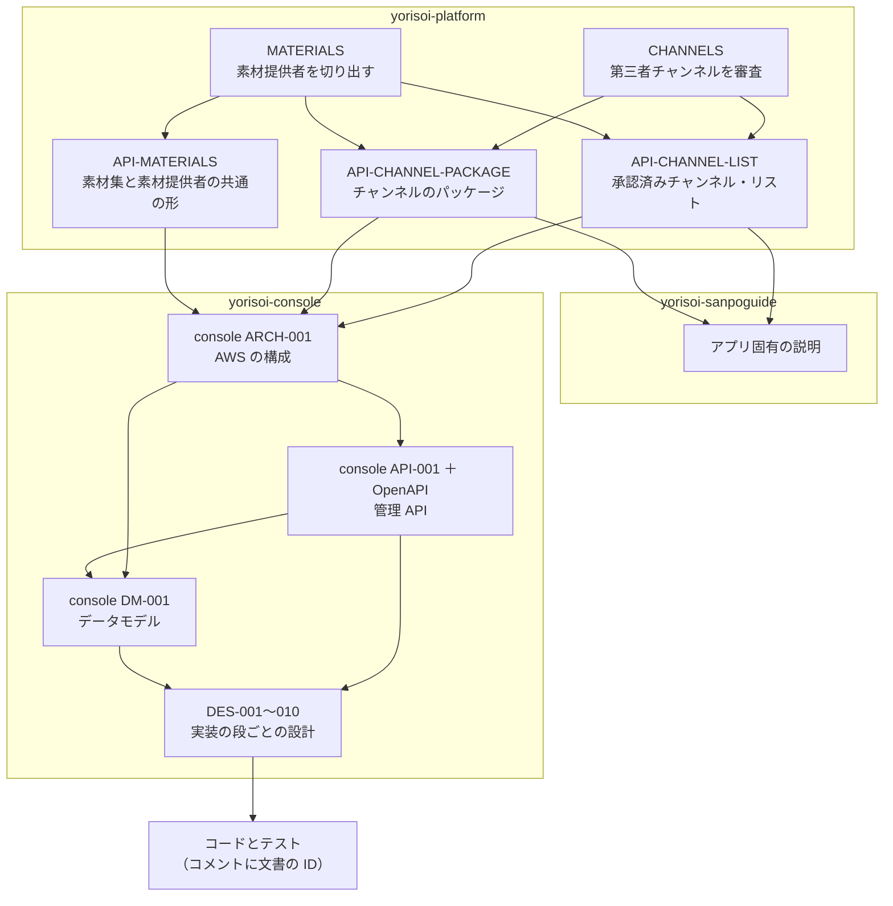
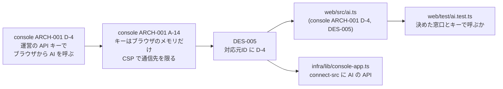

# 9-5 決めたことを残す

[目次](../README.md) ＞ 第 9 部 ＞ 9-5

## この章で学ぶこと

- 3 つのリポジトリの `docs/` にある文書の種類と、それぞれの役目
- 決まり: 何を決めたか。比べた案は検討中の ADR と git に残す
- 契約書・データモデル・設計書と、文書の ID でコードまでたどる仕組み（トレーサビリティ）
- 決めたことが実装の途中で変わるときの進め方
- 文書の ID を手がかりに、決定からコードとテストまでたどる

## なぜ書いて残すのか

ここまでの章で、何度も「console ARCH-001 A-14」「console API-001 C-8」「console DM-001」といった記号が出てきました。コードのコメントにも出てきます。

```ts
/** The `If-Match` value for a resource read earlier (API-001 C-8). */
export const ifMatch = (rev: number) => ({ 'If-Match': `"${rev}"` });
```

コードは **何をするか** を語りますが、**なぜそうしたのか**、**ほかに何を考えて捨てたのか** は語りません。半年後の自分や、新しく加わった人が「なぜ秘密鍵をサーバーに置かないのか」「なぜリストを API でなく静的なファイルで出すのか」と疑問に思ったとき、答えがどこかに書いてあれば、同じ議論を繰り返さずに済みます。間違って「直して」しまうことも防げます。

これらのリポジトリは、**決めてから作る**、**決めたことを文書に残す**、**コードから文書へたどれるようにする** を徹底しています。エコシステム共通のルールは platform、管理システム固有の実装判断は console の文書が正本です。

## 文書の種類

管理システムの [文書一覧](https://github.com/duwenji/yorisoi-console/blob/main/docs/README.md) を例にします。

| 種類 | 文書 | 答える問い |
|---|---|---|
| 構成の決まり | [console ARCH-001](https://github.com/duwenji/yorisoi-console/blob/main/docs/design/architecture.md) の「決まり」 | 何を決めたか。どうなったら見直すか |
| API 契約書 | [console API-001](https://github.com/duwenji/yorisoi-console/blob/main/docs/contracts/console-api.md) ＋ [OpenAPI](https://github.com/duwenji/yorisoi-console/blob/main/docs/contracts/api/console.openapi.yaml) | 画面と API の間で、何をどんな形でやりとりするか（[7-3](../07-typescript/03-openapi.md)） |
| データモデル | [console DM-001](https://github.com/duwenji/yorisoi-console/blob/main/docs/design/data-model.md) | 何をどんなキーで保存し、どう取り出すか（[8-5](../08-aws/05-dynamodb.md)） |
| 機能設計書 | [DES-001〜010](https://github.com/duwenji/yorisoi-console/tree/main/docs/design) | 実装の 1 段ごとに、どう作り、どう確かめたか（DES-007〜010 は素材集） |
| 利用ガイド | [guide/](https://github.com/duwenji/yorisoi-console/blob/main/docs/manual/README.md) | 運営・チャンネル提供者・素材提供者・保守する人は、どう使うか |
| 運用の手順 | [operations/](https://github.com/duwenji/yorisoi-console/tree/main/docs/operations) | 配備の手順（[deploy.md](https://github.com/duwenji/yorisoi-console/blob/main/docs/operations/deploy.md)）、費用（[cost.md](https://github.com/duwenji/yorisoi-console/blob/main/docs/operations/cost.md)） |
| 構成図 | [architecture.md](https://github.com/duwenji/yorisoi-console/blob/main/docs/design/architecture.md) | 全体がどうつながっているか |
| TODO | [console TODO](https://github.com/duwenji/yorisoi-console/blob/main/docs/TODO.md) | 残っている作業 |

SanpoGuide 固有の説明は [yorisoi-sanpoguide の文書](https://github.com/duwenji/yorisoi-sanpoguide/blob/main/docs/README.md) にあります。アプリと管理システムの共有契約（[platform API-CHANNEL-LIST](https://github.com/duwenji/yorisoi-platform/blob/main/docs/contracts/API-CHANNEL-LIST.md)・[API-CHANNEL-PACKAGE](https://github.com/duwenji/yorisoi-platform/blob/main/docs/contracts/API-CHANNEL-PACKAGE.md)・[API-MATERIALS](https://github.com/duwenji/yorisoi-platform/blob/main/docs/contracts/API-MATERIALS.md)）と、素材提供者の役割を定める [platform MATERIALS](https://github.com/duwenji/yorisoi-platform/blob/main/docs/overview/materials.md) は platform にあります。関係者の呼び方も [platform の共通用語](https://github.com/duwenji/yorisoi-platform/blob/main/docs/overview/roles-and-vocabulary.md) が正本です。



上の文書が「何を守るか」を決め、下の文書がそれを満たす作り方を決め、コードが実際に作ります。

## 決まり: 何を決めたか

決めたことは、正本の文書の **「決まり」** の節に、1 行ずつ ID を付けて書きます。管理システムの構成の決まりは [console ARCH-001](https://github.com/duwenji/yorisoi-console/blob/main/docs/design/architecture.md)（構成図と同じ文書）の後半にあります。

| 節 | 中身 |
|---|---|
| 決まり | 決めたことを、1 行ずつ ID 付きで（前提 D-1…・構成 A-1…） |
| 制約 | 外から決まっていて変えられないこと（KMS の署名の大きさなど） |
| 見直しの条件 | どうなったら決まりを考え直すか |
| 未決事項・リスク | まだ決めていないこと、いつ決めるか |

エコシステム共通の決まりは platform の方針の文書（[ECOSYSTEM](https://github.com/duwenji/yorisoi-platform/blob/main/docs/overview/yorisoi-ecosystem.md)・[CHANNELS](https://github.com/duwenji/yorisoi-platform/blob/main/docs/overview/channels.md)・[MATERIALS](https://github.com/duwenji/yorisoi-platform/blob/main/docs/overview/materials.md)・[AI-ROLES](https://github.com/duwenji/yorisoi-platform/blob/main/docs/overview/ai-roles.md)）に、同じ形で書いてあります。

### 比べた案はどこに残るか

大事な判断は、決める前に **ADR**（Architecture Decision Record）に書いて検討します。ADR には、目的・案ごとの評価・選んだ理由を書き、開発者が承認します。承認したら、決まりを正本の文書に移し、ADR は消します。文書には **今の決まりだけ** を残すためです。

比べた案と捨てた理由は、ADR を足して消したコミットとプルリクエストに残ります。消した ADR は git で読めます。

```sh
cd /c/Dev/apps/yorisoi-console
git log --diff-filter=D --oneline -- docs/adr/      # ADR を消したコミット
git show <そのコミット>^:docs/adr/ADR-001-aws-architecture.md   # 消す前の中身
```

「Lambda でリストを返したほうが簡単では？」と思ったら、決まりの A-7（S3 と CloudFront で静的なファイルとして出す）を読み、理由まで知りたければ、この方法で消す前の ADR の「検討した代替案」を開きます。

### 決まりに ID を付ける

決まりは、1 行ずつ ID を持ちます。

- `D-1`〜: 開発者が決めた前提（「審査の見本は、運営の API キーでブラウザから AI を呼ぶ」= D-4）
- `A-1`〜: 構成の決まり（Claude が提案し、開発者が承認したもの。「審査の見本の作り方」= A-14）

ID があるので、ほかの文書やコードのコメントから **1 行単位で指せます**。番号は詰めないので、行を消しても、ほかの番号の指す先は変わりません。

## ID でたどる: 決定からコードとテストまで

[9-3](03-keys-in-browser.md) で見た「AI の API キーをサーバーに送らない」を、文書からコードまでたどってみます。



- [console ARCH-001](https://github.com/duwenji/yorisoi-console/blob/main/docs/design/architecture.md) の D-4 と A-14 が決める
- [DES-005](https://github.com/duwenji/yorisoi-console/blob/main/docs/design/DES-005-review.md) の「対応元ID（トレーサビリティ）」の表が、`ARCH-001 … D-4（AI の見本は運営のキーでブラウザから） | 実装` と、応えたことを記録する
- [web/src/ai.ts](https://github.com/duwenji/yorisoi-console/blob/main/web/src/ai.ts) の先頭のコメント `The review samples' AI (ARCH-001 D-4, DES-005)` が、どの決定を実装したかを示す
- [infra/lib/console-app.ts](https://github.com/duwenji/yorisoi-console/blob/main/infra/lib/console-app.ts) の CSP にも同じ ID のコメント
- [web/test/ai.test.ts](https://github.com/duwenji/yorisoi-console/blob/main/web/test/ai.test.ts) が、決めた窓口とキーで呼ぶことを確かめる

逆向きにもたどれます。コードを読んでいて「なぜブラウザから直接 AI を呼ぶのだろう、サーバーを通したほうが安全では？」と思ったら、コメントの `console ARCH-001 D-4` から決まりの行にたどり着けます。比べた案まで知りたければ、消す前の ADR を git で開きます。

## 決めたことが変わるとき

決めたことが、実装してみて合わないと分かることもあります。そのときは、**文書を黙って無視せず、文書を直してから（または同時に）コードを変えます**。

たとえば console ARCH-001 の A-4 は「MFA（TOTP）は全員に必須」です。Cognito の MFA は **ユーザープール単位** でしか決められないので（[8-4](../08-aws/04-cognito.md)）、「運営だけに必須」にはできません。もし文書が「運営だけ」と書いていて、実装の途中でこの制約に気づいたら、次のように進めます。

1. 開発者に判断を仰ぐ（「全員に MFA を求める」か、プールを分けるか）
2. 決まったら、ARCH-001 の A-4 を新しい決まりに書き換える
3. 同じコミットで、コードとコメント（`(ARCH-001 A-4: one pool, TOTP MFA for everyone)`）を変える

文書には **今の決定だけ** を書きます。前の決定と、変えた理由は、コミットのメッセージと差分（git の履歴）に残ります。こうしておけば、「文書には運営だけと書いてあるのに、コードは全員に MFA を求めている。どちらが正しい？」という混乱が起きず、経緯も git でたどれます。

### 承認とステータス

文書には **ステータス**（草案 → 承認済）と **承認者** があります。このリポジトリでは、文書は Claude が開発者と相談しながら書き、**開発者が承認** してから、それに沿って実装に進みます。承認を待っている文書は TODO.md やメモに「承認待ち」と書き、承認前のものに沿って勝手に実装を進めません。

## ハンズオン: 文書の ID でたどる

読むだけのハンズオンです。何も変えません。

### 1. コードが、どの文書をいくつ指しているか

```sh
cd /c/Dev/apps/yorisoi-console
grep -rhoE "\b(ARCH-001|API-001|API-CHANNEL-[A-Z]+|API-MATERIALS|DM-001|DES-0[0-9][0-9])" api/src web/src infra/lib infra/bin validator/src packages \
  --include=*.ts --include=*.tsx --include=*.kt | sort | uniq -c | sort -rn
```

```text
     64 DM-001
     49 API-001
     38 DES-013
     38 ARCH-001
     34 API-CHANNEL-LIST
     29 DES-011
     20 DES-007
     18 DES-008
     16 DES-009
     15 API-MATERIALS
     13 API-CHANNEL-PACKAGE
      5 DES-010
      4 DES-006
      2 DES-005
      1 DES-003
```

（main で数えたもの。コードが変われば数も変わります）

データモデル・API 契約書・構成の決まりがよく指されています。platform の共有契約（API-CHANNEL-LIST・API-CHANNEL-PACKAGE・API-MATERIALS）も、管理システムのコードから指されています。アプリとの境界を守るコードだからです（番号の読み方は [0-4](../00-overview/04-reading-the-repos.md)）。エコシステムへの対応（DES-011）、素材集を足した段（DES-007〜010）の設計書が多く指されているのは、新しく書いたコードほど、どの決定に従ったかをコメントに残しているからです。

### 2. 1 つの決定をたどる

```sh
grep -n "^| D-4 \|^| A-14 " docs/design/architecture.md
grep -n "D-4" docs/design/DES-005-review.md
grep -rn "D-4" web/src infra/lib
```

構成の決まり → 設計書の対応元ID → 画面のコードと CDK のコメント、とつながっているのが見えます。

### 3. 決定が変わった記録をたどる

```sh
git log --oneline --follow -- docs/design/architecture.md
git log -p --follow -S "A-4" -- docs/design/architecture.md
```

1 つ目は、ARCH-001 を変えたコミットの一覧です。2 つ目は、`A-4` を含む行が増えたり減ったりしたコミットを、差分つきで出します。文書には今の決定だけが書かれているので、「前はどうだったか」「なぜ変えたか」は、こうして git の履歴から読みます。決定の変更と、それに合わせた実装が、同じコミットに入っていることも確かめられます。

## チュートリアルのおわりに

これで、3 つのリポジトリにまたがる 2 つのシステムで使われている技術をひととおり見ました。

| 部 | 学んだこと |
|---|---|
| 第 0 部 | 何を作っているか、技術の地図、手元の準備 |
| 第 1〜4 部 | Kotlin と Android、Compose、散策の仕組み、外の世界とのやりとり |
| 第 5 部 | アプリと管理システムが共有する形式（コアとプロンプト・パック） |
| 第 6 部 | 署名と信頼: なぜ、どう確かめるか |
| 第 7 部 | TypeScript のモノレポ、契約から始める作り方、テスト |
| 第 8 部 | AWS のサーバーレス: CDK・Lambda・Cognito・DynamoDB・S3・CloudFront・SQS・Kotlin の Lambda |
| 第 9 部 | 管理画面（React・ログイン・ブラウザの中の鍵）、CI、文書 |

次の一歩としては:

- 興味を持った部分の **テストを読む**。テストは、その部分に何が求められているかを一番正確に語る
- 各章の「やってみよう」のように、**わざと壊して、どのテストが止めるかを見る**
- 小さな変更を考え、**文書（どの決定に関わるか）→ コード → テスト → CI** の順に進めてみる

コードは日々変わります。このチュートリアルの見直しの手順は [MAINTENANCE.md](../MAINTENANCE.md) にあります。

## つまずきやすいところ

- **コードは「何を」、文書は「なぜ」**: なぜを知りたいときは、コメントの文書の ID からたどる
- **捨てた案こそ残す**: 同じ議論を繰り返さないため
- **決定が合わなくなったら、文書を直す**: 黙ってコードだけ変えない。文書には今の決定を書き、経緯は git に残す
- **共通契約の正本は platform に置く**: アプリと管理システムは、その契約に沿って実装する
- **承認前の文書に沿って、勝手に作り込まない**

## 確認問題

<details>
<summary>問 1. 「承認済みチャンネル・リストを Lambda で返せば、もっと簡単なのに」と思いました。どこを読めば、なぜそうしなかったかが分かりますか。</summary>

console ARCH-001 の「検討した代替案と比較軸」です。「公開 1. API Gateway と Lambda でリストを返す」は、管理システムが止まるとアプリがリストを取れない（platform API-CHANNEL-LIST P-7 に反する）、呼ばれるたびに費用がかかる、という理由で捨てられ、S3 と CloudFront の静的ファイル（A-7）が選ばれています。

</details>

<details>
<summary>問 2. コードに <code>(ARCH-001 A-4: one pool, TOTP MFA for everyone)</code> と、決定の中身まで書いてあるのはなぜですか。</summary>

ID だけでなく中身を一言添えると、コードを読む人が、文書を開かなくても何に従っているかが分かるからです。決定が変わったときも、コメントと文書を見比べれば、コードが今の決定に追従しているかをすぐに確かめられます。

</details>

<details>
<summary>問 3. 実装の途中で、決まりのとおりには作れないと分かりました。どう進めますか。</summary>

気づいたことを記録し、決める人（開発者）に判断を仰ぎます。決まったら、正本の文書の該当する行を今の決まりに書き換え、同じコミットでコードを変えます。前の決定と理由は git の履歴に残ります。

</details>

---

前: [9-4 CI](04-ci.md) ／ 次: [第 10 部 10-1 AAB と Play App Signing](../10-play/01-app-bundle.md)
