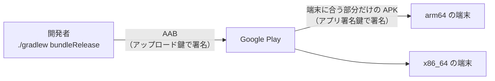

# 10-1 AAB と Play App Signing

[目次](../README.md) ＞ 第 10 部 ＞ 10-1

> AAB の仕組みと最小の使い方は [技術カード: Android App Bundle](../ref/android-app-bundle.md) にあります。

## この章で学ぶこと

- Google Play に上げるファイル（AAB）が、APK とどう違うのか
- 2 つの鍵（アップロード鍵とアプリ署名鍵）と、Play App Signing が守るもの
- `versionCode` がなぜ戻せないのか
- 散策ガイドと CycleGuide が、AAB を作って Play に上げるまで

## 第 10 部について

ここまでの部で、散策ガイドがどう動くかを読んできました。でも、アプリは作っただけでは散策者の手元に届きません。第 10 部は、**Google Play で配る** ための仕組みを読みます。

| 章 | 内容 |
|---|---|
| 10-1（この章） | Play に上げるファイルと、署名の鍵 |
| [10-2](02-tracks.md) | トラック（内部テスト → クローズドテスト → 製品版）と、版の出し方 |
| [10-3](03-console.md) | Play Console の申告（データ セーフティ・フォアグラウンドサービス・ストアの掲載情報） |
| [10-4](04-api.md) | Google Play Developer API で出す（`tools/play.mjs`） |
| [10-5](05-integrity.md) | Play Integrity: Play から入れた本物のアプリかを確かめる |

正本は SanpoGuide の [docs/release.md](https://github.com/duwenji/yorisoi-sanpoguide/blob/main/docs/release.md)・[play-console.md](https://github.com/duwenji/yorisoi-sanpoguide/blob/main/docs/play-console.md)・[play-api.md](https://github.com/duwenji/yorisoi-sanpoguide/blob/main/docs/play-api.md) です。このチュートリアルは「なぜそうするのか」を説明し、手順の細部はそちらに任せます。Play Console の画面やポリシーはよく変わるので、実際に操作するときは正本と Google の公式の案内を見てください。

## APK と AAB

[1-4](../01-kotlin-android/04-signing-apk.md) で作った APK は、端末にそのまま入れられるアプリのファイルでした。Google Play に上げるのは APK ではなく **AAB**（Android App Bundle）です。新しいアプリは AAB で出すことが求められています。



AAB は「APK の材料」です。端末ごとに要るもの（CPU の種類ごとのネイティブのライブラリ、画面の細かさごとの画像、言語ごとの文字列）を全部入れておき、Play が **端末ごとに要る部分だけで APK を組み立てて** 配ります。散策者がダウンロードする量が減ります。

散策ガイドの AAB の中を見ると、APK との違いが分かります（ハンズオンで実際に見ます）。

| AAB の中 | 意味 |
|---|---|
| `base/dex/` | コンパイルしたコード（APK の `classes*.dex` にあたる） |
| `base/lib/arm64-v8a/` など 4 つ | CPU の種類ごとのネイティブのライブラリ。端末には 1 つだけ届く |
| `base/res/`・`base/resources.pb` | 画像や文字列などのリソース |
| `base/manifest/AndroidManifest.xml` | マニフェスト（テキストではなく、protobuf という形） |
| `base/root/` | そのほかのファイル（プロンプト・パックのリソースなど） |
| `BundleConfig.pb` | どう分けて APK を作るかの設定 |
| `META-INF/*.SF`・`*.RSA` | アップロード鍵の署名（鍵があるときだけ） |

`base` は、アプリの本体の「モジュール」の名前です。大きなアプリは、必要になってからダウンロードする機能を別のモジュールに分けられますが、散策ガイドは本体だけです。

## 2 つの鍵: Play App Signing

[1-4](../01-kotlin-android/04-signing-apk.md) で見たように、Android は **同じ鍵で署名されたアプリだけ** を更新として受け入れます。鍵をなくすと、二度と同じアプリとして更新できません。Google Play は、この危うさを **Play App Signing** で和らげています。

| 鍵 | だれが持つか | 何に署名するか | なくしたら |
|---|---|---|---|
| **アップロード鍵** | 開発者（`release.jks`） | Play に上げる AAB | Play Console から新しいアップロード鍵に替えてもらえる |
| **アプリ署名鍵** | Google | 散策者の端末に届く APK | Google の手元にあるので、なくならない |

- 端末が「同じアプリか」を確かめるのは、アプリ署名鍵です。これを Google が持つので、開発者がパソコンを壊しても、アプリの更新は続けられます
- アップロード鍵は「この AAB は本当にこの開発者が上げたものか」を Play が確かめるための鍵です。漏れたら替えられます
- その代わり、端末に届くアプリには **Google の鍵で署名し直したもの** が入ります。開発者は、端末に届く APK を自分の鍵で作ることはできません

散策ガイドの `release.jks` は、このアップロード鍵です（[play-console.md の「アプリの基本」](https://github.com/duwenji/yorisoi-sanpoguide/blob/main/docs/play-console.md#アプリの基本)）。

### 手で入れた APK とは混ざらない

これには、気づきにくい結果があります。テストのために **APK を手で入れた端末** に、Play から同じアプリを入れようとすると、失敗します。手で入れた APK はアップロード鍵（`release.jks`）で、Play の APK はアプリ署名鍵で署名されていて、鍵が違うからです。先に手で入れた方を消す必要があり、端末に残した記録も消えます（[10-2](02-tracks.md) のテスターへの案内）。

## versionCode は戻せない

[1-2](../01-kotlin-android/02-gradle.md) で見た `versionCode` は、Play にとって特別な値です。

```kotlin
defaultConfig {
    // …
    versionCode = 9
    versionName = "1.5.2"
}
```

- 端末は `versionCode` が **大きい方** を新しい版と判断する。だから版を出すたびに 1 つ以上増やす
- Play は、**一度上げた `versionCode` の AAB を二度と受け付けない**。中身を直して同じ番号で上げ直すことはできない
- 不具合の版を出してしまったら、前の版のコードで `versionCode` だけを増やした版を作って出し直す（[release.md の「不具合の版を出してしまったとき」](https://github.com/duwenji/yorisoi-sanpoguide/blob/main/docs/release.md#不具合の版を出してしまったとき)）

`versionName`（`1.5.2`）は人に見せるための文字で、比べるのには使われません。散策ガイドは、Play のリリース名を `versionName` だけにしています（[10-2](02-tracks.md)）。

`versionCode` には、もう 1 つ役目があります。管理システムは、アプリが対応した機能（素材の段など）を `versionCode` で見分けます（[5-4](../05-station-format/04-materials-cues.md)）。版を出すときは、管理システムの側の数字との関係も考えます。

## AAB を作る

```sh
./gradlew bundleRelease
```

- 出力は `app/build/outputs/bundle/release/app-release.aab`
- 署名の設定は、APK と同じ `signingConfigs`（`keystore.properties` と `release.jks`、[1-4](../01-kotlin-android/04-signing-apk.md)）を使う。鍵がなければ、署名のない AAB ができる（Play には上げられない）
- 散策ガイドは、作った AAB を `release/yorisoi-sanpoguide-<版>.aab` の名前で取っておき、[10-4](04-api.md) の道具で Play に上げる

上げる前に、リリース版をエミュレータか実機で必ず確かめます。デバッグ版と違い、リリース版は最適化や署名の設定が違い、デバッグ版では出なかった不具合が出ることがあります。散策ガイドは、起動・位置の許可・散策の開始と終了（通知・画面を閉じたときの案内）・チャンネルの切り替え・設定の保存・記録を確かめる、と決めています（[release.md の「版を出すとき」](https://github.com/duwenji/yorisoi-sanpoguide/blob/main/docs/release.md#版を出すとき)）。

CycleGuide も同じ流れで、同じ形の AAB を作ります（[yorisoi-cycleguide の docs/release.md](https://github.com/duwenji/yorisoi-cycleguide/blob/main/docs/release.md)）。

## ハンズオン: AAB を作って、中を見る

署名の鍵は要りません。鍵がなければ、署名のない AAB ができます。

### 1. AAB を作る

```sh
cd ../yorisoi-sanpoguide
./gradlew :app:bundleRelease
ls app/build/outputs/bundle/release/
```

```
app-release.aab
```

GitHub Packages を読むトークンがないときは、`-Pyorisoi.platformDir=../yorisoi-platform` を付けます（[1-2](../01-kotlin-android/02-gradle.md)）。

### 2. 中を見る

AAB も ZIP です。

```sh
unzip -l app/build/outputs/bundle/release/app-release.aab | awk '{print $4}' \
  | sed -E 's#^([^/]+/[^/]+)/.*#\1/…#' | sort | uniq -c | sort -rn | head -14
```

```
    176 base/res/…
    161 base/root/…
      5 base/dex/…
      4 base/lib/…
      …
      1 base/resources.pb
      1 base/native.pb
      1 base/manifest/…
      1 BundleConfig.pb
      …
```

（数は版によって変わります。）

- `base/lib/…` が 4 つ: CPU の種類（`arm64-v8a`・`armeabi-v7a`・`x86`・`x86_64`）ごとのライブラリ。端末には、その端末の 1 つだけが届く
- `META-INF/` の `.SF`・`.RSA` がない: 署名がないから。本物の鍵で作った AAB には、アップロード鍵の署名が入る

### 3. APK と比べる

```sh
./gradlew :app:assembleRelease
unzip -l app/build/outputs/apk/release/app-release-unsigned.apk | grep "lib/"
```

APK には、4 つの CPU のライブラリが全部入っています。手で入れる APK は、どの端末でも動くように全部を持つしかありません。AAB なら、Play が端末ごとに選んで配れます。

### 4. 片付け

`app/build/` はビルドの出力なので、Git には入っていません。消すなら `./gradlew clean` です。

## つまずきやすいところ

- **Play に上げるのは AAB**: APK は手で入れるテストのとき
- **同じ `versionCode` は二度と上げられない**: 中身を直したら番号も上げる
- **手で入れたアプリと Play のアプリは鍵が違う**: 同じ端末で切り替えるときは、先に消す
- **アップロード鍵も別の場所に写しを置く**: 替えてもらえるが、手間と時間がかかる
- **リリース版を上げる前に動かす**: デバッグ版だけで確かめない

## 確認問題

<details>
<summary>問 1. Play App Signing を使うと、開発者がアップロード鍵をなくしても、アプリの更新を続けられるのはなぜですか。</summary>

端末が「同じアプリか」を確かめるのに使うのはアプリ署名鍵で、それは Google が持っているからです。アップロード鍵は、Play が「この AAB を上げたのは本人か」を確かめるだけの鍵なので、なくしても Play Console で新しいアップロード鍵に替えてもらえます。

</details>

<details>
<summary>問 2. テスターの端末に、手で入れた散策ガイド（APK）があります。Play から入れようとすると失敗します。なぜですか。</summary>

手で入れた APK はアップロード鍵で、Play から届く APK は Google のアプリ署名鍵で署名されていて、鍵が違うからです。Android は同じ鍵で署名されたアプリだけを更新として受け入れます。先に手で入れた方を消してから入れます。

</details>

<details>
<summary>問 3. versionCode 9 の版に不具合がありました。直して、もう一度 versionCode 9 で上げられますか。</summary>

上げられません。Play は一度上げた `versionCode` の AAB を受け付けないからです。直した版は `versionCode` を 10 以上にして上げます。

</details>

---

前: [9-5 決めたことを残す](../09-console/05-docs.md) ／ 次: [10-2 トラックと版を出す](02-tracks.md)
