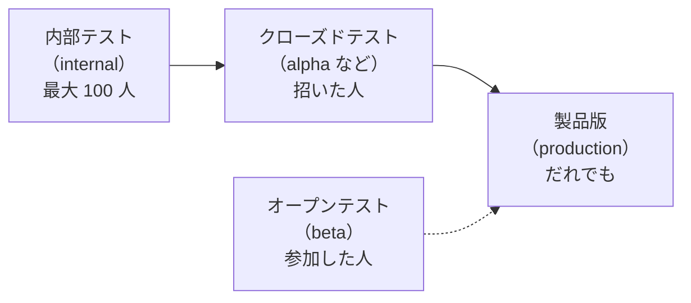

# 10-2 トラックと版を出す

[目次](../README.md) ＞ 第 10 部 ＞ 10-2

## この章で学ぶこと

- トラック（内部テスト・クローズドテスト・製品版）と、それぞれの使いどころ
- 審査と、新しいアプリの最初の審査
- 段階的な公開と、配布の停止
- リリース名とリリースノートの決まり
- テスターに入れてもらうときのつまずき

## トラック

Play に上げた AAB は、**トラック** に出します。トラックは「だれに配るか」の区切りです。



| トラック | だれに | 使いどころ |
|---|---|---|
| 内部テスト | 登録した人（最大 100 人） | 開発者と身近な人で、すぐに確かめる |
| クローズドテスト | 招いた人・グループ | 製品版の前に、決まった人たちに試してもらう |
| オープンテスト | 参加したいだれでも | 広く試してもらう（散策ガイドは使っていない） |
| 製品版 | ストアのだれでも | 本番 |

同じ AAB（同じ `versionCode`）を、内部テストで確かめてから、クローズドテスト・製品版に **そのまま** 出せます。作り直さないので、確かめたものと配るものが同じだと言えます（[10-4](04-api.md) の `--version-code`）。

### 個人のアカウントには、製品版の前の条件がある

散策ガイドは、個人のデベロッパー アカウントで出しています。新しい個人のアカウントは、製品版に出す前に **12 人以上のテスターで、14 日以上のクローズドテスト** を求められます（[play-console.md の「初回の登録」](https://github.com/duwenji/yorisoi-sanpoguide/blob/main/docs/play-console.md#初回の登録)）。内部テストには、この条件はありません。CycleGuide が「最初は内部テストまで出す」と決めているのは、このためです（[yorisoi-cycleguide の docs/release.md](https://github.com/duwenji/yorisoi-cycleguide/blob/main/docs/release.md)）。

## 審査

Play に出すものは、どのトラックでも Google の **審査** を通ります。アプリの中身だけでなく、ストアの掲載情報や申告（[10-3](03-console.md)）も審査の対象です。

- 新しいアプリは、最初の審査を通るまで、内部テストのテスターにも見えないことがある。見えても、仮の名前（パッケージ名と「unreviewed」）で出る
- 最初の審査を通るまで、クローズドテストには出せない（API が「draft app」として断る）
- 審査の結果は、Play Console の [公開の概要] で確かめる

保存しただけでは審査に出ません。保存した変更を [公開の概要] から **まとめて審査に送る** 形です（[10-4](04-api.md) の API では、`--commit` がこれにあたります）。

## 段階的な公開と、配布の停止

製品版では、新しい版を **一部の人にだけ** 先に配れます（段階的な公開。たとえば 5% → 20% → 100%）。クラッシュが増えないかを見てから広げ、問題があれば途中で止めます。

| 事態 | すること |
|---|---|
| 段階的な公開の途中で不具合 | 公開を止める（ロールアウトの停止）。まだ受け取っていない人には届かない |
| すでに全員に出た | 前の版のコードで `versionCode` を上げた版を作り、出し直す（[10-1](01-app-bundle.md)） |

止めても、すでに受け取った端末からは消えません。Play は止めた版の代わりに、一つ前の版を配り直します。

散策ガイドの API の道具（[10-4](04-api.md)）は、版をトラックの **全員に** 出します（段階的にはならない）。製品版を段階的に出すときは、Play Console の画面で出す、と決めています（[play-api.md の「使い方」](https://github.com/duwenji/yorisoi-sanpoguide/blob/main/docs/play-api.md#使い方)）。

## リリース名とリリースノート

[release.md の「リリース名とリリースノート」](https://github.com/duwenji/yorisoi-sanpoguide/blob/main/docs/release.md#リリース名とリリースノート)に、決まりがあります。

- **リリース名** は `versionName` だけ（例: `1.5.2`）。Play Console の画面で出すと、既定で `9 (1.5.2)` のように入るので書き換える
- **リリースノート** は散策者に向けた日本語で、500 文字まで。ストアの「最新情報」とテスターの画面に出る
  - 散策者から見て変わったことを、「・」で始めて 1 行に 1 つ、1〜3 行
  - 開発の言葉（中継・PR の番号・内部の名前）は使わない
  - 回数の上限や費用のように、散策者に関わる条件は書く
  - 同じ版は、どのトラックでも同じ文にする。最初に内部テストに出すときから、製品版に出せる文で書く

```text
・設定なしで AI の解説と話しかけを使えるようになりました（1 日に使える回数に上限があります）
・自分の API キーに切り替えて使うこともできます
```

コミットのメッセージや PR の説明は開発者に向けた文、リリースノートは散策者に向けた文です。同じ変更でも、読む人が違えば書き方が変わります。

## テスターに入れてもらう

テスターへの案内は、つまずきが多いところです（[release.md の「テスターへの案内」](https://github.com/duwenji/yorisoi-sanpoguide/blob/main/docs/release.md#テスターへの案内)）。

| つまずき | 理由と対処 |
|---|---|
| 「アイテムが見つかりませんでした」 | テスターとして登録したアカウントと、端末の Play ストアのアカウントが違う。または、テスターになってすぐで、まだ反映されていない。しばらく待って開き直す |
| ブラウザで「インストール」を押しても進まない | ブラウザからは端末への遠隔のインストールになり、機種によっては進まない。リンクを **Play ストアのアプリ** で開く |
| 入れられない | 手で入れた APK が残っている。鍵が違うので上書きできない（[10-1](01-app-bundle.md)）。先に消す |
| 検索に出てこない | 内部テストのアプリは検索に出ない。参加用の URL から開く |
| Play ストアが黒い画面のまま | 端末に複数のアカウントがあり、別のアカウントで開いている。右上で切り替える |

散策ガイドは有料のアプリです。内部テストのテスターは無料で入れられますが、クローズドテスト・オープンテストのテスターは購入が要ります。

## ハンズオン: リリースノートを決まりに照らす

AI の中継を入れたときの変更を、開発者向けに書くとこうなります。

```text
feat: route AI calls through the operator's relay (ADR-AI-RELAY), with Play Integrity and a
daily quota of 30 per install; own keys still work.
```

これを、決まりに沿ったリリースノートに書き直してみてください。

<details>
<summary>例</summary>

```text
・設定なしで AI の解説と話しかけを使えるようになりました（1 日に使える回数に上限があります）
・自分の API キーに切り替えて使うこともできます
```

- 「中継」「Play Integrity」「ADR」は開発の言葉なので書かない
- 「30 回」のような数は、運営が変えられる値なので書かない。ただし、上限があること自体は散策者に関わるので書く

</details>

## つまずきやすいところ

- **内部テストで確かめた版を、そのまま上のトラックへ**: 作り直すと、確かめたものと配るものが違ってしまう
- **保存しただけでは審査に出ない**: [公開の概要] から送る
- **新しいアプリは、最初の審査までテスターにも見えないことがある**: 結果は [公開の概要] で
- **リリースノートは散策者に向けて**: 開発の言葉を使わない。どのトラックでも同じ文に

## 確認問題

<details>
<summary>問 1. 内部テストで確かめた版を製品版に出すとき、AAB を作り直さずに同じものを出すのはなぜですか。</summary>

作り直すと、確かめたものと配るものが別物になるからです。同じ `versionCode` の AAB をそのまま上のトラックに出せば、内部テストで確かめた結果が、そのまま配るものの確かめになります。

</details>

<details>
<summary>問 2. 製品版の段階的な公開の途中で、クラッシュが増えました。どうしますか。止めると、すでに受け取った人の端末からは消えますか。</summary>

公開を止めます。まだ受け取っていない人には届かなくなりますが、すでに受け取った端末からは消えません。直した版を、`versionCode` を上げて出し直します。

</details>

---

前: [10-1 AAB と Play App Signing](01-app-bundle.md) ／ 次: [10-3 Play Console の申告](03-console.md)
