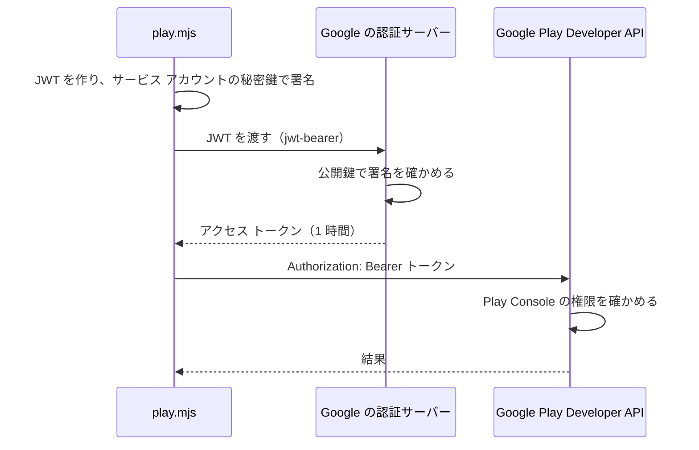
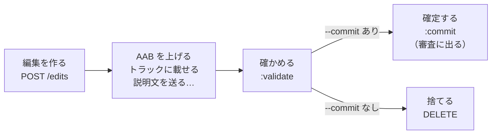

# 10-4 API で出す

[目次](../README.md) ＞ 第 10 部 ＞ 10-4

> Google Play Developer API の仕組みは [技術カード: Google Play Developer API](../ref/play-developer-api.md)、サービス アカウントでの名乗り方は [技術カード: サービス アカウントと OAuth 2.0](../ref/service-account-oauth.md) にあります。

## この章で学ぶこと

- Play Console の画面の操作を、プログラムから行う理由
- サービス アカウント: 人ではなくプログラムのための Google アカウント
- 認証（だれか）と認可（何をしてよいか）を、別の場所で受け持つ形
- JWT で名乗り、1 時間だけのアクセス トークンをもらう流れ
- 「編集」（edit）にまとめて積み、確かめてから確定する API の形
- 散策ガイドの `tools/play.mjs` を読む

## なぜ API で出すのか

版を出すたびに Play Console の画面で、AAB を上げ、リリースノートを書き、説明文を貼り、スクリーンショットを差し替え…と手で操作すると、入れ間違いが起きます。散策ガイドは、その一部を [tools/play.mjs](https://github.com/duwenji/yorisoi-sanpoguide/blob/main/tools/play.mjs) で行います。

| API でできる | 画面で入れる |
|---|---|
| AAB をトラックに上げ、リリースノートを付ける | データ セーフティ以外のアプリのコンテンツ（アクセス権・広告・レーティングなど） |
| アプリ名・説明文・スクリーンショット・連絡先を、文書と `store/` にそろえる | アイコン・フィーチャー グラフィック |
| データ セーフティの答えを CSV で置き換える | 価格・公開する国・テスターのリスト |
| 審査に出す、配布を止める | 段階的な公開の割合 |

いちばんの利点は、**文書が正本になる** ことです。説明文は [play-console.md](https://github.com/duwenji/yorisoi-sanpoguide/blob/main/docs/play-console.md) のコードブロックから、スクリーンショットは `store/screenshots/` から読んで送ります。画面に直接書き込まないので、「文書とストアの説明が違う」が起きません（[10-3](03-console.md)）。

CycleGuide も、アプリの名前だけを変えた同じ `play.mjs` を使っています。

## サービス アカウント

API を呼ぶには、だれが呼んでいるかを Google に名乗る必要があります。でも、運営者の Google アカウントは 2 段階認証が要り、プログラムから使うのに向きません。そこで、プログラム専用の **サービス アカウント** を作ります（`名前@プロジェクト ID.iam.gserviceaccount.com` のメールアドレスを持つ）。

### 認証と認可を、別の場所で

[play-api.md の「しくみ」](https://github.com/duwenji/yorisoi-sanpoguide/blob/main/docs/play-api.md#しくみ)に、分担がまとめてあります。

| 受け持つこと | 場所 | 中身 |
|---|---|---|
| **だれか**（認証） | Google Cloud | プロジェクト、API を有効にする、サービス アカウント、JSON の鍵 |
| **何をしてよいか**（認可） | Play Console | サービス アカウントを招待し、散策ガイドのリリースと掲載情報に要る権限だけを付ける |

Google Cloud の側では、サービス アカウントに役割（ロール）を付けません。何をしてよいかは Play Console が決めます。鍵が漏れても、できることは Play Console で付けた権限の中に収まり、鍵を消すか招待を外せば止められます。[8-1](../08-aws/01-aws-basics.md) の「最小の権限」と同じ考え方です。

## 名乗り方: JWT とアクセス トークン

`play.mjs` の `accessToken` は、Node の標準のライブラリだけで、サービス アカウントとして名乗ります。

```js
const claims = {
  iss: key.client_email,
  scope: 'https://www.googleapis.com/auth/androidpublisher',
  aud: key.token_uri,
  iat: now,
  exp: now + 3600,
};
const unsigned = `${base64url(JSON.stringify({ alg: 'RS256', typ: 'JWT' }))}.${base64url(JSON.stringify(claims))}`;
const signature = createSign('RSA-SHA256').update(unsigned).sign(key.private_key, 'base64url');
const res = await fetch(key.token_uri, {
  method: 'POST',
  headers: { 'Content-Type': 'application/x-www-form-urlencoded' },
  body: new URLSearchParams({ grant_type: 'urn:ietf:params:oauth:grant-type:jwt-bearer', assertion: `${unsigned}.${signature}` }),
});
```



- **JWT**（JSON Web Token）は、`ヘッダー.中身.署名` を base64url（[6-2](../06-trust/02-ed25519-and-ids.md)）でつないだものです。中身（`claims`）に「だれが（`iss`）・何のために（`scope`）・どこに向けて（`aud`）・いつまで（`exp`）」を書き、サービス アカウントの秘密鍵で署名します
- 認証サーバーは、Google が持っている公開鍵で署名を確かめ、**1 時間だけ使えるアクセス トークン** を返します。以後の API の呼び出しには、このトークンを付けます
- 秘密鍵そのものはネットワークに流れません。流れるのは、その鍵で作った署名だけです。[第 6 部](../06-trust/01-why-signatures.md)で見た「署名で、鍵を持っていることを示す」のと同じ形です

実は、[8-9](../08-aws/09-ai-relay.md) の中継も、Play Integrity の判定を読み解いてもらうときに、まったく同じ形で名乗っています（[integrity.ts](https://github.com/duwenji/yorisoi-console/blob/main/api/src/relay/integrity.ts)、違うのは `scope` だけ）。

### 鍵の置き場所

鍵（JSON）は、パスワードと同じに扱います。散策ガイドは `~/.yorisoi-sanpoguide/play-service-account.json` に置き、Git には入れません。別の場所に置くときは、環境変数 `PLAY_SERVICE_ACCOUNT` でパスを渡します。

## 編集（edit）にまとめる

Google Play Developer API で AAB や掲載情報を変えるときは、**編集**（edit）という入れ物を作り、その中に変更を積み、最後に **確定**（commit）します。



データベースのトランザクションのような形です。確定するまで、Play には何も反映されません。途中で失敗したら、編集を捨てれば元のままです。

`play.mjs` の `edit` は、この形を `try`／`finally` で守っています。

```js
async function edit(opts) {
  const { id } = await call('POST', `${API}/edits`, {});
  let committed = false;
  try {
    // … AAB・トラック・掲載情報・スクリーンショットを積む …
    await call('POST', `${API}/edits/${id}:validate`);
    if (!opts.commit) {
      console.log('valid; not committed (pass --commit to send it for review)');
      return;
    }
    await call('POST', `${API}/edits/${id}:commit`);
    committed = true;
    console.log('committed and sent for review');
  } finally {
    if (!committed) await call('DELETE', `${API}/edits/${id}`).catch(() => {});
  }
}
```

- **既定は「確かめるだけ」**: `--commit` を付けなければ、Play に確かめてもらうだけで、編集を捨てる。まず `--commit` なしで流して、問題がなければ付けて流す
- **確定しなかった編集は、必ず捨てる**: 途中で例外が起きても `finally` で捨てる。放っておくと、Play Console に「保存していない変更」が残る
- **確定すると、Play Console で保存したまま審査に出していない変更も一緒に出る**: 画面と API を混ぜて使うときは、何が出るかに気をつける

`status` も、一覧を読むためだけに編集を作り、読み終えたら捨てています。データ セーフティだけは編集を使わず、すぐに置き換わります。

## 使い方

```sh
node tools/play.mjs status                        # トラックとリリースの一覧
node tools/play.mjs listing                       # --listing で送るアプリ名と説明文（play-console.md から）
node tools/play.mjs edit --aab release/yorisoi-sanpoguide-<版>.aab --notes "リリースノート" --listing
node tools/play.mjs edit --aab release/yorisoi-sanpoguide-<版>.aab --notes "リリースノート" --listing --commit
node tools/play.mjs edit --version-code 9 --track alpha                  # 上げ済みの版をほかのトラックに出す
node tools/play.mjs edit --track alpha --halt                            # 配布中のリリースを停止する
node tools/play.mjs data-safety docs/play-data-safety.csv
```

- `--version-code` は、Play に上げ済みの版を別のトラックに出す。`--notes` がなければ、その版がほかのトラックで持つリリースノートを写す（[10-2](02-tracks.md) の「どのトラックでも同じ文」）
- `--halt` は、配布中のリリースを止める。Play は一つ前のリリースを配り直す
- トラックは既定で内部テスト。API で出したリリースは段階的な公開にならず、トラックの全員に出る

うまくいかないときの表は、[play-api.md の「うまくいかないとき」](https://github.com/duwenji/yorisoi-sanpoguide/blob/main/docs/play-api.md#うまくいかないとき)にあります。招待の直後は、権限が届くまで数時間かかることがある、PC の時刻がずれていると名乗りに失敗する（JWT の `iat`・`exp` が合わない）、などです。

## ハンズオン: 名乗り方を手で確かめる

サービス アカウントの鍵は、運営者しか持っていません。ここでは、鍵がなくてもできることを試します。

### 1. 送る説明文を確かめる（鍵は要らない）

```sh
cd ../yorisoi-sanpoguide
node tools/play.mjs listing
```

```
{
  title: '散策ガイド',
  shortDescription: '歩きながら周りのスポットを案内し、天気や休憩に合わせて声で話しかける散策のお供',
  fullDescription: '散策ガイドは、一緒に歩きながら …
```

`listing` は API を呼ばず、`play-console.md` を読んで、送るはずのものを表示するだけです。文書の見出しとコードブロックの形が崩れていたら、ここで止まります。

### 2. JWT を作って、書き換えを見破る

[scripts/jwt-practice.mjs](scripts/jwt-practice.mjs) は、捨てる RSA の鍵をその場で作り、`play.mjs` と同じ形の JWT を作って確かめます。Google にはつながりません。

```sh
cd ../yorisoi-tutorial
node 10-play/scripts/jwt-practice.mjs
```

```
JWT（. で 3 つに分かれる）:
  eyJhbGciOiJSUzI1NiIsInR5cCI6IkpXVCJ9…（36 文字）
  eyJpc3MiOiJwbGF5LXB1Ymxpc2hlckBleGFtcGxl…（268 文字）
  Hg-1jxqBnHGCQj0jntV46cDPI-zujH31i-ZZ7I6j…（342 文字）

そのまま: 署名は正しい
  名乗る相手: play-publisher@example-project.iam.gserviceaccount.com
  頼む範囲: https://www.googleapis.com/auth/androidpublisher
  期限まで: 3600 秒

期限を書き換えた: 署名が合わない（断られる）
```

（署名の部分は、鍵を毎回作るので実行のたびに変わります。）

期限（`exp`）を 1 年先に書き換えた JWT は、署名が合わずに断られます。中身は base64url なのでだれでも読めますが、**書き換えれば署名が合わなくなる** ので、鍵を持たない人は偽の名乗りを作れません。

### 3. 鍵を持っている人だけ（任意）

```sh
cd ../yorisoi-sanpoguide
node tools/play.mjs status
```

トラックとリリースの一覧が出ます。`status` は読むだけで、何も変えません。

## つまずきやすいところ

- **鍵はパスワードと同じ**: Git に入れない、人に送らない、ダウンロードのフォルダに残さない
- **権限は Play Console で、必要なものだけ**: Google Cloud の側でロールを付けない
- **まず確かめるだけで流す**: `--commit` は、確かめが通ってから
- **確定しない編集は捨てる**: 残すと、画面に保存していない変更が残る
- **API で出すと段階的にならない**: 製品版を段階的に出すときは画面で

## 確認問題

<details>
<summary>問 1. サービス アカウントの鍵が漏れたとき、被害が Play Console で付けた権限の中に収まるのはなぜですか。</summary>

認証（だれか）は Google Cloud が、認可（何をしてよいか）は Play Console が受け持ち、サービス アカウントには Google Cloud のロールを付けず、Play Console で散策ガイドに要る権限だけを付けているからです。漏れた鍵でできるのは、その権限の中のことだけで、鍵を消すか招待を外せば止められます。

</details>

<details>
<summary>問 2. <code>play.mjs edit</code> が、<code>--commit</code> を付けないと編集を捨てるだけなのはなぜですか。</summary>

まず Play に確かめてもらい（`:validate`）、問題がないことを見てから確定するためです。確定すると審査に出て取り消しにくいので、既定を安全な側（何も変えない）にしています。

</details>

<details>
<summary>問 3. JWT の中身は base64url で、だれでも読めます。それでも、ほかの人がサービス アカウントになりすませないのはなぜですか。</summary>

JWT にはサービス アカウントの秘密鍵の署名が付いていて、中身を 1 文字でも書き換えると署名が合わなくなるからです。秘密鍵を持たない人は、正しい署名を作れません。

</details>

---

前: [10-3 Play Console の申告](03-console.md) ／ 次: [10-5 Play Integrity](05-integrity.md)
