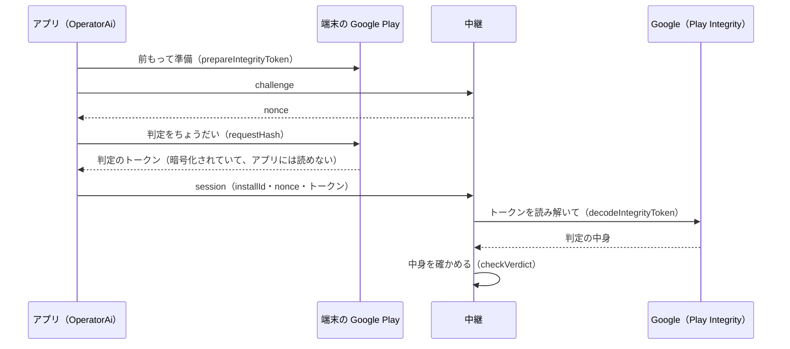

# 10-5 Play Integrity

[目次](../README.md) ＞ 第 10 部 ＞ 10-5

> Play Integrity API の仕組みと最小の使い方は [技術カード: Play Integrity API](../ref/play-integrity.md) にあります。

## この章で学ぶこと

- 「Play から入れた本物のアプリか」を、サーバーが確かめる必要がある場面
- Play Integrity の Standard request: 準備しておき、要るときに判定を取る
- `requestHash` で、判定をその 1 回の要求に結びつける
- サーバーが判定を Google に読み解いてもらい、中身を確かめる
- 開発用と本番の違い

## なぜ要るのか

[8-9](../08-aws/09-ai-relay.md) で見た運営の AI の中継は、端末に AI のキーを置かずに使える入口です。キーがないので、だれかがアプリの通信をまねて、プログラムから中継を呼び続けたら、運営の費用が使われてしまいます。

1 台ずつの回数の上限はありますが、`installId` はアプリが作るランダムな ID なので、まねる側は ID を作り放題です。そこで、セッションを開くときに「この要求は、**Google Play から入れた本物のアプリ** が、**まともな端末** で送ったものか」を確かめます。それが **Play Integrity API** です（platform の [ADR-AI-RELAY](https://github.com/duwenji/yorisoi-platform/blob/main/docs/decisions/ADR-AI-RELAY.md) R-7）。



## アプリの側: Standard request

kit-llm の [OperatorAi.kt](https://github.com/duwenji/yorisoi-platform/blob/main/kit-llm/src/main/java/io/github/duwenji/yorisoi/kit/llm/OperatorAi.kt) の `PlayIntegrity` が、判定を取ります。

```kotlin
override suspend fun token(requestHash: String): String {
    val p = lock.withLock {
        provider ?: manager.prepareIntegrityToken(
            PrepareIntegrityTokenRequest.builder().setCloudProjectNumber(cloudProjectNumber).build(),
        ).await().also { provider = it }
    }
    return try {
        p.request(StandardIntegrityTokenRequest.builder().setRequestHash(requestHash).build()).await().token()
    } catch (e: Exception) {
        // A provider can go stale; prepare a new one next time.
        lock.withLock { provider = null }
        throw e
    }
}
```

- **準備**（`prepareIntegrityToken`）は時間がかかるので、1 回だけして、できた `provider` を取っておく。`Mutex`（[3-1](../03-walk/01-coroutines.md)）で、2 つの要求が同時に準備しないようにする
- **判定を取る**（`request`）ときに、`requestHash` を渡す。判定にこの値が入るので、サーバーは「この要求のための判定か」を確かめられる
- 失敗したら、`provider` を捨てて、次は準備からやり直す。準備したものは、時間がたつと使えなくなることがあるから
- `cloudProjectNumber` は、Play Console のアプリにつないだ Google Cloud のプロジェクトの番号。判定を読み解く権限が、このプロジェクトに結びつく

### requestHash: 判定を 1 回の要求に結びつける

```kotlin
/** The Integrity request hash: base64url of SHA-256 over `{installId}.{nonce}` (API-AI-RELAY). */
fun requestHash(installId: String, nonce: String): String =
    Base64.getUrlEncoder().withoutPadding()
        .encodeToString(MessageDigest.getInstance("SHA-256").digest("$installId.$nonce".toByteArray(Charsets.UTF_8)))
```

`nonce` は中継が出した使い捨ての値（5 分、1 回だけ）なので、判定も **その 1 回のセッションにしか使えません**。本物のアプリから判定を 1 つ盗み見ても、別のセッションでは使い回せません。`requestHash` は、要求の中身そのものではなく、その **ハッシュ** を渡す欄です（SHA-256、[技術カード](../ref/sha-256.md)）。短い決まった長さで、要求を一意に表せます。

## サーバーの側: 読み解いて、確かめる

アプリが受け取るトークンは暗号化されていて、アプリにもサーバーにも読めません。中継は、それを Google の API（`decodeIntegrityToken`）に渡して、中身を読み解いてもらいます。そのとき、中継は運営の **サービス アカウント** として名乗ります。[10-4](04-api.md) の `play.mjs` とまったく同じ、JWT で名乗る形です（[integrity.ts](https://github.com/duwenji/yorisoi-console/blob/main/api/src/relay/integrity.ts) の `PlayIntegrity.accessToken`）。

読み解いた中身を、`checkVerdict` が確かめます。

```ts
export function checkVerdict(payload: IntegrityPayload, expect: { packageName: string; requestHash: string; now: Date }): string | undefined {
  const request = payload.requestDetails;
  if (request?.requestPackageName !== expect.packageName) return 'package';
  if (request.requestHash !== expect.requestHash) return 'request_hash';
  const age = expect.now.getTime() - Number(request.timestampMillis);
  if (!Number.isFinite(age) || age < -MAX_AGE_MS || age > MAX_AGE_MS) return 'stale';
  if (payload.appIntegrity?.packageName !== expect.packageName) return 'app_package';
  if (payload.appIntegrity.appRecognitionVerdict !== 'PLAY_RECOGNIZED') return 'app';
  if (!payload.deviceIntegrity?.deviceRecognitionVerdict?.includes('MEETS_DEVICE_INTEGRITY')) return 'device';
  return undefined;
}
```

| 確かめること | 判定の項目 | 外れる例 |
|---|---|---|
| 散策ガイド（か CycleGuide）のための判定か | `requestPackageName` | ほかのアプリの判定 |
| この 1 回の要求のための判定か | `requestHash` | ほかのセッションの判定の使い回し |
| 新しい判定か（前後 5 分） | `timestampMillis` | 古い判定の使い回し |
| Play が知っている、そのままのアプリか | `appRecognitionVerdict` が `PLAY_RECOGNIZED` | 書き換えたアプリ、Play 以外から入れたアプリ |
| まともな端末か | `deviceRecognitionVerdict` に `MEETS_DEVICE_INTEGRITY` | エミュレータ、改造した端末 |

最後の 2 つから分かるように、**手で入れた APK や、エミュレータからは通りません**。だから開発中のアプリは、本番の中継を使えません。

## 開発用と本番

| | 開発用の中継 | 本番の中継 |
|---|---|---|
| Play Integrity | 確かめない（`verifyIntegrity` がない） | 確かめる |
| アプリが送るもの | 判定を送らない（`cloudProjectNumber` が 0） | 判定を送る |
| 1 か月の予算 | 小さい | 運営が決めた額 |
| WAF | なし | あり |

開発中のアプリは Play から入れたものではないので、判定が通りません。そこで開発用の中継は判定を求めず、その代わりに予算を小さくしています（[8-9](../08-aws/09-ai-relay.md)）。

🚧 今のリリース版も、開発用の中継を使っています（`AI_RELAY_URL` は開発用、`PLAY_CLOUD_PROJECT_NUMBER` は 0）。本番の中継に切り替えるには、Play Console のアプリに Google Cloud のプロジェクトをつなぎ、その番号を `PLAY_CLOUD_PROJECT_NUMBER` に入れ、判定を読み解くサービス アカウントの鍵を本番の中継（Secrets Manager）に入れる必要があります（SanpoGuide の [TODO「Google Play での公開」](https://github.com/duwenji/yorisoi-sanpoguide/blob/main/docs/TODO.md#google-play-での公開)）。

## 判定に頼りすぎない

Play Integrity は強い守りですが、すり抜けられないとは言えません。ADR-AI-RELAY も「Integrity をすり抜けられた場合、全体の予算まで使われうる（R-10 で止まる）」と、リスクとして書いています。だから中継は、判定 **だけ** に頼らず、1 台ずつの回数・1 台 1 日のセッションの数・1 回の長さの上限・WAF・**月の予算での自動の停止** を重ねています（[8-9](../08-aws/09-ai-relay.md)）。1 つが破られても、次の守りで被害の大きさが決まっている、という作りです。

## ハンズオン: 判定の確かめを壊す

中継のテストには、判定の中身を確かめるテストがあります。DynamoDB Local のために Docker が要ります（[8-9](../08-aws/09-ai-relay.md) と同じ）。

### 1. 流す

```sh
cd ../yorisoi-console
npx vitest run api/test/relay.test.ts -t "Integrity verdict"
```

```
      Tests  3 passed | 16 skipped (19)
```

`-t` で、名前に「Integrity verdict」を含むテストだけを流しています。

### 2. 読む

```ts
it('names what fails', () => {
  expect(checkVerdict({ ...good, requestDetails: { ...good.requestDetails, requestHash: 'x' } }, expect_)).toBe('request_hash');
  expect(checkVerdict({ ...good, requestDetails: { ...good.requestDetails, timestampMillis: '0' } }, expect_)).toBe('stale');
  expect(checkVerdict({ ...good, appIntegrity: { appRecognitionVerdict: 'UNRECOGNIZED_VERSION', packageName: PKG } }, expect_)).toBe('app');
  expect(checkVerdict({ ...good, deviceIntegrity: { deviceRecognitionVerdict: ['MEETS_BASIC_INTEGRITY'] } }, expect_)).toBe('device');
  expect(checkVerdict({}, expect_)).toBe('package');
});
```

本物らしい判定（`good`）を 1 か所ずつ壊して、それぞれ正しい理由で断られることを確かめています。

### 3. 端末の確かめを消す

[integrity.ts](https://github.com/duwenji/yorisoi-console/blob/main/api/src/relay/integrity.ts) の `checkVerdict` から、

```ts
if (!payload.deviceIntegrity?.deviceRecognitionVerdict?.includes('MEETS_DEVICE_INTEGRITY')) return 'device';
```

の 1 行を消して、もう一度流します。

```
 FAIL  api/test/relay.test.ts > the Integrity verdict (AR-3) > names what fails
AssertionError: expected undefined to be 'device' // Object.is equality
      Tests  1 failed | 2 passed | 16 skipped (19)
```

改造した端末からの判定が、通ってしまうようになりました。

### 4. 元に戻す

```sh
git checkout -- api/src/relay/integrity.ts
git status
```

## つまずきやすいところ

- **判定はその 1 回の要求に結びつける**: `requestHash` を使わないと、盗み見た判定を使い回せる
- **判定の中身はサーバーで確かめる**: アプリは判定を読めない。読めても、アプリの側の確かめは書き換えられる
- **手で入れた APK・エミュレータは通らない**: 開発用には、判定を求めない入口を別に用意する
- **判定だけに頼らない**: 回数・長さ・予算の上限を重ねる

## 確認問題

<details>
<summary>問 1. 判定に <code>requestHash</code>（installId と nonce の SHA-256）を入れるのはなぜですか。</summary>

判定を、その 1 回のセッションを開く要求に結びつけるためです。nonce は中継が出した使い捨ての値なので、判定もその 1 回にしか使えません。本物のアプリの判定を盗み見ても、別のセッションでは `request_hash` で断られます。

</details>

<details>
<summary>問 2. 開発中にエミュレータで動かしたアプリが、本番の中継を使えないのはなぜですか。</summary>

エミュレータの判定は `MEETS_DEVICE_INTEGRITY` を満たさず、手で入れたアプリは `PLAY_RECOGNIZED` にならないので、`checkVerdict` が断るからです。開発中は、判定を求めない開発用の中継を使います。

</details>

<details>
<summary>問 3. Play Integrity があるのに、月の予算での自動の停止まで用意しているのはなぜですか。</summary>

Play Integrity も、すり抜けられないとは言い切れないからです。判定をすり抜けられても、1 台ずつの回数・長さの上限・月の予算で、使われる費用の上限が決まっています。守りを重ねておけば、1 つが破られても被害が限られます。

</details>

---

前: [10-4 API で出す](04-api.md) ／ [目次へ戻る](../README.md)
