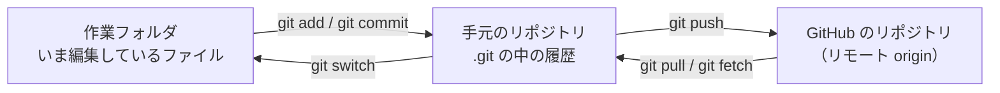

# 11-1 Git と 5 つのリポジトリ

[目次](../README.md) ＞ 第 11 部 ＞ 11-1

> Git の仕組みと最小の使い方は [技術カード: Git](../ref/git.md) にあります。

## この章で学ぶこと

- Git の 3 つの場所（作業フォルダ・手元のリポジトリ・GitHub のリポジトリ）と、コミット・ブランチ・リモート
- 散策ガイドの 5 つのリポジトリの役割と、それぞれが GitHub の何を使っているか
- `.gitignore` で秘密を入れない、`.gitattributes` で改行をそろえる
- ファイルの実行の権限も Git に記録される
- リポジトリの名前を変えたとき、何が転送され、何を自分で直すのか

## Git の 3 つの場所

Git は、ファイルの変更の記録（履歴）を残す道具です。GitHub は、その記録をインターネットの上に置いて、ほかの人や自動の仕組み（GitHub Actions）と共有する場所です。



- **コミット**: ある時点のファイル一式の記録。1 つ前のコミット（親）を指していて、たどると履歴になる
- **ブランチ**: コミットを指す名札。新しくコミットすると、名札が新しいコミットに動く。`main` がいつも動くコード、ほかのブランチが作業中の変更（[11-2](02-pull-requests.md)）
- **リモート**: 手元のリポジトリから見た、GitHub の上のリポジトリ。`git clone` したときの名前が `origin`
- **タグ**: コミットに付ける、動かない名札。公開した版の印に使う（[11-5](05-packages-tags.md)）

```sh
cd /c/Dev/apps/yorisoi-platform
git remote -v
```

```text
origin	https://github.com/duwenji/yorisoi-platform.git (fetch)
origin	https://github.com/duwenji/yorisoi-platform.git (push)
```

## 5 つのリポジトリ

[0-4](../00-overview/04-reading-the-repos.md) で中身を歩いた 4 つのリポジトリに、このチュートリアルを加えた 5 つが GitHub にあります。すべて **公開のリポジトリ**（public）です。

| リポジトリ | 中身 | CI | 公開（Packages） | Pages |
|---|---|---|---|---|
| [yorisoi-platform](https://github.com/duwenji/yorisoi-platform) | 共通の方針・契約、コアとキット | ✅ | ✅ タグ `v*` | |
| [yorisoi-sanpoguide](https://github.com/duwenji/yorisoi-sanpoguide) | 散策ガイドのアプリ、プロンプト・パック | ✅ | ✅ タグ `prompts-v*` | ✅ |
| [yorisoi-cycleguide](https://github.com/duwenji/yorisoi-cycleguide) | CycleGuide のアプリ、プロンプト・パック | ✅ | ✅ タグ `prompts-v*` | ✅ |
| [yorisoi-console](https://github.com/duwenji/yorisoi-console) | チャンネル管理システム、運営の AI の中継 | ✅ | | |
| [yorisoi-tutorial](https://github.com/duwenji/yorisoi-tutorial) | このチュートリアル | | | |

公開のリポジトリにしていることで、次のことが成り立っています。

- **ほかのリポジトリの CI が、Packages を `GITHUB_TOKEN` で読める**: アプリと管理システムの CI は、自分のリポジトリのトークンで yorisoi-platform のコアを取ってくる（[11-4](04-tokens.md)）
- **GitHub Actions の標準のランナーが無料**: 非公開のリポジトリには、月ごとの無料の時間の上限がある
- **GitHub Pages を無料で使える**: プライバシーポリシーをそこに置いている（[11-6](06-pages-releases.md)）

裏返すと、**リポジトリに入れたものは、だれでも読める** ということです。次の `.gitignore` が大事になります。

## .gitignore: 秘密を入れない

`.gitignore` に書いた名前のファイルは、Git が無視します（`git add .` でも入らない）。yorisoi-sanpoguide の [.gitignore](https://github.com/duwenji/yorisoi-sanpoguide/blob/main/.gitignore):

```gitignore
.gradle/
build/
local.properties
.idea/
*.iml
.kotlin/
keystore.properties
*.jks
*.keystore
release/
# Walk records pulled from a device for review: routes and AI prompts, never committed.
history-data/
```

| 書いてあるもの | 入れない理由 |
|---|---|
| `build/`・`.gradle/`・`.kotlin/` | ビルドするたびに作り直されるもの |
| `local.properties`・`.idea/` | そのパソコンだけの設定（Android SDK の場所など） |
| `keystore.properties`・`*.jks`・`*.keystore` | リリース用の署名の鍵とパスワード（[1-4](../01-kotlin-android/04-signing-apk.md)） |
| `release/` | 署名した AAB・APK |
| `history-data/` | 端末から取り出した散歩の記録。経路が入っている（[4-5](../04-outside/05-storage.md)） |

手元の yorisoi-sanpoguide には、`keystore.properties` も `release.jks` もあります。でも GitHub には上がっていません。

```sh
cd /c/Dev/apps/yorisoi-sanpoguide
ls keystore.properties release.jks
git check-ignore -v keystore.properties release.jks
```

```text
keystore.properties  release.jks
.gitignore:7:keystore.properties	keystore.properties
.gitignore:8:*.jks	release.jks
```

`git check-ignore -v` は、どの行がそのファイルを無視させているかを教えてくれます。

> **一度コミットした秘密は、消しても履歴に残ります。** 次のコミットで消しても、前のコミットをたどれば読めます。秘密を入れてしまったら、ファイルを消すだけでなく、その鍵やパスワードを **作り直す**（無効にする）ことが先です。

## .gitattributes: 改行をそろえる

Windows はテキストの行の終わりを CRLF（`\r\n`）、Linux と macOS は LF（`\n`）で書きます。散策ガイドの開発に使っているパソコンは Windows で、Git の設定 `core.autocrlf` が `true` です。

```sh
cd /c/Dev/apps/yorisoi-platform
git config core.autocrlf
```

```text
true
```

`true` だと、Git は **取り出すときに LF を CRLF に変え、記録するときに CRLF を LF に戻します**。リポジトリの中はいつも LF で、Windows の作業フォルダだけが CRLF になります。たいていのファイルはこれで困りません。困るのは次の 2 種類です。

- **Linux で動かすシェルスクリプト**（`gradlew`）: CRLF のままだと、GitHub Actions の Linux のランナーで動かない
- **バイトのとおりに比べるファイル**: チャンネル・パッケージの形式（platform の [API-CHANNEL-PACKAGE](https://github.com/duwenji/yorisoi-platform/blob/main/docs/contracts/API-CHANNEL-PACKAGE.md)）は CR を拒む。署名した文書は 1 バイト違えば署名が合わない（[6-3](../06-trust/03-signed-documents.md)）

そこで、ファイルごとに改行を **パソコンの設定に関係なく** 決めるのが `.gitattributes` です。yorisoi-platform の [.gitattributes](https://github.com/duwenji/yorisoi-platform/blob/main/.gitattributes):

```gitattributes
# Normalise line endings in the repository; keep gradlew runnable on macOS/Linux/CI.
* text=auto
gradlew text eol=lf
*.bat text eol=crlf
*.jar binary
*.png binary
# Channel packages must be LF: the channel format (API-CHANNEL-PACKAGE) rejects CR. Without this, a
# Windows checkout with core.autocrlf=true fails the test channels' own checks.
kit-channel/src/test/resources/** text eol=lf
```

| 書き方 | 意味 |
|---|---|
| `* text=auto` | テキストかどうかを Git が見分け、テキストならリポジトリの中は LF にする |
| `gradlew text eol=lf` | 作業フォルダでも LF にする（Windows でも） |
| `*.bat text eol=crlf` | 作業フォルダでは CRLF にする（Windows のコマンドのファイル） |
| `*.jar binary` | テキストとして扱わない（改行を変えない、差分を出さない） |
| `kit-channel/src/test/resources/** text eol=lf` | テスト用のチャンネルは、Windows でも LF |

yorisoi-sanpoguide は、アプリに入れるチャンネルとプロンプト（`prompts/src/main/resources/**`）を LF に固定しています。反対に、Play Console が CRLF で書き出すデータ セーフティの CSV は CRLF に固定しています（[10-3](../10-play/03-console.md)）。yorisoi-console は、署名した文書とテストの材料をバイトで比べるので、**すべてを LF** にしています（`* text=auto eol=lf`）。

実際にどうなっているかは `git ls-files --eol` で見られます。

```sh
cd /c/Dev/apps/yorisoi-platform
git ls-files --eol README.md gradlew gradlew.bat kit-channel/src/test/resources/test-channels/index.txt
```

```text
i/lf    w/crlf  attr/text=auto        	README.md
i/lf    w/lf    attr/text eol=lf      	gradlew
i/lf    w/crlf  attr/text eol=crlf    	gradlew.bat
i/lf    w/lf    attr/text eol=lf      	kit-channel/src/test/resources/test-channels/index.txt
```

`i/` はリポジトリの中（index）、`w/` は作業フォルダ（working tree）の改行です。どれもリポジトリの中は LF です。`README.md` は `core.autocrlf=true` に従って作業フォルダで CRLF になり、`gradlew` とテスト用のチャンネルは `.gitattributes` のとおり LF のままです。

## 実行の権限も記録される

Git は、ファイルの中身だけでなく **実行してよいか** も記録します。

```sh
git ls-files -s gradlew gradlew.bat
```

```text
100755 b9bb139f790567973216cd313e69ae65789c3754 0	gradlew
100644 24c62d56f2d4a91975bd1aa72103d2ec628e449f 0	gradlew.bat
```

`100755` は実行できるファイル、`100644` はふつうのファイルです。Windows のファイルには Linux と同じ形の実行の権限がないので、Windows で作った `gradlew` は `100644` で記録されることがあり、GitHub Actions で `Permission denied` になります。直し方（`git update-index --chmod=+x gradlew`）は [5-3](../05-station-format/03-publish.md) で見ました。

## リポジトリの名前を変える

エコシステムの名前を michizure から yorisoi に改めたとき、GitHub のリポジトリも改名しました（たとえば michizure-console → yorisoi-console）。GitHub は、**古い名前への接続を新しい名前に転送します**。

```sh
curl -sI https://github.com/duwenji/michizure-console | grep -iE "^(HTTP|location)"
```

```text
HTTP/1.1 301 Moved Permanently
Location: https://github.com/duwenji/yorisoi-console
```

`git clone`・`git push`・`gh` のコマンド・API も、古い名前のままで新しいリポジトリに届きます。ただし、転送に頼りきらず、次のものは自分で直します。

| 直すもの | なぜ |
|---|---|
| 手元のリモートの URL（`git remote set-url origin https://github.com/duwenji/yorisoi-console.git`） | 同じアカウントで古い名前のリポジトリを新しく作ると、転送が切れて、そちらにつながる |
| 文書の中のリンク | 読む人が、どちらが正しい名前か迷う |
| Gradle の Packages の URL（`maven.pkg.github.com/<owner>/<リポジトリ>`） | 取ってくる場所の設定そのもの（[11-5](05-packages-tags.md)） |
| GitHub Pages の URL（`<owner>.github.io/<リポジトリ>/`） | URL にリポジトリの名前が入る。Play に出したプライバシーポリシーの URL も変わる（[11-6](06-pages-releases.md)） |
| 手元のフォルダの名前 | Git には関係ないが、`../yorisoi-*` のパスをそろえるため |

管理システムの改名のプルリクエスト（yorisoi-console #37）は、リポジトリの改名に合わせて、npm のパッケージの名前・CDK のスタックの名前・文書の名前をまとめて置き換えています。**GitHub の上の名前を変えるのは一瞬ですが、その名前を使っているものは自分で追いかける** 必要があります。

## ハンズオン: 改行と権限を確かめる

手元の 3 つのリポジトリで、次を流してみてください。

```sh
cd /c/Dev/apps/yorisoi-sanpoguide
git check-attr -a prompts/src/main/resources/sanpoguide/channels/quiet/channel.json docs/play-data-safety.csv gradlew
git ls-files --eol docs/play-data-safety.csv gradlew README.md

cd ../yorisoi-console
git ls-files --eol | awk '{print $2}' | sort | uniq -c
git ls-files --eol | grep "w/crlf"
```

- yorisoi-sanpoguide の CSV は、作業フォルダでも CRLF（`w/crlf`）のはず
- yorisoi-console は、ほとんどが `w/lf`。`w/-text` はテキストでないファイル（画像・jar）

ある時点の yorisoi-console では、次のように出ました。

```text
      3 w/-text
      7 w/crlf
    194 w/lf
i/lf    w/crlf  attr/text=auto eol=lf 	docs/samples/kamakura-walk/README.md
i/lf    w/crlf  attr/text=auto eol=lf 	docs/samples/kamakura-walk/channel.json
…
i/lf    w/crlf  attr/text eol=crlf    	validator/gradlew.bat
```

`gradlew.bat` は規則どおりの CRLF です。でも見本のチャンネル（`docs/samples/kamakura-walk/`）は、規則が `eol=lf` なのに作業フォルダが CRLF です。Windows のエディタやツールが CRLF で書いたファイルを、取り出し直さずに使い続けているためと考えられます。Git は記録するときに LF に直す（`i/lf`）ので、GitHub の上は正しい。でも **作業フォルダのファイルは書いたときのまま** で、`git status` にも出ません。このフォルダをそのまま ZIP にして申請すると、CR が入っていて機械審査で落ちます。取り出し直すと、規則どおり LF になります。

```sh
rm -r docs/samples/kamakura-walk
git checkout -- docs/samples/kamakura-walk
git ls-files --eol docs/samples/kamakura-walk | grep -c "w/lf"
```

### やってみよう: 改行の固定を外すと何が起きるか

yorisoi-platform で、`.gitattributes` の最後の行（`kit-channel/src/test/resources/** text eol=lf`）を消し、テスト用のチャンネルを取り出し直してからテストを流します。

```sh
cd /c/Dev/apps/yorisoi-platform
# .gitattributes の最後の行を消してから:
rm -r kit-channel/src/test/resources/test-channels
git checkout -- kit-channel/src/test/resources/test-channels
git ls-files --eol kit-channel/src/test/resources/test-channels | head -3
./gradlew :kit-channel:test --console=plain
```

作業フォルダの改行が `w/crlf` に変わり、チャンネルの形式の確認が CR を見つけてテストが落ちます。Windows のパソコンでは、`.gitattributes` がなければ、**同じリポジトリが Linux の CI では通り、手元では落ちる** ということです。確かめたら元に戻します。

```sh
git checkout -- .gitattributes
rm -r kit-channel/src/test/resources/test-channels
git checkout -- kit-channel/src/test/resources/test-channels
git status
```

`git status` に何も出なければ元どおりです。

## つまずきやすいところ

- **公開のリポジトリは、だれでも読める**: 秘密は `.gitignore` で入れない。入れてしまったら、消す前に作り直す
- **`core.autocrlf` だけに頼らない**: パソコンごとの設定は人によって違う。改行が意味を持つファイルは `.gitattributes` で決める
- **`.gitattributes` を変えても、取り出し済みのファイルは変わらない**: 取り出し直して初めて反映される
- **実行の権限も変更の 1 つ**: `mode change 100644 => 100755` は、中身が同じでも差分になる
- **改名の転送に頼りきらない**: リモートの URL・Packages の URL・Pages の URL・文書のリンクは自分で直す

## 確認問題

<details>
<summary>問 1. 手元の yorisoi-sanpoguide に <code>release.jks</code> があるのに、GitHub には上がっていません。なぜですか。どう確かめますか。</summary>

`.gitignore` の `*.jks` の行で、Git が無視しているからです。`git check-ignore -v release.jks` で、どの行が無視させているかを確かめられます。

</details>

<details>
<summary>問 2. Windows のパソコン（<code>core.autocrlf=true</code>）で、<code>git ls-files --eol</code> が <code>i/lf w/crlf</code> と出ました。リポジトリの中と作業フォルダの改行は、それぞれ何ですか。</summary>

リポジトリの中（`i/`）は LF、作業フォルダ（`w/`）は CRLF です。`core.autocrlf=true` で、取り出すときに CRLF に変えられています。

</details>

<details>
<summary>問 3. yorisoi-console が、<code>* text=auto eol=lf</code> ですべてのファイルを LF にしているのはなぜですか。</summary>

署名した文書やテストの材料を、バイトのとおりに比べるからです。改行が 1 か所 CRLF になるだけで、ハッシュも署名も合わなくなります。

</details>

<details>
<summary>問 4. GitHub のリポジトリを改名すると古い URL は転送されます。それでも手元のリモートの URL を直したほうがよいのはなぜですか。</summary>

古い名前で新しいリポジトリが作られると、転送が切れて、そちらにつながってしまうからです。また、Packages や Pages の URL、文書のリンクは、転送とは別に自分で直す必要があります。

</details>

---

前: [10-5 Play Integrity](../10-play/05-integrity.md) ／ 次: [11-2 ブランチとプルリクエスト](02-pull-requests.md)
