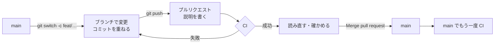
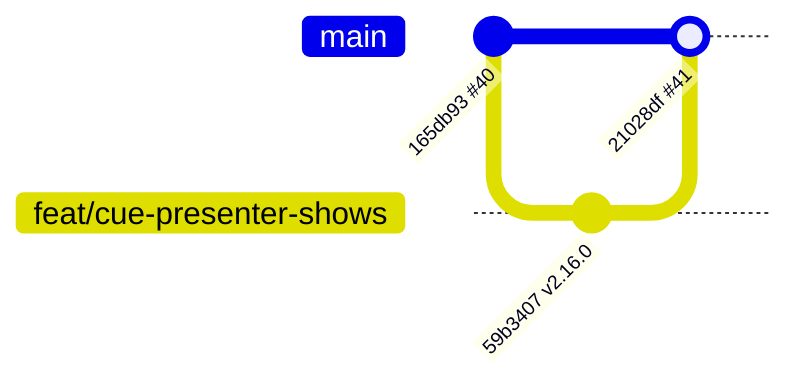
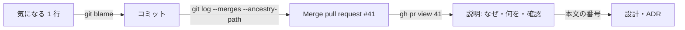
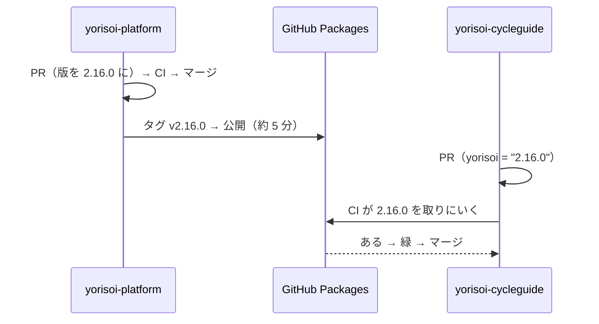

# 11-2 ブランチとプルリクエスト

[目次](../README.md) ＞ 第 11 部 ＞ 11-2

> プルリクエストの仕組みは [技術カード: プルリクエスト](../ref/pull-request.md)、コマンドは [技術カード: gh CLI](../ref/gh-cli.md) にあります。

## この章で学ぶこと

- `main` を直接変えず、ブランチ → プルリクエスト → CI → マージ の順に入れる理由
- ブランチの名前の付け方と、プルリクエストの説明の書き方
- マージの 3 つの方法と、散策ガイドが merge commit を選んでいること。`git log --first-parent` で読む
- プルリクエストの番号で、変更の理由までたどる
- 複数のリポジトリにまたがる変更の順番。順番を間違えると CI がどう落ちるか
- このリポジトリが使っていない仕組み（ブランチ保護など）と、入れるならどう効くか

## main はいつも動くように

5 つのリポジトリの `main` は、**いつ取り出しても組み立てられて、テストが通る** ことを目指しています。アプリのリリースもライブラリの公開も、`main` から行うからです（[11-5](05-packages-tags.md)、[第 10 部](../10-play/01-app-bundle.md)）。

そこで、変更はいつも次の順で入れます。



**プルリクエスト**（PR）は、「このブランチの変更を `main` に入れたい」という申し出です。GitHub の上で、差分・説明・CI の結果・やりとりが 1 か所にまとまります。散策ガイドは 1 人で開発していますが、それでもプルリクエストを使っています。

- CI が、まっさらな環境で確かめてくれる（[11-3](03-actions.md)）
- 入れる前に、差分を 1 つの画面で読み直せる
- 「なぜこの変更をしたか」が、番号つきで残る

## ブランチの名前

ブランチの名前は `<種類>/<内容>` にしています。5 つのリポジトリで、マージしたプルリクエストのブランチを数えると（ある時点）:

| 接頭辞 | 数 | 使う変更 | 例 |
|---|---|---|---|
| `docs/` | 107 | 文書だけ | `docs/cycle-review-scenes` |
| `feat/` | 99 | 機能の追加・変更 | `feat/cue-presenter-shows` |
| `refactor/` | 29 | 動きを変えない組み直し | |
| `chore/` | 26 | 版の更新・改名など | `chore/rename-yorisoi-console` |
| `fix/` | 15 | 不具合の修正 | `fix/tts-japanese-missing` |
| `build/` | 10 | リリースのためのビルド | `build/release-1.4.0` |
| `release/` | 4 | 同上（CycleGuide） | `release/1.4.0` |

接頭辞は Git にとっては意味のない文字です。でも **一覧で種類が分かる** ので、`git branch -r` や GitHub のブランチの画面を読みやすくなります。

## プルリクエストの説明

プルリクエストの説明には、だいたい次の 4 つを書いています。yorisoi-console の [#37](https://github.com/duwenji/yorisoi-console/pull/37)（改名）から抜き出すと:

```markdown
## 概要
SanpoGuide ADR-003 1.2（SanpoGuide #55）で、エコシステムの名前を michizure から yorisoi に改めた。…

## 変更
- npm のパッケージ `@michizure-console/*` → `@yorisoi-console/*`（package-lock も）
- …
- 変えないもの: `/.well-known/sanpo-channels`、リストID・アカウントIDの接頭辞

## 確認
- `npx tsc -b` 成功、`npx vitest run` 13 ファイル 150 件成功

## 注意
- CI の validator は GitHub Packages から 2.0.0 を取るので、… を公開するまで失敗する
```

| 見出し | 書くこと |
|---|---|
| 概要 | なぜ変えるのか。決めた文書（ADR・設計）や、関係するプルリクエストの番号 |
| 変更 | 何を変えたか。**変えないもの** も書くと、読む人が安心できる |
| 確認 | 手元で何を流して、どうなったか |
| 注意 | マージの前後にすること、CI が落ちると分かっているときはその理由 |

小さな変更なら、yorisoi-platform の [#41](https://github.com/duwenji/yorisoi-platform/pull/41) のように箇条書きだけでもかまいません。大事なのは、**半年後の自分がこの説明だけ読んで、変更の理由が分かる** ことです。

## マージの 3 つの方法

GitHub には、プルリクエストを `main` に入れる方法が 3 つあります。

| 方法 | `main` に残るもの | 向いているとき |
|---|---|---|
| **Create a merge commit** | ブランチのコミットすべて ＋ 2 つの親を持つ「マージ・コミット」 | ブランチの中の段階も残したい |
| Squash and merge | ブランチのコミットを 1 つにまとめたコミット | 途中のコミットに意味がない |
| Rebase and merge | ブランチのコミットを、`main` の先に付け直したもの | 1 本の線にしたい |

散策ガイドは、5 つのリポジトリとも **merge commit** で入れています（どの方法も選べる設定のままで、人の側でそろえています）。マージ・コミットの説明は、GitHub が自動で付ける `Merge pull request #<番号> from duwenji/<ブランチ>` です。



マージ・コミットには親が 2 つあります。1 つ目の親は、マージする前の `main`、2 つ目の親はブランチの先です。そこで、**1 つ目の親だけをたどる** と、`main` に入ったプルリクエストが 1 行ずつ並びます。

```sh
cd /c/Dev/apps/yorisoi-platform
git log --first-parent --oneline -5 main
```

```text
21028df Merge pull request #41 from duwenji/feat/cue-presenter-shows
165db93 Merge pull request #40 from duwenji/docs/cycle-review-scenes
aa7fd11 Merge pull request #39 from duwenji/feat/kit-channel-producers
89dba43 Merge pull request #38 from duwenji/feat/kit-channel-remote
3a9296d Merge pull request #37 from duwenji/feat/kit-geo-cycle-facilities
```

その中身（ブランチのコミット）は、2 つ目の親（`^2`）から見られます。

```sh
git log --oneline -3 21028df^2
```

```text
59b3407 kit-channel: CuePresenter に出す見せ方を渡せるようにする（v2.16.0）
165db93 Merge pull request #40 from duwenji/docs/cycle-review-scenes
900dceb 審査基準 2.7 に、自転車のチャンネルの見本の場面を足す
```

## 番号で理由までたどる

散策ガイドの文書や記録は、変更を **プルリクエストの番号** で呼んでいます（「SanpoGuide #55」「platform #41」）。コードの 1 行から、その理由までたどる道は次のとおりです。



```sh
cd /c/Dev/apps/yorisoi-platform
gh pr view 41 --json title,headRefName,mergedAt --jq '.'
gh pr checks 41
```

```text
{
  "headRefName": "feat/cue-presenter-shows",
  "mergedAt": "2026-10-25T14:28:44Z",
  "title": "kit-channel: CuePresenter に出す見せ方を渡せるようにする（v2.16.0）"
}
check	pass	2m4s	https://github.com/duwenji/yorisoi-platform/actions/runs/40199867170/job/121188559422
```

ADR や設計の文書が「何を決めたか」を残し、プルリクエストが「どう変えたか」を残します。2 つは番号でつながっています（[9-5](../09-console/05-docs.md)）。

## 複数のリポジトリにまたがる変更

いちばん気をつけるのは、yorisoi-platform（キット）とアプリを **一緒に** 変えるときです。アプリは、キットの **公開された版** を使うからです（[5-3](../05-station-format/03-publish.md)）。



順番を飛ばすと、アプリの CI が落ちます。実際に、CycleGuide のプルリクエスト [#30](https://github.com/duwenji/yorisoi-cycleguide/pull/30)（きっかけ、kit-channel 2.16.0 を使う）は、yorisoi-platform の 2.16.0 を公開する数分前に出したので、CI がこうなりました。

```text
> Task :prompts:compileKotlin FAILED
Execution failed for task ':prompts:compileKotlin'.
> Could not resolve all files for configuration ':prompts:compileClasspath'.
   > Could not find io.github.duwenji.yorisoi:core-format:2.16.0.
   > Could not find io.github.duwenji.yorisoi:core-prompt:2.16.0.
   > Could not find io.github.duwenji.yorisoi:kit-channel:2.16.0.
```

| 時刻（2026-10-25） | できごと |
|---|---|
| 14:26 | CycleGuide #30 を出す → CI が `Could not find …:2.16.0` で失敗 |
| 14:28 | platform #41（2.16.0）をマージ |
| 14:29 | CycleGuide #30 をマージ → `main` の CI も同じ理由で失敗 |
| 14:30〜14:35 | タグ `v2.16.0` の公開 |
| 14:36 | `main` の CI を流し直す（2 回目）→ 緑 |

コードの誤りではなく、**まだ公開されていない版を取りにいった** だけです。だから、公開が終わってから流し直した CI は通りました。

```sh
gh run view 40202476182 -R duwenji/yorisoi-cycleguide --json attempt,conclusion,startedAt
```

```text
{"attempt":2,"conclusion":"success","startedAt":"2026-10-25T14:36:36Z"}
```

`attempt` が 2 なのは、流し直した実行だからです（`gh run rerun <実行の番号>`）。ただ、この順番だと、**`main` が数分間「組み立てられない」状態** になり、プルリクエストの印は赤のまま残ります。キットの公開を待ってからアプリのプルリクエストの CI を流し直し、緑を確かめてからマージするのが正しい順番です。

開発の途中で、キットとアプリを行ったり来たりしながら直すときは、公開を待たず、手元のキットのソースで組み立てます（[1-2](../01-kotlin-android/02-gradle.md) の composite build、`-Pyorisoi.platformDir=../yorisoi-platform`）。CI は使わないので、プルリクエストを出すのは公開のあとです。

## このリポジトリが使っていない仕組み

GitHub には、プルリクエストの決まりを **設定で強制する** 仕組みがあります。5 つのリポジトリは、どれもまだ使っていません。

| 仕組み | できること | 今はどうしているか |
|---|---|---|
| ブランチ保護・ルールセット | `main` への直接の push を禁じる。CI の成功を必須にする | 人の側の決まりで守っている。上の #30 のように、赤のままマージできてしまう |
| レビューの必須・CODEOWNERS | ファイルごとに、承認する人を決める | 1 人で開発しているので、自分で読み直す |
| マージしたブランチの自動削除（Automatically delete head branches） | マージしたらブランチを消す | 消していない。GitHub の上に、yorisoi-sanpoguide だけで 23 本のブランチが残っている |
| Dependabot | 依存ライブラリやアクションの新しい版を、プルリクエストで知らせる | 手で上げている（[9-4](../09-console/04-ci.md) の注意書き） |

人が増えたら、最初に入れる価値があるのは **「CI の成功を必須にする」ルールセット** です。リポジトリの Settings → Rules → Rulesets で、`main` を対象に「Require status checks to pass」を選び、CI のジョブ（`check`）を指定します。ただし、上の #30 のような「公開待ち」のプルリクエストは、公開まで本当にマージできなくなります。決まりと仕組みのどちらで守るかは、それを受け入れられるかで決めます。

## ハンズオン: 練習用のリポジトリでプルリクエストを通す

5 つのリポジトリには手を入れず、**自分の練習用のリポジトリ** を作って試します。[gh](../ref/gh-cli.md) にログインしておいてください（`gh auth status`）。このリポジトリは 11-3・11-4・11-6 でも使います。

```sh
mkdir -p ~/practice && cd ~/practice
gh repo create yorisoi-practice --public --clone --add-readme
cd yorisoi-practice
git log --oneline
```

ブランチを作って変え、プルリクエストを出します。

```sh
git switch -c docs/hello
echo "練習です。" >> README.md
git commit -am "docs: 一行足す"
git push -u origin docs/hello
gh pr create --fill
gh pr view --web    # ブラウザで差分を読む
```

merge commit でマージし、`main` を取り直します。

```sh
gh pr merge --merge --delete-branch
git switch main && git pull
git log --first-parent --oneline
git log --oneline --graph
```

`--first-parent` では `Merge pull request #1 …` だけが、`--graph` ではブランチのコミットとの枝分かれが見えます。`--delete-branch` で、GitHub と手元の両方のブランチが消えます。

### やってみよう: 3 つのマージの方法を比べる

ブランチをもう 2 本作り、`gh pr merge --squash` と `gh pr merge --rebase` で入れてから、`git log --oneline --graph` を見比べてください。merge commit だけが、枝分かれの形を残します。

## つまずきやすいところ

- **`main` で作業を始めない**: 始める前に `git switch -c <種類>/<内容>`。始めてしまったら、コミットする前にブランチを作れば、変更はそのまま移る
- **説明には「なぜ」と「確かめたこと」を**: 差分を見れば「何を」は分かる。分からないのは理由
- **キットを先に公開する**: アプリの CI は公開された版を取りにいく。公開の前に出したら、公開のあとに流し直して緑を確かめる
- **赤のままマージしない**: 設定で禁じていないので、守るのは人
- **マージしたブランチは消す**: 消さないと、作業中のブランチと見分けにくくなる

## 確認問題

<details>
<summary>問 1. 散策ガイドが merge commit でマージしていることは、<code>git log --first-parent</code> で何を読めることにつながりますか。</summary>

`main` に入ったプルリクエストが、1 つのマージ・コミットずつ並んで読めます。マージ・コミットの 1 つ目の親がマージ前の `main` なので、1 つ目の親だけをたどると、プルリクエストの単位の履歴になります。

</details>

<details>
<summary>問 2. アプリのプルリクエストの CI が <code>Could not find io.github.duwenji.yorisoi:kit-channel:2.16.0</code> で落ちました。コードの誤りですか。どうしますか。</summary>

コードの誤りとは限りません。使おうとしているキットの版が、まだ GitHub Packages に公開されていないときに出ます。yorisoi-platform でタグ `v2.16.0` の公開が終わるのを待ち、落ちた CI を流し直して（`gh run rerun <番号> --failed`）、緑になることを確かめてからマージします。

</details>

<details>
<summary>問 3. 「CI の成功を必須にする」ルールセットを入れると、問 2 のようなプルリクエストはどうなりますか。</summary>

キットが公開されて CI が緑になるまで、マージできなくなります。赤のままマージすることを、仕組みで防げます。そのかわり、公開の待ちを飛ばす逃げ道もなくなります。

</details>

<details>
<summary>問 4. プルリクエストの説明に「変えないもの」を書くのはなぜですか。</summary>

読む人が、「これも変わったのでは」と心配する範囲を、先に閉じられるからです。たとえば改名のプルリクエストで「`/.well-known/sanpo-channels` は変えない」と書いておけば、すでに出ているアプリが壊れないことが一目で分かります。

</details>

---

前: [11-1 Git と 5 つのリポジトリ](01-git-and-repos.md) ／ 次: [11-3 GitHub Actions を読み比べる](03-actions.md)
