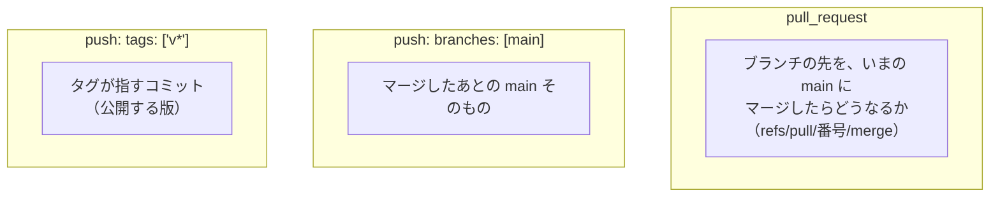

# 11-3 GitHub Actions を読み比べる

[目次](../README.md) ＞ 第 11 部 ＞ 11-3

> GitHub Actions の仕組みと最小の使い方は [技術カード: GitHub Actions](../ref/github-actions.md) にあります。公開のワークフローは [5-3](../05-station-format/03-publish.md)、管理システムの CI の 1 行ずつの読み方は [9-4](../09-console/04-ci.md) で見ました。

## この章で学ぶこと

- 4 つのリポジトリにある 7 つのワークフローの全体像
- きっかけ（`pull_request`・`push`・タグ）ごとに、何が試されるのか。`pull_request` は「マージしたあとの姿」で試す
- 4 つの CI を並べて、同じところと違うところを読む
- `concurrency`、失敗したときだけ報告を残す、キャッシュ、アクションの版
- 練習用のリポジトリで CI を落とし、ログと成果物を読む

## 7 つのワークフロー

| リポジトリ | ワークフロー | きっかけ | すること |
|---|---|---|---|
| yorisoi-platform | [ci.yml](https://github.com/duwenji/yorisoi-platform/blob/main/.github/workflows/ci.yml) | PR、`main` への push | 全モジュールのテスト・lint・公開の形にできるか |
| | [publish.yml](https://github.com/duwenji/yorisoi-platform/blob/main/.github/workflows/publish.yml) | タグ `v*` | タグと版の照合 → テスト → 全モジュールを公開 |
| yorisoi-sanpoguide | [ci.yml](https://github.com/duwenji/yorisoi-sanpoguide/blob/main/.github/workflows/ci.yml) | PR、`main` への push | テスト・lint・リリース版のビルド |
| | [publish.yml](https://github.com/duwenji/yorisoi-sanpoguide/blob/main/.github/workflows/publish.yml) | タグ `prompts-v*` | プロンプト・パックを公開 |
| yorisoi-cycleguide | [ci.yml](https://github.com/duwenji/yorisoi-cycleguide/blob/main/.github/workflows/ci.yml) | PR、`main` への push | テスト・lint・リリース版のビルド |
| | [publish.yml](https://github.com/duwenji/yorisoi-cycleguide/blob/main/.github/workflows/publish.yml) | タグ `prompts-v*` | プロンプト・パックを公開 |
| yorisoi-console | [ci.yml](https://github.com/duwenji/yorisoi-console/blob/main/.github/workflows/ci.yml) | PR、`main` への push | 型・テスト・画面のビルド・機械審査・CDK の合成 |

このほかに、yorisoi-sanpoguide と yorisoi-cycleguide の Actions の画面には **`pages-build-deployment`** という実行が並びます。リポジトリにファイルはありません。GitHub Pages を使うと、GitHub が自動で用意するワークフローです（[11-6](06-pages-releases.md)）。

```sh
gh run list -R duwenji/yorisoi-cycleguide --branch main --limit 4
```

```text
completed	success	pages build and deployment	pages-build-deployment	main	dynamic	40204547931	41s	…
completed	success	Merge pull request #31 from duwenji/release/1.4.0	CI	main	push	40204548290	2m56s	…
completed	success	pages build and deployment	pages-build-deployment	main	dynamic	40202475785	38s	…
completed	success	Merge pull request #30 from duwenji/feat/cues	CI	main	push	40202476182	3m8s	…
```

`main` に 1 回マージするたびに、CI（`push`）と Pages の組み立て（`dynamic`）が 1 つずつ動いています。

## きっかけごとに、何が試されるか



- **`pull_request`**: ブランチの先そのものではなく、**GitHub がその場で作った「main にマージした姿」** を試します。ブランチを切ったあとに `main` が進んでいても、入れたあとに壊れないかが分かります。ブランチを push し直すたびに動きます
- **`push`（`main`）**: マージしたあとの `main` を、もう一度試します。2 つのプルリクエストを続けてマージすると、片方ずつでは通っても、合わせると壊れることがあるからです
- **`push`（タグ）**: 公開のときだけ。`main` に入ったことと、公開することを分けています（[11-5](05-packages-tags.md)）

## 4 つの CI を並べる

### 同じところ

3 つの Gradle のリポジトリの CI は、ほとんど同じ形です。yorisoi-cycleguide の ci.yml:

```yaml
on:
  pull_request:
  push:
    branches: [main]

permissions:
  contents: read
  packages: read

concurrency:
  group: ci-${{ github.ref }}
  cancel-in-progress: true

jobs:
  check:
    runs-on: ubuntu-latest
    steps:
      - uses: actions/checkout@v4
      - uses: actions/setup-java@v4
        with:
          distribution: temurin
          java-version: '17'
      - uses: gradle/actions/setup-gradle@v4
      - name: Test, lint and build
        run: ./gradlew test lint assembleRelease --console=plain
        env:
          GITHUB_ACTOR: ${{ github.actor }}
          GITHUB_TOKEN: ${{ secrets.GITHUB_TOKEN }}
      - name: Keep the reports
        if: failure()
        uses: actions/upload-artifact@v4
        with:
          name: reports
          path: '**/build/reports/'
```

**取ってくる → 道具をそろえる → 1 つのコマンドで確かめる → 失敗したら報告を残す**、の 4 段です。確かめることを Gradle のタスク 1 行にまとめているので、手元でも同じ 1 行を流せば、CI と同じことを確かめられます。

### 違うところ

| | platform | sanpoguide・cycleguide | console |
|---|---|---|---|
| 確かめるコマンド | `test lint publishToMavenLocal` | `test lint assembleRelease` | `tsc -b`・`vitest run`・画面のビルド・validator・`cdk synth` |
| `packages` の権限 | なし（`contents: read` だけ） | `read` | `read` |
| `GITHUB_TOKEN` を渡す | 渡さない | Gradle に渡す | validator の Gradle に渡す |
| サービスコンテナ | | | DynamoDB Local |
| `concurrency` | ✅ | ✅ | なし |
| 失敗時の報告 | `build/reports/` | `build/reports/`（sanpoguide は `prompt-golden.txt` も） | なし |

読み取れることを挙げます。

- **platform は、ほかのリポジトリの公開物を使わない**。だから `packages` の権限も、トークンを Gradle に渡す必要もありません。権限は要るところにだけ（[11-4](04-tokens.md)）
- **platform は `publishToMavenLocal` まで流す**。公開のワークフローはタグのときしか動かないので、「公開の形（POM など）が作れるか」をふだんの CI で先に確かめています。タグを押してから公開の設定の誤りに気づくのを防げます
- **アプリは `assembleRelease` まで流す**。Play に出すのはリリース版なので、デバッグ版ではなくリリース版が組み立てられるかを確かめます。署名の設定は、鍵のファイルがなければ空になる作り（`signingConfigs.findByName("release")`）なので、鍵のない CI では署名していない APK ができるだけです（[1-4](../01-kotlin-android/04-signing-apk.md)、[11-4](04-tokens.md)）
- **sanpoguide は、プロンプトの「答え合わせ」のファイルも残す**。プロンプトの組み立ての結果を、期待のファイル（`src/test/resources/prompt-golden.txt`）と比べるテスト（`PromptGoldenTest`）があります。食い違うと、いまの結果を `build/prompt-golden.txt` に書き出すので、それを取り出して見比べられるようにしています

## 細かい書き方

### concurrency: 古い実行を止める

```yaml
concurrency:
  group: ci-${{ github.ref }}
  cancel-in-progress: true
```

同じ `group` の実行が動いている間に新しい実行が始まると、古いほうを止めます。`github.ref` は、プルリクエストなら `refs/pull/<番号>/merge`、`main` なら `refs/heads/main` です。プルリクエストに続けて push したとき、古いコミットの CI を最後まで待つ意味はないので、止めて時間を節約します。

### if: failure(): 落ちたときだけ残す

```yaml
      - name: Keep the reports
        if: failure()
        uses: actions/upload-artifact@v4
```

ふつう、前の手順が失敗すると、あとの手順は飛ばされます。`if: failure()` を付けると、**前が失敗したときだけ** 動きます。ランナーは終わると消えるので、テストの報告（どのテストがなぜ落ちたかの HTML）を **成果物**（artifact）として GitHub に残しておきます。成功したときは残しません。

```sh
gh run download <実行の番号> -R duwenji/yorisoi-sanpoguide -n reports
```

で手元に取り出せます。

### キャッシュ

- `gradle/actions/setup-gradle@v4`: Gradle 本体とダウンロードした依存を、次の実行のために取っておく
- `actions/setup-node@v4` の `cache: npm`: npm がダウンロードしたものを取っておく（console）

キャッシュは速くするためのもので、**結果は変えない** はずのものです。キャッシュのせいで結果が変わったと思ったら、Actions の画面の Caches から消して流し直します。

### アクションの版

`actions/checkout@v4` の `@v4` は、そのアクションの版です。`@main` のようにブランチを指すと、作った人の変更がある日突然入ってきます。版を指定し、上げるときは自分で上げます。成功していても出る注意書き（「この版は古い」など）は、[9-4](../09-console/04-ci.md) で見たとおり、ときどき読みます。

### ランナーと時間

`runs-on: ubuntu-latest` は、GitHub が用意する Linux の使い捨てのパソコンです。公開のリポジトリでは無料で使えます。1 回の時間は、platform の CI がおよそ 2 分、アプリがおよそ 3 分、console がおよそ 1 分強、公開がおよそ 5 分です。

## ハンズオン: CI を落として読む

[11-2](02-pull-requests.md) で作った練習用のリポジトリ（yorisoi-practice）に、小さな CI を入れます。Gradle も Node.js も使わず、シェルだけで試します。

```sh
cd ~/practice/yorisoi-practice
git switch -c feat/ci
mkdir -p .github/workflows
```

`check.sh`（テストの代わり。README に「練習」という言葉があるかを確かめる）:

```sh
#!/bin/sh
set -e
mkdir -p build/reports
grep -c "練習" README.md > build/reports/count.txt
grep -q "練習" README.md
echo "OK"
```

`.github/workflows/ci.yml`:

```yaml
name: CI

on:
  pull_request:
  push:
    branches: [main]

permissions:
  contents: read

concurrency:
  group: ci-${{ github.ref }}
  cancel-in-progress: true

jobs:
  check:
    runs-on: ubuntu-latest
    steps:
      - uses: actions/checkout@v4
      - name: Check
        run: sh check.sh
      - name: Keep the reports
        if: failure()
        uses: actions/upload-artifact@v4
        with:
          name: reports
          path: build/reports/
```

```sh
sh check.sh                      # 手元で先に流す
git add . && git commit -m "ci: 練習の CI を足す"
git push -u origin feat/ci
gh pr create --fill
gh pr checks --watch
```

緑になったら、わざと落とします。README から「練習」を消して push します。

```sh
sed -i 's/練習/れんしゅう/' README.md
git commit -am "docs: わざと CI を落とす"
git push
gh pr checks --watch
gh run list --limit 3
gh run view <落ちた実行の番号> --log-failed
gh run download <落ちた実行の番号> -n reports && cat count.txt
```

- `--log-failed` で、落ちた手順のログだけが読める
- 成果物の `count.txt` には `0` が入っている。ランナーが消えたあとでも、落ちたときの様子を取り出せる
- 続けて 2 回 push すると、`concurrency` で古い実行が `cancelled` になるのも見られる

確かめたら、README を戻して push し、緑にしてからマージします（`gh pr merge --merge --delete-branch`）。

## つまずきやすいところ

- **`pull_request` は「マージした姿」を試す**: ブランチの先だけ見ると通るのに CI で落ちるときは、`main` 側の変更とぶつかっていないかを見る
- **確かめることは 1 行のコマンドに**: 手元で同じ 1 行を流せる。CI だけでしか分からない失敗を減らせる
- **公開の設定も、ふだんの CI で試す**: タグのときだけ動くワークフローは、壊れていても気づきにくい
- **失敗の報告は成果物に**: ランナーは消える。`if: failure()` と `upload-artifact`
- **アクションは版を指定する**: `@main` にしない

## 確認問題

<details>
<summary>問 1. プルリクエストのブランチを切ったあと、<code>main</code> に別の変更が入りました。ブランチを push し直していないのに、CI の結果が変わることがあるのはなぜですか。</summary>

`pull_request` の CI は、ブランチの先そのものではなく、いまの `main` にマージした姿（`refs/pull/<番号>/merge`）を試すからです。流し直すと、新しい `main` とのマージの姿で試されます。

</details>

<details>
<summary>問 2. yorisoi-platform の CI に <code>packages</code> の権限がなく、アプリの CI には <code>packages: read</code> があるのはなぜですか。</summary>

platform は、ほかのリポジトリが GitHub Packages に公開したものを使わないからです。アプリは platform のコアとキットを GitHub Packages から取ってくるので、読み取りの権限が要ります。

</details>

<details>
<summary>問 3. yorisoi-platform の CI が <code>publishToMavenLocal</code> まで流すのはなぜですか。</summary>

公開のワークフローはタグを押したときしか動かないので、公開の設定が壊れていても、ふだんは気づけないからです。ふだんの CI で手元への公開まで流し、公開の形が作れることを先に確かめています。

</details>

<details>
<summary>問 4. <code>if: failure()</code> の手順で、テストの報告を成果物として残すのはなぜですか。</summary>

ランナーは実行が終わると消えるので、残さなければ、テストが落ちた理由の詳しい報告が読めなくなるからです。成功したときは要らないので、失敗したときだけ残します。

</details>

---

前: [11-2 ブランチとプルリクエスト](02-pull-requests.md) ／ 次: [11-4 トークンと権限](04-tokens.md)
