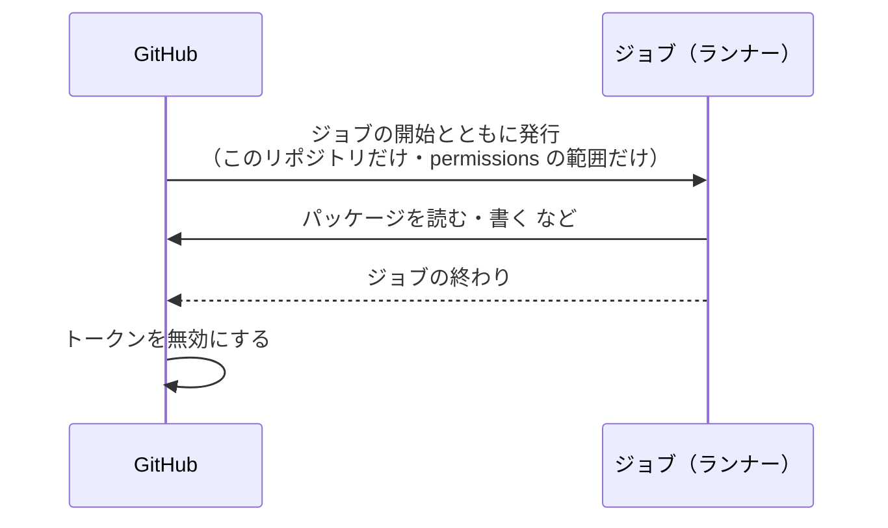

# 11-4 トークンと権限

[目次](../README.md) ＞ 第 11 部 ＞ 11-4

> `GITHUB_TOKEN` と個人用のトークンの仕組みは [技術カード: GITHUB_TOKEN と個人用のトークン](../ref/github-token.md) にあります。

## この章で学ぶこと

- GitHub に「だれが、何をしてよいか」を示す 3 つのもの: `GITHUB_TOKEN`・個人用のトークン（PAT）・シークレット
- `GITHUB_TOKEN` の一生と、`permissions` で権限を絞る書き方
- ほかのリポジトリのパッケージを、自分の `GITHUB_TOKEN` で読める条件
- 手元で GitHub Packages を読むトークンと、`gh` のトークンの違い
- 4 つのリポジトリが **シークレットを 1 つも使っていない** 設計と、その理由

## 3 つのもの

| | だれのものか | どこにあるか | 散策ガイドでは |
|---|---|---|---|
| `GITHUB_TOKEN` | そのワークフローの実行 | ジョブの間だけ、GitHub が自動で発行する | すべての CI と公開で使う |
| 個人用のトークン（PAT） | 人（GitHub のアカウント） | 自分で作り、自分で預かる | 手元で GitHub Packages を読むとき |
| シークレット（`secrets.名前`） | リポジトリ | GitHub の設定に預ける | **使っていない**（`GITHUB_TOKEN` だけ） |

```sh
gh api repos/duwenji/yorisoi-sanpoguide/actions/secrets --jq .total_count
```

```text
0
```

4 つのリポジトリとも 0 です。`${{ secrets.GITHUB_TOKEN }}` は「シークレット」の書き方をしていますが、預けたものではなく、GitHub が実行のたびに作るものです。

## GITHUB_TOKEN

### 一生



- **ジョブが終わると使えなくなる**。ログに漏れても、すぐに意味がなくなる
- **そのリポジトリのためのもの**。ほかのリポジトリに書き込むことはできない
- **できることは `permissions` で決まる**

### permissions で絞る

4 つのリポジトリは、どれもリポジトリの設定で、`GITHUB_TOKEN` の既定の権限を **読み取りだけ**（Read repository contents and packages permissions）にしています。

```sh
gh api repos/duwenji/yorisoi-platform/actions/permissions/workflow --jq .default_workflow_permissions
```

```text
read
```

そのうえで、ワークフローごとに `permissions` を書いています。**`permissions` を書くと、書かなかった権限はすべて「なし」になる** のが要点です。

| ワークフロー | `permissions` | 理由 |
|---|---|---|
| platform の ci.yml | `contents: read` | 取ってくるだけ |
| アプリと console の ci.yml | `contents: read`・`packages: read` | ほかのリポジトリのパッケージを読む |
| 3 つの publish.yml | `contents: read`・`packages: write` | 自分のリポジトリにパッケージを書く |

公開のワークフローでも、`contents: write` は与えていません。公開はタグを **読んで** 動くだけで、リポジトリに何かを書き戻すことはないからです。[IAM](../ref/iam.md) の「最小の権限」と同じ考え方です。

### ほかのリポジトリのパッケージを読む

アプリの CI は、自分のリポジトリ（yorisoi-sanpoguide）の `GITHUB_TOKEN` で、**別のリポジトリ**（yorisoi-platform）のパッケージを読んでいます。これができるのは、yorisoi-platform が公開のリポジトリだからです。

| パッケージの持ち主のリポジトリ | 別のリポジトリの `GITHUB_TOKEN` で読めるか |
|---|---|
| 公開 | 読める（`packages: read` があれば） |
| 非公開 | パッケージの設定の Manage Actions access で、読むリポジトリを 1 つずつ許したときだけ |

非公開だったころ、アプリの CI が `Could not find io.github.duwenji.yorisoi:core-format:1.0.0` で落ちたことは、[5-3](../05-station-format/03-publish.md) で見ました。[11-2](02-pull-requests.md) の「公開前の版を取りにいった」ときと、**同じ文言** です。この文言だけでは「読む権限がない」と「その版がない」を見分けられないので、両方を疑います。

### フォークからのプルリクエスト

公開のリポジトリには、だれでもフォーク（自分のアカウントへの写し）からプルリクエストを出せます。そのとき GitHub は、

- `GITHUB_TOKEN` を **読み取りだけ** にする（`permissions` に何を書いていても）
- シークレットを渡さない

という扱いをします。知らない人のコードが、こちらの権限で動くからです。`pull_request_target` というきっかけを使うと、この制限なしで動かせますが、知らない人のコードを書き込みの権限で動かすことになるので、使いません。

## 手元のトークン

### GitHub Packages を読むトークン

手元で Gradle が GitHub Packages からコアを取ってくるには、**`read:packages` の権限を持つ classic の個人用トークン** が要ります。GitHub Packages の Maven のリポジトリは、きめ細かい個人用トークン（fine-grained）では読めません。置き場所は、リポジトリの外の `~/.gradle/gradle.properties` です（[0-3](../00-overview/03-setup.md)）。

```properties
gpr.user=あなたの GitHub のユーザー名
gpr.key=ghp_…
```

アプリの [settings.gradle.kts](https://github.com/duwenji/yorisoi-sanpoguide/blob/main/settings.gradle.kts) は、`gpr.user`・`gpr.key` がなければ、CI の環境変数 `GITHUB_ACTOR`・`GITHUB_TOKEN` を使います。**同じ設定のファイルが、手元では個人のトークン、CI では実行のトークンを使う** わけです。どちらもなければ、手元に公開したもの（`mavenLocal`）だけを使います。

### gh のトークンでは足りない

`gh` も GitHub のトークンを持っていますが、ふつう `read:packages` を含みません。

```sh
gh auth status 2>&1 | grep -i scopes
gh api users/duwenji/packages?package_type=maven
```

```text
  - Token scopes: 'gist', 'read:org', 'repo', 'workflow'
{"message":"You need at least read:packages scope to list packages.", … "status":"403"}
```

`repo` があっても、パッケージは読めません。**トークンごとに、持っている権限（スコープ）を確かめる** ことが大事です。

## シークレットを使わない設計

4 つのリポジトリの CI が持っている権限は、`GITHUB_TOKEN` の「読む」と、公開のときの「パッケージを書く」だけです。強い力を持つ鍵は、どれも CI の外にあります。

| 強い力を持つもの | どこにあるか | CI に置かない理由 | 章 |
|---|---|---|---|
| アプリの署名の鍵（`release.jks`） | 開発者のパソコン | 漏れると、他人が「同じアプリの更新」を作れる | [1-4](../01-kotlin-android/04-signing-apk.md)、[10-1](../10-play/01-app-bundle.md) |
| Play のサービス アカウントの鍵 | `~/.yorisoi-sanpoguide/` | 漏れると、他人がアプリの版を出せる | [10-4](../10-play/04-api.md) |
| AWS に配備する権限 | 開発者の SSO のログイン | 漏れると、AWS の資源を作り替えられる | [9-4](../09-console/04-ci.md) |
| ルート鍵（チャンネル・リストの署名） | 運営の手元 | 信頼の根っこ | [6-4](../06-trust/04-two-tier-keys.md) |

だから、たとえ CI のワークフローに誤りがあっても、**CI から盗めるもので、アプリや AWS を乗っ取ることはできません**。そのかわり、署名・Play への送信・配備は、人が手元で行います。

自動にしたくなったら、次の順に考えます。

1. **長く使える鍵をシークレットに預けない方法がないか**: AWS は、GitHub の OIDC のトークンを IAM ロールと引き換える（console ADR-001 A-17、[9-4](../09-console/04-ci.md)）。鍵そのものを渡さずに済む
2. **シークレットを預けるなら、Environment に分ける**: リポジトリの Settings → Environments で `production` などを作り、そこにだけシークレットを置き、承認する人を決める。ほかのワークフローからは読めない

## ハンズオン: 権限を外すと何が拒まれるか

[11-2](02-pull-requests.md) の練習用のリポジトリで、`GITHUB_TOKEN` を使って Issue を作るワークフローを動かします。

`.github/workflows/token.yml`:

```yaml
name: Token

on:
  workflow_dispatch:

permissions:
  contents: read

jobs:
  issue:
    runs-on: ubuntu-latest
    steps:
      - name: Create an issue with GITHUB_TOKEN
        run: gh issue create -R "$GITHUB_REPOSITORY" --title "トークンの練習" --body "GITHUB_TOKEN で作った"
        env:
          GH_TOKEN: ${{ secrets.GITHUB_TOKEN }}
```

```sh
cd ~/practice/yorisoi-practice
git switch main && git pull
# 上のファイルを置いてから:
git add . && git commit -m "ci: トークンの練習" && git push
gh workflow run token.yml
gh run list --workflow token.yml --limit 1
gh run view <実行の番号> --log-failed
```

`permissions` に `issues` がないので、Issue を作れずに落ちます。ログに `Resource not accessible by integration`（この実行のトークンには、その操作が許されていない）と出るはずです。

次に、`permissions` に 1 行足して、もう一度流します。

```yaml
permissions:
  contents: read
  issues: write
```

```sh
git commit -am "ci: Issue を書く権限を足す" && git push
gh workflow run token.yml
gh issue list
```

今度は Issue ができます。作った人は `github-actions[bot]` です。**同じコマンドでも、トークンに許した権限で、できることが変わる** のを確かめられました。

> 練習は `main` に直接 push しています。自分 1 人の練習用のリポジトリだからです。5 つのリポジトリでは、[11-2](02-pull-requests.md) のとおりプルリクエストで入れます。

## つまずきやすいところ

- **`permissions` を書いたら、書かなかった権限は「なし」**: 足りなければ 1 つずつ足す
- **`Could not find …` は「ない」とも「読めない」とも限らない**: 版が公開されているか、パッケージを読める設定か、の両方を見る
- **`gh` のトークンと Packages のトークンは別**: `repo` があっても `read:packages` がなければ読めない
- **トークンはリポジトリの外に**: `~/.gradle/gradle.properties` か環境変数。リポジトリの `gradle.properties` に書かない
- **強い鍵を CI に持たせる前に、持たせない方法を探す**: OIDC、Environment と承認

## 確認問題

<details>
<summary>問 1. 公開のワークフローに <code>packages: write</code> だけを足し、<code>contents: write</code> を足さないのはなぜですか。</summary>

公開はタグが指すコミットを読んで、パッケージを書くだけで、リポジトリ（コードやタグ）に書き戻すことがないからです。要らない権限は与えません。

</details>

<details>
<summary>問 2. yorisoi-platform を非公開のリポジトリにすると、アプリの CI はどうなりますか。どうすれば直りますか。</summary>

アプリの CI の `GITHUB_TOKEN` では、yorisoi-platform のパッケージが読めなくなり、`Could not find io.github.duwenji.yorisoi:…` で落ちます。パッケージの設定の Manage Actions access で、アプリのリポジトリに読み取りを許すと直ります。

</details>

<details>
<summary>問 3. 4 つのリポジトリがシークレットを 1 つも使っていないことで、何が守られていますか。そのかわり何を人がしていますか。</summary>

CI のワークフローに誤りがあったり、ワークフローが乗っ取られたりしても、署名の鍵・Play の鍵・AWS の権限が盗まれることはありません。そのかわり、リリースの署名・Play への送信・AWS への配備は、人が手元で行っています。

</details>

<details>
<summary>問 4. フォークから出されたプルリクエストの CI で、<code>GITHUB_TOKEN</code> が読み取りだけになるのはなぜですか。</summary>

プルリクエストのコードは、知らない人が書いたものかもしれないからです。書き込みの権限やシークレットを渡すと、そのコードがこちらの権限でリポジトリを書き換えたり、シークレットを外へ送ったりできてしまいます。

</details>

---

前: [11-3 GitHub Actions を読み比べる](03-actions.md) ／ 次: [11-5 GitHub Packages とタグ](05-packages-tags.md)
