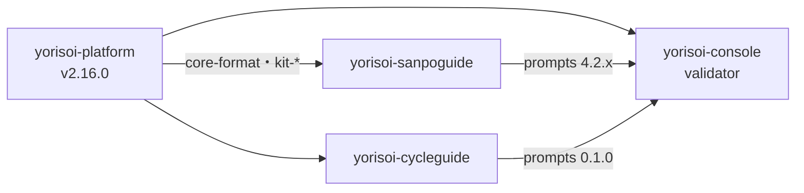
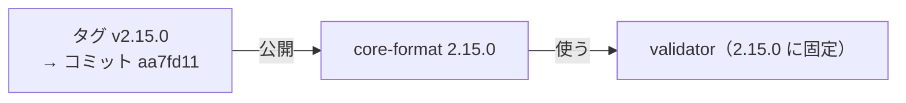

# 11-5 GitHub Packages とタグ

[目次](../README.md) ＞ 第 11 部 ＞ 11-5

> GitHub Packages の仕組みと最小の使い方は [技術カード: GitHub Packages](../ref/github-packages.md) にあります。Maven の座標・`maven-publish` の設定・使う側の設定は [5-3](../05-station-format/03-publish.md) で見ました。この章は、同じ公開を **GitHub の側から** 見ます。

## この章で学ぶこと

- 3 つのリポジトリが持つ 3 つの Maven のリポジトリ（置き場所）
- Maven のパッケージは、見える範囲も権限も、持ち主のリポジトリに従う
- タグの名前の付け方（`v*` と `prompts-v*`）と、タグを押す手順
- 公開した版とタグは、消さない・動かさない
- すべてのタグが版と合っているかを、手元で確かめる

## 3 つの置き場所

GitHub Packages の Maven のリポジトリは、**GitHub のリポジトリ 1 つにつき 1 つ** あります。URL は `https://maven.pkg.github.com/<持ち主>/<リポジトリ>` です。

| 置き場所 | グループ | 載っているもの | 版を書く場所 | タグ |
|---|---|---|---|---|
| `…/duwenji/yorisoi-platform` | `io.github.duwenji.yorisoi` | コア 2 つとキット 6 つ（すべて同じ版） | `gradle.properties` の `yorisoiVersion` | `v<版>` |
| `…/duwenji/yorisoi-sanpoguide` | `io.github.duwenji.yorisoi.sanpoguide` | 散策ガイドのプロンプト・パック | `sanpoguidePromptsVersion` | `prompts-v<版>` |
| `…/duwenji/yorisoi-cycleguide` | `io.github.duwenji.yorisoi.cycleguide` | CycleGuide のプロンプト・パック | `cycleguidePromptsVersion` | `prompts-v<版>` |

使う側は、置き場所ごとに `maven { url = … }` を書き、`includeGroup(…)` で「この置き場所からは、このグループだけ」と決めます（[5-3](../05-station-format/03-publish.md)）。管理システムの validator は 3 つとも、アプリは platform の 1 つだけを使います。



## パッケージはリポジトリに従う

Maven のパッケージは、**持ち主のリポジトリの見える範囲と権限を、そのまま受け継ぎます**。

| 持ち主のリポジトリ | パッケージ |
|---|---|
| 公開 | 公開。だれでも見つけられる。**ただし Maven で取ってくるにはトークンが要る**（[11-4](04-tokens.md)） |
| 非公開 | 非公開。読めるのは、そのリポジトリを読める人と、許したリポジトリの Actions |
| 書ける人 | そのリポジトリに書ける人と、そのリポジトリの `GITHUB_TOKEN`（`packages: write`） |

だから、同じ座標のパッケージを **別のリポジトリから** 公開することはできません（422 で失敗する。[5-3](../05-station-format/03-publish.md)）。プロンプト・パックの座標が `io.github.duwenji.yorisoi.sanpoguide:prompts` のようにアプリの名前を含むのは、置き場所（リポジトリ）とグループを 1 対 1 にしておくためです。

パッケージは、リポジトリの画面の右側の「Packages」、または `https://github.com/duwenji/yorisoi-platform/packages` で見られます。

## タグを押す

公開は、`gradle.properties` の版を上げたプルリクエストをマージしたあと、**そのマージ・コミットにタグを押す** ことで始まります。

```sh
cd /c/Dev/apps/yorisoi-platform
git switch main && git pull
grep '^yorisoiVersion=' gradle.properties   # yorisoiVersion=2.16.0
git tag v2.16.0
git push origin v2.16.0
gh run watch                                  # Publish の実行を見守る
```

散策ガイドのタグは、**軽量タグ**（コミットを指す名前だけ）です。

```sh
git cat-file -t v2.16.0
git rev-list -n1 v2.16.0
```

```text
commit
21028dfa4c6331c7afedfe7d5fa8d467a547198c
```

`commit` と出るのが軽量タグで、`21028df` は [11-2](02-pull-requests.md) で見た `Merge pull request #41` です。説明や作った人を記録する **注釈つきタグ**（`git tag -a`）なら `tag` と出ます。公開の理由はプルリクエストに書いてあるので、ここでは軽量タグで足りています。

### タグの名前を分ける

| リポジトリ | タグ | 動くワークフロー |
|---|---|---|
| yorisoi-platform | `v*` | publish.yml（すべてのモジュール） |
| yorisoi-sanpoguide・yorisoi-cycleguide | `prompts-v*` | publish.yml（`:prompts` だけ） |

アプリのリポジトリでは、アプリそのものの版（`versionCode`・`versionName`）は Play で出します（[第 10 部](../10-play/02-tracks.md)）。そこでプロンプト・パックのタグに `prompts-` を付けて、**アプリの版とプロンプト・パックの版を取り違えない** ようにしています。`v1.4.0` というタグを押しても、アプリのリポジトリでは何も公開されません。

## 消さない・動かさない



- **同じ版は 2 度公開できない**: GitHub Packages は、すでにある版への公開を拒みます（409 Conflict）。直すときは新しい版を出す
- **タグを動かさない**: 公開したあとにタグを別のコミットへ付け替えても、パッケージの中身は変わりません。タグと中身が食い違い、「v2.15.0 のソース」がどれか分からなくなります
- **タグを消さない**: yorisoi-platform には、名前を変える前のタグ（`station-format-v*`・`michizure-core-v*`）も残っています。どのコミットを公開したかの記録だからです。yorisoi-sanpoguide の `sanpoguide-prompts-v*` も同じです
- **版を消さない**: GitHub Packages の画面から版を消すこともできますが、その版を固定して使っている側（[5-3](../05-station-format/03-publish.md) の validator）が組み立てられなくなります

まちがえて公開したら、消すのではなく、**直した新しい版を出して、使う側に上げてもらう** のが基本です。

## ハンズオン: すべてのタグが版と合っているか

公開のワークフローは、タグと `gradle.properties` の版を照合してから公開します。過去のすべてのタグで、それが守られているかを手元で確かめます。`git show <タグ>:<ファイル>` で、そのタグの時点のファイルを読めます。

```sh
cd /c/Dev/apps/yorisoi-platform
for t in $(git tag -l 'v*'); do
  v=$(git show "$t:gradle.properties" | grep '^yorisoiVersion=' | cut -d= -f2)
  [ "${t#v}" = "$v" ] && echo "OK $t" || echo "NG $t ($v)"
done
```

```text
OK v1.0.0
OK v2.0.0
OK v2.1.0
OK v2.10.0
…
OK v2.16.0
```

アプリのリポジトリでも試します。

```sh
cd ../yorisoi-sanpoguide
for t in $(git tag -l 'prompts-v*'); do
  v=$(git show "$t:gradle.properties" | grep '^sanpoguidePromptsVersion=' | cut -d= -f2)
  [ "${t#prompts-v}" = "$v" ] && echo "OK $t" || echo "NG $t ($v)"
done
```

```text
OK prompts-v1.0.0
OK prompts-v2.0.0
…
OK prompts-v4.2.1
```

ある時点では、どちらのリポジトリもすべて `OK` でした。名前を変える前のタグ（`sanpoguide-prompts-v*` など）は、`prompts-v*` に当てはまらないので数えていません。`git show sanpoguide-prompts-v1.1.0:gradle.properties` で開くと、そのころはこのリポジトリがコアも公開していた（`michizureCoreVersion`）ことが分かります。

### やってみよう: タグを付けるべきコミットを探す

「`yorisoiVersion` を 2.16.0 にした変更が入ったマージ・コミット」は、次のように探せます。

```sh
cd /c/Dev/apps/yorisoi-platform
git log --first-parent --format='%h %s' -S 'yorisoiVersion=2.16.0' -- gradle.properties
```

`-S` は、その文字列が増えたり減ったりしたコミットを探します。出てきたコミットが、`git rev-list -n1 v2.16.0` と同じことを確かめてください。

### 置き場所をのぞく（任意）

`read:packages` の classic のトークンを持っていれば、置き場所にある版の一覧（`maven-metadata.xml`）を直接読めます。

```sh
curl -s -u "<ユーザー名>:<トークン>" \
  https://maven.pkg.github.com/duwenji/yorisoi-platform/io/github/duwenji/yorisoi/core-format/maven-metadata.xml
```

`<versions>` に、公開したすべての版が並びます。

## つまずきやすいところ

- **タグは、版を上げたマージのあとに `main` で押す**: ブランチの途中のコミットに押すと、`main` にないソースが公開される
- **タグと版は CI が照合する**: 合わなければ公開しないで止まる
- **公開した版・タグは消さない、動かさない**: 直すなら新しい版
- **置き場所 1 つにグループ 1 つ**: 同じ座標を別のリポジトリから公開できない
- **公開のパッケージでも、Maven で取るにはトークン**: [11-4](04-tokens.md)

## 確認問題

<details>
<summary>問 1. アプリのリポジトリのタグを <code>v*</code> ではなく <code>prompts-v*</code> にしているのはなぜですか。</summary>

アプリのリポジトリには、アプリそのものの版（Play で出す）と、プロンプト・パックの版の 2 つがあるからです。タグに `prompts-` を付けると、どちらの版の印かを取り違えません。アプリの版のつもりで `v1.4.0` を押しても、プロンプト・パックが公開されることはありません。

</details>

<details>
<summary>問 2. <code>core-format 2.15.0</code> に誤りがありました。版を消して、直したものを 2.15.0 として公開し直してよいですか。</summary>

いけません。GitHub Packages は同じ版への公開を拒みますし、版を消すと、2.15.0 に固定して使っている側が組み立てられなくなります。直したものを 2.15.1 などの新しい版として公開し、使う側に上げてもらいます。

</details>

<details>
<summary>問 3. 公開したあとで、タグ <code>v2.16.0</code> を別のコミットに付け替えると、何が困りますか。</summary>

パッケージの中身は最初のコミットから作られたままなので、タグが指すソースと、公開された中身が食い違います。「2.16.0 のソース」をタグでたどれなくなります。

</details>

<details>
<summary>問 4. yorisoi-platform が公開のリポジトリなのに、手元の Gradle がトークンなしでコアを取ってこられないのはなぜですか。</summary>

GitHub Packages の Maven のリポジトリは、パッケージが公開でも、取ってくるのに認証を求めるからです。`read:packages` の classic のトークンが要ります。

</details>

---

前: [11-4 トークンと権限](04-tokens.md) ／ 次: [11-6 GitHub Pages と Releases](06-pages-releases.md)
