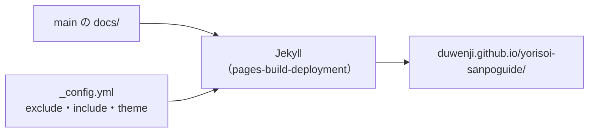
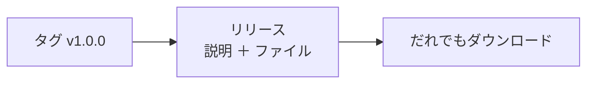

# 11-6 GitHub Pages と Releases

[目次](../README.md) ＞ 第 11 部 ＞ 11-6

> GitHub Pages の仕組みと最小の使い方は [技術カード: GitHub Pages](../ref/github-pages.md) にあります。

## この章で学ぶこと

- GitHub Pages で、リポジトリの `docs/` の一部だけを Web に出す仕組み
- `_config.yml` の `exclude`・`include` で、出すものと出さないものを分ける
- Play に出したプライバシーポリシーの URL を変えてはいけない理由
- GitHub Releases は何をするもので、散策ガイドがなぜ使っていないのか

## Pages で何を出しているか

yorisoi-sanpoguide と yorisoi-cycleguide は、**`main` の `/docs` フォルダ** を GitHub Pages で出しています。

```sh
gh api repos/duwenji/yorisoi-sanpoguide/pages --jq '{url:.html_url,source,build_type,https_enforced}'
```

```text
{"build_type":"legacy","https_enforced":true,"source":{"branch":"main","path":"/docs"},"url":"https://duwenji.github.io/yorisoi-sanpoguide/"}
```

| アプリ | 出しているページ | 使い道 |
|---|---|---|
| 散策ガイド | トップ（`index.html`）、[プライバシーポリシー](https://duwenji.github.io/yorisoi-sanpoguide/privacy-policy) | Play の「プライバシーポリシー」と「ウェブサイト」の欄（[10-3](../10-play/03-console.md)） |
| CycleGuide | [プライバシーポリシー](https://duwenji.github.io/yorisoi-cycleguide/privacy-policy) だけ | Play の「プライバシーポリシー」の欄 |

`docs/` には、設計書・TODO・Play Console の手順書など、開発のための文書がたくさんあります。それらは GitHub のリポジトリの画面で読むもので、Web には出しません。

## Jekyll と _config.yml

`build_type` が `legacy` のとき、GitHub は `docs/` を **Jekyll**（Markdown や HTML のひな形から Web のページを作る道具）で組み立てて出します。組み立ては、[11-3](03-actions.md) で見た `pages-build-deployment` のワークフローが、`main` に push するたびに行います。



yorisoi-sanpoguide の [docs/_config.yml](https://github.com/duwenji/yorisoi-sanpoguide/blob/main/docs/_config.yml):

```yaml
# GitHub Pages (main, /docs) publishes the landing page and privacy policy; the rest is for the repository.
title: 散策ガイド
lang: ja
exclude: ["*.md", "*.csv", "architecture.html"]
include: ["privacy-policy.md"]
theme: jekyll-theme-primer
defaults:
  - scope: { path: "" }
    values: { layout: default }
```

| 行 | 意味 |
|---|---|
| `exclude: ["*.md", "*.csv", "architecture.html"]` | Markdown と CSV と構成図は、すべて出さない |
| `include: ["privacy-policy.md"]` | ただし、プライバシーポリシーだけは出す |
| `theme: jekyll-theme-primer` | GitHub が用意している見た目（GitHub の画面に似た文字と色） |
| `defaults` の `layout: default` | すべてのページに、そのテーマの枠（見出し・タイトル）を付ける |

**「全部出して、隠したいものを外す」ではなく、「全部外して、出したいものだけ戻す」** 書き方です。あとから `docs/` に文書を足しても、勝手に Web に出ることはありません。

実際に確かめると:

```sh
for p in "" privacy-policy TODO README architecture.html; do
  curl -s -o /dev/null -w "%{http_code} /$p\n" "https://duwenji.github.io/yorisoi-sanpoguide/$p"
done
```

```text
200 /
200 /privacy-policy
404 /TODO
404 /README
404 /architecture.html
```

`privacy-policy.md` は `privacy-policy.html` に組み立てられ、`.html` を付けずに `/privacy-policy` でも開けます。

トップの [docs/index.html](https://github.com/duwenji/yorisoi-sanpoguide/blob/main/docs/index.html) は、先頭に Jekyll の設定（front matter）を持つ HTML です。

```html
---
layout: default
title: 散策ガイド
---
<h1>散策ガイド</h1>
…
<p>詳しくは<a href="{{ '/privacy-policy' | relative_url }}">プライバシーポリシー</a>をご覧ください。</p>
```

`{{ '/privacy-policy' | relative_url }}` は、Jekyll がサイトの場所（`/yorisoi-sanpoguide`）を前に付けて、`/yorisoi-sanpoguide/privacy-policy` にしてくれる書き方です。`/privacy-policy` と直接書くと、`duwenji.github.io/privacy-policy`（別のサイト）を指してしまいます。

## URL を変えない

プライバシーポリシーの URL は、Play Console に登録してあり、ストアの掲載ページから散策者がたどります。だから、

- **ファイルの名前を変えない**: `privacy-policy.md` を `privacy.md` にすると、URL が変わり、Play に登録した URL が 404 になる
- **リポジトリの名前を変えるときは、Play の登録も直す**: Pages の URL にはリポジトリの名前が入る（[11-1](01-git-and-repos.md)）
- **`exclude` を書き換えたら、出ているページを確かめる**: 上の `curl` で、要るページが 200、要らないページが 404 か

プライバシーポリシーの **中身** を変えるとき（たとえば外に送る情報を足したとき）の順番は、[10-3](../10-play/03-console.md) で見ました。Pages は `main` に入ると数十秒で出るので、アプリのリリースより先にマージできます。

## Releases

**GitHub Releases** は、タグに、説明の文章と、配るファイル（APK・zip など）を付けて出す仕組みです。



散策ガイドは、Releases を **使っていません**。

```sh
gh api repos/duwenji/yorisoi-sanpoguide/releases --jq length
```

```text
0
```

| 届けるもの | 届け方 | Releases を使わない理由 |
|---|---|---|
| アプリ | Google Play（[第 10 部](../10-play/02-tracks.md)） | Play が署名・更新・段階的な公開・テスターの管理をする。Releases に APK を置くと、Play を通らない入れ方ができてしまい、Play Integrity（[10-5](../10-play/05-integrity.md)）や更新の仕組みから外れる |
| コア・キット・プロンプト・パック | GitHub Packages（[11-5](05-packages-tags.md)） | 使う側は Gradle で版を指定して取る。説明はプルリクエストにある |

Releases が役に立つのは、たとえば「Play を使わずに配るツール」や「人が手でダウンロードするファイル」がある場合です。そのときは、タグを押すワークフローで、組み立てたファイルを `gh release create <タグ> <ファイル>` で付けるのが定番です。

> **下書き（Draft）のリリース** は、公開するまでタグを作りません。リポジトリを読める人にも見えず、ファイルだけが残ります。使わなくなった下書きは、`gh release delete <タグ> --yes` で消しておきます。

## ハンズオン: 練習用のリポジトリで Pages を出す

[11-2](02-pull-requests.md) の練習用のリポジトリで、`docs/` から 1 ページだけを出します。

```sh
cd ~/practice/yorisoi-practice
git switch main && git pull
mkdir -p docs
```

`docs/_config.yml`:

```yaml
title: 練習
exclude: ["*.md"]
include: ["hello.md"]
theme: jekyll-theme-primer
defaults:
  - scope: { path: "" }
    values: { layout: default }
```

`docs/hello.md` と、出さないつもりの `docs/notes.md` を置きます。

```sh
printf '# こんにちは\n\nPages の練習です。\n' > docs/hello.md
printf '# メモ\n\nこれは出さない。\n' > docs/notes.md
git add docs && git commit -m "docs: Pages の練習" && git push
```

Pages を有効にします（リポジトリの Settings → Pages で「Deploy from a branch」「main」「/docs」を選んでも同じです）。

```sh
gh api -X POST repos/{owner}/yorisoi-practice/pages \
  -f "source[branch]=main" -f "source[path]=/docs"
gh run list --limit 2      # pages build and deployment が動く
```

1 分ほど待ってから確かめます。

```sh
owner=$(gh api user --jq .login)
for p in hello notes; do
  curl -s -o /dev/null -w "%{http_code} /$p\n" "https://$owner.github.io/yorisoi-practice/$p"
done
```

`/hello` が 200、`/notes` が 404 になれば、`exclude`・`include` のとおりです。`include` から `hello.md` を外して push すると、`/hello` も 404 になることを確かめてみてください。

練習が終わったら、練習用のリポジトリは消してかまいません（`gh repo delete yorisoi-practice --yes`。`gh auth refresh -s delete_repo` で消す権限を足す必要があります）。

## つまずきやすいところ

- **出すものだけを `include` する**: `docs/` に足した文書が勝手に出ないように
- **サイトの中のリンクは `relative_url`**: プロジェクトのサイトは `/<リポジトリ>/` の下にある
- **Play に登録した URL は変えない**: ファイルの名前、リポジトリの名前、`exclude` の 3 つに気をつける
- **アプリは Releases で配らない**: Play を通らない入れ方を作らない
- **使わない下書きのリリースは消す**: ファイルが残り続ける

## 確認問題

<details>
<summary>問 1. <code>_config.yml</code> で <code>*.md</code> をすべて <code>exclude</code> し、<code>privacy-policy.md</code> だけを <code>include</code> しているのはなぜですか。</summary>

`docs/` には開発のための文書がたくさんあり、それらは Web に出す必要がないからです。全部外して出したいものだけ戻す書き方なら、あとから文書を足しても、勝手に Web に出ることがありません。

</details>

<details>
<summary>問 2. <code>docs/privacy-policy.md</code> の名前を <code>docs/privacy.md</code> に変えると、何が起きますか。</summary>

Pages の URL が `/privacy` に変わり、Play Console に登録した `/privacy-policy` が 404 になります（さらに `include` にも当てはまらなくなり、ページそのものが出なくなります）。ストアの掲載ページからプライバシーポリシーが読めなくなります。

</details>

<details>
<summary>問 3. <code>index.html</code> のリンクを <code>href="/privacy-policy"</code> と書くと、どこを指しますか。</summary>

`https://duwenji.github.io/privacy-policy` です。プロジェクトのサイトは `https://duwenji.github.io/yorisoi-sanpoguide/` の下にあるので、別の場所を指してしまいます。`relative_url` を使うと、サイトの場所が前に付きます。

</details>

<details>
<summary>問 4. 署名した APK を GitHub Releases にも置いておくと便利そうです。散策ガイドがそうしないのはなぜですか。</summary>

Play を通らない入れ方ができてしまうからです。Play の更新の仕組みや段階的な公開から外れ、Play から入れた本物のアプリかを確かめる Play Integrity の判定も通りません。アプリは Play で届けます。

</details>

---

前: [11-5 GitHub Packages とタグ](05-packages-tags.md) ／ [目次へ戻る](../README.md)
