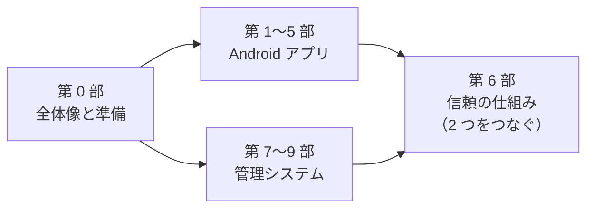

# 散策ガイドで学ぶ Kotlin・Android・TypeScript・AWS

SanpoGuide（Android アプリ）と michizure-console（AWS 上のチャンネル管理システム）の 2 つのリポジトリを教材にして、そこで使われている技術を順に学ぶチュートリアルです。

## このチュートリアルの考え方

- **本物のコードで学ぶ**: 説明のための小さな例ではなく、実際に動いているコードを読みます。「何をするか」だけでなく「なぜこう書いたか」まで追います
- **手を動かす**: 各部にハンズオンがあります。手元でコマンドを実行し、わざと壊して、エラーで止まることを確かめます
- **読者は Kotlin や AWS が初めての人**: プログラミングの経験（どの言語でもよい）とコマンドラインの基本操作は前提にします。Kotlin・TypeScript・AWS・暗号の知識は前提にしません

## 読む順番

第 0 部は必ず最初に読んでください。そのあとは、アプリから入っても管理システムから入ってもかまいません。第 6 部は両方にまたがる話なので、どちらか一方を読んだあとが読みやすいですが、第 0 部だけ読んでから挑戦することもできます（必要な文法はその場で補います）。

## 目次

✅ は執筆済みです（2026-10-05 に第 0〜9 部をすべて書き終えました）。

### 第 0 部 全体像と準備 ✅

| 章 | 内容 |
|---|---|
| [0-1 何を作っているのか](00-overview/01-what-we-build.md) | 散策ガイドとチャンネル管理システムが何をするか、2 つの境界 |
| [0-2 技術の地図](00-overview/02-technology-map.md) | どこでどの技術が使われているか、用語集 |
| [0-3 開発環境の準備](00-overview/03-setup.md) | JDK・Android Studio・Node.js・Docker、動作確認 |
| [0-4 リポジトリの歩き方](00-overview/04-reading-the-repos.md) | フォルダの構成、文書（ADR・契約書）の読み方 |

### 第 1 部 Kotlin と Android の基礎 ✅

| 章 | 内容 |
|---|---|
| [1-1 Kotlin の文法](01-kotlin-android/01-kotlin-syntax.md) | `val`/`var`、null 安全と `!!`、データクラス・enum・sealed、`when`、ラムダ、拡張関数。テストを壊すハンズオン |
| [1-2 Gradle とビルド](01-kotlin-android/02-gradle.md) | 設定ファイルの役割、2 つのモジュール、依存の種類と BOM、自作のタスク `channelIndex` |
| [1-3 Android アプリの部品](01-kotlin-android/03-android-components.md) | Application・Activity・Service とライフサイクル、マニフェスト、フォアグラウンドサービス、実行時の権限 |
| [1-4 署名と APK](01-kotlin-android/04-signing-apk.md) | 署名が守るもの、デバッグ用とリリース用、秘密を Git に入れない仕組み、署名の確かめ方 |

### 第 2 部 画面を作る（Jetpack Compose） ✅

| 章 | 内容 |
|---|---|
| [2-1 Compose の考え方](02-compose/01-compose-basics.md) | 宣言的 UI、Composable、再コンポーズ、`remember`・`rememberSaveable`、Modifier。`CompanionCard` を丸ごと読み、プレビューを並べる |
| [2-2 状態と ViewModel](02-compose/02-state-viewmodel.md) | ViewModel と StateFlow、単方向データフロー、`combine`・`stateIn`、遅れて届く結果への備え、下書き |
| [2-3 DI ライブラリを使わない構成](02-compose/03-manual-di.md) | 依存を外から渡す理由、`SanpoApp` で部品をつなぐ、時計を進める `ChannelSync` のテスト、この構成の限界 |
| [2-4 テーマと雰囲気](02-compose/04-theme-mood.md) | Material3 の色と文字、`MoodTheme`、色のアニメーション、`Canvas` で描く風景、`MoodSource` |

### 第 3 部 散歩についていく（非同期処理と端末の機能） ✅

| 章 | 内容 |
|---|---|
| [3-1 Coroutines と Flow](03-walk/01-coroutines.md) | `suspend`、`launch`・`async`、スコープの選び方、`withContext(Dispatchers.IO)`、`Mutex`、Flow。練習用のテストで確かめる |
| [3-2 常駐サービス](03-walk/02-service.md) | `WalkService` の一生、4 つの通知のチャンネル、PendingIntent、Service と画面の状態の共有。エミュレータでのぞく |
| [3-3 位置情報とセンサー](03-walk/03-location-sensors.md) | Fused Location の 2 つの受け取り方、GPS の揺れを除く工夫、方位センサーと偏角、角度の計算の落とし穴 |
| [3-4 「いま何を話すか」の判定](03-walk/04-maybe-talk.md) | `maybeTalk()` の 7 つの判断（＋チャンネルのきっかけ）と優先順位、話しすぎを防ぐしくみ、判断を小さな部品に分ける、enum の並び順の危うさ |

### 第 4 部 外の世界とつながる ✅

| 章 | 内容 |
|---|---|
| [4-1 HTTP と JSON](04-outside/01-http-json.md) | OkHttp、タイムアウトの選び方、予備のサーバー、`org.json`、重複のまとめ方。curl で同じサービスを呼ぶ |
| [4-2 地図](04-outside/02-map.md) | タイルの仕組み、地理院地図と Google Map Tiles、`AndroidView`、重ねる順番、作り直さない工夫、出典。タイルを 1 枚取る |
| [4-3 AI を組み込む](04-outside/03-ai.md) | `LlmClient` と 2 つの実装、プロンプトのファイルとテンプレート、チャンネルが変えられる部分と変えられない部分、定型文、キャッシュ、位置情報の扱い |
| [4-4 声と音](04-outside/04-voice-sound.md) | TTS とオーディオフォーカス、背景音の合成（ノイズとフィルター）、AudioTrack、専用のスレッドと `@Volatile`。WAV に書き出して聞く |
| [4-5 端末にデータを置く](04-outside/05-storage.md) | SharedPreferences と変えた値だけの保存、設定の移行、`AtomicFile`、古い記録を読めるようにする、Android Keystore での暗号化 |

### 第 5 部 共有ライブラリ（コアとプロンプト・パック。もとは station-format） ✅

| 章 | 内容 |
|---|---|
| [5-1 Android に依存しない JVM ライブラリ](05-station-format/01-jvm-library.md) | 切り出した理由、差し替え口・`compileOnly`・クラスパスのリソース、`StationFiles`、動きを変えずに切り出す進め方。jar の中を確かめる |
| [5-2 チャンネル・パッケージの形式](05-station-format/02-package-format.md) | `channel.json` は選択肢だけ、スロットの決まり、`signature.json`、確かめる順番、ZIP を安全に開く。自分のチャンネルを作って確かめる |
| [5-3 ライブラリを公開する](05-station-format/03-publish.md) | Maven の座標と版、`maven-publish`、タグで公開する GitHub Actions、使う側の設定、`Permission denied` の実話 |
| [5-4 素材ときっかけ](05-station-format/04-materials-cues.md) | 素材を切り出した理由、すべての出どころを同じ形（`Producer`）で扱い属性で許可を決める、候補を順に試す、きっかけと見せ方の安全、素材集を名前で借りる、ジオハッシュの地域、アプリの段階。自分のチャンネルにきっかけを足す |

### 第 6 部 信頼の仕組み（2 つのリポジトリをつなぐ） ✅

| 章 | 内容 |
|---|---|
| [6-1 なぜ署名が要るのか](06-trust/01-why-signatures.md) | ハッシュ・公開鍵・署名の基礎、「置き場所を信用しない」設計 |
| [6-2 Ed25519 と「鍵の指紋」の ID](06-trust/02-ed25519-and-ids.md) | Ed25519、base64url、base32、`sc1…`・`sg1…` |
| [6-3 署名つき文書の形](06-trust/03-signed-documents.md) | `payload`・`keyId`・`sig`、`type` で取り違えを防ぐ |
| [6-4 鍵を 2 段にする](06-trust/04-two-tier-keys.md) | ルート鍵と署名鍵、鍵セット、AWS KMS、要約への署名 |
| [6-5 アプリで確かめる](06-trust/05-verify-in-app.md) | Kotlin の `ProviderDocuments`、Tink、巻き戻しと期限 |
| [6-6 2 つの言語で同じ規則を守る](06-trust/06-same-rules.md) | テストベクタ、準拠テスト |
| [6-7 ハンズオン](06-trust/07-hands-on.md) | AWS なしで公開し、準拠テストをかけ、わざと壊す |

### 第 7 部 TypeScript のモノレポと契約 ✅

| 章 | 内容 |
|---|---|
| [7-1 TypeScript の文法](07-typescript/01-typescript-syntax.md) | Kotlin との対応、ユニオン型と判別できるユニオン、`unknown`、`never`、モジュール、`async`/`await`。tsx と tsc の違いを確かめる |
| [7-2 npm workspaces とプロジェクト参照](07-typescript/02-workspaces.md) | モノレポにする理由、リンクで名前を参照する仕組み、ソースをそのまま公開する作り、`tsc -b` が飛ばす判断 |
| [7-3 契約から始める（OpenAPI）](07-typescript/03-openapi.md) | 契約書 → OpenAPI → 型 → サーバーと画面、Problem Details、`ETag`・`If-Match`。契約と食い違うコードをコンパイルで止める |
| [7-4 テスト](07-typescript/04-testing.md) | Vitest、AWS なしでテストする 3 つの方法（メモリの代役・aws-sdk-client-mock・DynamoDB Local）、テストを絞って流して壊す |

### 第 8 部 AWS サーバーレス ✅

| 章 | 内容 |
|---|---|
| [8-1 AWS の基本](08-aws/01-aws-basics.md) | アカウント・リージョン、サーバーレス、IAM と最小の権限、タグと料金の考え方。合成したテンプレートで許可を読む |
| [8-2 CDK でインフラを書く](08-aws/02-cdk.md) | CloudFormation と CDK、スタックとコンストラクト、`cdk synth` と `deploy` の違い、`RETAIN`、テストで設定を守る |
| [8-3 Lambda と API Gateway](08-aws/03-lambda-apigw.md) | ハンドラ、コールドスタート、1 つの Lambda で 66 の操作、HTTP API と JWT の確認、非同期の呼び出しと Scheduler。偽のイベントで手元で呼ぶ |
| [8-4 Cognito でログイン](08-aws/04-cognito.md) | ユーザープール、グループ、全員に MFA、登録の後処理、認可コード ＋ PKCE、JWT の中身 |
| [8-5 DynamoDB の 1 テーブル設計](08-aws/05-dynamodb.md) | アクセスパターンからキーを決める、疎な GSI、条件つき書き込み、トランザクション、上限と TTL。DynamoDB Local で試す |
| [8-6 S3 と CloudFront](08-aws/06-s3-cloudfront.md) | 4 つのバケット、署名つき POST、OAC、キャッシュの長さと無効化、画面と API を 1 つの場所に |
| [8-7 SQS・SES・KMS](08-aws/07-sqs-ses-kms.md) | 待ち行列とデッドレターキュー、少なくとも 1 回と冪等、メールを送る前の準備、KMS の鍵ポリシー |
| [8-8 Kotlin の Lambda](08-aws/08-kotlin-lambda.md) | `validator`、`RequestHandler`、zip の形、JVM の起動を速くする工夫、S3 のイベントが 2 回来るとき |

### 第 9 部 管理画面と開発の進め方 ✅

| 章 | 内容 |
|---|---|
| [9-1 React と Vite](09-console/01-react-vite.md) | SPA、部品・JSX・`useState`・`useEffect`、管理画面の部品の木、react-router、OpenAPI の型で API を呼ぶ、Vite は型を確かめない |
| [9-2 ブラウザでログインする](09-console/02-browser-login.md) | OIDC、認可コード ＋ PKCE、oidc-client-ts、ログアウト、トークンの置き場所。PKCE を手で作る |
| [9-3 ブラウザの中で鍵を作る](09-console/03-keys-in-browser.md) | WebCrypto、取り出せない鍵、PBKDF2 ＋ AES-GCM の鍵のファイル、チャレンジへの署名、AI のキーもサーバーに送らない |
| [9-4 CI](09-console/04-ci.md) | ci.yml を読む、サービスコンテナ、捨てる鍵での合成、配備はしない理由、注意書きを読む |
| [9-5 決めたことを残す](09-console/05-docs.md) | ADR・契約書・データモデル・設計書、捨てた案を残す、文書の ID でコードまでたどる、決定が変わるとき |

### 技術カード

章とは別に、1 つの技術を 1 ページで説明する [技術カード](ref/README.md) があります。章は「このコードはなぜこう書かれているか」を、カードは「その技術がどう動き、最小限どう使うか」を説明します。章を書くときに、その章で出てくる技術のカードを一緒に作ります。

| カード | 状態 |
|---|---|
| 第 1 部: [Gradle](ref/gradle.md) | ✅ |
| 第 2 部: [Jetpack Compose](ref/jetpack-compose.md)・[ViewModel と StateFlow](ref/viewmodel-stateflow.md) | ✅ |
| 第 3 部: [Kotlin Coroutines](ref/kotlin-coroutines.md)・[Android のサービスと通知](ref/android-service-notification.md)・[Fused Location](ref/fused-location.md) | ✅ |
| 第 4 部: [OkHttp](ref/okhttp.md)・[osmdroid](ref/osmdroid.md)・[Android Keystore](ref/android-keystore.md) | ✅ |
| 第 5 部: [GitHub Actions](ref/github-actions.md)・[ジオハッシュ](ref/geohash.md) | ✅ |
| 第 7 部: [npm workspaces](ref/npm-workspaces.md)・[OpenAPI](ref/openapi.md)・[Vitest](ref/vitest.md)・[Docker](ref/docker.md) | ✅ |
| 第 6 部の 5 枚: [SHA-256](ref/sha-256.md)・[Ed25519](ref/ed25519.md)・[base64url と base32](ref/base64url-base32.md)・[AWS KMS](ref/aws-kms.md)・[Tink](ref/tink.md) | ✅ |
| 第 8 部: [IAM](ref/iam.md)・[AWS CDK](ref/aws-cdk.md)・[Lambda](ref/lambda.md)・[API Gateway](ref/api-gateway.md)・[Cognito](ref/cognito.md)・[DynamoDB](ref/dynamodb.md)・[S3](ref/s3.md)・[CloudFront](ref/cloudfront.md)・[SQS](ref/sqs.md)・[SES](ref/ses.md) | ✅ |
| 第 9 部: [React](ref/react.md)・[Vite](ref/vite.md)・[OIDC](ref/oidc.md)・[WebCrypto](ref/webcrypto.md) | ✅ |

## 各章の形

どの章も、おおむね次の順に書いています。

1. **この章で学ぶこと**
2. **本文**（概念の説明）
3. **このリポジトリでは**（実際のファイルと関数）
4. **つまずきやすいところ**
5. **確認問題**（答えは折りたたんであります）

## コードへのリンクについて

このフォルダは `SanpoGuide`・`michizure-console` と同じ親フォルダ（`c:\Dev\apps`）に置く前提で、`../../SanpoGuide/...` のような相対パスでリンクしています。VS Code ならクリックで開けます。

コードは日々変わるので、行番号ではなく **ファイルと関数の名前** で場所を示しています。リンク先で見つからないときは、関数名で検索してください。見直しの手順は [MAINTENANCE.md](MAINTENANCE.md) にあります。

| 項目 | 値 |
|---|---|
| 最後に照合した日 | 2026-10-12 |
| 照合したコミット | SanpoGuide `bd71c0a`、michizure-console `51cef1f`（どちらも `main`） |
