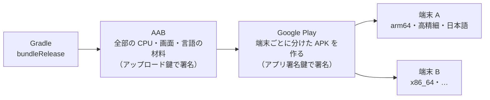

# Android App Bundle

[目次](../README.md) ＞ [技術カード](README.md) ＞ Android App Bundle

## 一言で

Google Play に上げるための、アプリの「材料一式」のファイル（`.aab`）です。Play が、端末ごとに要る部分だけを選んで APK を組み立て、配ります。

## 仕組み



- **AAB は端末に直接入れられない**: Play（か、手元の道具 bundletool）が、AAB から APK を作る
- **分けられるもの**: CPU の種類（ネイティブのライブラリ）、画面の細かさ（画像）、言語（文字列）。散策者のダウンロードが小さくなる
- **Play App Signing と組**: 端末に届く APK は、Google が預かるアプリ署名鍵で署名される。開発者はアップロード鍵で AAB に署名して上げる
- **中身**: `base/`（本体のモジュール。`dex/`・`lib/`・`res/`・`manifest/`・`root/`）、`BundleConfig.pb`（分け方の設定）、`BUNDLE-METADATA/`。マニフェストやリソースの表は protobuf の形で入っている
- **署名**: AAB の署名は jar の形（`META-INF/*.SF`・`*.RSA`）。APK の署名の形（APK Signature Scheme）とは違う

## 最小の使い方

```sh
./gradlew bundleRelease                       # app/build/outputs/bundle/release/app-release.aab
unzip -l app/build/outputs/bundle/release/app-release.aab | head
```

署名は、APK と同じ `signingConfigs` を使います。

```kotlin
android {
    signingConfigs {
        create("release") { /* storeFile・storePassword・keyAlias・keyPassword */ }
    }
    buildTypes {
        release { signingConfig = signingConfigs.getByName("release") }
    }
}
```

AAB から、手元で端末向けの APK を作って入れるには、Google の道具 **bundletool**（別に入れる jar）を使います。

```sh
java -jar bundletool.jar build-apks --bundle app-release.aab --output app.apks --connected-device
java -jar bundletool.jar install-apks --apks app.apks
```

## このリポジトリでは

| 場所 | 見どころ | 章 |
|---|---|---|
| [docs/release.md](https://github.com/duwenji/yorisoi-sanpoguide/blob/main/docs/release.md) の「版を出すとき」 | `versionCode` を上げ、`bundleRelease` で作り、リリース版を確かめてから上げる | [10-1](../10-play/01-app-bundle.md) |
| [app/build.gradle.kts](https://github.com/duwenji/yorisoi-sanpoguide/blob/main/app/build.gradle.kts) | `keystore.properties` があるときだけ署名する。なければ署名のない AAB | [1-4](../01-kotlin-android/04-signing-apk.md)、[10-1](../10-play/01-app-bundle.md) |

## よくある間違い

| 間違い | 起きること | 正しくは |
|---|---|---|
| APK を Play に上げようとする | 新しいアプリは AAB を求められる | `bundleRelease` で AAB を作る |
| 同じ `versionCode` の AAB を上げ直す | Play が受け付けない | 直したら `versionCode` を上げる |
| 手で入れた APK の端末に、Play から入れる | 鍵が違い、入れられない | 先に手で入れた方を消す |
| アップロード鍵の写しを置かない | なくすと、替えてもらうまで出せない | 別の場所に写しを置く |

## 版と公式ドキュメント

| 項目 | 版 |
|---|---|
| Android Gradle Plugin | 8.11.1（`gradle/libs.versions.toml`） |

- [Android App Bundle について](https://developer.android.com/guide/app-bundle?hl=ja)
- [Play App Signing](https://support.google.com/googleplay/android-developer/answer/9842756?hl=ja)
- [bundletool](https://developer.android.com/tools/bundletool?hl=ja)
